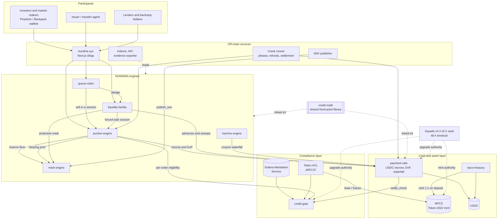
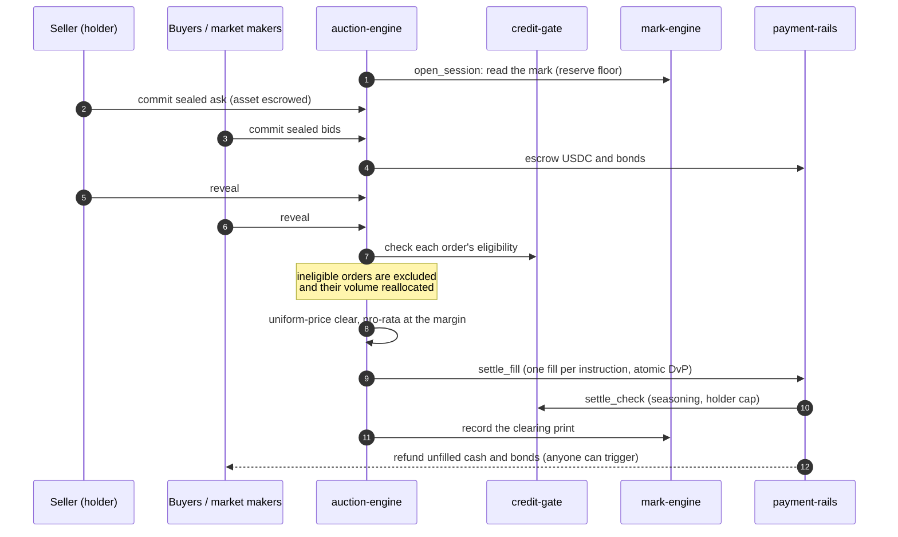

<p align="center">
  
</p>

<h1 align="center">NUNDINA Finance</h1>

<p align="center">
  <strong>The pricing, queue and risk-transfer engine for gated, NAV-priced private credit on Solana.</strong>
</p>

<p align="center">
  <a href="https://nundina.xyz">nundina.xyz</a> · Solana devnet (all eight programs live) · MIT License
</p>

NUNDINA is not a venue and not an AMM. It is the mechanism that tells a
quarterly-marked, redemption-gated credit position what it is worth, and that
turns a denied redemption request into a claim that can be priced, sold or
financed.

---

## Contents

1. [The problem](#the-problem)
2. [Why it matters now](#why-it-matters-now)
3. [The solution](#the-solution)
4. [Why we are building this](#why-we-are-building-this)
5. [Architecture](#architecture)
6. [Deployed contracts (devnet)](#deployed-contracts-devnet)
7. [Verify the deployment yourself](#verify-the-deployment-yourself)
8. [Current status](#current-status)
9. [Roadmap](#roadmap)
10. [Repo structure](#repo-structure)
11. [Build and run locally](#build-and-run-locally)
12. [Documentation](#documentation)
13. [Security, disclaimer and license](#security-disclaimer-and-license)

---

## The problem

Private credit is moving on-chain. Tokenized credit funds such as ACRED, STAC,
ONyc and SCOPE now sit on Solana, but the token wrapper has not changed the
economics of the underlying fund. Each of these positions has three
properties that make it illiquid:

| Property | What it means for a holder |
|---|---|
| **Redemption gates** | Funds typically allow redemptions of about 5% of NAV per quarter. When requests exceed the cap, every request is pro-rated and the remainder waits for the next window. |
| **Stale, self-reported NAV** | The manager marks the fund itself, usually once a quarter. Between marks there is no independent price, so nobody can say what a position is worth today. |
| **Permissioned transfer** | Only eligible, attested investors may hold the token. It cannot be sold on an open DEX, and a lender that takes it as collateral cannot liquidate it there either. |

The result is a large pool of capital with no exit and no price. A holder who
needs liquidity has two options: wait in a queue of unknown length, or sell
off-market to a buyer they have to find themselves, at a price nobody can
check.

Existing on-chain infrastructure does not solve this. Permissioned AMM pools
(Orca, Uniswap), issuer venues (Securitize with Jump and Jupiter) and
tranching protocols (Exponent) all shipped in 2026, and all of them are
**venues**. A passive liquidity pool quoting against a stale NAV is picked off
by anyone who knows more about the underlying loans than the last mark does.
Lending markets (Kamino, Loopscale) accept tokenized credit as collateral but
have no way to liquidate gated collateral when a loan goes bad.

## Why it matters now

- **The gate crisis became the defining event of 2026 for private credit.**
  Apollo received redemption requests of about 17% of NAV against a 5% cap.
  More than $5B of investor capital is waiting in redemption queues across
  the largest funds.
- **Tokenized private credit is scaling on Solana.** Kamino's RWA markets and
  Loopscale hold most of the ACRED minted on Solana as collateral. OnRe's
  ONyc has passed $300M AUM. Midas raised a $50M Series A plus a $40M
  liquidity facility for instant liquidity on tokenized funds, which shows
  that liquidity for these assets is a fundable business.
- **The compliance rails now exist.** Token-2022, Token ACL (sRFC37) with
  default-frozen accounts and permissionless thaw, and the Solana Attestation
  Service (SAS) are live. For the first time, investor eligibility can be
  enforced on-chain without a transfer hook on every transfer.

The venue layer is getting crowded. The layer underneath it, which prices the
asset, makes the queue tradable and makes the collateral liquidatable, is
empty.

## The solution

NUNDINA is a set of eight Solana programs that together provide price
discovery, queue liquidity and risk transfer for gated credit tokens.

| Component | What it does |
|---|---|
| **Sealed-bid batch auction** (`auction-engine`) | Periodic, uniform-price auctions: commit (sealed hash plus escrowed cash) → reveal → clear → pro-rata at the margin → issuer right of first refusal → atomic delivery-versus-payment. There is no passive LP, so there is nothing to pick off. Each session produces an arm's-length clearing price. |
| **Mark engine** (`mark-engine`) | Turns a stale NAV into a usable mark. It ingests the manager NAV and auction prints, moves through Fresh / Warned / Stale / Suspended states, and applies bounded haircuts. It never allows a liquidation on a stale mark. |
| **Queue claim** (`queue-claim`) | The new primitive. A pro-rated redemption request becomes a tokenized claim that can be sold in an auction or pledged as collateral. When the fund pays the window, the claim holder is paid. |
| **Liquidity facility** (`liquidity-facility`) | NAV-collateralized advances with a defined liquidation ladder: issuer right of first refusal → backstop bidder → forced-sale auction → workout. This is how permissioned collateral is actually liquidated. |
| **Tranche engine** (`tranche-engine`) | Senior/junior credit-loss tranching with separate mark, realised-loss and recovery books, and a coupon waterfall. |
| **Compliance gate** (`credit-gate`) | A Token ACL (sRFC37) gate program that reads SAS attestations. It enforces investor eligibility, per-lot Rule 144 seasoning, a holder cap and jurisdiction policy **when an account is activated**, so transfers after activation cost nothing extra. |
| **Payment rails** (`payment-rails`) | The USDC cash layer under every engine: per-order escrow and bonds, refunds that anyone can trigger and that cannot be paused, the DvP cash leg, facility cash and the coupon waterfall. |
| **Pilot asset treasury** (`npcs-treasury`) | Mints the pilot token NPCS only against deposited USDC (1:1) and redeems at the published NAV. |
| **Shared math** (`credit-math`) | One fixed-point crate for NAV, clearing, pro-rata, waterfall and present value. Every rounding goes against the party that initiates the action. CI requires 100% line and branch coverage. |

**Go-to-market (v1): the issuer-sponsored liquidity window.** The issuer runs
an auction on its own securities, as a buyback and price-discovery tool. The
issuer opens each session and keeps its right of first refusal. NUNDINA takes
**no per-trade fee** (enforced on-chain: `MAX_FEE_BPS = 0`).

## Why we are building this

- **Be the mechanism, not the venue.** Venues are commoditizing. Pricing,
  queue liquidity and risk transfer are the parts nobody has built, and every
  venue, issuer and lender needs them.
- **Never put a passive LP in front of a stale NAV.** A batch auction gathers
  every buyer and seller at one moment and clears them at one price. That
  removes the information advantage that drains passive liquidity.
- **The queue is the asset.** A pro-rated redemption request is a dated,
  priceable, financeable claim. No chain has tokenized it until now.
- **Compliance at account activation, not at transfer.** Token ACL plus SAS
  gives issuers the control they need without making every hop through a
  wallet, lending market or route pay for a compliance check.
- **Make gated credit usable as collateral.** Once a position has an
  independent price and a defined liquidation path, lenders such as Kamino
  can accept it with confidence, and holders can borrow against it instead of
  waiting in a queue.

---

## Architecture

### System overview



### One auction session, end to end



### Design principles

- **Atomic settlement.** Each fill moves the asset and the cash in one
  instruction, or neither moves.
- **Refunds cannot be paused.** Anyone can trigger a refund of escrowed cash
  once a session fails or expires. No admin key can block it.
- **No liquidation on a stale mark.** The facility checks the mark state
  before any liquidation step.
- **Upgrade authority under multisig.** `payment-rails`, `credit-gate` and the
  NPCS mint authorities are held by a Squads v4 2-of-2 vault with a 48-hour
  timelock on devnet.
- **Every deployment is verifiable.** Program IDs, build hashes, slots and
  upgrade authorities are recorded in [`DEPLOYMENTS.md`](DEPLOYMENTS.md) and
  checked by keyless scripts.

---

## Deployed contracts (devnet)

All addresses below were confirmed on Solana devnet on 2026-10-12. Build
SHA-256 hashes, deploy slots, signatures and upgrade authorities are recorded
in [`DEPLOYMENTS.md`](DEPLOYMENTS.md) and
[`payment-rails/DEPLOYMENTS.md`](payment-rails/DEPLOYMENTS.md).

### Programs

| Program | Program ID | Verify |
|---|---|---|
| `payment-rails` | `GdWmRivxe1k76apQB7EgJ4yBq8Fi3Lw25E8V3XosPocn` | [Solana Explorer](https://explorer.solana.com/address/GdWmRivxe1k76apQB7EgJ4yBq8Fi3Lw25E8V3XosPocn?cluster=devnet) · [Solscan](https://solscan.io/account/GdWmRivxe1k76apQB7EgJ4yBq8Fi3Lw25E8V3XosPocn?cluster=devnet) |
| `credit-gate` | `5ycYLKQjrbwxQ6VQLUSkQZXwLMn1zEeJ6f5ogFYzX6XX` | [Solana Explorer](https://explorer.solana.com/address/5ycYLKQjrbwxQ6VQLUSkQZXwLMn1zEeJ6f5ogFYzX6XX?cluster=devnet) · [Solscan](https://solscan.io/account/5ycYLKQjrbwxQ6VQLUSkQZXwLMn1zEeJ6f5ogFYzX6XX?cluster=devnet) |
| `auction-engine` | `Cw6wNpVJUaofUDZewG8sDKZu3nnHga4GaJJvKn7rSod7` | [Solana Explorer](https://explorer.solana.com/address/Cw6wNpVJUaofUDZewG8sDKZu3nnHga4GaJJvKn7rSod7?cluster=devnet) · [Solscan](https://solscan.io/account/Cw6wNpVJUaofUDZewG8sDKZu3nnHga4GaJJvKn7rSod7?cluster=devnet) |
| `mark-engine` | `79ypVjMMCDbmxYWaXTTgxz9jidjncoJAhHQC6e13x4LH` | [Solana Explorer](https://explorer.solana.com/address/79ypVjMMCDbmxYWaXTTgxz9jidjncoJAhHQC6e13x4LH?cluster=devnet) · [Solscan](https://solscan.io/account/79ypVjMMCDbmxYWaXTTgxz9jidjncoJAhHQC6e13x4LH?cluster=devnet) |
| `queue-claim` | `2EpAnJkvw6FH8j97k7WRE72E7oyarZpf7t2TYa26red4` | [Solana Explorer](https://explorer.solana.com/address/2EpAnJkvw6FH8j97k7WRE72E7oyarZpf7t2TYa26red4?cluster=devnet) · [Solscan](https://solscan.io/account/2EpAnJkvw6FH8j97k7WRE72E7oyarZpf7t2TYa26red4?cluster=devnet) |
| `liquidity-facility` | `PTNCoDA5WTbAN5RARzUA19Yr3qJYBzwwH63RPFKS7hY` | [Solana Explorer](https://explorer.solana.com/address/PTNCoDA5WTbAN5RARzUA19Yr3qJYBzwwH63RPFKS7hY?cluster=devnet) · [Solscan](https://solscan.io/account/PTNCoDA5WTbAN5RARzUA19Yr3qJYBzwwH63RPFKS7hY?cluster=devnet) |
| `tranche-engine` | `CvcaeyuPu7SrFJ91WniJfBhUbQBkb8QQVL9fyK4wcFAS` | [Solana Explorer](https://explorer.solana.com/address/CvcaeyuPu7SrFJ91WniJfBhUbQBkb8QQVL9fyK4wcFAS?cluster=devnet) · [Solscan](https://solscan.io/account/CvcaeyuPu7SrFJ91WniJfBhUbQBkb8QQVL9fyK4wcFAS?cluster=devnet) |
| `npcs-treasury` | `4BszRuAP4Gp7vdyu9MjE28gV8YTNtJZSRJRMQHdMut1y` | [Solana Explorer](https://explorer.solana.com/address/4BszRuAP4Gp7vdyu9MjE28gV8YTNtJZSRJRMQHdMut1y?cluster=devnet) · [Solscan](https://solscan.io/account/4BszRuAP4Gp7vdyu9MjE28gV8YTNtJZSRJRMQHdMut1y?cluster=devnet) |

### Asset, governance and protocol accounts

| Account | Address | Verify |
|---|---|---|
| NPCS pilot asset (Token-2022 mint, default-frozen) | `6vt1wHVQVuhnfJ3FtNbq4647mCjWUBmJCDABsYUgVKL4` | [Solana Explorer](https://explorer.solana.com/address/6vt1wHVQVuhnfJ3FtNbq4647mCjWUBmJCDABsYUgVKL4?cluster=devnet) · [Solscan](https://solscan.io/token/6vt1wHVQVuhnfJ3FtNbq4647mCjWUBmJCDABsYUgVKL4?cluster=devnet) |
| Squads v4 multisig (2-of-2, 48 h timelock) | `CHiMWD3q1eHZ8sfUCPzQPp9UWDQ7x2K75notiq1B39z7` | [Solana Explorer](https://explorer.solana.com/address/CHiMWD3q1eHZ8sfUCPzQPp9UWDQ7x2K75notiq1B39z7?cluster=devnet) · [Solscan](https://solscan.io/account/CHiMWD3q1eHZ8sfUCPzQPp9UWDQ7x2K75notiq1B39z7?cluster=devnet) |
| Squads vault (upgrade and mint authority) | `8wj1EfUyfNvBaMhxBd2iuyC7RLQh9oW2AAQdNRzdXLCV` | [Solana Explorer](https://explorer.solana.com/address/8wj1EfUyfNvBaMhxBd2iuyC7RLQh9oW2AAQdNRzdXLCV?cluster=devnet) · [Solscan](https://solscan.io/account/8wj1EfUyfNvBaMhxBd2iuyC7RLQh9oW2AAQdNRzdXLCV?cluster=devnet) |
| Token ACL MintConfig for NPCS (freeze authority → `credit-gate`) | `3AccB1giyy9Jcc9GZXJKKEqLyNHdY1SPcw1jreX9NRDS` | [Solana Explorer](https://explorer.solana.com/address/3AccB1giyy9Jcc9GZXJKKEqLyNHdY1SPcw1jreX9NRDS?cluster=devnet) · [Solscan](https://solscan.io/account/3AccB1giyy9Jcc9GZXJKKEqLyNHdY1SPcw1jreX9NRDS?cluster=devnet) |
| SAS credential `nundina` | `7H1P4RLB9VhsrSHwqtxJJsMC5wMtF9T7HUN6EUovhfxV` | [Solana Explorer](https://explorer.solana.com/address/7H1P4RLB9VhsrSHwqtxJJsMC5wMtF9T7HUN6EUovhfxV?cluster=devnet) · [Solscan](https://solscan.io/account/7H1P4RLB9VhsrSHwqtxJJsMC5wMtF9T7HUN6EUovhfxV?cluster=devnet) |
| `payment-rails` config | `HxQznN6P3NjKBkyi3UGz1ePJjop76mHNiWP9kFtKKYyc` | [Solana Explorer](https://explorer.solana.com/address/HxQznN6P3NjKBkyi3UGz1ePJjop76mHNiWP9kFtKKYyc?cluster=devnet) · [Solscan](https://solscan.io/account/HxQznN6P3NjKBkyi3UGz1ePJjop76mHNiWP9kFtKKYyc?cluster=devnet) |
| `mark-engine` NAV feed (NPCS) | `7b39TtCi6jLRFbNGSUU7tydefjWqc3w2jf5btdcQjT2k` | [Solana Explorer](https://explorer.solana.com/address/7b39TtCi6jLRFbNGSUU7tydefjWqc3w2jf5btdcQjT2k?cluster=devnet) · [Solscan](https://solscan.io/account/7b39TtCi6jLRFbNGSUU7tydefjWqc3w2jf5btdcQjT2k?cluster=devnet) |
| `auction-engine` venue | `B6bnWtdFecb3ByMSi5uuKDhXojgbL3xdfEAspH3vmQ3j` | [Solana Explorer](https://explorer.solana.com/address/B6bnWtdFecb3ByMSi5uuKDhXojgbL3xdfEAspH3vmQ3j?cluster=devnet) · [Solscan](https://solscan.io/account/B6bnWtdFecb3ByMSi5uuKDhXojgbL3xdfEAspH3vmQ3j?cluster=devnet) |
| `queue-claim` queue (NPCS) | `8HFKR5FkxMYcCgYqgvvPaPErQMsR4ccXjbHFkDyYavAK` | [Solana Explorer](https://explorer.solana.com/address/8HFKR5FkxMYcCgYqgvvPaPErQMsR4ccXjbHFkDyYavAK?cluster=devnet) · [Solscan](https://solscan.io/account/8HFKR5FkxMYcCgYqgvvPaPErQMsR4ccXjbHFkDyYavAK?cluster=devnet) |

### Third-party programs NUNDINA integrates with

| Program | Address |
|---|---|
| Solana Attestation Service | [`22zoJMtdu4tQc2PzL74ZUT7FrwgB1Udec8DdW4yw4BdG`](https://explorer.solana.com/address/22zoJMtdu4tQc2PzL74ZUT7FrwgB1Udec8DdW4yw4BdG?cluster=devnet) |
| Token ACL (sRFC37) | [`TACLkU6CiCdkQN2MjoyDkVg2yAH9zkxiHDsiztQ52TP`](https://explorer.solana.com/address/TACLkU6CiCdkQN2MjoyDkVg2yAH9zkxiHDsiztQ52TP?cluster=devnet) |
| Squads v4 | [`SQDS4ep65T869zMMBKyuUq6aD6EgTu8psMjkvj52pCf`](https://explorer.solana.com/address/SQDS4ep65T869zMMBKyuUq6aD6EgTu8psMjkvj52pCf?cluster=devnet) |
| Circle devnet USDC (settlement mint) | [`4zMMC9srt5Ri5X14GAgXhaHii3GnPAEERYPJgZJDncDU`](https://explorer.solana.com/address/4zMMC9srt5Ri5X14GAgXhaHii3GnPAEERYPJgZJDncDU?cluster=devnet) |

No program is deployed on mainnet-beta yet. Mainnet deployment follows the
external audit (see [Roadmap](#roadmap)).

---

## Verify the deployment yourself

None of these checks needs a private key.

```bash
# 1. Program metadata: upgrade authority, last deployed slot, data length
solana program show 5ycYLKQjrbwxQ6VQLUSkQZXwLMn1zEeJ6f5ogFYzX6XX -u devnet

# 2. Bytecode integrity: the dump must hash to the Build SHA-256 in DEPLOYMENTS.md
solana program dump 5ycYLKQjrbwxQ6VQLUSkQZXwLMn1zEeJ6f5ogFYzX6XX gate.so -u devnet
sha256sum gate.so

# 3. payment-rails: source id, genesis hash, build SHA-256, upgrade authority
#    and slot, all checked against the registry; fails closed on any mismatch
bash payment-rails/crank/scripts/devnet/verify.sh

# 4. credit-gate: the same checks, plus whether this checkout builds the live binary
bash programs/credit-gate/scripts/verify.sh

# 5. The NPCS mint: full extension manifest and provenance
cd token && npm install && CLUSTER=devnet npm run verify

# 6. The Squads migration record and the SAS credential and schemas
cd ops/squads && npm ci && npx tsx migrate.ts verify
cd ops/gate && npm ci && npm run sas -- verify
```

---

## Current status

As of 2026-10-12.

| Area | Status |
|---|---|
| Programs | All eight programs have code, IDLs and tests, and all eight are deployed on devnet. |
| Testing | Unit and property tests; LiteSVM integration suites that run against the real SAS, Token ACL and Squads programs; a "kill-the-crank" drill on a real validator; fuzz targets for the cash math; 100% line and branch coverage on `credit-math`. |
| Compliance | Live on devnet. NPCS accounts are frozen by default and thaw only through `credit-gate` via Token ACL. An attested holder is admitted; a wallet without an attestation is rejected with a typed error. |
| Cash layer | `payment-rails` is live and under the Squads vault (three upgrades executed through 2-of-2 proposals). A full commit → settle → payout run with DvP fills, refunds and a clean reconciliation is recorded on devnet in [`payment-rails/DEPLOYMENTS.md`](payment-rails/DEPLOYMENTS.md). |
| Engines | Venue, NAV feed (NAV #1 = 1.000000 USDC published), print source and redemption queue are initialized on devnet. A full sealed-bid session over NPCS is scripted and has passed on a clone of devnet (cleared at 0.97 against NAV 1.00, two DvP fills, clean reconciliation). |
| Governance | Squads proposal #4 (`credit-gate` custody upgrade) and #5 (NPCS mint authority handed to `npcs-treasury`, so backing is enforced by code) are approved and become executable on 2026-10-13 after the 48-hour timelock. |
| Application | [nundina.xyz](https://nundina.xyz): auction session view (phase clock, sealed and revealed book, clearing curve, fills), portfolio (lots with seasoning countdown, claims, advances), gate check, issuer ROFR decisions, tranche positions, admin authority map and data room, all reading the chain live. |
| Off-chain services | Indexer, read API, NAV publisher, treasury agent, crank runner and evidence exporter are built and tested; not yet hosted. |
| Audit | Scope written ([`10-Audit-Scope-P7.md`](preresearch/architecture/10-Audit-Scope-P7.md)); no external audit performed yet. |

A detailed, per-requirement audit of what is built is in [`STATUS.md`](STATUS.md)
and [SRS 08 §1.1](preresearch/architecture/08-SRS-Pilot-Rails.md).

---

## Roadmap

### Phase 1: Devnet completion (October 2026)

- Execute Squads proposals #4 and #5: the `credit-gate` custody module goes
  live and NPCS backing becomes enforced on-chain by `npcs-treasury`.
- Register the facility signer as an NPCS custodian and open the first
  liquidity facility.
- Run the first live sealed-bid auction session and the first queue-claim
  sale on devnet, with signed evidence bundles.
- Move the engine upgrade authorities into the Squads vault.
- Host the off-chain services (indexer, NAV publisher, crank runner).

### Phase 2: Security and legal readiness (Q4 2026)

- Full external audit of the programs that hold or move client cash
  (`payment-rails`, `credit-gate`), followed by the engines. Every critical
  and high finding fixed and re-reviewed; the report published.
- Engage securities counsel on the open questions in the
  [counsel engagement brief](preresearch/architecture/11-Counsel-Engagement-Brief.md)
  (resale exemptions, Rule 144 mechanics, holder counting).
- Reproducible (verifiable) builds for every program.

### Phase 3: Market maker onboarding (Q4 2026 – Q1 2027)

The auction only works if there is depth on both sides of every session.
NUNDINA will onboard professional market makers and credit desks as
recurring participants:

- **Session bidders**: attested market makers commit sealed bids in every
  scheduled window, giving sellers a reliable floor of demand.
- **Backstop bidders**: committed buyers on the liquidation ladder of the
  liquidity facility, who bid on collateral before any forced-sale auction.
- **Junior capital**: credit funds that take the first-loss tranche in
  `tranche-engine` pools.
- Onboarding through the same SAS attestation and `credit-gate` admission
  path as every other participant, with dedicated API and crank tooling for
  automated bidding.

### Phase 4: Ecosystem partnerships (in discussion)

NUNDINA is in active discussions with two Solana ecosystem partners. No
agreement has been signed; the scope below is what is under discussion.

- **OnRe**: the leading candidate for the first issuer-sponsored liquidity
  window. ONyc already publishes NAV attestations and is oriented toward
  liquidity, which makes it a natural first asset for a sealed-bid window and
  a tokenized redemption queue.
- **Kamino**: integration on two fronts. First, routing liquidity-facility
  collateral and advances to Kamino markets where they can host the position,
  with NUNDINA's facility as the venue of last resort. Second, using Kamino's
  USDC supply vault as the yield-bearing backing sleeve for NPCS and future
  pilot assets. In both cases NUNDINA supplies what Kamino's RWA markets lack
  today: an independent mark and a defined liquidation path for gated
  collateral.

### Phase 5: Mainnet pilot (2027)

- Deploy to mainnet-beta under a Squads 2-of-2 held on two separate hardware
  wallets.
- Re-run all twelve acceptance scenarios of the
  [pilot specification](preresearch/architecture/08-SRS-Pilot-Rails.md) on
  mainnet with real USDC, recorded and reproducible.
- First issuer-sponsored window with a live issuer.

### Beyond the pilot

- **v2, partner ATS**: a registered broker-dealer / ATS operates the venue for
  investor-to-investor flow, and NUNDINA licenses the engine.
- **v3, structured and offshore**: tranche SPVs, an externally funded
  facility, and a separate Reg S offshore book.

---

## Repo structure

```
nundina/
├── programs/                 ← Anchor workspace: seven programs + shared math
│   ├── credit-gate/          ← Token ACL (sRFC37) gate program, reads SAS attestations
│   ├── auction-engine/       ← sealed-bid uniform-price sessions over payment-rails
│   ├── mark-engine/          ← NAV feed, mark states, prints, protective mark
│   ├── queue-claim/          ← tokenized redemption-queue claims: sell or pledge
│   ├── liquidity-facility/   ← NAV-collateralized advances + liquidation ladder
│   ├── tranche-engine/       ← senior/junior tranching, three-book accounting
│   ├── npcs-treasury/        ← mint-on-deposit treasury for the pilot asset
│   └── credit-math/          ← shared fixed-point arithmetic
├── payment-rails/            ← USDC cash layer (own Anchor workspace)
│   ├── programs/payment-rails/ ← the Anchor program
│   ├── tests-svm/            ← LiteSVM integration tests for the rails and every engine
│   ├── fuzz/                 ← fuzz targets for the cash math
│   ├── crank/                ← settlement / refund crank, devnet scripts, evidence export
│   └── DEPLOYMENTS.md        ← payment-rails deployment history
├── client/                   ← Next.js 16 site and dApp (nundina.xyz)
├── services/                 ← indexer, API, NAV publisher, treasury agent, crank runner
├── token/                    ← NPCS pilot asset: docs, parameters, mint and verify scripts
├── ops/
│   ├── gate/                 ← SAS credential, schemas, attestations; Token ACL wiring
│   ├── squads/               ← Squads v4 2-of-2 authority migration and record
│   └── engines/              ← engine operations records (NAV inputs)
├── preresearch/              ← research corpus behind every design decision
│   ├── architecture/         ← problem register, solution architecture, legal, SRS, audit scope
│   └── research/             ← dated market evidence
├── DEPLOYMENTS.md            ← official deployment registry
├── STATUS.md                 ← as-built audit against the specification
├── HACKATHON.md              ← hackathon track map
└── Anchor.toml               ← workspace config (anchor 1.1.2, solana 2.3.0)
```

---

## Build and run locally

Toolchain: Rust 1.98.1 (pinned in `rust-toolchain.toml`), anchor-cli 1.1.2,
solana-cli 2.3.0, Node.js 24.

```bash
# Programs (root workspace) and their tests
anchor build
cargo test --workspace

# Cash layer and the LiteSVM integration suites
cd payment-rails && anchor build
cd tests-svm && cargo test

# Web application
cd client && npm ci && npm run dev        # http://localhost:3000

# Full auction session on a local validator, with the real programs
cd client && npm run localnet             # starts the validator with program state
npm run localnet:e2e                      # in a second terminal

# Off-chain services
cd services && npm ci && npm test
```

---

## Documentation

| Document | Purpose |
|---|---|
| [`client/src/content/docs/`](client/src/content/docs/) | Protocol documentation, also published at nundina.xyz/docs |
| [`preresearch/research/12-Validation-2026-Reality-Check.md`](preresearch/research/12-Validation-2026-Reality-Check.md) | Market evidence: why now |
| [`preresearch/architecture/05-Problem-Register.md`](preresearch/architecture/05-Problem-Register.md) | Ranked register of what could stop the project |
| [`preresearch/architecture/06-Solution-Architecture-v2.md`](preresearch/architecture/06-Solution-Architecture-v2.md) | Full solution architecture |
| [`preresearch/architecture/07-Legal-Topology-and-Compliance.md`](preresearch/architecture/07-Legal-Topology-and-Compliance.md) | Legal topology and compliance design |
| [`preresearch/architecture/08-SRS-Pilot-Rails.md`](preresearch/architecture/08-SRS-Pilot-Rails.md) | Pilot specification and the twelve acceptance scenarios |
| [`token/TOKENOMICS.md`](token/TOKENOMICS.md) | NPCS pilot asset and its invariants |
| [`payment-rails/INTERFACE.md`](payment-rails/INTERFACE.md) | Cash-layer interface used by every engine |
| [`ops/squads/README.md`](ops/squads/README.md) | Authority migration to Squads |
| [`DEPLOYMENTS.md`](DEPLOYMENTS.md) | Deployment registry and verification procedure |

---

## Security, disclaimer and license

**Security.** Please report vulnerabilities privately as described in
[`SECURITY.md`](.github/SECURITY.md). Do not open public issues for
security findings.

**Disclaimer.** NUNDINA is a devnet pilot. The software has not been audited,
no counsel has cleared its legal structure, and nothing in this repository is
an offer of securities, investment advice or a claim about returns. NPCS is a
pilot asset issued by the team for testing; it is not a fund interest and
NUNDINA has no protocol token.

**License.** MIT. See [LICENSE](LICENSE).
