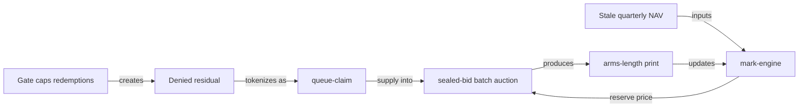

# Chapter 1 — Why NUNDINA

NUNDINA is a devnet-only pilot — the pricing, queue and risk-transfer engine for gated, NAV-priced private credit on Solana, explicitly "not a venue, not an AMM" (`README.md:3`). It exists to answer a single structural question that the tokenized-credit market keeps deferring: what is a locked, gated, quarterly-marked credit position actually worth, and what can be done with the part of a redemption request the fund refuses to pay? This chapter states the problem in the market's own terms, shows why the 2026 evidence made it urgent, and explains why the answer is being built on Solana.

## 1.1 The gate crisis

### 1.1.1 What a gate is

Most semi-liquid private credit vehicles are open-ended on paper but throttled in practice. They promise periodic redemptions, then cap the amount they will actually repurchase in any window — commonly at a fixed percentage of net asset value. When more holders ask to leave than the cap allows, the excess is pro-rated and queued. The lock-up is not the binding constraint on a holder; the gate is. NUNDINA's own problem register had already framed the market this way before the 2026 headlines: problem **A5** holds that the issuer's redemption window is the competing venue, and that NUNDINA's "customer is created by the gate, not by the lockup" (`preresearch/architecture/05-Problem-Register.md:55`).

### 1.1.2 The 2026 episode

In 2026 the gate stopped being a footnoted risk factor and became the market's defining event. Apollo capped redemptions in its main retail-focused private credit fund after requests reached **17% of NAV — more than 3× the 5% cap** (CNBC, 2026-06-23, recorded at `preresearch/research/12-Validation-2026-Reality-Check.md:13` and `:83`). Aggregate withdrawal requests from large private credit funds rose **+$4.3B quarter-over-quarter (+56%)**, with **~$5B+ sitting behind gates** by early 2026 (AdvisorHub, 2026-03, recorded at `12-Validation-2026-Reality-Check.md:84`). Fitch put the private credit default rate near **~10% mid-2025 and climbing** (`12-Validation-2026-Reality-Check.md:85`). The repo's read is blunt: "the gate crisis is now front-page news, at scale," and the research calls the trapped balance "the exact population NUNDINA's `queue-claim` serves" (`12-Validation-2026-Reality-Check.md:13`).

### 1.1.3 The denied residual is a market

When a fund pro-rates redemptions, each denied holder is left with two things a market could price: an unliquid position, and a dated claim on a future payout. NUNDINA's thesis is that the second is the more tractable asset. Problem **A5** identifies the gated residual as the market (`05-Problem-Register.md:55`); the research restates the strategic consequence — "the denied residual is NUNDINA's customer base" (`12-Validation-2026-Reality-Check.md:89`). The design turns that residual into a transferable `queue-claim` ([queue and liquidity](/docs/09-queue-and-liquidity)).

## 1.2 The stale-marking problem

### 1.2.1 The appraisal is not a price

A private credit fund's "price" is an appraisal produced quarterly by the party whose fee depends on it. Every risk decision made against that number is "wrong by construction" once the mark is old (`05-Problem-Register.md:70`, **B1**). Two further register entries sharpen this: **B3** — a manager-marked NAV "is not arms-length"; the appraisal is smoothed and lags reality, so protective logic computed off it overstates safety (`05-Problem-Register.md:72`); and **B4** — most issuers publish no NAV on-chain at all, leaving downstream systems without an input (`05-Problem-Register.md:73`). The register's summary is that "there is no price" in the continuous sense a venue normally requires (`05-Problem-Register.md:52`, **A2**).

### 1.2.2 Quarterly marks against continuous exit demand

This is the structural mismatch. NAV arrives quarterly, weeks in arrears; the desire to enter or exit is continuous. Classic mutual-fund late trading (`05-Problem-Register.md:172`, **G1**) is the pattern: whoever sees the new mark first trades against the stale one. Problem **B7** adds a second clock — credit accrues daily while NAV updates quarterly, so a "sawtooth" opens free arbitrage at each print (`05-Problem-Register.md:76`). A passive pool quoting off that stale mark is structurally the exit liquidity for informed sellers and bleeds to zero — problem **A1**, severity **S1**, likelihood **H** (`05-Problem-Register.md:51`). NUNDINA's position statement follows directly: "never put a passive LP in front of a stale NAV. Batch auction or nothing" (`README.md:155`).

### 1.2.3 Why risk cannot be repriced fast enough

The slow reprice is not laziness; it is the legal and accounting structure. The manager cannot mark a private loan to a market that does not exist, and the fund's redemption terms force it to ration rather than reprice. So the loss of confidence arrives as a *quantity* constraint — a gate — before it ever arrives as a *price* signal, which is why the 2026 funds gated "after mark-to-market stress became visible" (`12-Validation-2026-Reality-Check.md:86`). NUNDINA does not try to fix the manager's accounting. It manufactures an arms-length, periodic clearing price where none existed — a sealed-bid, uniform-price batch auction whose depth is *time-aggregated* rather than instantaneous (`05-Problem-Register.md:53`, **A3**; `README.md:16`, [the pricing engines](/docs/08-pricing-engines)).

## 1.3 What changed by 2026

### 1.3.1 The rails now exist

The research doc's "all the rails now exist" finding is the enabling condition: Token ACL (sRFC37) with default-frozen accounts and permissionless thaw; the Solana Attestation Service (SAS) live in production since May 2025; Orca permissioned pools (2026-05-27); and lending rails at Kamino and Loopscale where ~95% of all ACRED minted on Solana sat by end-Q1 2026 (`12-Validation-2026-Reality-Check.md:42`–`:46`). NUNDINA's compliance core is built directly on Token ACL + SAS ([the credit gate](/docs/07-credit-gate)); it deliberately does not rebuild issuance, custody, or an AMM (`12-Validation-2026-Reality-Check.md:51`).

### 1.3.2 The regulatory template

The SEC's **Press Release 2026-90 (2026-09-17)** granted five-year conditional relief to "Tokenized Securities Venues" using permissioned AMM pools (`12-Validation-2026-Reality-Check.md:14`, `:95`–`:99`). The research is careful about scope: the order covers **tokenized NMS stock**, not the Reg D private fund shares that are NUNDINA's v1 asset, so it is "a template — not yet a license" (`12-Validation-2026-Reality-Check.md:14`). It validates the compliance-at-activation architecture while leaving problem **C1** (venue registration) and **C17**'s discipline in force (`05-Problem-Register.md:87`, `:103`).

### 1.3.3 The whitespace

The venue layer commoditized in 2026 — Securitize/Jump/Jupiter, Orca, Exponent, Uniswap Labs permissioned pools all shipped (`12-Validation-2026-Reality-Check.md:15`). What did not ship, on any chain, is the mechanism layer. The research's whitespace verdict lists the four unbuilt things: periodic price discovery for stale-NAV assets, a tokenized redemption-queue claim, a credit-loss waterfall on gated fund shares with realized/unrealized accounting, and a liquidation path for permissioned collateral (`12-Validation-2026-Reality-Check.md:77`; `05-Problem-Register.md:287`–`:296`). That is NUNDINA's lane: "be the mechanism, not the venue" (`README.md:154`).

## 1.4 Why Solana

### 1.4.1 Compliance as a token property

The feasibility argument is one sentence: on EVM a compliant securities market is "a fragile assembly of identity contracts and transfer agents"; on Solana, Token-2022 makes accredited-only transfers a property of the token itself, so a permissioned market stays composable (`preresearch/architecture/03-Feasibility-and-Compliance.md:29`). This is also a correction of an earlier design error: transfer hooks fire on every transfer and break routing, so NUNDINA uses Token ACL with a pluggable Gate Program and a zero-CU transfer path instead (`05-Problem-Register.md:112`, **D1**). Compliance runs at account activation, not at transfer (`README.md:156`).

### 1.4.2 Composability with lending rails

Because the token stays route-clean, a priced credit position can become collateral. The feasibility table marks "lending against RWA tokens" as live on Kamino and Loopscale, and the target mechanism — a permissioned secondary market for credit — as the missing piece NUNDINA builds (`03-Feasibility-and-Compliance.md:105`–`:106`). Competitive analysis frames issuers as supply and NUNDINA as distribution: "their tokens become liquid *because of us*" (`preresearch/architecture/04-Competitive-Differentiation.md:53`).

### 1.4.3 Feasibility, honestly stated

The feasibility verdict is that the hard parts — native compliance, fast settlement, lending rails — are already live, and the two missing mechanisms are exactly what NUNDINA builds (`03-Feasibility-and-Compliance.md:110`). The counterweight is that this is a devnet pilot: `8/8` programs have code, tests and IDLs; `7/8` are deployed on devnet; `liquidity-facility` is built but not deployed; `0/8` are on mainnet-beta (`STATUS.md:31`–`:34`). It is not audited, and this chapter makes no APY, TVL, or yield claim.

## 1.5 Problem → response

| Register problem | Severity | NUNDINA response | State on devnet |
|---|---|---|---|
| **A1** passive-LP adverse selection (`05:51`) | S1 | Sealed-bid periodic auction; no passive LP on the raw share | `auction-engine` live (#192) (`README.md:39`) |
| **A2** there is no price (`05:52`) | S1 | Auction manufactures the price; `mark-engine` publishes a discount curve | feed live; NAV #1 = 1.000000 (`DEPLOYMENTS.md:49`) |
| **A5** issuer window is the competing venue (`05:55`) | S1 | Serve the gated residual; `queue-claim` | queue initialized (`DEPLOYMENTS.md:47`) |
| **B1/B3** stale, non-arms-length NAV (`05:70`) | S1 | Staleness-decayed haircut; `min(NAV_official, NAV_implied_auction)` | `mark-engine` live (#192) (`README.md:52`) |
| **C2** per-lot Rule 144 seasoning (`05:88`) | S1 | Per-holder, per-lot PDA ledger | `credit-gate` live devnet (#170) (`README.md:32`) |
| **C4** 12(g) holder-count (`05:90`) | S1 | Holder governor aggregating wallets to investor IDs | `credit-gate` live devnet (#170) (`README.md:32`) |
| **D1** hooks break composability (`05:112`) | S1 | Token ACL (sRFC37) as compliance core | live devnet (#171) (`README.md:38`) |
| **F8** liquidating permissioned collateral (`05:162`) | S1 | Liquidation *is* a forced-sale auction | `liquidity-facility` built, **not deployed** (`README.md:39`) |
| **K1/H1** issuer consent is a hard veto (`05:193`, `:240`) | S1 | Issuer-sponsored window; pay the issuer to say yes | unresolved (see Open questions) |

## 1.6 Scope of the claim

Everything above describes a devnet-only pilot. `credit-gate`, the NPCS mint `6vt1wHVQVuhnfJ3FtNbq4647mCjWUBmJCDABsYUgVKL4` (supply 1.000000), `payment-rails`, `mark-engine`, `auction-engine`, `queue-claim`, `npcs-treasury` and `tranche-engine` are live or initialized on devnet; the `liquidity-facility` is not deployed; there is no live auction session, live queue-claim sale, treasury-enforced mint path, or mainnet pilot (`STATUS.md:9`–`:24`, `:31`–`:34`). Governance is Squads v4 2-of-2 behind a 48h timelock (`DEPLOYMENTS.md:208`). Market figures quoted here — Apollo's 17%, the +$4.3B quarterly surge, the SEC's 2026-09-17 order, Midas's $50M Series A + $40M facility (`12-Validation-2026-Reality-Check.md:16`) — are third-party facts attributed and dated; they are not NUNDINA's metrics.

## Open questions

> Open question: the gating item is unchanged — which issuer will sign a secondary-transfer consent, and at what price? No named issuer has committed (`12-Validation-2026-Reality-Check.md:127`); OnRe is named only as the "most plausible" first ([the NPCS asset](/docs/11-npcs-asset)).

> Open question: whether private-fund secondary venues obtain federal relief. The Sept 17, 2026 TSV order covers NMS stock only; the Reg D venue path is "a matter of time, not certainty" (`12-Validation-2026-Reality-Check.md:101`, `:128`).
