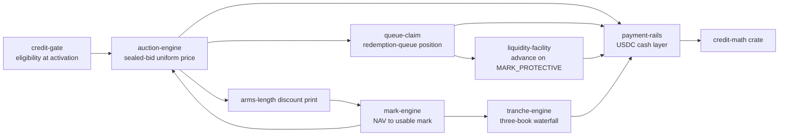

# Chapter 2 — What NUNDINA Is

NUNDINA is a devnet-only pilot that builds the pricing, queue and risk-transfer
engine for gated, NAV-priced private credit on Solana — "Not a venue. Not an
AMM." (`README.md:3-4`). It is not an issuer, a lending market, a DEX, or a
credential registry; it is the mechanism layer that prices a
quarterly-marked position, tokenizes a denied redemption request, and transfers
credit risk between tranches. This chapter fixes that positioning, enumerates
the primitives NUNDINA builds, draws the build-versus-integrate boundary, and
states plainly what it is not.

## 2.1 The position: be the mechanism, not the venue

The v2 thesis is explicit: "not a venue, not an AMM, not a compliance registry —
**the pricing, queue and risk-transfer engine for gated, NAV-priced, thin-float
credit**, delivered v1 as an **issuer-sponsored liquidity window**"
(`preresearch/architecture/00-README.md:10`). The repository's one-paragraph
framing is the same claim in full: NUNDINA is "the mechanism that tells a
quarterly-marked, gated credit position what it's worth — and turns a denied
redemption request into a priceable, financeable claim" (`README.md:4`).

Four stated positions anchor that framing (`README.md:154-157`):

- **Be the mechanism, not the venue.** The venue layer is commoditizing; the
  pricing/queue/risk-transfer layer is empty.
- **Never put a passive LP in front of a stale NAV.** Batch auction or nothing.
- **Compliance at account activation, not at transfer.** Token ACL + SAS, not
  transfer hooks.
- **The queue is the asset.** A pro-rated redemption request is a dated,
  priceable, financeable claim nobody has tokenized on any chain.

### 2.1.1 The three reframes that make this buildable

The v2 solution document opens with three reframes, which are the clearest
statement of what NUNDINA is *not* trying to be
(`preresearch/architecture/06-Solution-Architecture-v2.md:11-15`):

1. **Stop trying to be a venue. Be the mechanism.** "Orca and Securitize built
   venues in May 2026. Nobody built the thing that tells you what a gated,
   quarterly-marked credit position is worth, or that turns a denied redemption
   request into a financeable asset." (`06-Solution-Architecture-v2.md:13`)
2. **v1 is an issuer-sponsored liquidity window, not a third-party exchange.**
   An issuer running a periodic repurchase/liquidity auction in its own
   securities is "a fundamentally different regulatory object from a third
   party matching investor orders" — and the single decision that "resolves the
   five worst problems in the register at once: K1, H1, H2, C1, A7."
   (`06-Solution-Architecture-v2.md:14`)
3. **Never put a passive LP in front of a stale NAV.** Price discovery is a
   "sealed-bid periodic uniform-price auction… There is no pool to pick off, so
   the adverse-selection problem that has blocked this entire category simply
   does not arise." (`06-Solution-Architecture-v2.md:15`)

### 2.1.2 Where the boundaries are

The earlier layered docs (which assume `credit-amm`, `credit-book`,
`credential-registry`, `nav-oracle`) are marked **superseded** and read only as
history (`preresearch/architecture/00-README.md:24-27`). The whitespace the
current design targets: issuers tokenize credit but give no liquidity, lenders
accept credit collateral but offer no exit, and open DEXes legally cannot host
restricted securities (`preresearch/architecture/01-High-Level-Architecture.md:169-189`).
NUNDINA sits in that middle and does not compete with the venue layer; it is the
layer the venues and issuers license (see [the architecture](/docs/04-high-level-architecture)).

## 2.2 The primitives NUNDINA builds

The v2 "what we build" inventory names the components directly
(`06-Solution-Architecture-v2.md:44-53`); each maps to one mechanism.

| Primitive | Mechanism | Program |
|---|---|---|
| Pricing | Sealed-bid periodic uniform-price batch auction | `auction-engine` |
| Marking | NAV → usable mark: discount curve, haircuts, states | `mark-engine` |
| Queue | Tokenized redemption-queue position ("THE NOVEL PRIMITIVE") | `queue-claim` |
| Liquidity | NAV-collateralized advance (on-chain NAV loan) | `liquidity-facility` |
| Tranching | Credit-loss waterfall, three-book accounting | `tranche-engine` |
| Compliance | Gate Program for Token ACL: lot seasoning, holder cap, jurisdiction | `credit-gate` |
| Arithmetic | Shared fixed-point crate; round against initiator | `credit-math` |
| Cash | USDC cash layer: escrow, DvP cash leg, refunds, payouts | `payment-rails` |

### 2.2.1 Marking

"Oracles publish a *number*. Nobody publishes a *mark*. This is the layer that
does." (`06-Solution-Architecture-v2.md:368`). `mark-engine` turns a stale
appraisal into a usable price through a versioned, on-chain model with
staleness haircuts and accrual, producing a two-price system: `NAV_official` for
reporting, `NAV_effective` for reference, and
`MARK_PROTECTIVE = min(NAV_effective, NAV_implied)` used "for EVERY risk
decision" (`06-Solution-Architecture-v2.md:397-400`). Its mark states enforce
"never liquidate on stale data." See [Pricing Engines](/docs/08-pricing-engines).

### 2.2.2 Pricing

`auction-engine` runs a sealed-bid periodic uniform-price batch auction: with no
resting quote to pick off, "a week of intent aggregates into ONE cross: depth is
time-aggregated, not instantaneous," producing "a defensible arms-length
discount-to-NAV print" (`06-Solution-Architecture-v2.md:148-155`). The
commit–reveal–clear–allocate–settle flow and the issuer right of first refusal
are specified at `06-Solution-Architecture-v2.md:191-256`.

### 2.2.3 Queue-claim

"The binding constraint on private credit liquidity in 2026 is **not the
lock-up, it is the gate**" (`06-Solution-Architecture-v2.md:454`). A pro-rated
redemption request is "a dated, uncertain, perfectly priceable claim that
currently cannot be sold, financed, or hedged"; `queue-claim` tokenizes it so it
can be sold through the auction or pledged to the facility
(`06-Solution-Architecture-v2.md:454-489`). See
[Queue & Liquidity](/docs/09-queue-and-liquidity).

### 2.2.4 Liquidity facility

`liquidity-facility` provides a NAV-collateralized advance — "the on-chain NAV
loan — the pattern TradFi actually uses for lock-up"
(`06-Solution-Architecture-v2.md:488`). Its distinguishing feature is the
liquidation answer for permissioned collateral, a four-step ladder (issuer ROFR
→ backstop bidder → forced-sale auction → transfer to workout) ending
non-recourse, because "you cannot dump a gated security on an open DEX"
(`06-Solution-Architecture-v2.md:524-543`).

### 2.2.5 Tranching

`tranche-engine` does **credit-loss** tranching, not yield-variance: "An
allocator asking for 'senior' means **protection against principal loss from
underlying defaults**" (`06-Solution-Architecture-v2.md:553`). Loss attribution
is unambiguous via three-book accounting — a MARK BOOK, a REALISED BOOK, and a
RECOVERY BOOK (`06-Solution-Architecture-v2.md:557-566`). Crucially, "a tranche
is a new security you issued. So don't issue it": `tranche-engine` is "an
**accounting and distribution engine**," the paper is issued by an
issuer-side/sponsor-side SPV, and "we never operate a protocol-owned pooled
vehicle" (`06-Solution-Architecture-v2.md:623`). See
[Tranching, Treasury & Math](/docs/10-tranching-treasury-math).

### 2.2.6 Compliance and the shared layers

`credit-gate` moves compliance "at account activation, not at transfer":
freeze authority is delegated to Token ACL (sRFC37), accounts are default-frozen,
and a permissionless thaw is validated by the Gate Program with per-lot Rule 144
seasoning, a holder-count governor, and jurisdiction routing
(`06-Solution-Architecture-v2.md:277-315`). `credit-math` is the shared
fixed-point crate every money path routes through, and `payment-rails` is "a
shared cash layer below the engines that holds every escrowed client dollar"
audited to the same standard as the gate — "the gate enforces law, and the rails
hold the money" (`06-Solution-Architecture-v2.md:127`). See
[credit-gate](/docs/07-credit-gate) and [payment-rails](/docs/06-payment-rails).

## 2.3 How it differs from a lending app, an RWA fund, or a DEX

| It is… | NUNDINA is not that because… |
|---|---|
| **A lending app** | It integrates lending rather than replacing it: where Kamino or Loopscale can host the collateral, route there; the internal facility is "the venue of last resort" only for what cannot be routed (`06-Solution-Architecture-v2.md:546`). |
| **An RWA fund / issuer** | The asset layer is "not ours" (`06-Solution-Architecture-v2.md:23`); there is no protocol-owned pooled vehicle (C14, `06-Solution-Architecture-v2.md:623`) and no treasury of its own — NPCS is a pilot sleeve, not an investment product (`token/README.md:48-53`). |
| **A DEX / AMM** | "Never put a passive LP in front of a stale NAV" (`06-Solution-Architecture-v2.md:15`); the AMM is a deliberate omission because it is "the wrong primitive for the raw asset" (`06-Solution-Architecture-v2.md:123`). |
| **A credential registry or NAV oracle** | Both are integrated, not rebuilt: SAS + Token ACL for credentials, NAVLink/RedStone/issuer attestation for NAV (`06-Solution-Architecture-v2.md:32-42`, `06-Solution-Architecture-v2.md:123`). |

## 2.4 Scope: what NUNDINA builds vs. integrates

The build/integrate split is explicit in the v2 system overview
(`06-Solution-Architecture-v2.md:23-68`):

- **Builds:** `auction-engine`, `mark-engine`, `queue-claim`,
  `liquidity-facility`, `tranche-engine`, `credit-gate`, `credit-math`, and
  (added by the September 2026 amendment) `payment-rails`
  (`06-Solution-Architecture-v2.md:44-53`, `06-Solution-Architecture-v2.md:127`).
- **Integrates:** the asset layer (ACRED, STAC, SCOPE, ONyc), compliance
  primitives (Token ACL / sRFC37, SAS, the sRFC 00020 token interface, the
  issuer permanent delegate), price inputs (NAVLink, RedStone, issuer-signed NAV
  attestation), and demand/distribution (Kamino, Loopscale, Orca, Jupiter,
  Exponent) (`06-Solution-Architecture-v2.md:23-61`).
- **Deliberate omissions:** "No AMM… No credential registry… No NAV oracle… No
  issuance platform… No protocol token… No custody."
  (`06-Solution-Architecture-v2.md:123`)

`npcs-treasury` is the pilot-specific additional program (the only NPCS mint
path); `README.md:43` names "seven programs… plus `npcs-treasury`" in the build.
See [the program map](/docs/05-program-map-and-accounts).

## 2.5 The pilot framing and what is real today

NUNDINA is a **devnet-only pilot**, and the documentation here follows that
reality: devnet facts only in the present tense, no mainnet claims, and no APY,
TVL, or LP-yield claims. The substantive status is:

- **Seven programs are deployed on devnet; `liquidity-facility` is built but not
  deployed; none is on mainnet** (`README.md:43-55`). Deployed
  engines on devnet are `auction-engine`, `mark-engine`, `queue-claim`,
  `tranche-engine`, and `npcs-treasury`, alongside `payment-rails` and
  `credit-gate` (`DEPLOYMENTS.md:14-22`).
- **The pilot asset is NPCS**, a Token-2022 mint live on devnet at
  `6vt1wHVQVuhnfJ3FtNbq4647mCjWUBmJCDABsYUgVKL4`, 6dp, frozen-by-default, gated
  through `credit-gate` (`token/README.md:11-14`).
- **Backing is by process, not enforced on-chain.** Supply `1.000000` matches 1
  USDC deposited by hand into the vault's sleeve account; "nothing on-chain
  enforces I1" (`token/README.md:5`, `token/TOKENOMICS.md:13`). NAV publication
  #1 records 1.000000 USDC per NPCS (`DEPLOYMENTS.md:49-52`).
- **Governance is a Squads v4 2-of-2 multisig behind a 48h timelock**, holding
  the `payment-rails` and `credit-gate` upgrade authorities and the NPCS mint,
  delegate and metadata authorities (`README.md:70`, `DEPLOYMENTS.md:206-214`).

The token is deliberately not a crypto asset: "No distribution, no vesting, no
emissions, no staking, no governance" — it is "a *pilot fund share*: one base
unit per USDC micro deposited" (`token/README.md:48-53`, `token/TOKENOMICS.md:3-4`).

## 2.6 What NUNDINA is not

- **Not an offer.** The pilot asset carries an on-chain `PILOT-DEMO-ASSET — NOT
  AN OFFER — SYNTHETIC LABEL` (`token/README.md:15`), and the repository states
  its securities posture explicitly (`token/README.md:52-53`).
- **Not audited.** No external audit has been performed; audit and counsel
  engagements are prepared but not started (`preresearch/architecture/00-README.md:22-23`).
- **Not a guaranteed gate solution, and not a venue today.** Whether an
  issuer-sponsored window operated on this software makes the operator an
  exchange or a broker is unresolved pending a securities opinion
  (`06-Solution-Architecture-v2.md:1056`); v1 is an issuer-sponsored window, not
  a third-party matching venue (`06-Solution-Architecture-v2.md:14`).
- **Not a protocol token.** "No protocol token in v1 — a token on a securities
  venue creates a second securities problem you do not need" (`06-Solution-Architecture-v2.md:992`,
  `token/TOKENOMICS.md:101`).

The mechanisms themselves — batch pricing, per-lot seasoning, the queue-claim —
are what NUNDINA *is*; the venue, custody, issuance and legal wrapper are roles
it integrates or leaves to others (`06-Solution-Architecture-v2.md:723-744`). See
[Legal, Risk, Audit & Roadmap](/docs/15-legal-risk-audit-roadmap).

## Open questions

> Open question: the canonical count of "eight programs" is not stated in one
> place — `06-Solution-Architecture-v2.md:44` heads its inventory "seven
> programs, one crate" (P1–P8 including the `credit-math` crate and the
> `payment-rails` amendment), while `README.md:43` counts "seven programs… plus
> `npcs-treasury`." A single authoritative list should be pinned. Related:
> [the program map](/docs/05-program-map-and-accounts).

> Open question: whether v1's issuer-sponsored window structure makes the
> operator an exchange or a broker under Exchange Act Rule 3b-16 is unresolved
> and awaits a securities opinion (`06-Solution-Architecture-v2.md:1056`).
