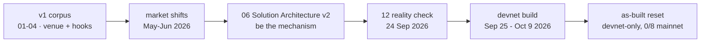

# Chapter 3 — Origins & Evolution

NUNDINA did not arrive as a finished design. Its repository preserves a self-correction: an initial "permissioned secondary market" thesis (`01`–`04`), a full re-architecture in `06-Solution-Architecture-v2.md` that renamed the product and replaced its load-bearing primitives, a dated market validation in `12-Validation-2026-Reality-Check.md`, and finally an as-built reset that grades the pilot as devnet-only. This chapter reconstructs that timeline. Every step is a repository fact with a path and line; where a document carries no date, that is stated explicitly rather than invented. For the underlying problem and the resulting product, see [Why NUNDINA](/docs/01-why-nundina) and [What NUNDINA Is](/docs/02-what-is-nundina).

## 3.1 The v1 corpus — a permissioned venue

### 3.1.1 The six-program premise

The earliest architecture documents describe a **venue**, not a mechanism. Doc `01` defines a "CORE PROTOCOL LAYER — what WE build (six programs)": `credit-amm` (a permissioned AMM, `x·y=k`, hooks-gated), `credit-book` (a Phoenix/OpenBook-style permissioned orderbook), `tranch-engine`, `nav-oracle`, `issuer-sdk` and `credential-registry`, with the two mechanisms being secondary trading and senior/junior tranching (`preresearch/architecture/01-High-Level-Architecture.md:26`). Settlement is called "a *property of the AMM/book flows* (atomic swap), not a seventh program" (`preresearch/architecture/01-High-Level-Architecture.md:57`). The compliance layer was Token-2022 **transfer hooks** enforcing KYC on every movement (`preresearch/architecture/01-High-Level-Architecture.md:20`), described as a design principle: "Compliance by construction — the registry is *read* by hooks" (`preresearch/architecture/02-Protocol-Components.md:34`). Doc `03` argued the grant case — "Only possible on Solana" — with a one-sentence thesis (`preresearch/architecture/03-Feasibility-and-Compliance.md:29`) and a feasibility table that lists "Permissioned secondary market for credit" as "❌ Does not exist … We build it" (`preresearch/architecture/03-Feasibility-and-Compliance.md:106`). Doc `04` built the differentiation claim that nobody on Solana did this (`preresearch/architecture/00-README.md:27`).

None of `01`–`04` carries an in-document date. The only dating is the index: those docs "were written against the market as of early 2026 and are **superseded**" (`preresearch/architecture/00-README.md:3`).

### 3.1.2 The v1 compliance mistake

Two v1 claims were later declared **wrong**. The index states them plainly: doc `03`'s "two load-bearing claims are wrong: transfer hooks *break* rather than enable composability (use Token ACL / sRFC37), and 'permissioned = compliant by construction' ignores Exchange Act Rule 3b-16 venue registration" (`preresearch/architecture/00-README.md:26`). Doc `06` expands the first: transfer hooks fire on every transfer, force every caller to resolve `ExtraAccountMetaList` in exact order, and make routers drop the token entirely (`preresearch/architecture/06-Solution-Architecture-v2.md:280`). Doc `06` §9 expands the second: "Reg D governs whether the *transfer* is exempt; it says nothing about whether *you* may run the *venue*" (`preresearch/architecture/06-Solution-Architecture-v2.md:721`). Those two corrections are the hinge of the whole evolution.

## 3.2 The v2 reframe — be the mechanism, not the venue

`06-Solution-Architecture-v2.md` opens by **superseding** `01`–`04` because "those documents assume a world that ended in May–June 2026" (`preresearch/architecture/06-Solution-Architecture-v2.md:3`). Its "three reframes that make this buildable" are the transition in its own words (`preresearch/architecture/06-Solution-Architecture-v2.md:11`):

1. "**Stop trying to be a venue. Be the mechanism.** Orca and Securitize built venues in May 2026. Nobody built the thing that tells you what a gated, quarterly-marked credit position is worth…" (`preresearch/architecture/06-Solution-Architecture-v2.md:13`).
2. "**v1 is an issuer-sponsored liquidity window, not a third-party exchange.** … **This single decision resolves the five worst problems in the register at once: K1, H1, H2, C1, A7.**" (`preresearch/architecture/06-Solution-Architecture-v2.md:14`).
3. "**Never put a passive LP in front of a stale NAV.** Price discovery is a **sealed-bid periodic uniform-price auction**." (`preresearch/architecture/06-Solution-Architecture-v2.md:15`).

The index restates the reframed thesis: "not a venue, not an AMM, not a compliance registry — **the pricing, queue and risk-transfer engine** … delivered v1 as an **issuer-sponsored liquidity window**" (`preresearch/architecture/00-README.md:10`).

### 3.2.1 What v2 changed concretely

The program inventory became seven programs plus a shared crate — `auction-engine`, `mark-engine`, `queue-claim`, `liquidity-facility`, `tranche-engine`, `credit-gate`, `credit-math` (`preresearch/architecture/06-Solution-Architecture-v2.md:44`) — with `payment-rails` added as a shared USDC cash layer in an amendment (#47): "the build added **`payment-rails`**, a shared cash layer below the engines that holds every escrowed client dollar" (`preresearch/architecture/06-Solution-Architecture-v2.md:127`). The reframe was commercial as well as technical: "**Any pitch positioned against Securitize loses.** Solana-first, single-chain" (`preresearch/architecture/06-Solution-Architecture-v2.md:965`); revenue does "not come from trading" (`preresearch/architecture/06-Solution-Architecture-v2.md:972`); and "**No protocol token in v1**" (`preresearch/architecture/06-Solution-Architecture-v2.md:992`). Doc `05` is the adversarial companion — the "complete failure inventory" whose ranked ten end on the same question the reframe answers (`preresearch/architecture/05-Problem-Register.md:303`; indexed at `preresearch/architecture/00-README.md:17`).

## 3.3 The 2026 reality check

`12-Validation-2026-Reality-Check.md` was compiled **24 September 2026** from a ~20-angle research sweep (`preresearch/research/12-Validation-2026-Reality-Check.md:3`), and the index names it "the adversarial validation … and the repositioned thesis" (`preresearch/architecture/00-README.md:16`). It concludes the problem register is "still directionally correct on mechanism" but records four material changes by late September 2026 (`preresearch/research/12-Validation-2026-Reality-Check.md:11`): the gate crisis is now front-page at scale (Apollo capped redemptions at 17% of NAV against a 5% cap) (`preresearch/research/12-Validation-2026-Reality-Check.md:13`); the SEC Innovation Exemption **landed** on 17 September 2026 (`preresearch/research/12-Validation-2026-Reality-Check.md:14`); the venue layer shipped and is crowded (`preresearch/research/12-Validation-2026-Reality-Check.md:15`); and a TradFi-native competitor, Midas, emerged (`preresearch/research/12-Validation-2026-Reality-Check.md:16`).

### 3.3.1 What the reality check corrected

The report explicitly overwrites an earlier claim. The problem register (C17) had said the exemption was "delayed 26 May 2026 after exchange-lobby pushback, architecting on it is architecting on a press release"; the reality check calls that "now **stale**" (`preresearch/research/12-Validation-2026-Reality-Check.md:14`). But it refuses to over-correct: the relief covers "tokenized NMS stock (public equities), *not* Reg D private fund shares," so it is "validation of the permissioned-AMM venue model, and a template — not yet a license" (`preresearch/research/12-Validation-2026-Reality-Check.md:14`). Doc `06` had already ruled the exemption "not load-bearing" (`preresearch/architecture/06-Solution-Architecture-v2.md:721`). A second correction is quantitative: the "$620M+ RWA deposits" figure in the old docs "is mostly treasury and basis wrappers, not gated private-credit fund shares"; the real addressable float is small (~$6.9M ACRED on Loopscale) (`preresearch/architecture/06-Solution-Architecture-v2.md:909`; `preresearch/research/12-Validation-2026-Reality-Check.md:129`). The report also flags its own limits: market-size figures vary by methodology and "treat as order-of-magnitude," while the Apollo 17% and SEC-order facts are "primary-sourced" (`preresearch/research/12-Validation-2026-Reality-Check.md:133`).

### 3.3.2 The repositioned thesis

The whitespace verdict survived: "Nobody — on any chain or off — has shipped: **(a)** periodic price discovery designed for stale-NAV assets … **(b) a tokenized redemption-queue claim** … **(c)** a credit-loss waterfall … **(d) liquidation for permissioned collateral**" (`preresearch/research/12-Validation-2026-Reality-Check.md:77`). The bottleneck is unchanged: "**get one issuer to sponsor a window** (K1/H1)" (`preresearch/research/12-Validation-2026-Reality-Check.md:145`; the open item at `:127`).

## 3.4 From thesis to as-built — the devnet reset

The corpus then turns from target to reality. Founder decisions were "locked" on **24 Sep 2026** (devnet → mainnet-beta, real asset, no mocks) in the SRS (`preresearch/architecture/08-SRS-Pilot-Rails.md:7`) and in the legal register (`preresearch/architecture/07-Legal-Topology-and-Compliance.md:7`), with counsel explicitly "not engaged yet" (`preresearch/architecture/07-Legal-Topology-and-Compliance.md:11`). The NPCS asset spec records its decision record on **25 Sep 2026** (`preresearch/architecture/09-NPCS-Asset-Spec.md:9`) and notes "the devnet mint is throwaway" (`preresearch/architecture/09-NPCS-Asset-Spec.md:14`).

### 3.4.1 Honest grading replaces target claims

`HACKATHON.md` — compiled **25 Sep 2026** (`HACKATHON.md:3`) — separates the two registers: "The Status column is the as-built truth; the description is the target" (`HACKATHON.md:14`). It states the pilot asset's backing is "unbacked, process-only" (`HACKATHON.md:28`), matching `token/TOKENOMICS.md` §0, where invariant I1 is "enforced by process and event evidence, not by a program" (`token/TOKENOMICS.md:13`). The root README says the one-paragraph description "is the **target architecture**; the table below says what exists today" (`README.md:16`). The SRS adds a per-scenario "as-built grade (2026-10)" table (`preresearch/architecture/08-SRS-Pilot-Rails.md:34`) and marks the earlier 2026-09 status as "superseded" (`preresearch/architecture/08-SRS-Pilot-Rails.md:332`). The `STATUS.md` audit snapshot is dated **2026-10-09** and records **7/8 programs deployed on devnet, 0/8 on mainnet-beta** (`STATUS.md:3`, `STATUS.md:33`); P0 was "closed with three criteria unmet, and it is **open** again here (#129)" (`README.md:61`, `HACKATHON.md:113`). This is the reset from an ambitious target document to devnet-only, uncited-claim-free facts.

### 3.4.2 Governance and deployment timeline

The authority layer is a Squads v4 multisig: "threshold 2, both members with all permissions, `TIMELOCK_SECONDS` (default 172800 = 48h), **no config authority**" (`ops/squads/README.md:11`; recorded in `ops/squads/deployment-devnet.json:11`). The migrations executed on **2026-10-03** and **2026-10-04** (`ops/squads/deployment-devnet.json:20`, `:27`, `:34`). The superseded credit-gate program was replaced by a new program id deployed **2026-10-04** (`DEPLOYMENTS.md:24`). The live NPCS mint — `6vt1wHVQVuhnfJ3FtNbq4647mCjWUBmJCDABsYUgVKL4`, supply `1.000000` against 1 USDC — is the #171 mint (`DEPLOYMENTS.md:120`). The engines went live on devnet **2026-10-07** (`DEPLOYMENTS.md:33`) and NAV publication #1 was `1.000000` (`DEPLOYMENTS.md:49`); `npcs-treasury` and `tranche-engine` followed on **2026-10-08** (`DEPLOYMENTS.md:60`). The audit scope pack and counsel brief are both dated **2026-10-07**, each marked not sent / not engaged (`preresearch/architecture/10-Audit-Scope-P7.md:3`, `preresearch/architecture/11-Counsel-Engagement-Brief.md:3`). `liquidity-facility` remains built but not deployed (`STATUS.md:33`).

## 3.5 Chronology

| Step | Evidence | Where it lives |
|---|---|---|
| v1 venue thesis (`credit-amm`/`credit-book`, transfer hooks) | "written against the market as of early 2026 and are superseded" | `preresearch/architecture/00-README.md:3`, `01-High-Level-Architecture.md:26` |
| May–June 2026 | Orca, Securitize+Jump+Jupiter, Exponent ship the venue/tranching layer | `00-README.md:3`, `research/12-Validation-2026-Reality-Check.md:15` |
| v2 reframe ("be the mechanism") | three reframes; supersedes `01`–`04` | `06-Solution-Architecture-v2.md:3`, `:11` |
| `payment-rails` added | amendment #47 (2026-09) | `06-Solution-Architecture-v2.md:127` |
| 24 Sep 2026 | reality check compiled; founder decisions locked | `research/12-Validation-2026-Reality-Check.md:3`, `08-SRS-Pilot-Rails.md:7` |
| 25 Sep 2026 | HACKATHON compiled; NPCS decision record | `HACKATHON.md:3`, `09-NPCS-Asset-Spec.md:9` |
| 2026-10-03/04 | Squads 2-of-2 created; authorities moved; new NPCS mint `6vt1…VKL4` (#171) | `ops/squads/deployment-devnet.json:20`, `DEPLOYMENTS.md:120` |
| 2026-10-07 | engines on devnet; NAV #1 = `1.000000`; audit/counsel packs dated | `DEPLOYMENTS.md:33`, `:49`, `10-Audit-Scope-P7.md:3` |
| 2026-10-08 | `npcs-treasury`, `tranche-engine` deployed | `DEPLOYMENTS.md:60` |
| 2026-10-09 | `STATUS.md` snapshot: 7/8 devnet, 0/8 mainnet | `STATUS.md:3`, `STATUS.md:33` |

## Open questions

> Open question: docs `01`–`04` carry no in-document date; only `00-README.md:3` dates them to "the market as of early 2026." Their exact authoring dates are not recorded in the repository.

> Open question: no repository file uses the term "mezzanine" (or any mezzanine-debt premise). The v1 premise that the repository documents is the permissioned AMM/orderbook venue with transfer-hook compliance; whether an earlier, unrecorded v1 framing existed cannot be established from the repo.
