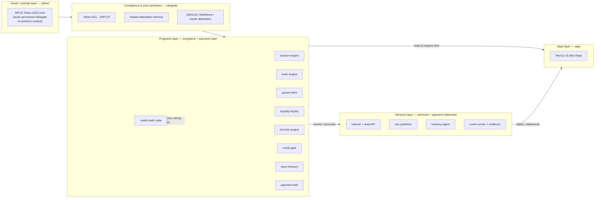

# Chapter 4 — High-Level Architecture

NUNDINA is a devnet-only pilot that builds the *mechanism* layer for gated, NAV-priced private credit rather than a venue: it tells a quarterly-marked position what it is worth and turns a denied redemption request into a priceable, financeable claim (`README.md:3-4`). This chapter gives the whole-system view — the layers and which repository directory owns each, the core mechanisms the design rests on, the trust flow that decides who can move money, and the end-to-end lifecycle of one pilot deal. The authoritative program-level design is `preresearch/architecture/06-Solution-Architecture-v2.md`; the earlier `01-High-Level-Architecture.md` and `02-Protocol-Components.md` are explicitly superseded and their AMM/orderbook design is not what is built (`preresearch/architecture/06-Solution-Architecture-v2.md:3-5`). Deeper treatment lives in [the program map](/docs/05-program-map-and-accounts), [payment-rails](/docs/06-payment-rails), [credit-gate](/docs/07-credit-gate), [the pricing engines](/docs/08-pricing-engines), [queue & liquidity](/docs/09-queue-and-liquidity), and [tranching, treasury & math](/docs/10-tranching-treasury-math).

## 4.1 The layered view

### 4.1.1 Four operational layers

The architecture reads top-to-bottom as four operational layers. Nothing NUNDINA builds is a blanket "protocol": the asset is one repo, the on-chain logic another, the off-chain services a third, and the user-facing apps a fourth.



The design is deliberately minimal. `06-Solution-Architecture-v2.md` lists what it does *not* build: no AMM, no credential registry, no NAV oracle, no issuance platform, no protocol token, no custody (`preresearch/architecture/06-Solution-Architecture-v2.md:123`). Compliance runs at account activation through Token ACL, not on every transfer (`token/ARCHITECTURE.md:38-41`). Custody of client assets is never NUNDINA's (`preresearch/architecture/06-Solution-Architecture-v2.md:839-845`).

### 4.1.2 Layer → repository map

| Layer | Repository directory | Responsibility |
|---|---|---|
| Asset / custody | `token/` | The NPCS pilot mint, its extension manifest, params, scripts and runbooks (`README.md:89-97`). The security never leaves Solana (`payment-rails/README.md:4-6`). |
| Compliance primitives | `ops/gate/`, external programs | Token ACL (sRFC37), SAS credential + schemas, attestations, Token ACL wiring (`README.md:114`; `preresearch/architecture/06-Solution-Architecture-v2.md:31-36`). |
| Programs | `programs/` and `payment-rails/programs/payment-rails/` | The eight programs plus the `credit-math` crate (`Cargo.toml:1-16`). `payment-rails` is its own workspace (`payment-rails/README.md:155-186`). |
| Services | `services/` | Indexer, read API, NAV publisher, treasury agent (`services/README.md:9-16`). |
| Crank & evidence | `payment-rails/crank/` | Crank-runner (phases, refunds, seasoning, distribution) and the session evidence exporter (`services/README.md:15-16`). |
| Apps | `client/` | Next.js 16 (App Router); every page reads the cluster at request time, no backend or cache (`client/README.md:1-8`). |
| Ops | `ops/gate/`, `ops/squads/`, `ops/engines/` | Gate onboarding, Squads authority migration, engine wiring (`README.md:114-115`). |

A note on the word "protocol": the docs' own program inventory is **seven programs plus one crate** — `auction-engine`, `mark-engine`, `queue-claim`, `liquidity-facility`, `tranche-engine`, `credit-gate`, `payment-rails`, and the shared `credit-math` crate (`preresearch/architecture/06-Solution-Architecture-v2.md:44-52`); the repository adds `npcs-treasury` as an eighth deployable program (`Cargo.toml:14-15`).

## 4.2 The core mechanisms

The v2 design reframes the whole product around what it can actually build and integrate (§4.1.1). The mechanisms that survive are two: manufacturing a defensible price, and turning a gated redemption into a financeable claim. Tranching is a third, dependent primitive.

### 4.2.1 Pricing: a sealed-bid auction and a mark

An AMM cannot quote a quarterly, manager-appraised NAV without a passive LP absorbing every markdown, so the price is produced by a **sealed-bid periodic uniform-price auction** (`preresearch/architecture/06-Solution-Architecture-v2.md:136-159`). The `auction-engine` runs commit → reveal → clear → allocate → issuer-ROFR → settle, with every terminal path returning escrow (`preresearch/architecture/06-Solution-Architecture-v2.md:161-189`). The auction's output is a print; the `mark-engine` turns a stale appraisal into a *usable* mark via a two-price system: `NAV_official` for reporting, `NAV_effective`, and `MARK_PROTECTIVE = min(NAV_effective, NAV_implied)` used for every risk decision (`preresearch/architecture/06-Solution-Architecture-v2.md:365-403`). No liquidation runs on a stale mark (`preresearch/architecture/06-Solution-Architecture-v2.md:412-443`).

### 4.2.2 The queue primitive: queue-claim + liquidity-facility

The binding constraint is the *gate*, not the lock-up. A pro-rated investor holds a dated, priceable claim that cannot be sold, financed, or hedged (`preresearch/architecture/06-Solution-Architecture-v2.md:449-456`). `queue-claim` mints that claim from an attested redemption request, then either sells it in an auction or pledges it to `liquidity-facility` for a USDC advance (`preresearch/architecture/06-Solution-Architecture-v2.md:458-498`). A claim on proceeds does not change the holder of record, so it does not push the 12(g) holder count (`preresearch/architecture/06-Solution-Architecture-v2.md:456`). Liquidation of permissioned collateral is the facility's hard problem; the four-step ladder ends in a workout rather than a fire sale, and it never liquidates on stale data (`preresearch/architecture/06-Solution-Architecture-v2.md:522-546`).

### 4.2.3 Tranching depends on the mark

`tranche-engine` is credit-loss tranching, not yield-variance tranching: senior protection is against principal loss from underlying defaults, with three-book accounting (mark / realised / recovery) and a cash and loss waterfall (`preresearch/architecture/06-Solution-Architecture-v2.md:550-586`). It is deliberately downstream of pricing — "you cannot tranche what you cannot price" — and the paper is issued by an issuer- or sponsor-side SPV, not by the protocol (`preresearch/architecture/06-Solution-Architecture-v2.md:623`, `:944`).

### 4.2.4 One shared math crate

Every money path routes through `programs/credit-math` (`README.md:106`). It provides NAV, clearing, pro-rata, waterfall, PV and the prudential floor, and its release profile sets `overflow-checks = true` so arithmetic panics rather than wraps (`Cargo.toml:1-16`, `:28`). The build is frank that not every function is wired: 14 of 16 public functions have a program caller (`README.md:31`, `:50`). This is the "round against the taker" discipline the design principle calls for (`preresearch/architecture/02-Protocol-Components.md:30-34`).

## 4.3 Trust flow: who can touch the money

### 4.3.1 Authorities held vs never held

The authority map is published because institutions ask for it (`preresearch/architecture/06-Solution-Architecture-v2.md:829-854`). NUNDINA holds a minimal set — program upgrade authority (Squads multisig + timelock, staged toward immutable), a pause-only authority, bounded parameter authority, and a gate allow-list authority. It never holds the permanent delegate / freeze authority (the issuer does, for court orders, sanctions and lost keys), NAV publication, the master securityholder file, session opening, or custody of client assets (`preresearch/architecture/06-Solution-Architecture-v2.md:833-845`). On devnet the upgrade authorities are the Squads v4 vault of the 2-of-2 multisig `CHiMWD3q1eHZ8sfUCPzQPp9UWDQ7x2K75notiq1B39z7` behind a 48h timelock (`payment-rails/README.md:263`, `:318-328`).

### 4.3.2 The operator's bounded power

The trusted party in a live fill is the **operator**, which reports reveals and chooses the matching. It cannot redirect value: the seller is paid only into its own account, the buyer receives only into its own, fees and reserve go only to accounts recorded at session open, and a seller is paid only by delivering already-escrowed asset. These are pinned by the test `operator_cannot_redirect_any_leg` (`payment-rails/README.md:71-78`). For every fill the conservation invariant `to_seller + fee + to_reserve == gross` holds, computed in `u128` through `credit-math` and checked against real balances (`payment-rails/INTERFACE.md:82-88`). Since upgrade #147 the protocol fee cap `MAX_FEE_BPS` is **0** — the reserve cut (≤ 200 bps) funds a reserve that absorbs forfeitures and is never revenue (`payment-rails/README.md:54-62`). The engine that drives the rails signs as a granted PDA rather than the raw authority, admitted by an `EngineGrant` (`payment-rails/INTERFACE.md:51-59`).

## 4.4 The lifecycle of a pilot deal

```mermaid
sequenceDiagram
    participant Seller
    participant Rails as payment-rails
    participant Gate as credit-gate
    participant AE as auction-engine
    participant ME as mark-engine
    participant Buyer
    participant Issuer as Issuer / transfer agent
    Seller->>Rails: open_asset_vault then deposit_ask(qty)<br/>asset + USDC bond escrowed
    Seller->>Gate: request permissionless thaw of the ask vault
    Buyer->>Rails: deposit(cash) — qty x limit
    AE->>ME: reserve floor / reference mark
    AE->>Gate: settle_check(buyer, lots) in the value-moving tx
    AE->>Rails: clear, allocate, settle_fill (per fill)
    Rails->>Seller: USDC proceeds
    Rails->>Buyer: NPCS, same instruction (DvP)
    AE->>ME: publish_print
    Issuer->>Issuer: NAV publication (weekly)
    Seller->>Issuer: submit redemption request
    Issuer->>Issuer: attest RedemptionRequest, mint QueueClaim
    Seller->>Rails: queue claim sold or pledged
    Issuer->>Issuer: redeem at published NAV; sleeve pays out
```

### 4.4.1 Escrow at the token transfer

The asset leg moves as an SPL Token / Token-2022 transfer into the seller's **own** ask vault `["asset_vault", escrow]`, authority the escrow PDA, and only between commit and settlement or refund (`payment-rails/INTERFACE.md:24-27`). Because NPCS is `DefaultAccountState=Frozen`, the sell side is two steps: the seller calls `open_asset_vault`, the gate thaws it, then `deposit_ask` fills it; a still-frozen vault fails typed with `AssetVaultFrozen` (`payment-rails/INTERFACE.md:33`). Bidder cash is escrowed by `deposit(cash)`; the bid stays sealed and the rails see only `qty × limit` (`payment-rails/INTERFACE.md:65`).

### 4.4.2 NAV publication

The `services/` NAV publisher reads the treasury or sleeve, the supply, the feed and the Clock in one `getMultipleAccounts` call, computes NAV with `credit-math`, hashes the canonical inputs into `inputs_hash`, and sends `mark-engine::publish_nav` signed by a publisher-set key (`services/README.md:13`). Devnet publication #1 recorded NAV `1.000000` USDC per NPCS (`DEPLOYMENTS.md:49-52`).

### 4.4.3 Clearing and DvP settlement

The auction clears at a uniform price and the rails settle one fill per instruction: `settle_fill` pays `gross = ceil(qty × price / 10^dec)`, splits it through `credit-math`, and moves `qty` asset seller → buyer in the same instruction. Only revealed escrows, on opposite sides, inside the settlement window, and not while paused or depegged (`payment-rails/INTERFACE.md:70`). Every fill CPIs credit-gate `settle_check` before any value moves (`payment-rails/INTERFACE.md:45`).

### 4.4.4 The queue claim

When a redemption request exceeds the gate, the issuer (or transfer agent) attests the request and `queue-claim` mints a `QueueClaim` position, non-transferable until the issuer consent flag is set (`preresearch/architecture/06-Solution-Architecture-v2.md:471-475`). On devnet the queue and its attester are wired (`DEPLOYMENTS.md:47`); NPCS never moves to create the claim — a claim is minted against the request instead (`token/ARCHITECTURE.md:103`).

### 4.4.5 Redemption

Redemption is a burn at the published NAV, with the sleeve paying out; the invariant I1 (supply backed 1:1 by USDC) holds across it (`token/ARCHITECTURE.md:106`). Backing is maintained by process today, not yet enforced on-chain: `npcs-treasury`, which enforces it, is deployed on devnet but the mint authority hand-over is scripted and tested, not yet proposed (`README.md:22-26`, `DEPLOYMENTS.md:80-98`).

## 4.5 Built versus deployed

All eight programs are deployed to devnet (`liquidity-facility` since 2026-10-11); none are on mainnet. Every row in the registry is devnet only (`DEPLOYMENTS.md:14-22`).

| Program | Repo path | Devnet state |
|---|---|---|
| `payment-rails` | `payment-rails/programs/payment-rails/` | live, `GdWmRivxe1k76apQB7EgJ4yBq8Fi3Lw25E8V3XosPocn` (`DEPLOYMENTS.md:16`) |
| `credit-gate` | `programs/credit-gate/` | live, `5ycY…X6XX`, Squads-held (`DEPLOYMENTS.md:17`) |
| `mark-engine` | `programs/mark-engine/` | live (`DEPLOYMENTS.md:18`) |
| `auction-engine` | `programs/auction-engine/` | live (`DEPLOYMENTS.md:19`) |
| `queue-claim` | `programs/queue-claim/` | live (`DEPLOYMENTS.md:20`) |
| `npcs-treasury` | `programs/npcs-treasury/` | live (`DEPLOYMENTS.md:21`) |
| `tranche-engine` | `programs/tranche-engine/` | live, no pool yet (`DEPLOYMENTS.md:22`) |
| `liquidity-facility` | `programs/liquidity-facility/` | deployed on devnet 2026-10-11; NPCS pledges after the credit-gate custody upgrade (`DEPLOYMENTS.md`) |

The off-chain services are built but not hosted, and no Helius webhook or Supabase project is provisioned (`services/README.md:18-37`). The pilot asset is live: NPCS `6vt1wHVQVuhnfJ3FtNbq4647mCjWUBmJCDABsYUgVKL4`, supply `1.000000` against 1 USDC (`DEPLOYMENTS.md:120`). NUNDINA is not audited, and this chapter makes no APY, TVL, or yield claim.

## Open questions

> Open question: the `mark-engine` feed is not on devnet yet, so the devnet NAV publication is computed and signed by `services` without an on-chain feed to verify against (`services/README.md:13`, `DEPLOYMENTS.md:49-54`).
>
> Open question: the first live NPCS auction session, and the queue-claim sale that follows it, are scripted and rehearsed on a devnet clone but blocked on rails upgrade #3 and holder H's lot seasoning (`README.md:82-83`, `DEPLOYMENTS.md:65-78`).
