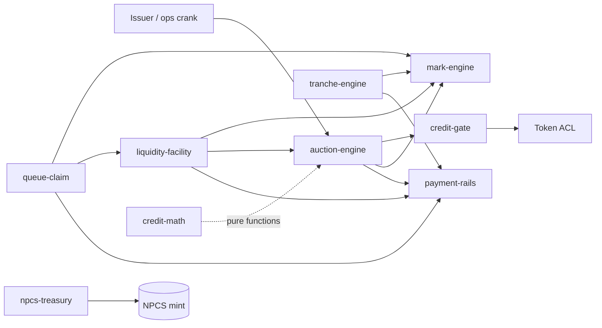

# Chapter 5 — Program Map & Accounts

NUNDINA's on-chain surface is eight Anchor programs plus one shared Rust crate,
`credit-math`. Seven of the eight programs are deployed on devnet,
`liquidity-facility` is built but not deployed, and none is on mainnet
(STATUS.md:32-34). The programs split cleanly along one rule: a program owns the
*semantics* of a mechanism (phases, checks, state machines), while
`payment-rails` moves the money and `credit-gate` decides who may hold
(auction-engine/src/lib.rs:4-8). This chapter maps the whole set — purpose,
interactions, the accounts and PDAs each program owns, its instruction surface,
and its deployment state — then closes with the two end-to-end transaction
flows.

## 5.1 The program map

| Program | Directory | Purpose | Deployment |
|---|---|---|---|
| `payment-rails` | `programs/payment-rails` | USDC cash layer: escrow, bonds, DvP, refunds, ROFR, advances, coupon sweeps | Deployed (devnet) — payment-rails/DEPLOYMENTS.md:12 |
| `credit-gate` | `programs/credit-gate` | Compliance at activation and transfer: SAS attestations, holder governor, lot ledger, block-list | Deployed (devnet) — STATUS.md:82 |
| `auction-engine` | `programs/auction-engine` | Sealed-bid, uniform-price batch auction sessions | Deployed, venue live (devnet) — STATUS.md:84 |
| `mark-engine` | `programs/mark-engine` | NAV feeds, mark states, auction prints, `MARK_PROTECTIVE` | Deployed, feed live (devnet) — STATUS.md:85 |
| `liquidity-facility` | `programs/liquidity-facility` | Advances against pledged collateral, health checks, liquidation ladder | Built, **not deployed** — STATUS.md:33,87 |
| `queue-claim` | `programs/queue-claim` | Tokenized redemption-queue positions | Deployed, queue initialized (devnet) — STATUS.md:86 |
| `tranche-engine` | `programs/tranche-engine` | SPV-configured senior/junior tranching | Deployed, no pool (devnet) — STATUS.md:88 |
| `npcs-treasury` | `programs/npcs-treasury` | NPCS backing (invariant I1), mint-on-deposit / redeem | Deployed, no treasury state (devnet) — STATUS.md:89 |

`credit-math` is a library, not a deployed program; it is covered in section 5.3.
"Deployed" here means the binary is on devnet — several programs have no live
state yet (STATUS.md:19-23).

## 5.2 The eight programs

### 5.2.1 payment-rails — the cash layer

Program ID `GdWmRivxe1k76apQB7EgJ4yBq8Fi3Lw25E8V3XosPocn` (payment-rails/DEPLOYMENTS.md:12).
This is the only program that holds and moves value; the engine programs own
semantics and CPI into it (auction-engine/src/lib.rs:4-8). Its escrows, bonds,
DvP fills, refunds, advances, sweeps and coupon cash are described in
[the cash-layer chapter](/docs/06-payment-rails). Its settlement PDA
`["gate_settle"]`, `GX6PXFskZdcA8L9FMgS81sAVtQNki4a2B5XFW9oWaqJm`, is the sole
signer `credit-gate` accepts on every settlement re-check
(credit-gate/src/settle.rs:32-37). The upgrade authority is the Squads v4 vault
`8wj1EfUyfNvBaMhxBd2iuyC7RLQh9oW2AAQdNRzdXLCV`, a 2-of-2 multisig with a 48h
timelock (payment-rails/DEPLOYMENTS.md:13).

### 5.2.2 credit-gate — compliance at activation

Program ID `5ycYLKQjrbwxQ6VQLUSkQZXwLMn1zEeJ6f5ogFYzX6XX` (credit-gate/src/lib.rs:38).
The gate reads real SAS attestations (program `22zoJMtdu4tQc2PzL74ZUT7FrwgB1Udec8DdW4yw4BdG`,
credit-gate/src/eligibility.rs:37) and drives Token ACL hooks. Its accounts are
per-mint PDAs: `MarketConfig` `["config", mint]` (lib.rs:142), `GateRoot`
`["gate_root"]` (lib.rs:198), `PendingGateAuthority`
`["pending_gate_authority", mint]` (lib.rs:218), `MarketPolicy`
`["policy", mint]` (eligibility.rs:186), `HolderLink` `["holder", mint, owner]`
(eligibility.rs:234), `InvestorRecord` `["investor", mint, investor_id]`
(eligibility.rs:254), the per-holder `HolderLots` ledger, and the block-list
header and per-wallet entries. The instruction surface (credit-gate/src/lib.rs:434-1035)
covers root/governance (`initialize_root`, `propose_root_authority`,
`accept_root_authority`, config and gate-authority hand-overs), config and policy
writes (`initialize_config`, `update_config`, `initialize_policy`, `update_policy`),
admission (`validate`, `release_holder`, `project_and_check`), the lot ledger
(`open_holder_lots`, `append_lot`, `split_lot`, `merge_expired`), the block-list,
Token ACL hooks (`can_thaw_permissionless`, `can_freeze_permissionless`,
`initialize_token_acl_metas`), and the settlement re-checks `settle_check` /
`settle_check_rofr` (credit-gate/src/settle.rs:108-194). The full mechanics are in
[the gate chapter](/docs/07-credit-gate).

### 5.2.3 auction-engine — sealed-bid sessions

Program ID `Cw6wNpVJUaofUDZewG8sDKZu3nnHga4GaJJvKn7rSod7` (auction-engine/src/lib.rs:56).
It owns the session semantics and never holds a token: every escrow path is a
`payment-rails` CPI (auction-engine/src/lib.rs:4-8). Its PDAs are the venue
`["venue"]`, the per-session `["session", …]`, the operator `["rails_operator"]`
and the print authority `["print"]` (auction-engine/src/lib.rs:72-84). The
instruction surface (auction-engine/src/lib.rs:107-722) is `initialize_venue`,
`set_forced_sale_opener`, `open_session` (AE-P1), `commit_bid`/`commit_ask`
(AE-P3), `reveal` (AE-P4), `clear` (AE-P5), `allocate` (AE-P6),
`exercise_rofr`/`close_rofr` (AE-P7), `settle` (AE-P8), `finish` (AE-P9),
`expire` (AE-P10); forced-sale sessions (AE-P11) come from
`liquidity-facility`. Lifecycle and requirement IDs are documented at
auction-engine/src/lib.rs:10-43; see [pricing engines](/docs/08-pricing-engines).

### 5.2.4 mark-engine — NAV and marks

Program ID `79ypVjMMCDbmxYWaXTTgxz9jidjncoJAhHQC6e13x4LH` (mark-engine/src/lib.rs:38).
One `Feed` PDA `["feed"]` per asset mint holds the latest NAV and the implied
curve; a `["print"]` PDA records prints (mark-engine/src/lib.rs:460,584). Every
consumer reads the feed account and calls its pure methods — `state_at`,
`nav_effective`, `mark_protective`, `allows_liquidation` — so no CPI is needed to
read a mark (mark-engine/src/lib.rs:5-12). Instructions
(mark-engine/src/lib.rs:64-186): `initialize_feed`, `set_params`, `set_publishers`,
`set_print_source`, `publish_nav` (ME-P1), `publish_drill_nav`, `refresh` (ME-P2),
`suspend`, `resume`, `record_print` (ME-P4). It is live on devnet with NAV #1 =
`1.000000` and no four-week history (STATUS.md:63).

### 5.2.5 liquidity-facility — advances and the ladder

Program ID `PTNCoDA5WTbAN5RARzUA19Yr3qJYBzwwH63RPFKS7hY` (liquidity-facility/src/lib.rs:47).
The engine owns advance/liquidation semantics; `payment-rails` moves the cash and
`auction-engine` runs the forced sale (liquidity-facility/src/lib.rs:4-9). PDAs:
`["lf_signer"]`, `["lf_facility"]`, `["position"]`, `["collateral"]`, `["proceeds"]`
(liquidity-facility/src/lib.rs:49-53). Instructions
(liquidity-facility/src/lib.rs:76-629): `open_facility` (LF-P2), `pledge_and_advance`
(LF-P1), `add_collateral`, `check_health` (LF-P3), `start_liquidation` (LF-P4),
`ladder_buy`, `pass_step`, `open_forced_sale`/`list_forced_sale`/`reveal_forced_sale`/
`settle_forced_sale` (LF-P5), `release`. It is **built but not deployed**
(STATUS.md:33,87); see [queue and liquidity](/docs/09-queue-and-liquidity).

### 5.2.6 queue-claim — tokenized redemption positions

Program ID `2EpAnJkvw6FH8j97k7WRE72E7oyarZpf7t2TYa26red4` (queue-claim/src/lib.rs:47).
A pro-rated redemption request becomes a dated, priceable claim that can be sold
in an auction or pledged for an advance (queue-claim/src/lib.rs:1-5). PDAs:
`["qc_signer"]`, `["queue"]`, `["request"]`, `["npcs"]`, `["cash"]`, `["claim_mint"]`,
`["claim_account"]` (queue-claim/src/lib.rs:49-55). The claim token is a per-request
Token-2022 mint (supply 1, decimals 0) whose mint and freeze authority is the
program signer PDA (queue-claim/src/lib.rs:11-17). Instructions
(queue-claim/src/lib.rs:69-592): `init_queue`, `request_redemption` (QC-P1),
`attest` (QC-P2), `set_flags`, `pledge` (QC-P4), `record_fill`, `collect`,
`sweep_pledged`, `discharge`, `quote_pv` (QC-P3), `cancel`, `set_state`.

### 5.2.7 tranche-engine — senior/junior tranching

Program ID `CvcaeyuPu7SrFJ91WniJfBhUbQBkb8QQVL9fyK4wcFAS` (tranche-engine/src/lib.rs:46).
It configures senior/junior tranches over NPCS and values collateral at
mark-engine's `MARK_PROTECTIVE` (tranche-engine/src/lib.rs:8-10). PDAs:
`["te_signer"]`, `["pool"]`, `["senior"]`, `["junior"]`, `["collateral"]`, `["cash"]`
(tranche-engine/src/lib.rs:48-53). Instructions
(tranche-engine/src/lib.rs:79-677): `create_pool` (TE-P1), `deposit` (TE-P2),
`activate`, `mark`, `realise_loss`, `record_recovery` (TE-P3), `distribute` (TE-P4),
`exit_junior` (TE-P5), `set_pool_state`, `human_override` (TE-P7). Only the binary
is on devnet; no pool exists (STATUS.md:68,88).

### 5.2.8 npcs-treasury — the NPCS backing

Program ID `4BszRuAP4Gp7vdyu9MjE28gV8YTNtJZSRJRMQHdMut1y` (npcs-treasury/src/lib.rs:31).
It enforces invariant **I1**: NPCS supply equals the USDC in the treasury vault,
1:1 at deposit (npcs-treasury/src/lib.rs:1-6). The treasury signer PDA
`["treasury_signer", treasury]` must be the asset mint's mint authority, so
`deposit` is the only way NPCS is minted (npcs-treasury/src/lib.rs:8-10,37-38).
PDAs: `["treasury"]`, `["vault"]`, `["treasury_signer"]` (npcs-treasury/src/lib.rs:33-35).
Instructions (npcs-treasury/src/lib.rs:48-197): `initialize`, `deposit`, `redeem`,
`reconcile` (permissionless), `set_paused`. Every mint and burn checks I1 before
and after (npcs-treasury/src/lib.rs:17-20). The binary is deployed but the treasury
PDA and mint-authority hand-over are not active (STATUS.md:67,89). See
[tranching, treasury and math](/docs/10-tranching-treasury-math).

## 5.3 credit-math — the shared crate

`credit-math` is a pure Rust library (`programs/credit-math`) of fixed-point
arithmetic and finance functions with no accounts and no CPI: clearing, pro-rata
allocation, NAV, haircuts, present-value, waterfall, loss and prudential
functions (STATUS.md:62). Only `payment-rails` consumes it today — `ceil_div`,
`mul_div`, `accrue_interest`, `distribute_cash`, `MathError`
(credit-math/src/lib.rs:16-23). The clearing, pro-rata, NAV, haircut, PV,
waterfall and prudential functions are tested but not yet called by any program
(credit-math/src/lib.rs:16-23). The engine programs also import selected
functions directly (auction-engine/src/lib.rs:53, liquidity-facility/src/lib.rs:44,
tranche-engine/src/lib.rs:43).

## 5.4 PDAs, seeds and signers

Most cross-program authority runs through PDAs, not keypairs. The settlement
authority above is the one signer `credit-gate` trusts on a fill
(credit-gate/src/settle.rs:31-37); each engine likewise owns a signer PDA that
`payment-rails` recognises as either operator or curator
(liquidity-facility/src/lib.rs:15-17, npcs-treasury/src/lib.rs:8). The
`npcs-treasury` signer is special: it is designed to become the NPCS mint
authority so minting is gated by the deposit path (npcs-treasury/src/lib.rs:8-10).

Arrows are CPIs or direct imports, not an exhaustive call graph.

## 5.5 Transaction flows

### 5.5.1 The ops flow: issuance → session → settle → payout

The engine opens a session and snapshots its parameters (`open_session`, AE-P1);
participants commit sealed bids and asks with pre-funded escrow, then reveal and
are cleared to a uniform price (AE-P3..AE-P5). Fills settle one per instruction
through `payment-rails` `settle_fill`, which CPIs `credit-gate` `settle_check`
before any value moves (credit-gate/src/settle.rs:1-22); `finish` writes the
print into `mark-engine` `record_print` (auction-engine/src/lib.rs:35-38). The
recorded R5 devnet demo shows the same shape — commit, DvP fills, finish,
refunds, and a proceeds sweep where the facility is repaid first
(payment-rails/DEPLOYMENTS.md:16-32).

### 5.5.2 The user flow: redemption → queue claim → pledge or collect

A holder escrows NPCS via `request_redemption` (QC-P1); the attester then
`attest`s it with a queue rank and schedule, minting a frozen claim-position
token (QC-P2). The holder can sell that token like any asset, or `pledge` it to
`liquidity-facility` for an advance (QC-P3, QC-P4). As each queue window fills,
`record_fill` books the execution and `sweep_pledged` routes proceeds through
`payment-rails` `sweep_proceeds` — facility repayment first, then the holder;
an unpledged claim's holder `collect`s (queue-claim/src/lib.rs:18-28).

## Open questions

> Open question: which seven programs are individually verified as deployed on
> devnet, and at which slots? `STATUS.md:33` states 7/8 but `DEPLOYMENTS.md`
> records addresses only for `payment-rails`. No per-program deployment registry
> for the other six was found.

> Open question: the pilot `holder_cap` and `seasoning_seconds` are described as
> 8 and 7 days in code comments (credit-gate/src/lib.rs:125-128). The live devnet
> `MarketConfig` values were not read here; confirm them against the on-chain
> account before quoting.
