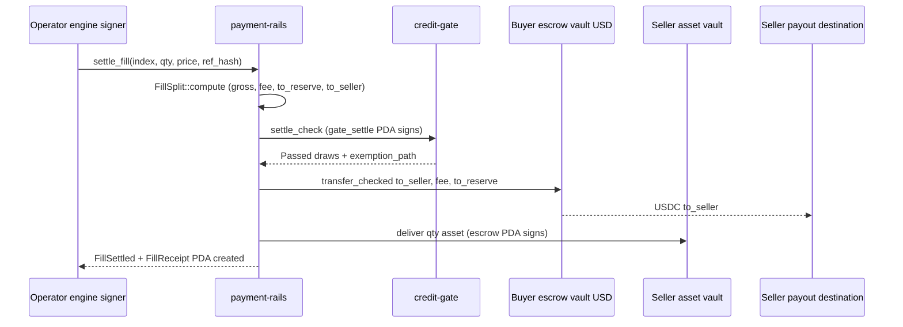

# Chapter 6 — payment-rails: The Cash Layer

`payment-rails` is the one program that ever holds client cash in NUNDINA. Its program ID is `GdWmRivxe1k76apQB7EgJ4yBq8Fi3Lw25E8V3XosPocn` (`payment-rails/README.md:8`), it is live on devnet (`payment-rails/DEPLOYMENTS.md:12`), and it is the cash leg for every money path in the SRS — auction escrow, per-fill settlement, timeout refunds, issuer ROFR, queue-claim sweeps, facility advances, and tranche coupons (`payment-rails/PHASES.md:10-20`). The security never leaves Solana; only cash moves (`payment-rails/PHASES.md:8`). This is a devnet pilot: it is **not audited**, and nothing here is an APY, TVL, or yield claim.

## 6.1 One program, one job

The program is deliberately narrow. Its module documentation describes it as a cash layer whose only cross-program calls are SPL Token and Token-2022 `transfer_checked` and `close_account` (`payment-rails/programs/payment-rails/src/lib.rs:1-6`). There is no AMM, no lending curve, and no engine-owned balance: every vault is owned by an escrow PDA, not by an operator or engine (`payment-rails/README.md:31-38`). The entire parameter surface is a single `RailsConfig` PDA at `["rails_config"]` (`payment-rails/programs/payment-rails/src/state.rs:70`) holding `authority`, `usdc_mint`, `fee_receiver`, `reserve`, `operator`, `registrar`, `fee_bps`, `reserve_bps`, `paused`, and `depeg_breaker` (`payment-rails/programs/payment-rails/src/state.rs:36-66`). The USDC mint must have 6 decimals, enforced at initialization (`payment-rails/INTERFACE.md:17`), and one conservation invariant governs every money move: cash leaves exactly when an equal-and-opposite debit is booked, with no mint or burn in between (`payment-rails/INTERFACE.md:82-88`, `payment-rails/programs/payment-rails/src/instructions/escrow.rs:6-7`).

| Layer | Mechanism | Evidence |
|---|---|---|
| Cash vaults | escrow-owned PDAs, `has_one`, no operator balance | `payment-rails/programs/payment-rails/src/instructions/escrow.rs:805` |
| Settlement asset | one USDC mint, 6 decimals, no transfer fee/hook | `payment-rails/INTERFACE.md:17` |
| Authority | Squads v4 vault as upgrade authority | `payment-rails/DEPLOYMENTS.md:13` |
| Custody boundary | only cash moves; asset leg via escrow PDA | `payment-rails/PHASES.md:8` |

## 6.2 The cash waterfall: what one fill splits into

A single fill is split by `FillSplit::compute` (`payment-rails/programs/payment-rails/src/state.rs:374`). The gross is `ceil(qty × price / 10^dec)`; the protocol fee is `gross × fee_bps / 10_000` floored; the reserve cut is `gross × reserve_bps / 10_000` floored; and the seller receives the remainder `gross − fee − to_reserve` (`payment-rails/programs/payment-rails/src/state.rs:374-407`). The fee ceiling is hard-coded at zero for the pilot — `MAX_FEE_BPS = 0` (`payment-rails/programs/payment-rails/src/state.rs:11`, requirement AE-3, doc 07) — while the reserve cut is capped at `MAX_RESERVE_BPS = 200` (2%) (`payment-rails/programs/payment-rails/src/state.rs:20`), with `BPS = 10_000` (`payment-rails/programs/payment-rails/src/state.rs:22`). `compute` rejects any split whose legs do not sum exactly to gross, and the property suite sweeps all 360 combinations of fee and reserve bps to prove `to_seller + fee + to_reserve == gross` (`payment-rails/README.md:53`, `payment-rails/README.md:65`), with the target `settle_fill` (`payment-rails/fuzz/src/lib.rs:51`) asserting the fill-leg invariant (`payment-rails/README.md:218`). The named invariant is `operator_cannot_redirect_any_leg` (`payment-rails/README.md:78`).

| Leg | Formula (floored unless noted) | Evidence |
|---|---|---|
| Gross | `ceil(qty × price / 10^dec)` | `payment-rails/programs/payment-rails/src/state.rs:374-407` |
| Fee | `gross × fee_bps / 10_000`, `fee_bps ≤ MAX_FEE_BPS = 0` | `payment-rails/programs/payment-rails/src/state.rs:11` |
| Reserve | `gross × reserve_bps / 10_000`, `≤ MAX_RESERVE_BPS = 200` | `payment-rails/programs/payment-rails/src/state.rs:20` |
| Seller | `gross − fee − to_reserve` | `payment-rails/programs/payment-rails/src/state.rs:374-407` |

## 6.3 Sessions and the operator

A `CashSession` is a PDA at `["session", operator, id]` (`payment-rails/programs/payment-rails/src/state.rs:219`) whose status is one of `Open`, `Failed`, or `Settled` (`payment-rails/programs/payment-rails/src/state.rs:115-125`). `open_session` snapshots its `SessionParams` — `commit_end`, `reveal_end`, `settle_deadline`, `bond_amount`, `max_cash`, and `rofr_authority` (`payment-rails/programs/payment-rails/src/instructions/session.rs:15-29`) — and none of those deadlines, caps, or the bond amount can be changed afterwards (`payment-rails/programs/payment-rails/src/instructions/session.rs:73-101`). The lifecycle is `open_session` (`payment-rails/programs/payment-rails/src/instructions/session.rs:34`), `mark_revealed` (`payment-rails/programs/payment-rails/src/instructions/session.rs:114`), and then `fail_session` (`payment-rails/programs/payment-rails/src/instructions/session.rs:143`) or `finish_session` (`payment-rails/programs/payment-rails/src/instructions/session.rs:166`). Who may call these is governed by an `EngineGrant` role set (`payment-rails/programs/payment-rails/src/state.rs:1197`) checked by `require_operator_role` (`payment-rails/programs/payment-rails/src/state.rs:1218`). The trust assumption is stated plainly: an operator can only trigger pre-approved settlement instructions, never redirect value (`payment-rails/INTERFACE.md:75-80`). The operator is rotated with `set_operator` (`payment-rails/programs/payment-rails/src/instructions/admin.rs:12`), and engine roles via `grant_engine` (`payment-rails/programs/payment-rails/src/instructions/admin.rs:97`) and `set_engine_roles` (`payment-rails/programs/payment-rails/src/instructions/admin.rs:116`).

## 6.4 Escrow vaults and bonds

An `Escrow` is a PDA at `["escrow", session, owner]` (`payment-rails/programs/payment-rails/src/state.rs:315`) owning a USDC cash vault at `["vault", escrow]` (`payment-rails/programs/payment-rails/src/state.rs:317`) and, on the sell side, a Token-2022 asset vault at `["asset_vault", escrow]` (`payment-rails/programs/payment-rails/src/state.rs:319`). Buy-side `deposit` locks `qty × limit` USDC plus the budget bond into the cash vault and re-checks conservation on the way in (`payment-rails/programs/payment-rails/src/instructions/escrow.rs:82-145`). The sell side is a **three-phase delivery**: the seller calls `open_asset_vault` to create the empty vault (`payment-rails/programs/payment-rails/src/instructions/escrow.rs:152`), the gate then thaws it, and only then does `deposit_ask` fill it with `qty` asset plus a USDC bond (`payment-rails/programs/payment-rails/src/instructions/escrow.rs:159-236`). There is exactly one escrow per `(session, owner)`, so a wallet has one bid and one ask per session, both under the same escrow seed (`payment-rails/programs/payment-rails/src/instructions/escrow.rs:584`, `payment-rails/programs/payment-rails/src/instructions/escrow.rs:663`).

| When | Unrevealed escrow | Revealed escrow |
|---|---|---|
| Before `commit_end` | deposits accepted; locked | — |
| `reveal_end` ≤ now < `settle_deadline` | refundable: cash/asset → owner, bond → reserve | locked; fills settle here |
| Session `Settled` | cash/asset → owner, bond → reserve | remaining cash/asset + bond → owner |
| now ≥ `settle_deadline` | cash/asset → owner, bond → reserve | remaining cash/asset + bond → owner |
| Session failed before `reveal_end` | everything → owner | everything → owner |
| Session failed after `reveal_end` | cash/asset → owner, bond → reserve | everything → owner |

(`payment-rails/README.md:137-145`.)

## 6.5 Atomic DvP settlement

`settle_fill` is the delivery-versus-payment instruction (`payment-rails/programs/payment-rails/src/instructions/settle.rs:151`). It settles **one fill per instruction** and writes a `FillReceipt` PDA at `["fill", session, index]` (`payment-rails/programs/payment-rails/src/state.rs:326-352`); a replay is rejected, which is what makes retried cranks safe. Order matters: the handler computes the split, re-runs the credit-gate settlement check **before any value moves** (`payment-rails/programs/payment-rails/src/instructions/settle.rs:186-212`), moves the cash leg from the buyer's vault to the seller, fee receiver, and reserve, then delivers the asset leg from the seller's asset vault, emitting `FillSettled` and `TransferInstruction`. The gate CPI targets `CREDIT_GATE_ID = 5ycYLKQjrbwxQ6VQLUSkQZXwLMn1zEeJ6f5ogFYzX6XX` with a `gate_settle` PDA (`GATE_SETTLE_SEED = b"gate_settle"`) and selector `[33, 135, 215, 34, 235, 119, 151, 162]` (`payment-rails/programs/payment-rails/src/instructions/gate.rs:27-32`). The issuer ROFR path is `settle_rofr_fill`, where the issuer pays cash at the clearing price (`payment-rails/programs/payment-rails/src/instructions/settle.rs:281`).



## 6.6 Refunds and the liveness guarantee

Refunds are the safety valve and they are deliberately ungated. `refund` drains a buy-side vault (`payment-rails/programs/payment-rails/src/instructions/escrow.rs:355`) and `refund_ask` drains the sell side, including the bond (`payment-rails/programs/payment-rails/src/instructions/escrow.rs:444`); both are permissionless — any participant can call them, in any phase — and refunds are never gated by `paused` or `depeg_breaker` (`payment-rails/programs/payment-rails/src/instructions/escrow.rs:9-10`, `payment-rails/programs/payment-rails/src/state.rs:62-65`). `VaultDrain::compute` computes the forfeit-first residual and records any shortfall rather than reverting (`payment-rails/programs/payment-rails/src/state.rs:263-282`). This matters because the NPCS `PermanentDelegate` can pull asset out of an ask vault; the resolution refunds what remains plus the bond, closes the accounts, and books the gap as `EscrowAction::AssetShortfall` / `CashShortfall` (`payment-rails/PHASES.md:48`). Because refunds need no crank, a dead crank never strands funds: the kill-the-crank drill is an exit criterion for the era (`payment-rails/PHASES.md:39`, `payment-rails/crank/README.md:1-19`).

## 6.7 The payout router — "private" payouts

Every outgoing destination is a registered `PayoutDestination` PDA at `["payout", owner]` (`payment-rails/programs/payment-rails/src/state.rs:417-453`), created by `register_destination` (`payment-rails/programs/payment-rails/src/instructions/payout.rs:46`), refreshed with `renew_destination` (`payment-rails/programs/payment-rails/src/instructions/payout.rs:69`), and removed with `revoke_destination` (`payment-rails/programs/payment-rails/src/instructions/payout.rs:90`). `load_destination` re-derives the canonical PDA and rejects anything else with a typed reason (`payment-rails/programs/payment-rails/src/instructions/payout.rs:19-42`). "Private" in this pilot means payments go only to attested, allowlisted wallets, with no PII on-chain (only reference hashes) and aggregate-only prints; Confidential Transfers are out of scope because they are incompatible with the permissioned book (`payment-rails/PHASES.md:22`).

| Situation | Error |
|---|---|
| never registered · not a registry account · another wallet's entry · a token account other than the registered one | `DestinationNotAllowlisted` |
| revoked (checked first; revocation takes precedence) | `DestinationRevoked` |
| attestation expired | `DestinationExpired` |

(`payment-rails/README.md:86-99`.)

## 6.8 Facility advances and the treasury top-up

An advance is a `Facility` PDA (`payment-rails/programs/payment-rails/src/state.rs:483`) with a `facility_vault` (`payment-rails/programs/payment-rails/src/state.rs:485`) and an `Advance` PDA at `["advance", facility, borrower]` (`payment-rails/programs/payment-rails/src/state.rs:534`). `open_facility` (`payment-rails/programs/payment-rails/src/instructions/facility.rs:75`), `fund_facility` (`payment-rails/programs/payment-rails/src/instructions/facility.rs:110`), `advance_funds` (`payment-rails/programs/payment-rails/src/instructions/facility.rs:140`), `repay` (`payment-rails/programs/payment-rails/src/instructions/facility.rs:228`), and `sweep_proceeds` (`payment-rails/programs/payment-rails/src/instructions/facility.rs:265-329`) form the ladder. The H1 ceiling is enforced in `Advance::max_advance` (`payment-rails/programs/payment-rails/src/state.rs:541-552`) against `credit_math::MAX_ADVANCE_RATE_BPS = 5_000` — a hard 50% (`programs/credit-math/src/prudential.rs:35`), requirement LF-P1. Interest accrues through `credit_math::accrue_interest` (`programs/credit-math/src/accrual.rs:19`), floored, and `Advance::apply` repays interest-first (`payment-rails/programs/payment-rails/src/state.rs:576-585`). On a sale, `sweep_proceeds` charges the facility before the claim holder (`payment-rails/PHASES.md:17`) and its arithmetic is `to_facility + to_holder == proceeds` (`payment-rails/programs/payment-rails/src/instructions/facility.rs:265-329`). The treasury top-up is therefore bounded:

```text
max_advance = collateral_value × advance_rate_bps / 10_000
             with advance_rate_bps ≤ 5_000
```

## 6.9 Coupons

Tranche coupons are paid with `distribute_coupon` (`payment-rails/programs/payment-rails/src/instructions/coupon.rs:19`), parameterised by `CouponParams` and computed by `CouponSplit::compute` (`payment-rails/programs/payment-rails/src/state.rs:591-663`). The coupon lines are grouped into payout destinations and the transaction fails unless they sum exactly to the cash in (`payment-rails/README.md:113-116`); the cash waterfall is `credit-math::distribute_cash`, requirement TE-P4 (`payment-rails/PHASES.md:19`).

## 6.10 Bonded keepers

Keepers are an optional, bonded liveness accelerator, not a dependency. `initialize_keeper_policy` (`payment-rails/programs/payment-rails/src/instructions/keeper.rs:43`) and `set_keeper_policy` (`payment-rails/programs/payment-rails/src/instructions/keeper.rs:60`) define the policy; `register_keeper` (`payment-rails/programs/payment-rails/src/instructions/keeper.rs:74`) and `top_up_keeper` (`payment-rails/programs/payment-rails/src/instructions/keeper.rs:107`) fund it; `assign_keeper` (`payment-rails/programs/payment-rails/src/instructions/keeper.rs:128`) grants an operator assignment. `refund_escalated` (`payment-rails/programs/payment-rails/src/instructions/keeper.rs:194`) and `refund_ask_escalated` (`payment-rails/programs/payment-rails/src/instructions/keeper.rs:213`) let a keeper run the refund path, `release_assignment` (`payment-rails/programs/payment-rails/src/instructions/keeper.rs:232`) ends it, and `withdraw_keeper` (`payment-rails/programs/payment-rails/src/instructions/keeper.rs:246`) returns the bond from the `keeper_vault` (`payment-rails/programs/payment-rails/src/state.rs:719`) keyed by `["session_keeper", session]` (`payment-rails/programs/payment-rails/src/state.rs:740`). Liveness is never conditional on keeper accounting: the refunds in 6.6 always work without one (`payment-rails/README.md:120-133`).

## 6.11 Phase status and the three-phase ask delivery

The rail was built in R0–R5 (`payment-rails/PHASES.md:35-42`). The R5 row records the state of the sell-side delivery exactly:

> **R5 Devnet + integration** — cash leg · live NPCS pending: NPCS leg validated against a **manifest mint, not live NPCS** (Circle devnet USDC). The cash-leg check covers the cash leg only; R5 counts as met for live NPCS when a DvP against mint `Dy1VW2…dx2i` is recorded, which waits on the gate thaw (#122, #127).

(`payment-rails/PHASES.md:40`.)

The related finding that produced the three-phase delivery is recorded in the open questions:

> **R5:** confirmed against a real NPCS-manifest mint (the old one-shot `deposit_ask` failed with `AccountFrozen`); the rails now split out `open_asset_vault` so the gate can thaw in between (`tests-svm/tests/npcs.rs`). Gate side still open.

(`payment-rails/PHASES.md:48`.)

On deployment, `payment-rails` is one of the programs live on devnet, not on mainnet:

| Item | State | Evidence |
|---|---|---|
| Devnet deploy | live | `payment-rails/DEPLOYMENTS.md:12` |
| Upgrade authority | Squads vault `8wj1EfUyfNvBaMhxBd2iuyC7RLQh9oW2AAQdNRzdXLCV` | `payment-rails/DEPLOYMENTS.md:13` |
| Live NPCS DvP | pending gate-side thaw | `payment-rails/PHASES.md:40` |
| Mainnet | not deployed (devnet-only pilot) | `payment-rails/README.md:262` |

## Open questions

> Open question: who owns the auction state machine (commit/reveal/clear) that the rails only implement the cash leg of? (`payment-rails/PHASES.md:46`.)

> Open question: does the gate expose the escrow-vault thaw before the live NPCS DvP can be recorded? Gate side is still to build (`payment-rails/PHASES.md:47-48`).

> Open question: a *frozen* ask vault blocks `refund_ask` until the freeze authority thaws it; a frozen destination is typed (`RefundAssetDestinationFrozen` / `RefundUsdcDestinationFrozen`) and resolved by passing another thawed account of the same owner (`payment-rails/PHASES.md:48`).
