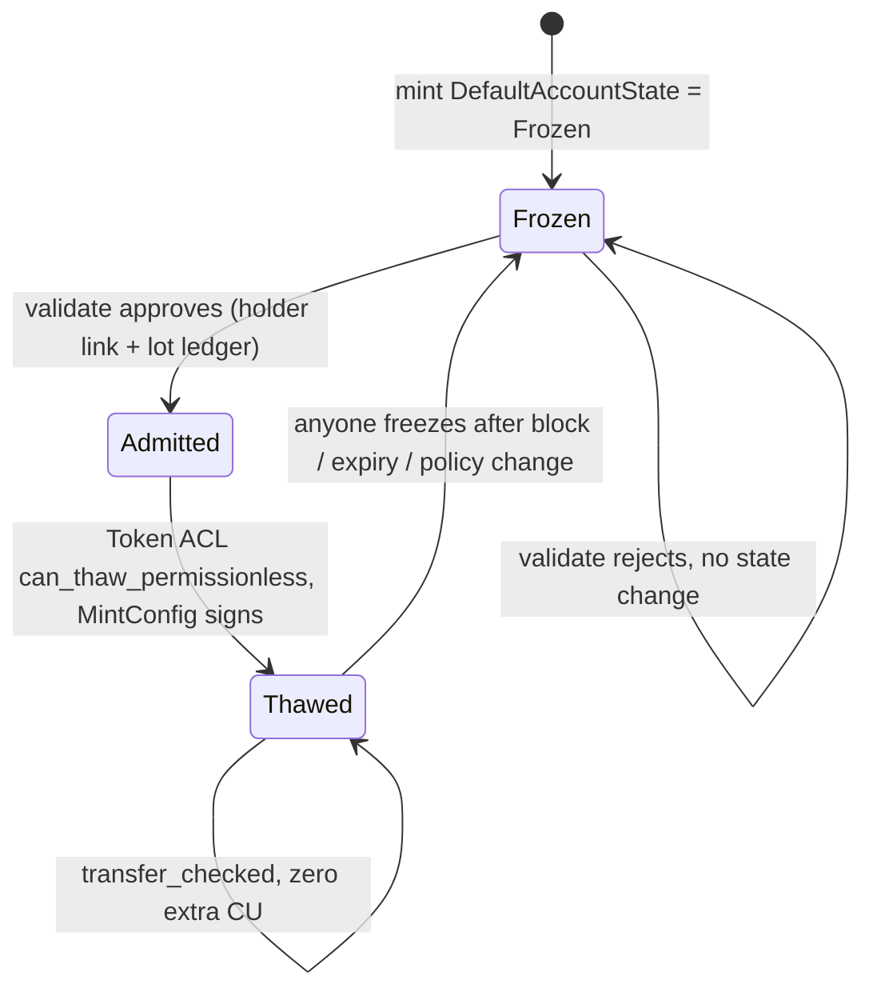

# Chapter 7 — credit-gate — Compliance at Activation

`credit-gate` is the one program in NUNDINA that enforces the offering rules, and it does so **once, when a holder is admitted** — not on every transfer. It is the Gate Program behind a Token ACL (sRFC37) freeze authority, it reads real Solana Attestation Service (SAS) records, and it decides eligibility from four moving parts: a block-list, SAS attestations, a per-lot seasoning ledger, and a holder-count governor. This chapter describes what the program actually does as built. NUNDINA is a devnet pilot; 7 of 8 programs are deployed, `liquidity-facility` is built but not deployed, and nothing is on mainnet or audited (`preresearch/architecture/10-Audit-Scope-P7.md:27`, `DEPLOYMENTS.md:17`).

## 7.1 Why a Gate Program, not a transfer hook

Transfer hooks fire on every transfer, force every caller to resolve an extra-account-meta list in exact order, and cause routers to drop hooked tokens from routes — many protocols blacklist them outright (`preresearch/architecture/06-Solution-Architecture-v2.md:280`). Token ACL (sRFC37) exists to fix this: a mint's freeze authority is delegated to a `MintConfig` PDA, token accounts are default-frozen, and a **permissionless thaw** is validated by a pluggable Gate Program (`programs/credit-gate/src/token_acl.rs:3-9`). Compliance therefore runs at account activation and the transfer path costs zero extra compute; the repo states this as a headline design rule (`README.md:156-157`). The devnet NPCS mint is wired this way: its freeze authority is a Token ACL `MintConfig` that names `credit-gate`, so a holder can thaw only through the gate (`DEPLOYMENTS.md:120`).

## 7.2 The program and its config anchor (CG-P2)

The program is deployed at `5ycYLKQjrbwxQ6VQLUSkQZXwLMn1zEeJ6f5ogFYzX6XX` (`programs/credit-gate/src/lib.rs:38`; devnet row `DEPLOYMENTS.md:17`). One immutable-per-market policy PDA, `MarketConfig` (`["config", mint]`), anchors everything: the policy class, `holder_cap`, `seasoning_seconds`, `settlement_horizon_seconds`, up to four attesters, both SAS schema keys, and an optional block-list (`lib.rs:99-131`). Bounds are hard-coded: at most 4 attesters (`lib.rs:42`), a ceiling on `holder_cap` (`lib.rs:44`), and a one-day floor on seasoning so the Rule-144 analog can never be a no-op (`lib.rs:52-54`). Onboarding is one-shot and signed by the `GateRoot` authority, so it cannot be front-run (`lib.rs:500-506`); any change emits `ConfigUpdated` (`lib.rs:560-631`). The root itself moves by a two-step propose/accept hand-over (`lib.rs:454-498`).

## 7.3 Admission — `validate` (CG-P1)

`validate(owner, mint)` may be paid for by anyone (`ops/gate/README.md:19`). It runs the CG-P1 decision in a fixed order and, on approval, writes the holder link the Token ACL hooks later read; on rejection it **changes no state and still succeeds**, so the typed reason is kept as an event (`lib.rs:897-904`). The order is exactly (`programs/credit-gate/src/eligibility.rs:18-21`):

1. block-list screen (CG-P5, always first);
2. identity attestation (SAS-owned, canonical PDA, market credential and schema, attester-signed);
3. accreditation attestation, checked the same way;
4. attestation expiry against the settlement horizon (H4);
5. jurisdiction, KYC-level and accreditation policy;
6. holder governor (CG-P4, in `validate` only).

## 7.4 The SAS read (CG-P6)

An attestation counts only if it is an account of the SAS program `22zoJMtdu4tQc2PzL74ZUT7FrwgB1Udec8DdW4yw4BdG` (`eligibility.rs:36-37`), sits at its canonical PDA `["attestation", credential, schema, nonce]` with `nonce` equal to the holder wallet, is under the market's credential and the expected schema, was signed by one of `MarketConfig::attesters`, and stays valid for the whole settlement horizon — `expiry == 0` meaning "never expires" (`eligibility.rs:1-11`, `340-370`). Schemas are SAS byte layouts: `nundina.identity.v1` = `investor_id: u128`, `jurisdiction: String` (2 bytes), `kyc_level: u8`; `nundina.accreditation.v1` = `accredited: bool`, `method: u8` (`eligibility.rs:13-16`). The credential (`nundina`), both schemas, and the authorized attester are live on devnet (`ops/gate/deployment-devnet.json:3-13`; SAS attester row `DEPLOYMENTS.md:224-228`). Revocation is structural: closing the attestation in SAS makes the account stop existing, so the gate refuses it (`eligibility.rs:11`).

## 7.5 The holder governor (CG-P4)

Holders are counted by `investor_id`, not by wallet, so one investor's several wallets count once (`eligibility.rs:23-27`). A new `investor_id` is admitted only while `distinct_investors < holder_cap`; the count drops when the investor's last wallet is released, which the gate-config authority confirms to zero (`eligibility.rs:24-27`, `lib.rs:906-926`). `project_and_check` lets a caller (auction-engine at allocation) test headroom without writing (`lib.rs:928-938`). The pilot cap is 8 (`token/TOKENOMICS.md:15`); the target framing is the securities 12(g) holder-count limit (`HACKATHON.md:18`).

## 7.6 The block-list (CG-P5)

There is one `BlockList` header per mint and one `BlockEntry` PDA per blocked wallet; **existence of the entry is the block** and closing it unblocks (`programs/credit-gate/src/blocklist.rs:1-9`, `53-68`). The entry address is re-derived from `(mint, wallet)` on every path, so a caller cannot dodge the screen by passing another account (`blocklist.rs:6-9`). The screen runs before anything that grants or extends a position — ledger open and lot append — and a block beats every allow-side fact (`blocklist.rs:11-19`). Because a sanctions screen is not a governance action, `update_config` can re-point the list but never clear it (`lib.rs:619-620`). Reasons are stored as a `reason_hash`, never the reason itself, so no PII lands on-chain (`blocklist.rs:61-63`). If the config points at a list the program cannot read, the screen fails closed (`blocklist.rs:16-19`, `99-109`).

## 7.7 The lot ledger (CG-P3)

Each `(mint, holder)` gets a fixed-capacity ledger of seasoning lots plus a `FREE` bucket (`programs/credit-gate/src/lots.rs:1-7`). A lot is sellable once `restriction_expiry ≤ now`, where `restriction_expiry = acquired_ts + seasoning_seconds`; a split keeps every field but `lot_id` and `qty`, so a partial fill never resets seasoning (`lots.rs:45-66`, `816-832`). Capacity is 16 lots per holder (`lots.rs:31`); a sale may draw from at most 8 lots, FREE included (`lots.rs:90`). `open_holder_lots` may be paid by anyone but screens the holder first (`lib.rs:765-779`); `append_lot` and `split_lot` are gate-config-authority-only, standing in for auction-engine settle and the primary mint until those exist (`lots.rs:12-15`). `merge_expired` is permissionless — it folds seasoned lots into `FREE` — and has no crank fee yet (`lots.rs:16-17`, `lib.rs:1013-1031`). The pilot seasoning is 7 days (`token/TOKENOMICS.md:15`).

## 7.8 Token ACL hooks — thaw and freeze (CG-P1)

Token ACL CPIs into the gate with the "efficient allow/block list" interface: accounts `[signer, token_account, mint, owner, flag_account, extra_metas, …extras]`, where the extras are resolved from a TLV list the gate stores at `["thaw_extra_account_metas", mint]` (resp. freeze) (`token_acl.rs:5-8`, `23-28`, `74-98`). The hooks are read-only — Token ACL passes no payer — so admission state is written beforehand by `validate` (`token_acl.rs:11-12`). `can_thaw_permissionless` returns `Ok` only if the owner is admitted **right now**, re-deciding block-list, attestation existence, signer, expiry versus horizon, jurisdiction and accreditation policy, and that the attestations are still the same ones the admission rested on with the same `investor_id` (`token_acl.rs:100-159`). `can_freeze_permissionless` is the mirror: it succeeds only when the owner is no longer admitted, so a still-eligible holder cannot be frozen by anyone (`token_acl.rs:161-168`). Revocation — the block-list plus attestation expiry — is therefore enforceable on-chain, not just recorded (`blocklist.rs:21-24`).

## 7.9 Settle-time re-check (AE-P8)

Compliance repeats inside every settlement. `payment-rails`' `settle_fill` CPIs `settle_check` before any value moves, signed by its settlement PDA `GX6PXFskZdcA8L9FMgS81sAVtQNki4a2B5XFW9oWaqJm` (`programs/credit-gate/src/settle.rs:1-6`, `32-37`; instruction `lib.rs:986-998`). Each fill re-checks, in order: block-list on seller then buyer; the buyer's admission and SAS attestations re-read now; the seller's seasoned quantity covering the fill and being debited; and the buyer's new lot appended, seasoning from now (`settle.rs:8-17`). The exemption basis is returned for the transfer record: an accredited buyer → §4(a)(7); an admitted but non-accredited buyer → §4(a)(1½); the issuer's own ROFR purchase → the issue's exemption (`settle.rs:19-22`, `41-48`). The ROFR path (`settle_check_rofr`) block-checks both sides and debits the seller but gives the issuer no lot, because the issuer is not admitted as a holder (`lib.rs:1000-1011`).

## 7.10 Events (CG-P7)

Every state change emits exactly one event from a fixed family (`lib.rs:221`): `ConfigUpdated`, `GateRootAuthority`, `GateAuthorityTransfer`, `PolicyUpdated`, `HolderReleased`, `ValidateDecision`, `BlocklistUpdated`, `LotEvent`, and `SettleChecked` (`lib.rs:222-260`; `eligibility.rs:284-320`; `blocklist.rs:75-91`; `lots.rs:107-130`; `settle.rs:61-76`). The config fingerprint and `field_group` mask make each governance change attributable (`lib.rs:1034-1046`).

## 7.11 Typed rejections

A rejection is a value, not a revert: `GateReject` is wire-stable and mapped to a matching `GateError` for CPI callers and Token ACL hooks (`lib.rs:273-305`, `eligibility.rs:440-454`).

| Reject (dimension) | Meaning | Source |
|---|---|---|
| Blocklisted | wallet on the market block-list (CG-P5) | `blocklist.rs:99-109` |
| AttestationInvalid | SAS record missing, wrong PDA/schema/credential/attester | `eligibility.rs:340-363` |
| AttestationExpiry | valid now but not through the settlement horizon | `eligibility.rs:364-368` |
| JurisdictionRejected | jurisdiction not allowed by policy | `eligibility.rs:415-416` |
| KycLevelTooLow | `kyc_level < min_kyc_level` | `eligibility.rs:418-419` |
| NotAccredited | accreditation required and absent | `eligibility.rs:421-422` |
| GovernorCap | new `investor_id` would breach `holder_cap` | `lib.rs:379`, `928-938` |
| InvestorIdChanged | link's `investor_id` differs from the attestation now | `token_acl.rs:146-148` |
| StillEligible | freeze attempted on a still-admitted holder | `token_acl.rs:163-166` |

## 7.12 Devnet wiring and operations

Two tools operate the gate (`ops/gate/README.md:5-8`): `sas.ts` (`setup`, `attest`, `verify`) and `wire.ts` (`root`, `market`, `acl`, `validate`, `thaw`, `append-lot`, `verify`). On devnet, everything is live: the SAS credential, attester and schemas (`ops/gate/deployment-devnet.json`), `credit-gate` v0.2.0 at `5ycY…X6XX` with its root, and the NPCS mint `6vt1wHVQ…VKL4` wired through Token ACL; holder `BJL7…2EMh` was attested, validated and thawed by a non-issuer wallet (`ops/gate/README.md:10-15`). The end-to-end rejection and revocation cases — every typed reason, the governor, one investor's second wallet counted once, SAS-close revocation, the hook refusing calls from outside Token ACL — are the LiteSVM suite `programs/credit-gate/tests-svm/tests/sas_token_acl.rs` (`tests-svm/tests/sas_token_acl.rs:1-12`; suites named in `preresearch/architecture/10-Audit-Scope-P7.md:51`).

## 7.13 What is not yet in force

The gate's devnet **upgrade authority** is held by a Squads 2-of-2 vault, but the gate root and the NPCS `MarketConfig` authority remain with the devnet governance key: `append_lot` for primary issuance still needs it, pending the #50 hand-over when that path becomes an auction-engine CPI (`DEPLOYMENTS.md:212`). `append_lot`/`split_lot` are signed by the gate-config authority because auction-engine settle and the primary mint do not exist yet (`lots.rs:12-15`), and `merge_expired` has no crank fee (`lots.rs:16-17`). The program is audit-scope-critical — it is the one enforcing the law — and is part of the fixed external-audit scope (`preresearch/architecture/10-Audit-Scope-P7.md:27`). Nothing here should be read as a present-tense control beyond the devnet wiring recorded above. See [the NPCS asset](/docs/11-npcs-asset) for the mint this gate guards and [legal, risk and audit](/docs/15-legal-risk-audit-roadmap) for the compliance topology it enforces.

## Open questions

> Open question: `merge_expired` is permissionless with no crank fee (`lots.rs:16-17`); whether the target design funds a merge crank is not recorded in the sources read here.

> Open question: the date and shape of the #50 hand-over that moves the NPCS `MarketConfig` authority and gate root from the devnet governance key to the vault (`DEPLOYMENTS.md:212`) are not recorded.
