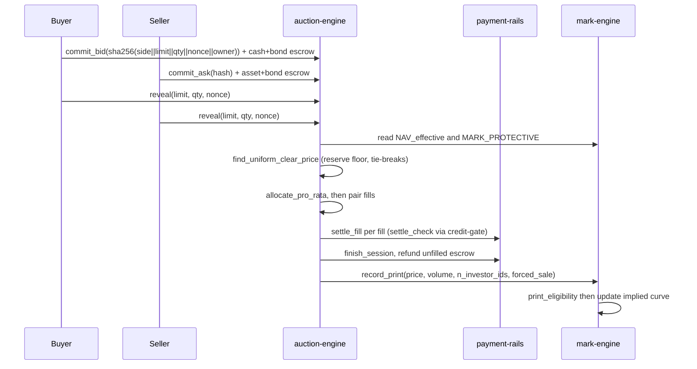

# Chapter 8 — Pricing Engines

NUNDINA reprices with two programs that meet at one number. `auction-engine`
(`Cw6wNpVJUaofUDZewG8sDKZu3nnHga4GaJJvKn7rSod7`, `programs/auction-engine/src/lib.rs:56`) runs
sealed-bid, uniform-price batch auctions and emits a clearing print; `mark-engine`
(`79ypVjMMCDbmxYWaXTTgxz9jidjncoJAhHQC6e13x4LH`, `programs/mark-engine/src/lib.rs:38`) turns an
issuer appraisal into a usable mark and decides whether an auction print may move it. Both are
deployed to devnet (`DEPLOYMENTS.md:18-19`), neither is audited, and NUNDINA is devnet-only — this is
not an offer. `auction-engine` holds no token: it owns the *semantics* (phases, sealed commitments,
reveal checks, clearing, allocation, ROFR, the print), while [the cash layer](/docs/06-payment-rails)
moves every micro-USDC and every asset unit and CPIs [the credit gate](/docs/07-credit-gate)'s
`settle_check` on every fill (`programs/auction-engine/src/lib.rs:1-9`).

## 8.1 The two-price problem

An oracle publishes a *number*; nobody publishes a *mark* (`preresearch/architecture/06-Solution-Architecture-v2.md:368`).
`mark-engine` produces two outputs from one feed: `NAV_effective = NAV_official − haircut(state)` for
subscriptions and reference, and `MARK_PROTECTIVE = min(NAV_effective, NAV_implied)` for *every* risk
decision (`06-Solution-Architecture-v2.md:399-400`; `ME-P5`). The auction is the only source of
`NAV_implied`, and the auction's reserve floor is itself read from the mark feed — so the two engines
price each other in a controlled loop rather than trusting a single stale appraisal.

The rationale is explicit: a pool quotes off the last published NAV, an informed holder sells into it
at the old price before a markdown, and the passive LP absorbs it until depth goes to zero. A
sealed-bid periodic auction has no resting quote to pick off, seals bids until reveal, aggregates a
week of intent into one cross, and clears at a single uniform price with no reordering incentive and
therefore no MEV (`06-Solution-Architecture-v2.md:134-159`, `:262-263`).

## 8.2 `auction-engine` — sealed-bid uniform-price sessions

### 8.2.1 Session lifecycle (AE-P1, AE-P2)

`open_session` snapshots every parameter into the `Session` PDA and opens the rails `CashSession`
(deadlines, bond, cap, ROFR) with the engine's operator PDA as its operator
(`programs/auction-engine/src/lib.rs:147-234`). Params are validated and immutable for the session
(`lib.rs:1040-1085`). The seven `Phase` values are `Commit`, `Reveal`, `Allocating`, `IssuerRofr`,
`Settling`, `Printed`, `Failed` (`lib.rs:1022-1030`), and every transition emits `PhaseChanged`
(`lib.rs:911-920`). The book is a fixed-capacity `MAX_ORDERS = 16` (`lib.rs:59`); the fill list is
`MAX_FILLS = 24` (`lib.rs:61`).

| Stage | Instruction | Effect |
|---|---|---|
| Open | `open_session` (AE-P1) | Snapshot params; open rails session via operator PDA; `Phase::Commit` (`lib.rs:147-234`) |
| Commit | `commit_bid` / `commit_ask` (AE-P3) | Record sealed commitment; escrow cash+asset in rails (`lib.rs:238-272`) |
| Reveal | `reveal` (AE-P4) | Check preimage and escrow budget; rails `mark_revealed` (`lib.rs:277-350`) |
| Clear | `clear` (AE-P5) | `find_uniform_clear_price`; set price/volume/reserve/reference; `Allocating` (`lib.rs:357-416`) |
| Allocate | `allocate` (AE-P6) | Pair buyers×sellers into fills in chunks; `IssuerRofr` or `Settling` (`lib.rs:422-471`) |
| ROFR | `exercise_rofr` / `close_rofr` (AE-P7) | Issuer takes part of a fill at the clearing price; `Settling` (`lib.rs:478-576`) |
| Settle | `settle(fill_index)` (AE-P8) | One fill per instruction through rails `settle_fill` (`lib.rs:581-643`) |
| Finish | `finish` (AE-P9) | Rails `finish_session`; `record_print` into mark-engine; `Printed` (`lib.rs:649-716`) |
| Expire | `expire` (AE-P10) | Past deadline: fail session; escrows refundable (`lib.rs:722-760`) |

### 8.2.2 Commit — sealed commitments and pre-funded escrow (AE-P3)

An order is committed as `sha256(side ‖ limit ‖ qty ‖ nonce ‖ owner)` (`lib.rs:88-97`); binding the
owner stops a copied hash from being replayed by another wallet (`lib.rs:87`). In the *same*
instruction the owner pre-funds the rails escrow — cash + bond for a bid, asset + bond for an ask
(`lib.rs:238-272`, `:765-829`). This is why there is no failed-fill risk: the money and the units are
already in escrow before clearing (`06-Solution-Architecture-v2.md:264`). Duplicate orders from one
wallet are rejected (`lib.rs:780-783`).

### 8.2.3 Reveal — preimage and budget (AE-P4)

`reveal` runs only in `[commit_end, reveal_end)` and moves the session to `Reveal` on its first call
(`lib.rs:287-297`). It checks the preimage against the stored commitment (`lib.rs:306-309`) and that
the revealed order fits the escrow: a bid's cost `gross(qty, limit, decimals)` must not exceed the
escrowed cash, and an ask's `qty` must not exceed the escrowed asset (`lib.rs:310-316`, `:899-909`).
It then reports `mark_revealed` to the rails (`lib.rs:335-341`). Orders never revealed are excluded
from clearing and forfeit their bond in the rails (`programs/auction-engine/src/lib.rs:23-25`;
`AE-P4`).

### 8.2.4 Clear — uniform price, reserve floor, tie-breaks (AE-P5)

`clear` is permissionless once reveals close and before the settlement deadline (`lib.rs:357-368`).
It computes `reserve = NAV_effective × (1 − max_discount_bps)`, rounding *up* so a seller's floor is
never undercut (`lib.rs:952-965`), and `reference = MARK_PROTECTIVE` (`lib.rs:966`). A session fails
when `mark-engine` reports `Suspended` or has no NAV (`FailReason::MarkUnavailable`), when fewer than
`min_reveals` orders revealed (`FailReason::TooFewReveals`), or when no candidate price at or above
the reserve crosses (`FailReason::NoCross`) (`lib.rs:936-984`, `:1033-1038`). Failure calls the rails
`fail_session`, after which every escrow is refundable (`lib.rs:394-414`).

The mechanism itself is `credit_math::find_uniform_clear_price`
(`programs/auction-engine/src/lib.rs:980`): among candidate prices ≥ reserve, it maximizes executed
volume, then tie-breaks in a fixed order — minimal buy/sell imbalance, then nearest to the reference
mark, then lowest price (`programs/credit-math/src/allocation.rs:30-107`). Candidates are the revealed
limit prices, so the equilibrium price is always some participant's limit (`allocation.rs:38-40`).

### 8.2.5 Allocate — pro-rata at the margin (AE-P6)

Allocation gives full fills on the short side and pro-rata on the long side via
`credit_math::allocate_pro_rata`, which floors each share (rounding against the bidder) and hands the
residue out one unit at a time, larger commitment first (`programs/credit-math/src/allocation.rs:109-149`).
`allocate` then pairs the longest-standing unpaired buy and sell into a `Fill`, in order-book order,
up to `max_fills` per call — deterministic and resumable via each order's `alloc_left` cursor
(`programs/auction-engine/src/lib.rs:422-471`). When every allocation is paired it advances to
`IssuerRofr` if an ROFR authority is set, otherwise `Settling` (`lib.rs:462-469`).

### 8.2.6 Issuer right of first refusal (AE-P7)

If a session names a `rofr_authority`, the issuer may take all or part of any fill *at the clearing
price* (`exercise_rofr`), settled immediately through the rails `settle_rofr_fill`; the buyer's
allocation shrinks by the taken quantity and their unused cash is refundable after `finish`
(`programs/auction-engine/src/lib.rs:478-555`). `close_rofr` ends the window — the issuer declines, or
anyone once `rofr_end` has passed (`lib.rs:559-576`). The rationale: the issuer becomes a sponsor with
a NAV-accretive buyback that also controls the print, instead of a veto over it
(`06-Solution-Architecture-v2.md:266`).

### 8.2.7 Settle and print (AE-P8, AE-P9)

`settle(fill_index)` moves exactly one fill through rails `settle_fill` — permissionless and
crank-loopable, with the caller funding the rails fill receipt's rent
(`programs/auction-engine/src/lib.rs:581-633`). The rails `settle_fill` performs atomic DvP and CPIs
`credit-gate`'s `settle_check` first, which re-checks block-lists, the buyer's attestations, the
seller's seasoned lots, and appends the buyer's lot (`preresearch/architecture/08-SRS-Pilot-Rails.md:304`).
`finish` requires every fill settled, calls rails `finish_session` (making unfilled escrow refundable
at once), then writes the `ClearingPrint` into `mark-engine::record_print` signed by the print PDA
(`lib.rs:649-716`).

### 8.2.8 Timeout and forced-sale sessions (AE-P10, AE-P11)

Past `settle_deadline` an open session fails via `expire`, and the rails' permissionless refunds
return every escrow (`programs/auction-engine/src/lib.rs:718-760`). Forced-sale sessions are a
distinct path: only the venue's `forced_sale_opener` (the facility's PDA, see
[queue & liquidity](/docs/09-queue-and-liquidity)) may open them, the reserve
is relaxed to zero, and the print is flagged `forced_sale` so `mark-engine` excludes it
(`lib.rs:156-161`, `:940-947`, `:41-43`; `AE-P11`). That exclusion is what stops a liquidation cascade
from feeding its own mark down (`06-Solution-Architecture-v2.md:271`).

## 8.3 `mark-engine` — from appraisal to mark

### 8.3.1 The feed and publication (ME-P1)

One `Feed` PDA per asset mint holds the latest published NAV and the implied point built from eligible
prints (`programs/mark-engine/src/lib.rs:5-13`, `:428-457`). `publish_nav` accepts only a key in the
feed's publisher set (up to `MAX_PUBLISHERS = 4`, `lib.rs:41`, `:131-141`), and `write_nav` rejects a
NAV that is not positive, is timestamped in the future, or is not strictly newer than the current mark
(`lib.rs:242-265`). `model_version` and `inputs_hash` are stored so every mark is reproducible
(`lib.rs:250-253`; `ME-1`, `AC-12`).

### 8.3.2 States and staleness (ME-P2)

`state_at(now)` derives `Fresh → Warned → Stale` by age from `effective_ts`; a feed that was never
published is `Stale`, and `Suspended` is set only by the authority (`programs/mark-engine/src/lib.rs:467-482`,
`:163-180`). `refresh` is permissionless and events each transition once (`lib.rs:155-160`, `:268-280`).
The schedule is bounded: `warn_after ≥ MIN_WARN_SECONDS = 3_600` and `stale_after ≤ MAX_STALE_SECONDS = 60 days`
(`lib.rs:49-51`, `:377-384`). This is the "not everything can be marked" rule at the feed level: an old
appraisal degrades rather than silently persisting.

### 8.3.3 `NAV_effective` and haircuts (ME-P3)

`NAV_effective = NAV × (1 − haircut_at(state))`, where `Fresh` carries no haircut, `Warned` carries
`warned_haircut_bps`, and `Stale`/`Suspended` carry `stale_haircut_bps`
(`programs/mark-engine/src/lib.rs:485-496`). The haircuts are capped by hard on-chain ceilings that
governance cannot exceed: `MAX_WARNED_HAIRCUT_BPS = 1_000` and `MAX_STALE_HAIRCUT_BPS = 5_000`
(`lib.rs:43-45`, `:385-390`).

### 8.3.4 Print eligibility and the implied curve (ME-P4)

`record_print` is callable only by the feed's configured `print_source` — `auction-engine`'s print PDA
(`programs/mark-engine/src/lib.rs:186-193`; `DEPLOYMENTS.md:46`). Eligibility is tested in a fixed
order: `ForcedSale`, then `BelowMinVolume`, then `TooFewInvestors`, then `Outlier` (the |print − NAV|
band), else `Eligible` (`lib.rs:543-565`). An eligible print sets `implied_pico` and `implied_ts`
(`lib.rs:198-201`); ineligible prints are still stored, flagged, and never enter the curve
(`lib.rs:202-204`, `:568-585`). Each session produces exactly one `PrintRecord`, seeded on the session,
so a replayed print fails because the account already exists (`lib.rs:640-659`).

### 8.3.5 `MARK_PROTECTIVE` (ME-P5)

`mark_protective(now) = min(NAV_effective, NAV_implied)`, and the implied point drops out once it is
older than `stale_after` (`programs/mark-engine/src/lib.rs:499-512`). Every risk consumer reads this
pure method — the facility's underwriting and no-liquidation rule, and the tranche MARK book — so no
consumer can compute a mark any other way (`lib.rs:5-12`). The auction's opening-time reserve floor is
the one place a consumer reads `NAV_effective` directly (`auction-engine/src/lib.rs:952-966`).

### 8.3.6 Print disclosure classes (ME-P6)

What a print discloses at the event level depends on the market's `PrintPolicy`: `Public` shows price
and volume; `Banded` shows a band floor (never the exact price) and volume; `AggregateOnly` shows
volume only; `DataRoom` shows neither (`programs/mark-engine/src/lib.rs:216-226`, `:282-287`). The
eligibility and curve update are identical in every class — only disclosure differs.

### 8.3.7 Breaker hierarchy (ME-P7)

`Feed::allows_liquidation` returns true only for `Fresh` or `Warned`, and `allows_new_advance` only for
`Fresh` (`programs/mark-engine/src/lib.rs:514-522`). Each state maps to a `BreakerLevel` —
`Normal/Cautious/Restricted/Standstill` — matching the system breaker hierarchy (`lib.rs:315-333`;
`06-Solution-Architecture-v2.md:862-900`). Because this gate lives in the mark engine, a `Stale` or
`Suspended` mark forbids liquidation for *every* consumer, not just the ones that remember to check
(`ME-P7`).

## 8.4 How the two engines interlock

The loop: an issuer publishes a NAV, `mark-engine` ages and haircuts it into `NAV_effective`; an
auction sets its reserve floor from `NAV_effective` and its tie-break reference from `MARK_PROTECTIVE`;
the uniform clearing price becomes a print; if eligible, the print sets `NAV_implied`, which can only
*lower* `MARK_PROTECTIVE` via the `min`. The two-price system thus resists a distressed one-sided
session printing an absurd mark: the print must pass the volume, distinct-investor, and outlier-band
tests, and it competes against a haircut appraisal rather than replacing it
(`06-Solution-Architecture-v2.md:265`, `:445`).

## 8.5 Deployment status

`auction-engine` and `mark-engine` are both deployed to devnet (`DEPLOYMENTS.md:18-19`). The live NPCS
feed was initialized with a weekly cadence (Warned 8 d, Stale 15 d), public prints, and drills off, and
the auction print PDA is set as its print source (`DEPLOYMENTS.md:43-46`). The first live session is a
runbook gated on a rails `grant_engine` upgrade and a seller's lot seasoning; a local rehearsal cleared
0.970000 against NAV 1.00 (reserve 0.95) with two DvP fills (`DEPLOYMENTS.md:56-78`). Neither program is
on mainnet and nothing is audited; see [deployment, governance & ops](/docs/12-deployment-governance-ops).

## Open questions

> Open question: `mark-engine`'s `ME-P4` docstring and `06 §4` describe
> `NAV_implied` as a *curve* of "trimmed, volume-weighted, time-decayed prints"
> (`preresearch/architecture/06-Solution-Architecture-v2.md:392`), but the built
> `record_print` stores only the single latest eligible `price_pico`
> (`programs/mark-engine/src/lib.rs:198-201`). Is the curve still planned, or is the
> latest-eligible-print rule the pilot's final design?

> Open question: the auction counts `n_investor_ids` as **distinct wallets** across the
> session's fills (`programs/auction-engine/src/lib.rs:673-689`), while the `ME-P4`
> requirement wording says prints must clear a minimum of distinct *investor IDs*,
> "not wallets" (`preresearch/architecture/06-Solution-Architecture-v2.md:445`,
> `G3`). Which identity does `min_print_investors` mean to count?

> Open question: the auction reserve's plan-of-record discount below `NAV_effective`
> is unresolved. The code enforces an interim ceiling `MAX_DISCOUNT_BPS = 5_000`
> (`programs/auction-engine/src/lib.rs:62-65`), and SRS 08 records H3 as needing a
> signed-off value (`preresearch/architecture/08-SRS-Pilot-Rails.md:63`, `#123`).
