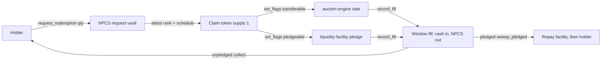

# Chapter 9 — Queue & Liquidity

NUNDINA's two illiquidity primitives answer the same question from opposite ends: what can a holder *do* with a position the fund will not redeem today? `queue-claim` turns the denied residual of a redemption request into a dated, priceable, transferable claim; `liquidity-facility` borrows against such positions and, when a borrower defaults, runs a gated liquidation ladder ending in a workout rather than a dump. Both are devnet-only work: `queue-claim` is deployed but has no live request, claim, sale, or pledge (`STATUS.md:65`), and `liquidity-facility` is **built but not deployed** (`STATUS.md:66`, `:87`). This chapter covers the mechanism, the exact instructions and account layouts in source, and the line between what is live on devnet and what is only designed. It makes no yield, TVL, or audit claim.

## 9.1 The redemption queue: `queue-claim`

The framing is in the architecture doc's §5: the binding constraint on private-credit liquidity "is **not the lock-up, it is the gate**" (`preresearch/architecture/06-Solution-Architecture-v2.md:454`). When a fund pro-rates redemptions, each denied holder holds a claim on a future payout. The core bet is that a claim on *proceeds* can be structured "without changing the holder of record," which sidesteps holder-count pressure ([the credit gate](/docs/07-credit-gate)) and is often a lower consent bar than an outright share transfer (`06-Solution-Architecture-v2.md:456`). The program is `queue-claim`, id `2EpAnJkvw6FH8j97k7WRE72E7oyarZpf7t2TYa26red4` (`programs/queue-claim/src/lib.rs:47`), on devnet since 2026-10-07 (`DEPLOYMENTS.md:20`).

### 9.1.1 Request and attestation (QC-P1)

One `Queue` exists per asset, seeded `[QUEUE_SEED, asset_mint]` (`programs/queue-claim/src/lib.rs:713`), and `init_queue` records the issuer `authority`, an `attester`, the asset and USDC mints, a monotonic `requests` counter, and the signer bump (`lib.rs:69`–`:84`). Creation is a governance act: `init_queue` takes the program's `ProgramData` and accepts only its upgrade authority (`lib.rs:721`–`:725`).

A holder calls `request_redemption(qty, window_date)`; `qty` NPCS move by `transfer_checked` into a per-request `npcs_vault` owned by the signer PDA (`lib.rs:95`–`:107`), the `Request` PDA is seeded `[REQUEST_SEED, queue, id]` where `id = queue.requests` (`lib.rs:737`), and the state is set `Requested` (`lib.rs:119`). Only the configured `attester` — the issuer / transfer-agent bridge — can `attest` (`lib.rs:766`), supplying a `rank` and an expected-fill `schedule` of at most `MAX_SCHEDULE = 8` entries (`lib.rs:57`, `:133`–`:137`). The SRS frames the attester as the issuer side attesting a real request via SAS (`preresearch/architecture/08-SRS-Pilot-Rails.md:255`); the source notes the exact gap: "an SAS `redemption_request` attestation read is not wired yet" (`08-SRS-Pilot-Rails.md:251`).

### 9.1.2 The claim position token (QC-P2)

`attest` mints the claim token: a Token-2022 mint seeded `[CLAIM_MINT_SEED, request]`, `decimals = 0`, supply `1`, with mint and freeze authority = this program's signer PDA (`lib.rs:770`–`:779`, `:145`–`:156`). The holder's `holder_claim` account is immediately frozen (`lib.rs:157`–`:165`), so the position is non-transferable until the issuer consents. `set_flags(transferable, pledgeable)` sets the two consent flags independently; either flag thaws the holder account, neither re-freezes it (`lib.rs:183`–`:226`). The `Request` state machine is `Requested → Attested → PartiallyFilled → Retired`, plus `Cancelled`, `Frozen`, and `Restructured` (`lib.rs:642`–`:650`). `set_state` allows `Attested`/`PartiallyFilled → Frozen`, un-freezes back to `Attested` only at zero fills or `PartiallyFilled` above zero, and `Frozen → Restructured` (`lib.rs:592`–`:608`). The `Request` account carries `qty`, `window_date`, `rank`, the bounded `schedule`, the vault/mint keys, the two flags, `filled_qty`, `cash_received`, and an optional `PledgeRef` (`lib.rs:681`–`:703`).

### 9.1.3 Sell, price, and pledge

**Sell path (QC-P3).** A transferable claim is an ordinary asset to `auction-engine` and `payment-rails`, with its own market class and mark feed (`lib.rs:18`–`:22`). `quote_pv(discount_bps_per_period)` computes the model value with `credit_math::pv_of_claim` over the *unfilled* part of the attested schedule, pricing each expected fill at the underlying asset's `MARK_PROTECTIVE` and discounting per period (`lib.rs:481`–`:510`, `:44`); the event is what the nav-publisher publishes into the claim's feed (`lib.rs:477`–`:480`). The SRS describes the claim clearing "at 9.50" against a NAV of `1.00` in a local `auction-engine` session (`08-SRS-Pilot-Rails.md:50`).

**Pledge path (QC-P4).** `pledge(amount)` requires `pledgeable`, no existing pledge, and state `Attested`/`PartiallyFilled` (`lib.rs:233`–`:238`); it forwards a `liquidity-facility` `PledgeAndAdvance { qty: 1, amount }` CPI over a fixed 25-account remaining list (`lib.rs:241`, `:272`). Fills are booked by `record_fill(fill_qty, price)`: cash of `ceil(fill_qty × price / 10^decimals)` is transferred from the issuer into the claim's `cash_vault` and `fill_qty` NPCS leave the vault to the issuer; a full fill sets `Retired` (`lib.rs:294`–`:356`). An unpledged holder takes proceeds with `collect` (`lib.rs:359`–`:379`); a pledged claim routes through `sweep_pledged`, which CPIs rails `SweepProceeds` with facility repayment first and clears the pledge when the advance closes (`lib.rs:385`–`:446`). `discharge` clears a pledge whose advance the rails closed by any other path (`lib.rs:450`–`:475`), and `cancel` returns NPCS and burns the claim before any fill (`lib.rs:514`–`:588`).

### 9.1.4 What is live on devnet

The **queue is initialized** on devnet at `8HFKR5FkxMYcCgYqgvvPaPErQMsR4ccXjbHFkDyYavAK`, with attester `9WH1…2uDZ` as a stand-in for the transfer agent (`DEPLOYMENTS.md:47`). The program ID is deployed (`DEPLOYMENTS.md:20`), but STATUS is explicit that there is "no live request, claim, sale or pledge" (`STATUS.md:65`). The claim's sale and pledge paths are proven only in local/LiteSVM fixtures (`STATUS.md:106`, `:120`). QC-P5 is a structural invariant, not a runtime feature: claims are "a separate mint: they never touch the NPCS holder governor" (`lib.rs:29`–`:30`), an invariant the gate's governor relies on (`08-SRS-Pilot-Rails.md:259`).

## 9.2 The liquidity facility

`liquidity-facility` is id `PTNCoDA5WTbAN5RARzUA19Yr3qJYBzwwH63RPFKS7hY` (`programs/liquidity-facility/src/lib.rs:47`). It "owns the *semantics*"; `payment-rails` moves the cash and `auction-engine` runs any forced sale, while collateral sits in a per-position vault owned by the program's signer PDA (`lib.rs:6`–`:9`). It is the keystone of AC-8's pledge path and all of AC-9 (`STATUS.md:106`–`:107`).

### 9.2.1 Pledge and advance (LF-P1, LF-P2)

`open_facility(facility_id, params)` (LF-P2) creates a rails facility fund whose curator is this program's signer PDA (rails `EngineGrant`, role `FACILITY`), funded by anyone through rails `fund_facility` (`lib.rs:73`–`:75`, `:96`–`:114`). `FacilityParams` binds the interest `rate_bps`, curator `advance_rate_bps`, `maintenance_ltv_bps`, `grace_seconds`, the step-1 `issuer`/`issuer_window`, step-2 `backstop`/`backstop_haircut_bps`/`backstop_window`, `forced_sale_max_cash`, and `lender_workout` (`lib.rs:849`–`:869`). `validate` enforces `0 < advance_rate_bps ≤ credit_math::MAX_ADVANCE_RATE_BPS` (the H1 50% hard ceiling, `programs/credit-math/src/prudential.rs:35`), `advance_rate_bps < maintenance_ltv_bps ≤ 10000`, and `backstop_haircut_bps ≤ MAX_BACKSTOP_HAIRCUT_BPS = 5_000` (`lib.rs:55`, `:872`–`:893`).

`pledge_and_advance(qty, amount)` (LF-P1) transfers `qty` collateral into the position's vault and draws USDC (`lib.rs:137`–`:211`). Two guards are load-bearing: new advances require a **Fresh** mark — `feed.allows_new_advance(now)` (`lib.rs:147`) — and `amount` must be `≤ value × advance_rate_bps`, where `value = collateral_value` prices the collateral at `MARK_PROTECTIVE`, never raw NAV (`lib.rs:148`–`:155`, `:668`–`:677`). Cash is paid via rails `AdvanceFunds`, carrying `collateral_ref_hash = position`, `collateral_value`, and `advance_rate_bps` (`lib.rs:183`–`:188`). `add_collateral(qty)` tops up an `Active` or `Breached` position (`lib.rs:214`–`:241`).

### 9.2.2 Health and the stale-mark guard (LF-P3, LF-P4)

`check_health` (LF-P3) is permissionless: it computes debt as the rails principal plus interest accrued to now (`owed_now`, `lib.rs:694`–`:702`) over collateral value at `MARK_PROTECTIVE`, and sets `Breached` (recording `breach_ts`) or cures back to `Active` (`lib.rs:246`–`:275`). LTV is rounded up against the borrower, with zero value treated as maximal (`lib.rs:680`–`:690`).

The H4 rule is the design's spine: **no liquidation step runs on a Stale or Suspended mark**. `start_liquidation`, `ladder_buy`, and `open_forced_sale` each begin with `feed.allows_liquidation(now)` (`lib.rs:283`, `:310`, `:424`–`:427`), the guard that a suspended mark propagates globally (`08-SRS-Pilot-Rails.md:64`, `:245`). The SRS records this as tested for Suspended and Stale-by-age, in `payment-rails/tests-svm/tests/facility.rs` (`08-SRS-Pilot-Rails.md:51`).

### 9.2.3 The liquidation ladder (LF-P5)

Past `grace_seconds` and still breached, `start_liquidation` enters `IssuerRofr` with an `issuer_window` deadline (`lib.rs:279`–`:300`). The ladder is defined by `PositionState` — `Active`, `Breached`, `IssuerRofr`, `Backstop`, `ForcedSale`, `Closed`, `Workout` (`lib.rs:904`–`:912`) — and each step carries its own window:

1. **Issuer ROFR** at `MARK_PROTECTIVE`: `ladder_buy` requires the buyer to equal `cfg.params.issuer` and prices at collateral value (`lib.rs:316`–`:319`).
2. **Backstop** at its contracted haircut: buyer must equal `cfg.params.backstop`, price = value × `(10000 − backstop_haircut_bps) / 10000` (`lib.rs:320`–`:331`).
3. **Forced sale**: `pass_step` advances `IssuerRofr → Backstop → ForcedSale` when the buyer declines or the window closes (`lib.rs:392`–`:412`); `open_forced_sale` opens an `auction-engine` session with `forced_sale: true`, `max_discount_bps: 0`, `min_reveals: 2`, and `disclosure_hash = position` (`lib.rs:441`–`:453`); `list_forced_sale` lists the whole collateral and funds a `FORCED_SALE_BOND = 1` micro-USDC ask bond (`lib.rs:61`, `:476`–`:524`); `reveal_forced_sale` reveals inside the window (`lib.rs:529`–`:551`). A forced-sale print is flagged and excluded from the mark, so "a liquidation cascade cannot feed itself" (`06-Solution-Architecture-v2.md:271`).
4. **Workout**: `settle_forced_sale` runs once the session is `Printed` or `Failed` and the ask escrow is refunded; unsold collateral transfers to the lender's `workout_asset` and the position becomes `Workout` (`lib.rs:558`–`:625`).

Every sale routes proceeds through `apply_proceeds`: the rails advance is repaid first, the surplus goes to the borrower, and any remaining debt is booked as a **non-recourse shortfall** (`lib.rs:786`–`:844`, `:30`). `release` returns collateral once the rails advance is closed (`lib.rs:629`–`:662`). The whole ladder was exercised locally in an `ADMIN_DRILL` (`STATUS.md:107`).

### 9.2.4 Status: built, not deployed

This is the chapter's most important boundary. `liquidity-facility` has complete code through LF-P6 with unit tests (`lib.rs:1361`–`:1401`), but it is **0 of 8 on mainnet and absent from devnet**: only 7 of 8 programs are deployed on devnet, and `liquidity-facility` is the one that is not (`STATUS.md:33`–`:34`). DEPLOYMENTS lists it under "Not deployed yet," pending a rails `ROLE_FACILITY` grant and roughly 3.5 SOL once upgrade #3 refunds its rent (`DEPLOYMENTS.md:61`–`:63`). Its local proof is real-program execution on synthetic accounts and clocks, not live-devnet evidence (`STATUS.md:73`–`:75`). AC-9 is graded Partial for exactly this reason (`STATUS.md:107`).

## 9.3 Mechanism → program → status

| Mechanism | Requirement | Program · instruction | Source | Status |
|---|---|---|---|---|
| Redemption request escrow | QC-P1 | `queue-claim` · `request_redemption` | `programs/queue-claim/src/lib.rs:88` | devnet queue init; no live request (`STATUS.md:65`) |
| Claim token, issuer consent | QC-P2 | `queue-claim` · `attest`, `set_flags` | `lib.rs:133`, `:183` | local/LiteSVM only (`STATUS.md:106`) |
| Claim PV / own market | QC-P3 | `queue-claim` · `quote_pv` | `lib.rs:481` | local only (`08-SRS-Pilot-Rails.md:50`) |
| Claim pledge / fills / sweep | QC-P4 | `queue-claim` · `pledge`, `record_fill`, `sweep_pledged` | `lib.rs:231`, `:294`, `:385` | local only (`STATUS.md:106`) |
| Advance at protective mark | LF-P1 | `liquidity-facility` · `pledge_and_advance` | `programs/liquidity-facility/src/lib.rs:137` | **not deployed** (`DEPLOYMENTS.md:63`) |
| Facility fund via rails | LF-P2 | `liquidity-facility` · `open_facility` | `lib.rs:76` | **not deployed** |
| Health / maintenance LTV | LF-P3 | `liquidity-facility` · `check_health`, `add_collateral` | `lib.rs:246`, `:214` | local ladder (`STATUS.md:107`) |
| No-liquidation-on-stale-mark | LF-P4 | `liquidity-facility` · `allows_liquidation` guards | `lib.rs:283`, `:310`, `:424` | local, tested Stale/Suspended (`08-SRS-Pilot-Rails.md:64`) |
| Liquidation ladder | LF-P5 | `liquidity-facility` · `start_liquidation` → `settle_forced_sale` | `lib.rs:279`–`:625` | local `ADMIN_DRILL` (`STATUS.md:107`) |
| Interest accrual / sweep hooks | LF-P6 | rails + `queue-claim` · `record_fill` | `lib.rs:294`; `08-SRS-Pilot-Rails.md:274` | local only |

## Open questions

> Open question: whether `queue-claim`'s attester becomes a real transfer-agent / SAS bridge. The source attests against a configured `attester` key and states that an SAS `redemption_request` read "is not wired yet" (`preresearch/architecture/08-SRS-Pilot-Rails.md:251`); the devnet attester is the `9WH1…2uDZ` stand-in (`DEPLOYMENTS.md:47`).

> Open question: the exact dates and parameters of the first live claim sale and facility deployment. The queued work is "create and sell a real queue claim on the live venue" (`STATUS.md:213`) and "deploy and initialize `liquidity-facility`" once the rails `ROLE_FACILITY` grant and upgrade #3 rent refund land (`DEPLOYMENTS.md:61`–`:63`); neither has a committed schedule.

> Open question: how a pledge moves the borrower's gate lots to the custody PDA. The SRS records that "a pledge does not move the borrower's gate lots to the custody PDA," and that the forced-sale seller must be admitted and hold seasoned lots — the local test does this through the gate authority (`08-SRS-Pilot-Rails.md:265`).
