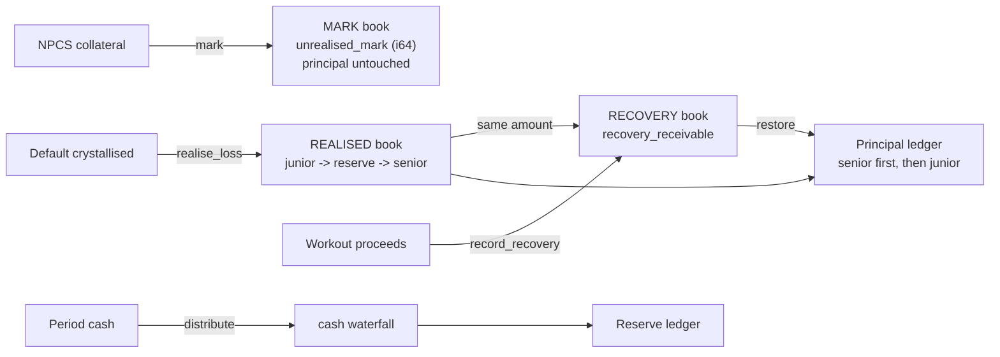

# Chapter 10 — Tranching, Treasury & Math

NUNDINA's tranching layer is `tranche-engine` (`programs/tranche-engine`), an SPV-configured senior/junior engine over NPCS collateral; the treasury layer is `npcs-treasury` (`programs/npcs-treasury`), the I1 mint-on-deposit path; and both rest on `credit-math` (`programs/credit-math`), the `no_std` fixed-point crate. This chapter describes the three-book accounting model exactly as coded, the treasury's I1 ledger, and the shared numerical core — its units, rounding direction, conservation laws, and documented NAV math. NUNDINA is a devnet-only pilot: all 8 programs are on devnet, 0 are on mainnet ([deployment & governance](/docs/12-deployment-governance-ops)), and nothing here is audited.

## 10.1 tranche-engine — senior/junior over NPCS

`tranche-engine` is named by its own manifest as "SPV-configured senior/junior tranching over NPCS collateral: three-book accounting, cash waterfall through payment-rails, loss/recovery waterfalls, subordination invariant (SRS 08 §4.6, TE-P1..P7)" (`programs/tranche-engine/Cargo.toml:7`). Its program ID is `CvcaeyuPu7SrFJ91WniJfBhUbQBkb8QQVL9fyK4wcFAS` (`programs/tranche-engine/src/lib.rs:46`); the binary is deployed to devnet, with **no pool created yet**, because a pool's coupons need a rails `ROLE_COUPON` grant (`DEPLOYMENTS.md:22`).

### 10.1.1 Pool parameters and creation

`create_pool` (TE-P1) refuses a pool without a `legal_doc_hash` and a nonzero `waterfall_version` (`programs/tranche-engine/src/lib.rs:79-80`, validated at `:678-681`). It also constrains the attachment point to `MIN_ATTACHMENT_BPS = 500` … `MAX_ATTACHMENT_BPS = 9_000` and every coupon/fee rate to `MAX_RATE_BPS = 5_000` (`:56-59`, `:682-691`). Creation is deliberately governance-gated: the `authority` must equal the program's upgrade authority (`:793-797`), which on devnet is the Squads v4 2-of-2 vault behind a 48h timelock (`DEPLOYMENTS.md:16,208`). A pool starts in `PoolState::Warehousing` (`:91`) and moves to `Active` only via `activate`, which requires funded senior principal (`:211-218`).

PDAs are seeded `["te_signer"]`, `["pool"]`, `["senior"]`, `["junior"]`, `["collateral"]`, `["cash"]` (`:48-53`); the `te_signer` PDA is mint authority, freeze authority, vault owner and the rails coupon operator (`:788-790`, `:862-864`).

### 10.1.2 The three books

The requirement `TE-P3` names three ledgers — `unrealised_mark / realised_loss / recovery_receivable` (`preresearch/architecture/08-SRS-Pilot-Rails.md:286`) — and the source implements exactly that split (`programs/tranche-engine/src/lib.rs:12-16`). The `Books` event is a full snapshot of them plus principal and reserve (`:633-643`).

| Book | State field(s) | Writer | Meaning | Evidence |
|---|---|---|---|---|
| MARK — unrealised | `unrealised_mark: i64`, `last_value` | `mark` (permissionless) | collateral at `MARK_PROTECTIVE` minus principal; **principal untouched** | `lib.rs:712-714`, `:224-239` |
| REALISED — crystallised | `realised_loss`, `senior_loss`, `junior_loss` | `realise_loss` (authority) | a default is written down junior → reserve → senior via `credit_math::apply_loss` | `lib.rs:715-718`, `:244-283` |
| RECOVERY — receivable | `recovery_receivable` | `realise_loss` adds, `record_recovery` removes | expected/collected workout proceeds; reverses losses **senior first, then junior** | `lib.rs:719-720`, `:287-309` |
| Principal ledger | `senior_principal`, `junior_principal` | `deposit`, `realise_loss`, `record_recovery`, `distribute`, `exit_junior` | outstanding tranche principal (micro-USDC) | `lib.rs:710-711` |
| Reserve ledger | `reserve_level` | `distribute`, `realise_loss` | tracks the reserve line, whose cash "sits in the rails reserve" | `lib.rs:721-722` |

A mark never moves principal: `mark` sets `unrealised_mark = value − principal` and emits the books (`:228-232`); a breach of the attachment floor in `Active`/`Amortizing` moves the pool to `Impaired` (`:233-237`). A realised loss first passes through `apply_loss`, which returns the junior/reserve/senior hits and the reserve balance after the loss (`programs/credit-math/src/waterfall.rs:134-163`); the same `amount` becomes both `realised_loss` and `recovery_receivable` (`lib.rs:261-262`). `record_recovery` can never exceed the receivable (`:289-292`) and restores senior before junior (`:293-299`).

### 10.1.3 Subordination invariant (TE-P5)

`subordination_ok(senior, total, attachment_bps)` computes `junior_nav = total − min(senior, total)` — i.e. senior is protected first — and requires `junior_nav × 10_000 ≥ total × attachment_bps`, returning false when `total == 0` (`lib.rs:613-621`). It is checked after marks (`:233`), after losses on the surviving principal stack (`:272-277`), and *before* a junior exit, where the post-exit value is `value.saturating_sub(principal_out)` and a breach rejects with `SubordinationBreach` (`:494-499`). A junior exit that would breach the floor must instead be an auction sale to a replacement holder (`:456-459`). The unit test pins the intent: at an 2 000 bps floor, `(senior 80, total 100)` passes and `(81, 100)` fails; a 25% mark-down that wipes a 20% junior also fails (`:1027-1034`).

### 10.1.4 Cash distribution (TE-P4)

`distribute` accepts one period's actual `cash` from the caller, requires the exact `period`, and accrues lines per second since `last_distribution` using `credit_math::accrue_interest` — fees on the total principal, senior coupon on senior principal, junior coupon on junior principal; senior amortization is the whole `senior_principal` only in `Amortizing` (`lib.rs:316-347`). It runs `credit_math::distribute_cash` itself, then CPIs `payment-rails` `distribute_coupon` with the `te_signer` PDA (`:349-434`), and finally books only the reserve and the amortization: `reserve_level += paid_reserve` and `senior_principal -= paid_senior_amort` (`:435-439`). The waterfall order is fees → senior coupon → reserve top-up → senior amortization → junior coupon → junior residual, each line `min(due, remaining)` (`programs/credit-math/src/waterfall.rs:71-115`). The rails side mirrors `WaterfallParams` as `CouponParams` and re-checks conservation before moving value (`payment-rails/programs/payment-rails/src/state.rs:588-662`).

### 10.1.5 States (TE-P6) and override (TE-P7)

`PoolState` has six variants: `Warehousing, Active, Standstill, Amortizing, Impaired, WoundDown` (`lib.rs:648-655`). Governed transitions are `Active↔Standstill`, `Active/Standstill→Amortizing`, and `Amortizing|Impaired→WoundDown` (`:561-573`); `mark` and `realise_loss` can escalate to `Impaired` directly (`:233-237`, `:280`). `human_override` is authority-only, any state, requires a nonzero `authority_doc_hash`, and events the hash (`:581-596`).

## 10.2 npcs-treasury — the I1 backing

`npcs-treasury` (`4BszRuAP4Gp7vdyu9MjE28gV8YTNtJZSRJRMQHdMut1y`, `programs/npcs-treasury/src/lib.rs:31`) implements invariant **I1**: NPCS supply equals the USDC held by the treasury, 1:1 at deposit, per doc 09 §3 (`:1-6`). The treasury's signer PDA must be the asset mint's mint authority, checked at `initialize`, "so `deposit` is the only way NPCS is ever minted" (`:8-10`, `:51-54`). `deposit` transfers USDC into the vault and mints `amount × scale` NPCS (`:76-111`); `redeem` burns issuer-held NPCS and pays back `amount / scale` USDC (`:130-166`); both call `check_i1` before and after (`:81`, `:114`, `:138`, `:169`). `scale = 10^(asset_decimals − usdc_decimals)` (`:208-210`), and `check_i1` requires `asset.supply == vault.amount × scale` exactly (`:213-223`). A mint outside this program (or a drained vault) makes every further mint/burn fail `Unreconciled` until governance repairs it; `reconcile` is permissionless and reports `backed` (`:17-20`, `:183-194`). Its books are minimal: `total_deposited`, `total_redeemed`, `paused` (`:225-237`), and `set_paused` stops deposits while redemptions stay open (`:196-204`).

**Honesty boundary.** On devnet the treasury PDA state and mint-authority hand-over are **not active**: the NPCS mint authority is the Squads vault `8wj1EfUy…LCV`, so I1 still holds by a recorded hand deposit, not by code (`DEPLOYMENTS.md:80-98`; `token/params.toml:37-47`). Supply is 1.000000 NPCS against 1 USDC in sleeve `B78W…NKAz` (`DEPLOYMENTS.md:120`), NAV #1 = 1.000000 (`DEPLOYMENTS.md:49-52`). The hand-over is a single Squads transaction, tested on a local validator but not yet proposed on devnet (`DEPLOYMENTS.md:80-98`). See [the NPCS asset](/docs/11-npcs-asset) for the mint manifest.

## 10.3 credit-math — the shared numerical core

`credit-math` is a pure library: "u128 only, floors against the initiator, zero dependencies (doc 09 §6; SRS D8)" (`programs/credit-math/Cargo.toml:7`). It is `#![no_std]` with `alloc` and `#![forbid(unsafe_code)]`, and declares four rules: u128 intermediates everywhere with no float, "round against the initiator" at every division, zero dependencies, and "exact conservation" — allocation sums equal the amount allocated and waterfall lines sum exactly to cash received, with residue re-attached by rule (`programs/credit-math/src/lib.rs:1-14`, `:30-34`). Amounts are integers in their smallest unit; NPCS base units and USDC micros are 1e6-scaled, and NAV is carried at **pico** precision (`:25-28`), `PICO = 10¹²` sub-units per whole NPCS (`src/nav.rs:18`).

### 10.3.1 Rounding direction

Every division site calls `div_round` with its direction written at the call site, so the policy is greppable (`src/lib.rs:54-88`). `RoundDirection` is `Floor`, `Ceil`, `AgainstInitiator` (an explicit alias of `Floor`); `Floor`/`AgainstInitiator` truncate and `Ceil` uses `checked_ceil_div` (`src/error.rs:20-28`). `mul_div(a,b,c)` computes `a*b/c` without overflowing the multiply by splitting `q = a/c`, `r = a%c` (`src/lib.rs:107-119`), and `ceil_div` is the ceiling form (`:90-105`). Floors apply to NAV gross and fee (`src/nav.rs:40`, `:61`), to PV valuation (`src/pv.rs:46`, `:52`), and to pro-rata shares, whose sub-unit residue is then handed out one unit at a time, larger commit first, lower id first (`src/allocation.rs:109-150`, `:175-193`). One deliberate exception is documented: `accrue_interest` floors at every call even though the borrower initiates repayment, and the sub-micro remainder stays with the borrower; this is a bounded waiver of rule 2 and changing it is a rails upgrade (`src/accrual.rs:6-11`, `:31`).

### 10.3.2 NAV math (I2) and the pico decision

The precision decision is recorded in the module: at $3K / 10 bps the weekly fee on NAV 1.0 is 19 178 082 pico (≈19.18 µUSDC per NPCS), which a 6dp NAV would truncate by up to ~5% at each publish, so pico precision makes the fee exact (`src/nav.rs:3-11`; `token/TOKENOMICS.md:50-57`). The formulas are:

- `nav_gross_pico = floor(treasury_micros × 10¹² / supply_base)` (`src/nav.rs:30-41`);
- `fee_pico = floor(nav_gross × fee_bps × Δt ÷ (10⁴ × 31_536_000))`, using `SECONDS_PER_YEAR = 31_536_000` (`:21`, `:49-62`);
- `nav_published = nav_gross − fee`, never inflating because the publisher floors against itself (`:64-69`).

`haircut_bps(nav, h, ceiling_bps) = mul_div(nav, 10⁴ − h, 10⁴)`, rejecting `h > ceiling` or `ceiling > 100%` (`:71-87`). The worked pilot vector: $3,001.234567 sleeve over 3,000 NPCS → `1_000_411_522_333` pico, fee(7d, 10 bps) = `19_178_082` pico (`:107-132`; `token/TOKENOMICS.md:66-72`).

### 10.3.3 Conservation laws

The waterfall module states both laws (`src/waterfall.rs:1-11`). For cash, every paid line plus `junior_residual` equals cash received, exactly — the residual "absorbs whatever remains" and `total_distributed()` re-sums the lines as a check (`:55-65`, `:101-102`). For losses, `apply_loss` handles junior → reserve → senior and returns `InvalidInput` for a loss exceeding the whole stack rather than wrapping (`:130-146`). The public property tests pin these as audit claims: cash conservation for every cash/due combination (`tests/props.rs:135-161`), loss conservation with typed over-stack rejection (`:167-185`), pro-rata exact sums with nobody over their commit (`:41-75`), NAV's floor definition `gross × supply ≤ treasury × 10¹² < (gross+1) × supply` (`:112-129`), clearing volume-maximality and determinism (`:238-263`), and `div_round` direction (`:270-280`).

### 10.3.4 The rest of the crate

`find_uniform_clear_price` (AE-P5) picks the price ≥ reserve maximizing volume, tie-broken by minimal imbalance → nearest reference mark → lowest price, returning `None` rather than clearing below reserve (`src/allocation.rs:30-107`). `pv_of_claim` discounts a fill schedule per period, flooring each step (`src/pv.rs:1-57`). The prudential module holds hard ceilings: `BPS_DENOMINATOR = 10_000` and `MAX_ADVANCE_RATE_BPS = 5_000` (50%), enforced by `payment-rails` (`src/prudential.rs:30-44`).

## Open questions

> Open question: `credit-math`'s own module doc is dated 2026-09 (#48) and says "the only program consumer is `payment-rails`" and that the tranche-engine is "not built" (`programs/credit-math/src/lib.rs:16-23`). In the repo today `tranche-engine` imports `accrue_interest`, `apply_loss`, `distribute_cash`, `mul_div` and `WaterfallParams` (`programs/tranche-engine/src/lib.rs:43`) and is deployed (`DEPLOYMENTS.md:22`). Which comment is authoritative should be reconciled.

> Open question: `prudential.rs` says the H2 subordination floor is "not enforced: no tranche program exists" (`programs/credit-math/src/prudential.rs:11`), while `tranche-engine` now enforces an interim floor `MIN_ATTACHMENT_BPS = 500` (`programs/tranche-engine/src/lib.rs:54-56`). No plan-of-record H2 value is fixed; whether 500 bps is H2 or an interim placeholder (#123) is unresolved.

> Open question: `programs/tranche-engine/Cargo.toml:7` and `preresearch/architecture/08-SRS-Pilot-Rails.md:280` describe the program as built but "not deployed", yet `DEPLOYMENTS.md:22` records a devnet deployment on 2026-10-08. The deployment row is taken as current here; the stale text should be reconciled.

> Open question: the theme of "treasury books (cash, safe, untranched)" has no source analogue. The only treasury accounting found is `total_deposited / total_redeemed / paused` (`programs/npcs-treasury/src/lib.rs:225-237`); no `safe` or `untranched` identifier exists in the repo. Do not attribute such a split to NUNDINA without a code reference.
