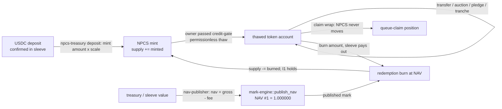

# Chapter 11 — The NPCS Pilot Asset

NPCS — the *NUNDINA Pilot Credit Sleeve* — is the one real asset every NUNDINA program is built to run on, a Token-2022 (Token Extensions) mint live on devnet, born frozen, gated through `credit-gate`, and owned by a Squads 2-of-2 vault (`token/README.md:3-16`). It is not a protocol token: there is no distribution, vesting, emissions, staking or governance, and its whole "tokenomics" is three invariants plus a movement topology (`token/TOKENOMICS.md:3-7`). This chapter is the asset's reference: its anatomy and decimal rules, the invariants that constrain every movement, the paths a unit may take on Solana, how NAV is published, and the subscription → NAV → redemption lifecycle across the programs. All facts are devnet facts; NPCS is not audited, makes no APY/TVL/yield claim, and backing is a process rule today, not code (`token/params.toml:44`, `token/TOKENOMICS.md:13`).

## 11.1 Token anatomy

### 11.1.1 Identity and manifest

NPCS is a single Token-2022 mint account carrying an exact set of extensions; it is **not** a program — all behavior around it (thaw, lot ledger, governor) lives in `credit-gate`, and all math lives in `credit-math` (`preresearch/architecture/09-NPCS-Asset-Spec.md:262`). The live devnet mint supersedes an earlier one whose only key was lost.

| Property | Value | Evidence |
|---|---|---|
| Name | `NUNDINA Pilot Credit Sleeve` | `token/params.toml:5`, `token/metadata.json:2` |
| Symbol | `NPCS` | `token/params.toml:6` |
| Decimals | `6` | `token/params.toml:7`; asserted at `token/scripts/verify.ts:75` |
| Mint (devnet) | `6vt1wHVQVuhnfJ3FtNbq4647mCjWUBmJCDABsYUgVKL4` | `token/deployment-devnet.json:3`, `token/README.md:11`, `DEPLOYMENTS.md:120` |
| Supply (devnet) | `1.000000` = 1,000,000 base units | `DEPLOYMENTS.md:120`; `ops/engines/nav/nav-6vt1wHVQVuhnfJ3FtNbq4647mCjWUBmJCDABsYUgVKL4-1791399487.json:6` |
| Standard | Token-2022 (Token Extensions) | `token/README.md:12` |
| On-chain label | `PILOT-DEMO-ASSET — NOT AN OFFER — SYNTHETIC LABEL` | `token/params.toml:9`, `token/README.md:15` |
| Superseded mint | `Dy1VW2uC8G3PxDkfmJya1tRrzSTWQ18GkbN3qh3mdx2i` (supply 0, key lost) | `token/README.md:11`, `DEPLOYMENTS.md:121` |

The mint carries `DefaultAccountState = Frozen`, `PermanentDelegate`, `MetadataPointer` (self) and `TokenMetadata` (TLV inside the mint), and deliberately omits `TransferHook`, `TransferFee`, `InterestBearing`, `ConfidentialTransfer` and `NonTransferable` (`token/ARCHITECTURE.md:17-35`; asserted by `token/scripts/verify.ts:88-150`). The on-chain `status` label states the as-built posture exactly: “TARGET-STATE: USDC 1:1 backing is a process rule, not enforced on-chain. IN FORCE: thaw/freeze through Token ACL to credit-gate; mint, permanent-delegate and metadata authority = Squads 2-of-2 vault” (`token/runbook.md:59-63`).

### 11.1.2 Decimal invariants

The decimals are load-bearing because both the mint path and the NAV path scale by them.

- **1 whole NPCS = 10⁶ base units** (`preresearch/architecture/09-NPCS-Asset-Spec.md:73`).
- `npcs-treasury` derives `scale = 10^(asset_decimals − usdc_decimals)` and requires `asset_mint.decimals >= usdc_mint.decimals`, else `BadDecimals` (`programs/npcs-treasury/src/lib.rs:55-58`, `:207-210`). `deposit(amount)` mints `amount × scale` (`programs/npcs-treasury/src/lib.rs:82-84`); `redeem(amount)` rejects any `amount % scale != 0` (`programs/npcs-treasury/src/lib.rs:134-137`). At 6dp on both sides, `scale = 1`, so 1 USDC deposits to exactly `1.000000` NPCS.
- NAV is carried at **pico precision** — 10¹² sub-units per whole NPCS, not 6dp — because the weekly 10bps fee is ≈ 19.18 µUSDC per NPCS and a 6dp mark truncates ~5% of it each publish (`token/params.toml:32`, `preresearch/architecture/09-NPCS-Asset-Spec.md:93`).

## 11.2 The invariants that constrain movement

The asset's economics is three invariants; each constrains what may happen to a unit (`token/TOKENOMICS.md:24-48`).

**I1 — backing / supply.** `supply_base == confirmed_deposits_usdc × 10⁶` at all times (`token/params.toml:47`, `preresearch/architecture/09-NPCS-Asset-Spec.md:78`). The live mint authority is the Squads vault `8wj1EfUyfNvBaMhxBd2iuyC7RLQh9oW2AAQdNRzdXLCV` (2-of-2, 48h timelock), so no single key can inflate supply (`token/README.md:16`, `token/runbook.md:8-13`, `DEPLOYMENTS.md:211`). On devnet I1 is enforced **by process, not by a program**: supply `1.000000` matches 1 USDC deposited by hand into the vault sleeve `B78WTdsY4MYhAvT757xtdb6KZ61pkBTPzKCtohK3NKAz`, and “nothing on-chain enforces I1” (`token/README.md:5`, `token/TOKENOMICS.md:13`). The program that *does* enforce it, `npcs-treasury`, is deployed on devnet but its mint-authority hand-over has not been proposed, so its `deposit`/`redeem` path is not yet the live mint path (`DEPLOYMENTS.md:21`, `:80-98`). When handed over, `initialize` requires the treasury's signer PDA to be the mint authority (`programs/npcs-treasury/src/lib.rs:48-54`), and every `deposit`/`redeem` checks `supply == vault × scale` before and after, failing closed with `Unreconciled` otherwise (`programs/npcs-treasury/src/lib.rs:81`, `:114`, `:213-223`, `:394`).

**I2 — NAV floor.** `nav_gross_pico = floor(treasury_micros × 10¹² ÷ supply_base)`, `fee_pico = floor(nav_gross × fee_bps × Δt ÷ (10⁴ × 31,536,000))`, `nav_published = nav_gross − fee`, so the published mark never inflates and rounding always goes against the publisher (`token/TOKENOMICS.md:60-63`). This is implemented and tested in `credit-math`, but no program calls it yet — there is no mark engine on-chain consumer (`token/TOKENOMICS.md:14`, `:96`).

**I3 — eligibility.** No NPCS unit may sit in a token account whose owner has not passed `credit-gate`. This *is* enforced on the devnet mint: the freeze authority is the Token ACL `MintConfig` PDA `3AccB1giyy9Jc9GZXJKKEqLyNHdY1SPcw1jreX9NRDS`, which routes permissionless thaw/freeze to `credit-gate`, so a holder thaws only after SAS attestations plus `validate` (`token/TOKENOMICS.md:16`, `DEPLOYMENTS.md:120`, `token/scripts/verify.ts:152-182`). The gate enforces `holder_cap` (8 distinct `investor_id`s) and 7-day lot seasoning (`token/params.toml:26-27`). One gap remains: the `MintConfig` authority `7UdtTMgH4v8YSG8mWX2r8uASgJwAkxyo4h8yb5UEEbuh` can still freeze/thaw by hand until it moves to the vault (`token/README.md:16`, `DEPLOYMENTS.md:211`).

## 11.3 Movement topology — who may move what

Because the base layer is frozen-by-default, *all* custody movement is mediated: no wallet can move units except through an ACL-thawed account, and thaw is gate-gated (`preresearch/architecture/09-NPCS-Asset-Spec.md:110`). Eight paths exist; anything else is impossible at the base layer (`token/ARCHITECTURE.md:90-118`, `preresearch/architecture/09-NPCS-Asset-Spec.md:160-173`).

| Path | Movement | Authority / gate | Evidence |
|---|---|---|---|
| 1 · Primary mint | USDC deposit → mint NPCS 1:1 | Squads vault proposes; `npcs-treasury` signer PDA once handed over | `token/ARCHITECTURE.md:99`, `programs/npcs-treasury/src/lib.rs:76-126` |
| 2 · P2P transfer | `transfer_checked` between thawed accounts, zero extra CU post-thaw | none at transfer time (sRFC37) | `token/ARCHITECTURE.md:100`, `:38-41` |
| 3 · Auction escrow | seller → per-escrow asset vault; settle DvP to a gate-checked buyer; permissionless refund | per-fill `credit-gate::settle_check` | `token/ARCHITECTURE.md:101`, `preresearch/architecture/09-NPCS-Asset-Spec.md:166` |
| 4 · Facility pledge | holder → collateral PDA under `MARK_PROTECTIVE` | gate lot append | `token/ARCHITECTURE.md:102` |
| 5 · Claim wrap | **NPCS never moves** — a `queue-claim` is minted against an attested redemption request | issuer consent flag | `token/ARCHITECTURE.md:103` |
| 6 · Tranche deposit | holder → pool collateral PDA | subordination invariant pre-check | `token/ARCHITECTURE.md:104` |
| 7 · Seizure | `permanent_delegate` break-glass transfer, evented with reason hash | Squads 2-of-2 | `token/ARCHITECTURE.md:105`, `preresearch/architecture/09-NPCS-Asset-Spec.md:170` |
| 8 · Redemption burn | `burn` at published NAV; sleeve pays out; I1 holds | issuer / treasury authority | `token/ARCHITECTURE.md:106` |

**The blocked set** is deliberate: a unit cannot move to a frozen account (the token program refuses), cannot be bought at an AMM (none exists for the raw asset), cannot leave the allowlisted universe (thaw is gate-bounded), and cannot enter a foreign DeFi route because that route's token accounts arrive frozen (`token/ARCHITECTURE.md:117`, `preresearch/architecture/09-NPCS-Asset-Spec.md:173`). The frozen-by-default choice means compliance runs **once at account activation**, so post-thaw transfers cost zero extra compute — the entire reason Token ACL was chosen over a transfer hook (`token/ARCHITECTURE.md:38-41`).

## 11.4 NAV publication

NAV #1 is `1.000000` USDC per NPCS, computed from a sleeve holding 1 USDC against supply `1.000000` (`DEPLOYMENTS.md:49-52`). **No program computes NAV on-chain**; the mark is published off-chain. The `services` `nav-publisher` reads the treasury (or sleeve), the supply, the feed and the Clock in a single `getMultipleAccounts` call (one slot), computes NAV with `credit-math`'s exact bigint arithmetic (floors against the publisher), hashes the canonical inputs into `inputs_hash`, and sends `mark-engine::publish_nav` signed by a publisher-set key (then writes the inputs document as evidence), weekly from cron (`services/README.md:13`). Publication #1 is recorded with `nav_gross_pico = 1_000_000_000_000`, `fee_pico = 0` and `nav_published_pico = 1_000_000_000_000`, `inputs_hash 464e3f16…d44f4118` (`ops/engines/nav/nav-6vt1wHVQVuhnfJ3FtNbq4647mCjWUBmJCDABsYUgVKL4-1791399487.json:17-20`), tx `4Jf5dTHT…UGzUXJ` (`DEPLOYMENTS.md:49-52`). Because the devnet `mark-engine` feed is not yet wired to this publish, the devnet mark is computed and signed by `services` without an on-chain feed to verify against (`services/README.md:13`). A local run with a real fee published `0.999999877854` (130 USDC / 130 NPCS less 3,852 s of the 10bps/yr fee), showing the pico path exercised (`services/README.md:13`).

## 11.5 Pilot asset lifecycle

The lifecycle spans the asset, the gate, and the off-chain services. Subscription (deposit) and redemption are the two I1 movements; the weekly NAV is the read between them.

Today the two I1 endpoints are not automated end to end: there is no deposit instruction wired to the live mint (the mint authority is still the Squads vault, not the `npcs-treasury` signer PDA) and no burn-on-redemption script, so I1 holds by a recorded manual deposit and process (`token/TOKENOMICS.md:13`, `DEPLOYMENTS.md:80-98`). What *is* live on devnet is the eligibility leg: the mint is gated through Token ACL → `credit-gate`, and the NAV #1 mark is published (`DEPLOYMENTS.md:120`, `:49-54`). Deployment and the Squads authority map are covered in [deployment, governance & ops](/docs/12-deployment-governance-ops); the gating mechanics in [the credit gate](/docs/07-credit-gate).

## Open questions

> Open question: the recorded final mint-account size disagrees between the asset docs and the deployment record — `token/README.md:17` and `token/ARCHITECTURE.md:17` say 275 B pods → 581 B with metadata, while `token/deployment-devnet.json:13` records `final_space: 793`. The later on-chain `status` label (#121) may explain the growth, but no file states which figure is current.

> Open question: `npcs-treasury` is deployed (`DEPLOYMENTS.md:21`) yet the mint-authority hand-over is scripted and tested but not proposed (`DEPLOYMENTS.md:80-98`), so the on-chain I1 mint path is still inactive; until it executes, supply immutability rests on the Squads vault alone and deposits remain manual.
