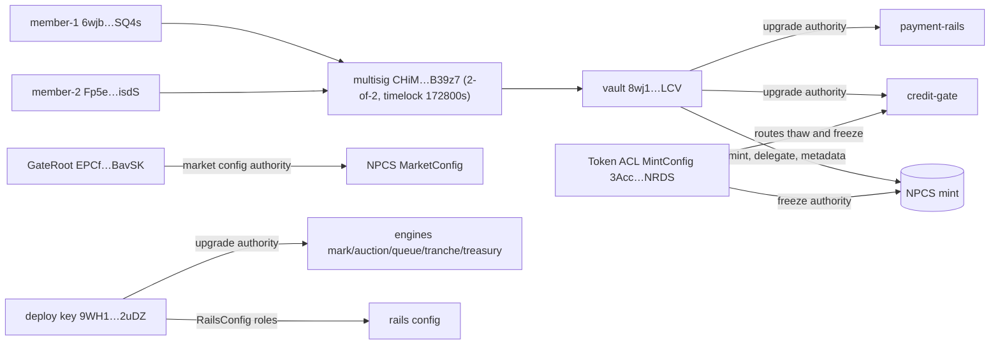

# Chapter 12 — Deployment, Governance & Ops

NUNDINA is a devnet-only pilot. All eight of its Anchor programs are deployed on devnet (`liquidity-facility` since 2026-10-11), and none is on mainnet (`DEPLOYMENTS.md`). It is not audited, and nothing here is a return or yield claim. This chapter reconstructs the deployment topology — which program sits at which address, under whose authority, and how a reviewer can prove it — the Squads v4 governance that now holds the sensitive authorities, the registry and keyless-verification discipline, and the operational runbooks that publish NAV, drive the crank, run gate checks, and keep the NPCS backing reconciled. Program mechanics themselves are in the [program map](/docs/05-program-map-and-accounts); the runtime services are in [off-chain services](/docs/13-off-chain-services).

## 12.1 Deployment topology

### 12.1.1 The program registry

The official registry is `DEPLOYMENTS.md`; it states one rule for the whole repo: it lists the *current* official deployment of every program, while `payment-rails` keeps its full per-deploy history in `payment-rails/DEPLOYMENTS.md`, and when the two disagree the payment-rails file wins and the root row must be updated (`DEPLOYMENTS.md:7-12`).

| Program | Program ID | Upgrade authority | State (devnet) |
|---|---|---|---|
| `payment-rails` | `GdWmRivxe1k76apQB7EgJ4yBq8Fi3Lw25E8V3XosPocn` | Squads vault `8wj1EfUyfNvBaMhxBd2iuyC7RLQh9oW2AAQdNRzdXLCV` | live v0.1.0; upgrades #2 executed, #3 approved (`DEPLOYMENTS.md:16`) |
| `credit-gate` | `5ycYLKQjrbwxQ6VQLUSkQZXwLMn1zEeJ6f5ogFYzX6XX` | Squads vault `8wj1EfUy…LCV` | live v0.2.0, root seeded (`DEPLOYMENTS.md:17`) |
| `mark-engine` | `79ypVjMMCDbmxYWaXTTgxz9jidjncoJAhHQC6e13x4LH` | deploy key `9WH1WZWBSEQRpixmREZ8RFkzT9xkG9X8NvRpU3Jo2uDZ` (hand-over pending) | live; NPCS feed, NAV #1 (`DEPLOYMENTS.md:18`) |
| `auction-engine` | `Cw6wNpVJUaofUDZewG8sDKZu3nnHga4GaJJvKn7rSod7` | `9WH1…2uDZ` | live; venue created, no session (`DEPLOYMENTS.md:19`) |
| `queue-claim` | `2EpAnJkvw6FH8j97k7WRE72E7oyarZpf7t2TYa26red4` | `9WH1…2uDZ` | live; NPCS queue initialized (`DEPLOYMENTS.md:20`) |
| `npcs-treasury` | `4BszRuAP4Gp7vdyu9MjE28gV8YTNtJZSRJRMQHdMut1y` | `9WH1…2uDZ` | binary live; no treasury state (`DEPLOYMENTS.md:21`) |
| `tranche-engine` | `CvcaeyuPu7SrFJ91WniJfBhUbQBkb8QQVL9fyK4wcFAS` | `9WH1…2uDZ` | binary live; no pool (`DEPLOYMENTS.md:22`) |
| `liquidity-facility` | `PTNCoDA5WTbAN5RARzUA19Yr3qJYBzwwH63RPFKS7hY` | `9WH1…2uDZ` | deployed 2026-10-11, slot 509828983; no facility opened (`DEPLOYMENTS.md`) |

The program IDs are fixed in the Anchor workspace for `localnet`, `devnet` and `mainnet` alike (`Anchor.toml:14-39`); listing an ID there is not evidence of deployment, so every status above is taken from the registry. The six non-rails programs are the eight-program inventory minus `credit-math`, which Anchor treats as a pure dependency crate rather than a program (`Anchor.toml:8-12`; `README.md:50`).

Two older deployments are dead records. The P0 credit-gate skeleton at `7yREa5V3ttjmwQ5dDv1DhThBzywgE5knJJuEAxppQa9c` can never be upgraded — no one holds its `Bprm…` authority — so the current source was deployed at a new program id instead (`DEPLOYMENTS.md:24-31`). The earlier NPCS mint `Dy1VW2uC8G3PxDkfmJya1tRrzSTWQ18GkbN3qh3mdx2i` is likewise dead: every authority is the lost key `2xhjfAdr…6sRXMh` (`DEPLOYMENTS.md:121`).

### 12.1.2 Engine state accounts

The engine binaries were built from `main` at `74effa7` with `anchor build` (anchor-cli 1.1.2), and the on-chain bytes were checked against that local build with `solana program dump` before the singleton accounts were created (`DEPLOYMENTS.md:33-39`). Wiring is done by `payment-rails/crank/scripts/devnet/engines.ts`, signed by the rails authority `9WH1…2uDZ`, with `--status` to read state back (`DEPLOYMENTS.md:38-39`). The live accounts are the NPCS feed `7b39TtCi6jLRFbNGSUU7tydefjWqc3w2jf5btdcQjT2k`; its only publisher `6DZGcFWxr6VHQrXscQsG55gwNbFv3sCttHkcLPVBpUbT`; the auction venue `B6bnWtdFecb3ByMSi5uuKDhXojgbL3xdfEAspH3vmQ3j`; the auction print PDA `AyfBCCp2wDC4pjen8kdZfD7gtB5r4tigW8QHzMRNEMwr` set as the feed's print source; and the NPCS queue `8HFKR5FkxMYcCgYqgvvPaPErQMsR4ccXjbHFkDyYavAK` whose attester is `9WH1…2uDZ`, a devnet stand-in for the transfer agent (`DEPLOYMENTS.md:41-47`).

The feed is configured for the SRS weekly cadence with `warn_after` 8 days, `stale_after` 15 days, warned haircut 200 bps, stale haircut 1,000 bps, public prints, `band_bps` 100, `min_print_volume` 1,000,000, `min_print_investors` 2, `outlier_band_bps` 2,000, and `drills_enabled: false` (`payment-rails/crank/scripts/devnet/engines.ts:57-68`).

## 12.2 Governance

### 12.2.1 Squads v4 2-of-2

The governance target is SRS 08 §8: every administrative authority — program upgrades and the NPCS mint, freeze, permanent-delegate and metadata authorities — sits behind a Squads 2-of-2 with a 48-hour timelock (`ops/squads/README.md:1-7`). On devnet this is multisig `CHiMWD3q1eHZ8sfUCPzQPp9UWDQ7x2K75notiq1B39z7` with vault `8wj1EfUyfNvBaMhxBd2iuyC7RLQh9oW2AAQdNRzdXLCV`, created under the Squads v4 program `SQDS4ep65T869zMMBKyuUq6aD6EgTu8psMjkvj52pCf` (`ops/squads/deployment-devnet.json:3-5`). The recorded config is exact: `threshold: 2`, two members `6wjbrnq2CCXdo2JaxupTYk2YnZNVHUYX2grg7EL4SQ4s` and `Fp5eduZv9Zw2phTHVkoGxfUhsb6KLxczsVG2srNfisdS`, `timeLockSeconds: 172800` (48 h), and `configAuthority: null` so members and threshold change only by a 2-of-2 vote (`ops/squads/deployment-devnet.json:7-12`; `ops/squads/migrate.ts:209-222`).

The migration record is not a narrative: `npx tsx migrate.ts verify` re-reads the multisig and every recorded move from chain keylessly, failing if the threshold is not 2-of-2, if the members differ, if the timelock differs, or if any authority that should be the vault is not (`ops/squads/migrate.ts:482-506`). The member keypairs were generated on one machine outside the repo (`~/.config/nundina/squads-devnet/`, mode 600); that demonstrates the mechanism — two approvals required, old keys powerless — but is not two-person custody, and mainnet is to use two people's hardware wallets (`DEPLOYMENTS.md:216-222`; `ops/squads/README.md:43-48`).

### 12.2.2 Authority map

| Authority | Holder | Cite |
|---|---|---|
| `payment-rails` upgrade | Squads vault `8wj1EfUy…LCV` | `payment-rails/DEPLOYMENTS.md:13` |
| `credit-gate` upgrade | Squads vault `8wj1EfUy…LCV` | `DEPLOYMENTS.md:17,212` |
| NPCS mint, permanent delegate, metadata pointer + update | Squads vault `8wj1EfUy…LCV` | `DEPLOYMENTS.md:120` |
| NPCS freeze | Token ACL `MintConfig` `3AccB1giyy9Jcc9GZXJKKEqLyNHdY1SPcw1jreX9NRDS`, routing to credit-gate | `token/runbook.md:8-13` |
| Token ACL `MintConfig` (`7Udt…`) manual freeze/thaw | bootstrap key `7UdtTMgH4v8YSG8mWX2r8uASgJwAkxyo4h8yb5UEEbuh` (**still single key**) | `token/runbook.md:14-21` |
| `credit-gate` `GateRoot` | `EPCf8gbRaQNqyetsnDxrctgaJjwSzSbxDUSyNBxBavSK` (governance key) | `DEPLOYMENTS.md:145,176-182` |
| `MarketConfig.gate_config_authority` (per mint) | governance key `EPCf…BavSK` on devnet; moves only by its own two-step hand-over | `DEPLOYMENTS.md:189-199` |
| Engine upgrade authorities (`mark-engine`, `auction-engine`, `queue-claim`, `tranche-engine`, `npcs-treasury`) | deploy key `9WH1…2uDZ` (Squads hand-over pending) | `DEPLOYMENTS.md:18-22` |
| `RailsConfig` roles `authority`, `operator`, `registrar` | `9WH1…2uDZ` (program-level roles, not the upgrade authority) | `DEPLOYMENTS.md:221-222` |
| Rails fee receiver / reserve token accounts | `BCppgtLV86NShmezwdUsEAMxCy6BDfpbqpQfpDbqfcsc` / `2sZdQ5F3UHbehXYxkv67t5JGRxVb3hGvU6gDryiuWNz6`, owned by `9WH1…2uDZ` | `payment-rails/README.md:265` |
| SAS credential authority | `ErrdHFMVEDdY8idFNKrr4TBsfBgsedxFt89otFm2xCc7` | `ops/gate/deployment-devnet.json:6` |
| SAS attester | `2L8VPRJme9bEtqoBRTG3kR9JkfbT3GF1DBf48vp2ksQC` | `ops/gate/deployment-devnet.json:7-9` |

### 12.2.3 The upgrade lifecycle

Moving an authority is one loader-v3 `SetAuthority` (instruction tag `4`), whose new authority need not sign, so the PDA vault can receive it (`ops/squads/migrate.ts:145-157`). A `move-mint` sets the mint, permanent-delegate, metadata-pointer and metadata-update authorities in one transaction and refuses a partial-custody state, leaving the freeze authority with Token ACL if it already is (`ops/squads/migrate.ts:254-297`). An upgrade is then: `solana program write-buffer`, `solana program set-buffer-authority <buffer> --new-buffer-authority <vault>`, a Squads vault transaction carrying the loader's `Upgrade` instruction, both member approvals, and execution once the timelock opens (`payment-rails/README.md:318-328`). `propose-upgrade` records the buffer's SHA-256 and extends `ProgramData` first if the build is larger, because a Squads CPI can grow an account by only 10 KiB (`ops/squads/README.md:15`; `ops/squads/migrate.ts:394-421`).

The executed and pending governance actions, with signatures, are tabulated in `DEPLOYMENTS.md` (`DEPLOYMENTS.md:206-214`): row 0 created the multisig (2026-10-03); row 1 moved the payment-rails upgrade authority to the vault; row 2 proved the vault answers to 2-of-2; row 3 moved the NPCS mint authorities to the vault and left the freeze authority at Token ACL (2026-10-04); row 4 moved the credit-gate upgrade authority to the vault; row 5 executed the payment-rails upgrade to the build that CPIs the new gate (2026-10-07); row 6 is the payment-rails upgrade to main (`GrantEngine`/`SetEngineRoles` #181, `MAX_FEE_BPS = 0` #185), approved 2026-10-07 20:43 UTC and executable from 2026-10-09 20:43 UTC (`DEPLOYMENTS.md:214`). A `move-mint` deliberately leaves a Token ACL freeze authority in place rather than returning it to a wallet (`ops/squads/migrate.ts:167-169,284`).

### 12.2.4 What is not yet under governance

The deployment is honest about its residual single-key surface. The engine programs stay on the deploy key `9WH1…2uDZ` until after the demo (`README.md:70`; `DEPLOYMENTS.md:103-114`). The NPCS Token ACL `MintConfig` authority is still the bootstrap admin `7UdtTMgH4v8YSG8mWX2r8uASgJwAkxyo4h8yb5UEEbuh`, needed to thaw payment-rails' session vault accounts for the #172 DvP, and it moves to the vault right after that fill (`token/runbook.md:14-21`). The credit-gate gate root and each `MarketConfig` move only by their own hand-overs — `propose_root_authority` + `accept_root_authority` for the root, `propose_gate_authority` + `accept_gate_authority` per config — so moving the program upgrade authority to Squads does not move them (`DEPLOYMENTS.md:176-199`). And because whoever can replace the binary can remove any on-chain check, the only control until a program is finalized is the upgrade authority itself (`DEPLOYMENTS.md:183-188`). `payment-rails/README.md:252-271` lists every privileged key by public key and records that, as of the file's status line, none has a recorded offline backup (`#57`); `token/runbook.md:23-27` and `payment-rails/README.md:282-291` state the backup policy as a plan, not a record.

## 12.3 Registry and verification

### 12.3.1 Registries

There are two registries. `DEPLOYMENTS.md` is the current-official row for every program plus the NPCS mint; `payment-rails/DEPLOYMENTS.md` is append-only history written by `deploy.sh`, with genesis hashes, signatures and byte counts (`payment-rails/DEPLOYMENTS.md:1-14`). `deploy.sh` derives the cluster label from the endpoint's genesis hash, never from the caller, and aborts if a `CLUSTER` moniker disagrees (`payment-rails/crank/scripts/devnet/deploy.sh:100-125`); it refuses a mainnet deploy without `I_MEAN_MAINNET=1` and a pinned Squads vault, and refuses a single-key mainnet authority (`deploy.sh:127-133,186-190`). It is idempotent: a program already holding exactly this build is left alone, and a different build needs `UPGRADE=1` (`deploy.sh:32-33,175-192`).

### 12.3.2 Keyless verification

Every registry row is independently checkable with no secret. `payment-rails/crank/scripts/devnet/verify.sh` fails closed on five facts: the registry program id must equal the source's `declare_id!`; the row must record a genesis hash and the endpoint's must match it; the dump's first `Bytes` bytes must hash to the recorded Build SHA-256 with only zero padding after; the on-chain upgrade authority must equal the recorded authority; and the on-chain `Last Deployed In Slot` must equal the recorded slot (`payment-rails/crank/scripts/devnet/verify.sh:15-27,88-125`). It reports RPC exhaustion as an RPC problem, not a mismatch (`verify.sh:52-60`).

`programs/credit-gate/scripts/verify.sh` applies the same checks against the root registry and additionally reports — without failing — whether a local `anchor build` equals the live build (`programs/credit-gate/scripts/verify.sh:8-13,93-99`). The verification procedure is documented as a runnable block: `solana program show` / `dump` / `sha256sum` for credit-gate, `bash payment-rails/crank/scripts/devnet/verify.sh`, and `cd token && CLUSTER=devnet npm run verify` for the NPCS asset manifest and provenance (`DEPLOYMENTS.md:123-135`). The recorded Build SHA-256 is the verification artifact, and the dumped `.so` bytes are published as the `devnet-programs-2026-10` release assets rather than committed (`payment-rails/README.md:273-280`). Deterministic verifiable (docker) builds are deferred to P1; until then hashes are recorded from the building machine (`DEPLOYMENTS.md:161-162`; `README.md:71`).

## 12.4 Operational runbooks

### 12.4.1 Publishing NAV

NAV is published weekly by the `nav-publisher` service (`services/README.md:13`). It reads the treasury (`treasury:<npcs-treasury PDA>` or the manual `sleeve:<USDC account>`), the supply, the feed and the `Clock` in one `getMultipleAccounts` so all inputs share a slot, then computes NAV with `credit-math`'s exact arithmetic — `NAV_gross = floor(treasury_µUSDC × 10¹² / supply_base)`, `fee = floor(NAV_gross × fee_bps × Δt / (10⁴ × 31_536_000))`, `NAV = NAV_gross − fee` — flooring every division because the publisher initiates the mark (`services/src/nav.ts:7-38`; `services/src/nav-publisher.ts:71-118`). It hashes the canonical inputs document to `inputs_hash`, sends `mark-engine::publish_nav` signed by a key in the feed's publisher set, and writes the inputs document as evidence (`services/src/nav-publisher.ts:158-198`). The recorded devnet publication #1 is NAV 1.000000 USDC per NPCS, `inputs_hash` `464e3f16…d44f4118`, committed at `ops/engines/nav/nav-6vt1wHVQVuhnfJ3FtNbq4647mCjWUBmJCDABsYUgVKL4-1791399487.json` (`DEPLOYMENTS.md:49-54`). The weekly cadence is a cron or systemd timer; the example is `0 12 * * 1` (`services/README.md:49-52`). SRS §3.2 step 5 (a SAS attestation of each NAV) is not done, because `publish_nav` takes no attestation account (`services/README.md:25-27`).

### 12.4.2 Driving the crank

The cranks live with the rails crank package and are optional by design: the on-chain program decides whether each step is done, keyed on a receipt PDA or a closed escrow, so a restarted or competing crank skips completed work (`payment-rails/crank/README.md:8-19`). Refunds are permissionless, so any wallet can run them with no crank key (`payment-rails/crank/README.md:18-19`). The `crank-runner`, `run --config runner.json`, is the hosted duty loop: each tick it drives every live auction session through the phase planner (`clear`, `allocate`, `close_rofr`, `settle`, `finish`, `expire`), refunds finished or failed sessions with open escrows, runs `seasoning` for each configured mint, and pays due tranche coupon periods (`payment-rails/crank/README.md:177-215`). The kill switch `CRANK_KILL_FILE` pauses phases, seasoning and distribution while the file exists, but refunds keep running because they are never pausable (`payment-rails/crank/README.md:49`). A `settle` transaction is 1,684 bytes as a plain transaction, so settle steps go through an address lookup table the crank creates and extends on demand (`payment-rails/crank/README.md:171-173`).

### 12.4.3 Gate and SAS checks

Gate onboarding is two tools in `ops/gate/`: `sas.ts` sets up the credential and three schemas and attests a wallet (signed by the credential authority or attester), and `wire.ts` writes the GateRoot, market config, policy, block-list and Token ACL extra metas, wires the mint's freeze authority into Token ACL's `MintConfig`, and validates/thaws/append-lots (`ops/gate/README.md:5-15`). Both have keyless `verify`: `cd ops/gate && npm ci && npm run sas -- verify` checks the SAS side against `ops/gate/deployment-devnet.json`, and `wire.ts verify --mint <mint>` checks that the mint's freeze authority is the Token ACL `MintConfig`, that the gating program is credit-gate, and that permissionless thaw and freeze are both on (`ops/gate/wire.ts:163-192`). The devnet sequence — gate deploy, root, market, freeze-authority → Token ACL, check, then per-investor `attest` / `validate` / `thaw` — is recorded step by step in `token/runbook.md` § ACL wiring (`token/runbook.md:125-150`).

### 12.4.4 Cash top-up and treasury reconciliation

Two directories hold money and each has a runbook. On the rails side, `setup.ts` creates the fee-receiver and reserve token accounts, `initialize_config`s the settlement mint (Circle devnet USDC `4zMMC9srt5Ri5X14GAgXhaHii3GnPAEERYPJgZJDncDU`), and sets pilot fees `FEE_BPS = 0`, `RESERVE_BPS = 5` (`payment-rails/crank/scripts/devnet/setup.ts:20-21,34-62`; `payment-rails/DEPLOYMENTS.md:18`). A facility is funded with `fund_facility` before an advance (`payment-rails/crank/scripts/devnet/demo.ts:147-155`), and coupon periods are paid from the runner wallet's own USDC (`payment-rails/crank/README.md:188-201`). On the NPCS side, the weekly treasury checklist in `token/runbook.md` § Treasury is manual by design: read the sleeve at a recorded slot, read `spl-token supply`, check invariant I1 (`deposits × 10⁶ == supply_base`) and **stop** if it does not hold, reconcile every movement to a signature, compute NAV with `credit-math`, bound the move, and sign off with two initials (`token/runbook.md:71-96`). The `treasury-agent` service automates the read (`treasury status`, `BACKED` on devnet) and can send npcs-treasury's permissionless `reconcile`, which evaluates I1 on chain and emits `Reconciled { backed }` (`services/README.md:14`; `services/src/treasury.ts:101-122`).

### 12.4.5 Pending operations

The first live auction session is scripted and rehearsed but not yet run on devnet; `payment-rails/crank/scripts/devnet/auction-session.ts --preflight` lists exactly what blocks it, and on 2026-10-08 that was rails upgrade #3 (executable 2026-10-09 20:43 UTC) and holder H's lot seasoning (`DEPLOYMENTS.md:65-78`). The NPCS backing hand-over to `npcs-treasury` is a single Squads vault transaction — mint authority vault → treasury signer PDA, `initialize`, the 1.000000 USDC sleeve `B78WTdsY4MYhAvT757xtdb6KZ61pkBTPzKCtohK3NKAz` → the treasury vault, metadata status updated — proposed with `propose-treasury` and executed with `execute-treasury` after 48 h (`DEPLOYMENTS.md:80-101`; `ops/squads/migrate.ts:523-603`). `liquidity-facility` is deployed (2026-10-11); before a facility opens it needs the credit-gate custody upgrade (Squads proposal + 48 h), its signer registered as an NPCS custodian, and a rails `ROLE_FACILITY` grant (`DEPLOYMENTS.md`). When the treasury hand-over executes, the weekly NAV reads `--source treasury:<treasury PDA>` instead of the sleeve (`DEPLOYMENTS.md:100-101`).

## Open questions

> Open question: the deployed engine binaries were built from `main` at `74effa7` (`DEPLOYMENTS.md:33-36`) and their init instructions predate the `ProgramData`/upgrade-authority gate added by #201, so they must be rebuilt, redeployed and reverified; `STATUS.md:200-202` flags `DEPLOYMENTS.md` engine binary/source synchronization as still needing updating after that redeployment. The current source/on-chain alignment for the six engine programs is unresolved here.

> Open question: the credit-gate row records a live build (`DEPLOYMENTS.md:17,139-147`) while `STATUS.md`'s own note (2026-10-09) still lists "custody hardening; broader live session usage" as remaining work; whether every registry row has been re-recorded to its exact source commit is not stated per row.

> Open question: the NPCS metadata `status` value changes with the `npcs-treasury` hand-over (`ops/squads/migrate.ts:511-514`, `DEPLOYMENTS.md:80-88`), but whether the committed `token/deployment-devnet.json` is updated to the enforced-backing text after execution is not shown.
