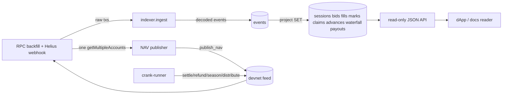

# Chapter 13 — Off-Chain Services

NUNDINA's on-chain programs define truth, but almost everything a person or a
dApp reads is assembled off chain. The `services/` package is a Node 24 /
TypeScript application built on `@solana/kit` that decodes the eight programs'
own IDLs, projects their events into a Postgres database, serves a read-only
JSON API over those projections, computes and publishes the NPCS NAV, and runs
the weekly treasury reconciliation (`services/README.md:1-7`). The settlement
cranks, the crank-runner and the session evidence exporter live beside the rails
crank in `payment-rails/crank/` (`services/README.md:5-7`). NUNDINA is a
devnet-only pilot: this layer is built and tested but, as of this writing,
nothing is hosted continuously and no Supabase project or Helius webhook is
provisioned (`services/README.md:18-24`).

## 13.1 The service map

| Service (SRS 08 §6) | Directory / entry point | Responsibility | Evidence |
|---|---|---|---|
| indexer | `services/src/indexer.ts` · `services/schema.sql` · `npm run svc -- indexer` / `webhook` | Decode every event of the eight programs from transaction logs into normalized tables | `services/README.md:11` |
| api | `services/src/api.ts` · `npm run svc -- api` | Read-only JSON over the indexer's tables | `services/README.md:12` |
| nav-publisher | `services/src/nav.ts` · `services/src/nav-publisher.ts` · `npm run svc -- nav` | Compute NAV with `credit-math` arithmetic and send `mark-engine::publish_nav` | `services/README.md:13` |
| treasury-agent | `services/src/treasury.ts` · `npm run svc -- treasury` | Weekly I1 check and an on-chain `reconcile` | `services/README.md:14` |
| crank-runner | `payment-rails/crank` `run --config` | Drive auction phases, refunds, seasoning and coupon distribution | `services/README.md:15` |
| evidence-exporter | `payment-rails/crank` `export --session` | Per-session signed evidence bundle with state snapshot | `services/README.md:16` |

All commands dispatch from one CLI, `services/src/cli.ts:59-136`, which parses
`indexer`, `webhook`, `api`, `nav` and `treasury` subcommands; the runner and
exporter are the crank package's `run` and `export` (`services/src/cli.ts:16-18`).

## 13.2 Data flow: chain → indexer → db → api → apps



### 13.2.1 Ingestion: two feeds, one path

Two feeds share one ingestion function (`services/src/indexer.ts:1-24`). The RPC
backfill pages `getSignaturesForAddress` per program from a stored cursor,
oldest first, then `getTransaction` and `ingest` (`services/src/indexer.ts:315-344`);
it is also the gap-fill after a webhook outage. The webhook receiver accepts
Helius raw-transaction payloads or the same shape (`services/src/indexer.ts:366-412`),
gating on `Authorization == WEBHOOK_SECRET` and rejecting bodies over
`MAX_WEBHOOK_BYTES = 4 MiB` with HTTP 413 (`services/src/indexer.ts:376-389`).

`ingest` returns early on `tx.err`, so failed transactions — whose logs can carry
events of instructions that were rolled back — are skipped
(`services/src/indexer.ts:50-52`). Every RPC call goes through `makeRpc`, which
retries network/429 errors with exponential backoff (`services/src/rpc.ts:13-27`);
`RPC_URL` defaults to `http://127.0.0.1:8899` (`services/src/rpc.ts:39`). Every
event is written to `events` keyed by
`(signature, event_index)` with `ON CONFLICT DO NOTHING`
(`services/src/indexer.ts:54-68`; `services/schema.sql:10-19`), then projected
only if it decoded (`services/src/indexer.ts:69`). Re-ingesting is therefore a
no-op: the projections are SETs, phases only move forward, and state columns take
the latest slot (`services/README.md:11`; verified in `services/test/indexer.spec.ts:86-93`).

### 13.2.2 Decoding and event attribution

`eventsFromLogs` tracks the program invoke stack from `Program X invoke [n]`
lines and attributes each `Program data:` line to the program on top of the stack
(`services/src/logs.ts:31-63`). This matters because `auction-engine` and
`payment-rails` both emit a `FillSettled` with the same discriminator
(`sha256("event:FillSettled")`) in one transaction while the engine CPIs the rails
(`services/src/logs.ts:1-11`); the indexer test asserts the two decode with
different layouts (`services/test/indexer.spec.ts:34-41`). Decoding is driven by
the programs' own Anchor IDLs loaded from `app/idl/*.json`
(`services/src/programs.ts:10-27`), with `Codec.decodeAccount`/`decodeType` and
`prefixed` discriminator matching in `services/src/codec.ts:146-197`. Bytes that
match a discriminator but not the IDL layout — an older deployment, such as
devnet payment-rails predating `EscrowEvent.unit` — are stored raw as
`data.undecoded` and not projected, so nothing is dropped
(`services/src/logs.ts:23-28`, `services/src/logs.ts:56-60`; asserted in
`services/test/indexer.spec.ts:95-108`).

### 13.2.3 Projections and the schema

`events` is the source of truth; every other table is a projection rebuilt from
it (`services/schema.sql:5-8`). The `project` switch maps `program:event` to
tables (`services/src/indexer.ts:73-298`): `auction-engine` → `sessions`,
`bids`, `fills` (`services/src/indexer.ts:78-137`); `payment-rails`
`FillSettled`/`PayoutMade` → `fills`, `payouts`
(`services/src/indexer.ts:139-161`); `credit-gate` → `lot_events`,
`gate_decisions` (`services/src/indexer.ts:163-184`); `mark-engine` → `marks`,
`mark_states`, `prints` (`services/src/indexer.ts:186-205`); `queue-claim` →
`claims`, `liquidity-facility` → `advances`, and `tranche-engine`
`PeriodDistributed` → `waterfall_lines` (`services/src/indexer.ts:207-293`).
Amounts are `NUMERIC` so u64/u128 values stay exact (`services/schema.sql:3-4`).
The rails `FillSettled` is a special case: because the rails session is not the
auction session when the engine sits in front, the row is attributed to the
auction session by finding the engine's matching `FillSettled` in the same
transaction (`services/src/indexer.ts:139-146`).

## 13.3 The read API

`services/src/api.ts` is a small HTTP router over the same `Db`
(`services/src/api.ts:1-16`). Every route is a `GET`; a non-GET returns 405 and
there are no write routes, because user actions are wallet-signed transactions
built client-side and the server never custodies or signs
(`services/src/api.ts:1-5`, `services/src/api.ts:91`; tested in
`services/test/indexer.spec.ts:182`).

| Route | Returns | Cite |
|---|---|---|
| `/health` | cursors and event count | `services/src/api.ts:25-32` |
| `/sessions` | every indexed auction session | `services/src/api.ts:33` |
| `/sessions/:session` | session + bids + fills + print + its events | `services/src/api.ts:34-51` |
| `/holders/:wallet` | lot events, claims, advances, bids, gate decisions | `services/src/api.ts:52-61` |
| `/marks/:feed` | NAV publications + mark-state changes + prints | `services/src/api.ts:62-69` |
| `/pools/:pool/waterfall` | one line per distributed period | `services/src/api.ts:70` |
| `/events?program=&name=&limit=` | raw decoded events, newest first, limit ≤ 1000 | `services/src/api.ts:71-82` |

Address path components are validated by the base58-shaped regex
`([1-9A-HJ-NP-Za-km-z]{32,44})` (`services/src/api.ts:22`), and responses are
JSON with bigints stringified and `access-control-allow-origin: *`
(`services/src/api.ts:87-90`). This is the surface the dApp consumes; see
[applications](/docs/14-applications).

## 13.4 The NAV publisher

`services/src/nav.ts` re-implements `credit-math`'s NAV arithmetic in `bigint`
so the publisher computes exactly what the crate computes, flooring every
division because the publisher initiates the mark
(`services/src/nav.ts:1-14`):

```
NAV_gross = floor(treasury_µUSDC × 10¹² / supply_base)          (I2a)
fee       = floor(NAV_gross × fee_bps × Δt / (10⁴ × 31_536_000)) (I2b)
NAV       = NAV_gross − fee                                       (I2c)
```

`navGrossPico`, `feeAccrualPerPeriod` and `weeklyPublish` implement these
(`services/src/nav.ts:22-38`), with `MODEL_VERSION = 1`
(`services/src/nav.ts:20`). The inputs are serialized by `canonical` as sorted-key
JSON and hashed by `inputsHash` with SHA-256 to become the on-chain
`inputs_hash` (`services/src/nav.ts:56-63`). The test suite pins the functions to
`credit-math`'s own hand vectors and to `1 USDC behind 1 NPCS = NAV_ONE`
(`services/test/nav.spec.ts:10-23`).

### 13.4.1 One snapshot, then the arithmetic

`computeNav` derives the feed PDA (`["feed", mint]`, `nav-publisher.ts:46-52`),
optionally resolves a `treasury:<npcs-treasury PDA>` to its USDC vault
(`nav-publisher.ts:80-86`), then reads the mint, the sleeve, the feed and the
`Clock` sysvar in **one** `getMultipleAccounts` call so all inputs share a slot
(`services/src/nav-publisher.ts:87-98`). It reads `supply` at mint offset 36 and
the token amount at offset 64 (`services/src/nav-publisher.ts:55-57`), derives
`Δ = now − previous computed_ts` floored at zero (`services/src/nav-publisher.ts:100-101`),
and rejects a sleeve that is actually an NPCS account
(`services/src/nav-publisher.ts:102`).

### 13.4.2 Publishing, the publisher set, and evidence

`publishNavIx` builds `mark-engine::publish_nav` as
`disc | u128 nav_published | i64 computed_ts | u32 model_version | [32] inputs_hash`
(`services/src/nav-publisher.ts:128-142`; layout asserted in
`services/test/nav.spec.ts:50-60`). `publish` refuses to sign unless the key is in
the feed's `publishers` set (`services/src/nav-publisher.ts:171-172`), sends via
`sendAndPoll` with a fresh blockhash and confirms within 90 polls
(`services/src/nav-publisher.ts:144-162`), and writes the inputs document
beside the signature so anyone can recompute the number
(`services/src/nav-publisher.ts:176-196`). Weekly cadence comes from cron or a
systemd timer; `--dry-run` computes without sending (`services/README.md:13`,
`services/src/cli.ts:91-115`).

The recorded devnet publication #1 is **NAV 1.000000 USDC per NPCS**: the sleeve
`B78W…NKAz` holds 1 USDC and supply is 1 NPCS, with `inputs_hash`
`464e3f16…d44f4118` (`DEPLOYMENTS.md:49-54`). The publisher's evidence document
is committed at `ops/engines/nav/nav-6vt1wHVQVuhnfJ3FtNbq4647mCjWUBmJCDABsYUgVKL4-1791399487.json`,
whose `nav_published_pico` is `1000000000000` — exactly 1.000000 (`ops/engines/nav/nav-6vt1wHVQVuhnfJ3FtNbq4647mCjWUBmJCDABsYUgVKL4-1791399487.json:18-21`).
On a local demo run over 130 USDC / 130 NPCS the publisher produced
0.999999877854, i.e. gross less 3,852 s of the 10 bps/yr fee
(`services/README.md:13`; the indexer test bounds the indexed value at
`999_990_000_000 < nav_pico < 1_000_000_000_000`, `services/test/indexer.spec.ts:63-70`).

## 13.5 The treasury agent

`services/src/treasury.ts` is runbook-driven and holds no key that moves money;
deposits and withdrawals stay manual per `token/runbook.md`
(`services/src/treasury.ts:1-15`). `treasuryStatus` reads the supply and the USDC
held and evaluates invariant I1, `supply == USDC × 10^(dec_diff)`
(`services/src/treasury.ts:37-79`; the scale is computed at
`services/src/treasury.ts:62-65`). `reconcileOnChain` sends npcs-treasury's
permissionless `reconcile`, which evaluates I1 on chain and emits
`Reconciled { backed }`, then reads that event back out of the logs
(`services/src/treasury.ts:101-122`). The devnet run on the manual sleeve
reported **BACKED** (`services/README.md:14`). The weekly checklist that owns the
manual steps is `token/runbook.md` § Treasury, steps 1-7
(`token/runbook.md:71-96`).

## 13.6 The crank-runner

`run --config runner.json` is the hosted runner of SRS 08 §6
(`payment-rails/crank/src/runner.ts:1-22`). Each tick it (1) discovers every
`auction-engine` session via `getProgramAccounts` filtered by the `Session`
discriminator and drives the live ones forward
(`payment-rails/crank/src/runner.ts:60-88`); (2) refunds finished or failed
sessions whose rails `CashSession` still has `open_escrows > 0`
(`payment-rails/crank/src/runner.ts:82-85`); (3) runs `seasoning` for each
configured mint (`payment-rails/crank/src/runner.ts:91-93`); and (4) pays the
next coupon period for each due tranche pool, skipping if the wallet cannot pay
(`payment-rails/crank/src/runner.ts:94-109`).

The phase planner `planPhase` is pure and mirrors the program's guards —
`clear`, `allocate` (8 fills per tx), `close_rofr`, `settle` per unsettled fill,
`finish`, or `expire` past `settle_deadline` (`payment-rails/crank/src/phases.ts:69-88`).
Because a plain `settle` transaction is 1,684 bytes, settle steps go through an
address lookup table the crank creates on demand (`payment-rails/crank/src/phases.ts:214-240`;
`payment-rails/crank/README.md:149-175`). Seasoning reads credit-gate's
`HolderLots` bytes (582 bytes; lot `restriction_expiry` at `+20`) and sends the
permissionless `merge_expired` for every ledger with a seasoned lot
(`payment-rails/crank/src/seasoning.ts:17-37`, `:56-83`). Distribution derives
every rails `DistributeCoupon` account, including the tranche signer's
`EngineGrant`, and calls `tranche-engine::distribute(period, cash)`
(`payment-rails/crank/src/distribute.ts:42-55`, `:85-150`).

### 13.6.1 Statelessness and the kill switch

Like every crank, the runner keeps no state: a restart re-reads the chain
(`payment-rails/crank/src/runner.ts:16-18`). `CRANK_KILL_FILE` pauses phases,
seasoning and distribution while it exists, but refunds keep running because
refunds are never pausable (AE-P10); the file is checked once per tick
(`payment-rails/crank/src/runner.ts:54-57`, `:79`, `:90`; `payment-rails/crank/README.md:49`).

## 13.7 Evidence and logging

The database is production Postgres through `pg`, or PGlite — real Postgres
compiled to WASM — for local runs and tests via `pglite:<dir>`/
`pglite:memory` (`services/src/db.ts:1-38`); the schema is applied idempotently on
every start (`services/src/db.ts:13`, `services/schema.sql:1-3`). Beyond the
projection tables, `cursors` holds the per-program high-water mark for the
backfill (`services/schema.sql:23-29`), and `lot_events`/`gate_decisions` keep
credit-gate's evented lot ledger (`services/schema.sql:108-134`). RPC nodes
truncate logs past ~10 KB ("Log truncated"), so events after the cut are not
indexed (`services/src/indexer.ts:21-23`; `services/README.md:35-36`).

The evidence exporter writes a per-session bundle: `events.jsonl` (every event
of auction-engine, payment-rails, credit-gate and mark-engine in every
transaction touching the session or its rails session, attributed by invoke
stack), `snapshot.json` (session, `CashSession`, feed NAV/`model_version`/
`inputs_hash`, print), and `manifest.json` with both SHA-256s
(`payment-rails/crank/src/session-evidence.ts:1-18`, `:71-143`). The manifest is
ed25519-signed over a domain-separated canonical JSON
(`EVIDENCE_DOMAIN = "nundina:payment-rails:evidence-manifest:v1\n"`,
`payment-rails/crank/src/evidence.ts:109-139`), and its `transferProof`
classifies fills so a bare event count cannot read as compliance evidence — a
fill is `proven` only under AE-P8's transfer rules
(`payment-rails/crank/src/evidence.ts:67-93`). `verify-export` re-checks both
hashes, the event count and the signature offline and keylessly
(`payment-rails/crank/src/evidence.ts:234-273`; `payment-rails/crank/README.md:203-209`).
The rails-wide `export` and the reconciliation ledger (`reconcileSession`,
`reconcileFacility`, which flags a booked shortfall as a failed check, not a
footnote) live in `payment-rails/crank/src/evidence.ts:164-226` and
`payment-rails/crank/src/ledger.ts:29-89`.

## 13.8 What is verified

| Area | Verified against | Cite |
|---|---|---|
| indexer projections, re-ingest, undecoded events, failed txs | real local-demo transactions in PGlite | `services/test/indexer.spec.ts:27-172` |
| webhook auth, 413/500 paths | HTTP tests | `services/test/indexer.spec.ts:118-158` |
| API read-only behaviour | HTTP tests | `services/test/indexer.spec.ts:174-187` |
| NAV arithmetic and `publish_nav` layout | `credit-math` vectors | `services/test/nav.spec.ts:10-61` |
| indexer on devnet history | credit-gate holder H's `ValidateDecision` | `services/README.md:11` |
| NAV #1 | devnet feed `7b39…` | `DEPLOYMENTS.md:49-54` |
| crank-runner tick | local validator: 9 escrows refunded, 2 ledgers merged, 1 coupon paid | `payment-rails/crank/README.md:211-215` |
| session evidence | 16 txs, 39 events, 2/2 fills proven, verifies | `payment-rails/crank/README.md:213-214` |

The settlement/refund duties and the treasury's authority and runbook are
covered in [deployment & ops](/docs/12-deployment-governance-ops); the programs
these services decode are in the [program map](/docs/05-program-map-and-accounts).

## Open questions

> Open question: `services/README.md:13` describes the devnet NAV run as a dry
> run against a cluster with no feed yet, while `DEPLOYMENTS.md:49-54` and
> `README.md:52` record publication #1 to the live devnet feed `7b39…`. The two
> repo files have not been reconciled; the recorded publication #1 is treated as
> the present devnet fact here.

> Open question: hosting is not provisioned — no Supabase project, no Helius
> webhook, no VPS or systemd unit (`services/README.md:18-24`). Whether the
> pilot ever runs these services continuously, rather than from the CLI, is not
> decided in the repo.
