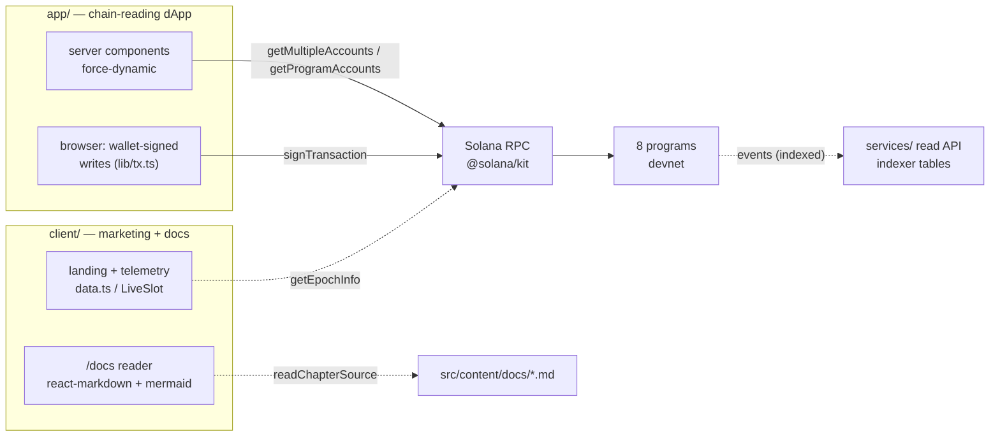

# Chapter 14 — Applications: dApp & Marketing Client

NUNDINA ships two user-facing surfaces, both Next.js 16 (App Router): the chain-reading dApp in `app/`, whose no-backend, no-cache server components read accounts straight from Solana through `@solana/kit` and whose writes are built in the browser and wallet-signed (`app/README.md:1-8`); and the public marketing client in `client/` — a static landing page, an honest telemetry strip, and the `/docs` reader that renders this handbook (`client/README.md:1-5`). This chapter maps each surface's routes, names the program or account each screen reads, and records the honest-numbers discipline that governs both. NUNDINA is a **devnet-only pilot**: 7 of 8 programs are deployed to devnet, `liquidity-facility` is built but not deployed, 0 of 8 are on mainnet, and there is no external audit.

## 14.1 Two surfaces, one split

### 14.1.1 The chain-reading dApp (`app/`)

The dApp is the only surface that reads the live cluster. Every page is `force-dynamic` (`app/app/page.tsx:9` and each sibling page), so nothing is cached between a request and the programs. `app/lib/rpc.ts:1-5` states the rule directly: everything shown is read from the cluster at request time, with no cache and no backend of NUNDINA's own. Accounts are decoded with each program's own IDL (`app/lib/programs.ts:1-26`), synced from `anchor build` by `npm run sync-idl` (`app/package.json:12`). The server never signs: participant writes are built in-browser by `app/lib/tx.ts` and signed by the wallet, and the public devnet RPC is wrapped in a bounded retry because it drops connections under load (`app/lib/rpc.ts:19-32`).

The dApp reads the **cluster directly**, not the `services/` read API. The read-only JSON API builds an indexed view over the same programs (`services/src/api.ts:1-16`), but no `app/` file imports or fetches it; the app's only server route is the allowlist endpoint at `/api/access` (`app/app/api/access/route.ts:1-54`). The services layer is described in [off-chain services](/docs/13-off-chain-services).

### 14.1.2 The public marketing client (`client/`)

The client is a separate package: a static landing page (`client/src/app/page.tsx:1-23`), the docs reader, and a footer/header whose routes are declared in one place (`client/src/lib/site.ts:16-64`). `client/README.md:3-5` states the hosting decision from `frontend/info.md`: the marketing pages live at the root and the live chain-reading dApp is linked under `/app`, set by `NEXT_PUBLIC_APP_URL` (`client/src/lib/site.ts:7`).

## 14.2 The dApp routes

The global chrome links `/sessions`, `/portfolio`, `/gate`, `/data-room` and `/admin` from `app/app/layout.tsx:24-33`, and shows the active cluster and the signed-in viewer. Access is gated by `AccessGuard`: in `NUNDINA_ACCESS=allowlist` mode nothing below renders until the viewer signs in, while otherwise (local development) only `/data-room` and `/admin` are gated — and those two are gated in every mode (`app/components/AccessGuard.tsx:12-21`, `app/lib/access.ts:31-40`). Sign-in is a server challenge the wallet signs, admitted from the operator allowlist or credit-gate's own simulated `validate`, and answered with an HMAC'd httpOnly cookie valid 12 hours (`app/lib/access.ts:92-101`, `app/app/api/access/route.ts:40-46`).

| Route | Page file | Data source / programs read |
|---|---|---|
| `/` | `app/app/page.tsx` | all 8 program IDs; `credit-gate` `MarketConfig` + `MarketPolicy`; `mark-engine` `Feed`; `auction-engine` session count — `app/app/page.tsx:31-42` |
| `/sessions` | `app/app/sessions/page.tsx` | `auction-engine` `Session` accounts, newest first — `app/lib/session.ts:123-128` |
| `/sessions/[address]` | `app/app/sessions/[address]/page.tsx` | `auction-engine` `Session`; `mark-engine` `Feed` + `PrintRecord`; `payment-rails` `CashSession`; writes auction/ROFR — `app/lib/session.ts:95-120` |
| `/portfolio` | `app/app/portfolio/page.tsx` | `credit-gate` `HolderLink` + `HolderLots`; `queue-claim` `Request`; `liquidity-facility` `Position`; `auction-engine` orders; `tranche-engine` `Pool` — `app/lib/portfolio.ts:30-72` |
| `/gate` | `app/app/gate/page.tsx` | `credit-gate` `validate` (simulated) + SAS attestations — `app/lib/gate.ts:158-237` |
| `/data-room` | `app/app/data-room/page.tsx` | `mark-engine` `PrintRecord` + `Feed` — `app/lib/prints.ts:60-90` |
| `/admin` | `app/app/admin/page.tsx` | all 8 `ProgramData` accounts + rails/gate/feed/venue/queue singletons — `app/lib/admin.ts:56-97` |
| `/api/access` | `app/app/api/access/route.ts` | `credit-gate` admission for sign-in — `app/app/api/access/route.ts:13-48` |

### 14.2.1 `/` — dashboard

Reads all eight program IDs in one `getMultipleAccounts` call, checks each is deployed, then decodes the NPCS market config, policy and mark feed (`app/app/page.tsx:31-42`). It renders the NPCS market stats — gate configured, distinct investors against the holder cap, seasoning, mark feed state, NAV, NAV effective time, session count — and the program deployment table (`app/app/page.tsx:72-102`). NAV is formatted from `mark-engine`'s pico-scaled `nav_pico` (`app/app/page.tsx:84`, `app/lib/session.ts:171-175`).

### 14.2.2 `/sessions` and `/sessions/[address]`

`/sessions` lists every `auction-engine` session account newest-first and auto-refreshes every 10 seconds (`app/app/sessions/page.tsx:20-24`, `app/lib/session.ts:122-128`). The detail page is the core screen: the phase timeline from the fixed sequence `Commit, Reveal, Allocating, IssuerRofr, Settling, Printed`, countdowns, clearing stats, the demand/supply clearing chart, the sealed order book (commitments stay hashed until reveal), DvP fills, the ROFR decision during `IssuerRofr`, the print, and the rails `CashSession` summary (`app/app/sessions/[address]/page.tsx:62-234`, `app/lib/session.ts:11`). It contrasts the clock's expected phase with the on-chain phase, which advances only when a crank sends the next instruction (`app/app/sessions/[address]/page.tsx:74-78`, `app/lib/session.ts:151-160`). Writes — commit, reveal, ROFR — are signed in the browser; see [pricing engines](/docs/08-pricing-engines).

### 14.2.3 `/portfolio`

One wallet's positions with `?wallet=` (and optional `?mint=`, defaulting to the NPCS mint): token holdings with frozen/thawed state, gate admission, the CG-P3 lot ledger with a per-lot seasoning countdown, queue-claim requests, facility advances, tranche positions, and the wallet's orders across every session (`app/app/portfolio/page.tsx:169-257`, `app/lib/portfolio.ts:30-72`). A wallet that is not admitted links straight to its gate check (`app/app/portfolio/page.tsx:210-214`). Tranche positions are a share of each pool's three books — principal and allocated loss (`app/lib/tranche.ts:38-58`).

### 14.2.4 `/gate` — the gate-rejection view

This page runs `credit-gate`'s **real** `validate` instruction as a simulation: nothing is signed or sent (`app/lib/gate.ts:119-144`). It decodes the program's own `ValidateDecision` event or its typed error, and shows every input the gate read — block entry, identity and accreditation attestations (signer, expiry vs settlement horizon, jurisdiction, KYC level, accreditation), the holder governor, the holder link, and token-account state — beside the verdict (`app/app/gate/page.tsx:24-93`, `app/lib/gate.ts:158-237`). The typed `GateReject` variants and their plain-language meanings are enumerated in `app/lib/gate.ts:240-252`; the mechanism is in [credit-gate](/docs/07-credit-gate).

### 14.2.5 `/data-room` and `/admin`

`/data-room` shows every `mark-engine` print in full next to what its market's ME-P6 class discloses outside the room (Public / Banded / AggregateOnly / DataRoom), with eligible volume and VWAP (`app/app/data-room/page.tsx:23-100`, `app/lib/prints.ts:26-38`). It is allowlisted in every access mode (`app/app/data-room/page.tsx:105-111`). `/admin` reads the authority map from the chain — each program's upgrade authority from its `ProgramData`, and the holders of the rails config, gate root, feed, venue and queue — then offers the admin actions; when the authority is the Squads vault the page builds a proposal JSON instead of signing (`app/app/admin/page.tsx:22-148`, `app/lib/admin.ts:56-97`). SAS attestation issuance and NAV publication are deliberately absent from the browser (`app/app/admin/page.tsx:145-148`). Governance is covered in [deployment, governance & ops](/docs/12-deployment-governance-ops).

## 14.3 The marketing client

### 14.3.1 Nav and site map

`client/src/lib/site.ts` is the single source of routes: the header nav is `Protocol`, `Architecture`, `Security`, `Docs`, `Deployments` plus the `Enter Nundina` CTA (`client/src/lib/site.ts:16-24`), and the footer groups Protocol, App (five app routes under `APP_URL`), and Docs (`client/src/lib/site.ts:26-58`). `SmartLink` renders in-site routes with `next/link` and absolute URLs as new-tab anchors (`client/src/components/ui/SmartLink.tsx:7-19`).

### 14.3.2 `data.ts` — the honest telemetry

Every number shown lives in `client/src/lib/data.ts`, with its source, under the rule that nothing may claim what the repo or devnet cannot verify (`client/src/lib/data.ts:1-6`). The telemetry strip states `7/8` programs on devnet and `0/8` on mainnet, NAV publication #1 = `1.000000` USDC per NPCS weekly, NPCS supply `1.000000` backed by 1 USDC, governance `2-of-2` Squads v4 with a 48h timelock, and audit `Pending` (`client/src/lib/data.ts:12-52`). The gate-crisis cards are labelled market data with outlet and date (`client/src/lib/data.ts:81-120`), and the ecosystem strip lists only real dependencies, marking Helius planned (`client/src/lib/data.ts:124-133`). The strip cites `DEPLOYMENTS.md / STATUS.md · Solana devnet only` (`client/src/components/landing/TelemetryStrip.tsx:49-51`), and `LiveSlot` reads the live devnet epoch and slot from the cluster RPC every 15 seconds (`client/src/components/landing/LiveSlot.tsx:16-51`). NPCS matches the hard anchors: mint `6vt1wHVQVuhnfJ3FtNbq4647mCjWUBmJCDABsYUgVKL4`, supply and NAV `1.000000`, holder cap 8, seasoning 7 days (`client/src/lib/data.ts:54-65`); see [the NPCS pilot asset](/docs/11-npcs-asset).

### 14.3.3 The `/docs` reader

The reader is driven by a manifest: `client/src/lib/docs.ts` lists the four Parts and all fifteen chapters, each with a slug, short label, blurb and part (`client/src/lib/docs.ts:21-149`) — the single source of truth for the `/docs` index, the sidebar, and `generateStaticParams` (`client/src/app/docs/[slug]/page.tsx:9-11`). `docs.ts` also computes prev/next neighbours and extracts the h2–h4 headings (skipping fenced code) for the on-page ToC (`client/src/lib/docs.ts:159-208`). Chapter markdown is read from disk on the server (`client/src/lib/docs-server.ts:6-16`) and rendered by `react-markdown` with `remark-gfm` (`client/src/components/docs/Markdown.tsx:111-113`), with heading ids assigned in document order so the ToC resolves (`client/src/components/docs/Markdown.tsx:15-47`). A fenced ```` ```mermaid ```` block is rendered by a client-only Mermaid component that dynamically imports the library and falls back to a readable `<pre>` on failure (`client/src/components/docs/Markdown.tsx:83-97`, `client/src/components/docs/Mermaid.tsx:10-60`). The sidebar groups chapters by Part (`client/src/components/docs/DocsSidebar.tsx:22-50`), and each chapter renders `neighbours` links (`client/src/app/docs/[slug]/page.tsx:31-59`). Authors follow `client/src/content/docs/AUTHORING.md`.

## 14.4 Data flow



## 14.5 Honest-numbers discipline

Both surfaces follow one rule: a number is shown only if the repo or devnet can verify it, with its source. The dApp displays what it decodes from chain — NAV #1 `1.000000`, NPCS supply `1.000000`, and the per-program deployed flags (`app/app/page.tsx:84-102`) — and the client confines every figure to `data.ts`, citing the market figures it shows (`client/src/lib/data.ts:1-6`, `:95-120`). Neither claims an APY, a TVL, LP yield, or an audit. The dApp's NPCS views carry the `PILOT-DEMO-ASSET` label (`app/README.md:10`); the client footer states "not audited, not offered publicly" with the `PILOT-DEMO-ASSET — NOT AN OFFER` tag (`client/src/components/layout/SiteFooter.tsx:41-45`, `client/src/lib/site.ts:12`); and the data room notes its prints are synthetic-labelled demo data excluded from any dataset claim (`app/app/data-room/page.tsx:39-43`).

## Open questions

> Open question: the header and footer declare marketing routes `/protocol`,
> `/architecture`, `/security`, `/deployments`, `/status` and `/legal/terms` /
> `/legal/privacy` (`client/src/lib/site.ts:16-64`), but only `/` and `/docs/*`
> have page files under `client/src/app`; the others currently resolve to
> `not-found`. Confirm whether these pages are intended to be built.

> Open question: the chapter brief described `services/` as "the read API the
> dApp consumes", but no `app/` file imports or fetches it — the dApp reads the
> cluster directly through `@solana/kit` (`app/lib/rpc.ts:1-32`), and the
> read-only JSON API (`services/src/api.ts:1-16`) is a separate, unhosted
> service. Confirm whether the dApp is meant to switch to the indexed API.

> Open question: both dApp and client default to the public devnet RPC
> (`app/lib/programs.ts:44-51`, `client/src/lib/site.ts:9-10`, `LiveSlot`); no
> committed RPC provider key was found, and Helius is listed as planned only
> (`client/src/lib/data.ts:124-133`).
