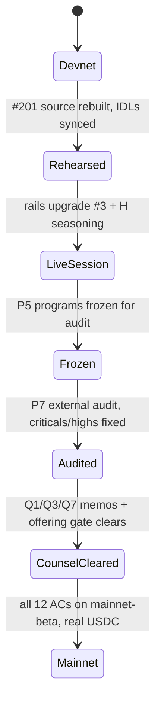

# Chapter 15 — Legal, Risk, Audit & Roadmap

NUNDINA is a **devnet-only pilot**, and this chapter is its honest edge: the legal topology the software is structured toward but has not been cleared for, the risks the repository records against itself, the external audit that has been scoped but not commissioned, and the phased path to a mainnet pilot. No counsel has been engaged and **no third-party audit has been performed**; nothing here is legal advice, an offer, or a returns claim. Citations use repo-root paths (`path/file.md:line`).

## 15.1 Legal topology

### 15.1.1 Operating posture and the entity frame

The scope decisions are locked and dated. Doc 07 records the founder's 24 Sep 2026 choices: a **US operating posture with partner broker-dealer topology** (Option A for v1, Option B for the v2 US investor-to-investor flow), **full v1→v3 coverage**, every unconfirmed item treated as a numbered counsel gate, and **no counsel engaged yet** (`preresearch/architecture/07-Legal-Topology-and-Compliance.md:7`–`11`).

The design principle is that NUNDINA's programs are non-custodial software with deterministic, published rules; every legally sensitive *activity* — operating a venue, effecting trades, holding custody, booking the ledger of record — is assigned to a **named licensed role**, and the protocol enforces that only an authorized role can trigger the corresponding action (`preresearch/architecture/07-Legal-Topology-and-Compliance.md:23`). Two commitments make the posture concrete:

- **No per-trade revenue to NUNDINA, ever.** A per-trade fee or solicitation-shaped marketing is broker-indicia risk (`preresearch/architecture/07-Legal-Topology-and-Compliance.md:38`); the code resolved this via founder decision 2026-10-06 (#147): `payment-rails` `MAX_FEE_BPS` = 0, so `set_fees` refuses any per-trade fee and `open_session` refuses a config still carrying one (`preresearch/architecture/07-Legal-Topology-and-Compliance.md:166`).
- **No protocol token in v1** (`preresearch/architecture/07-Legal-Topology-and-Compliance.md:75`; `token/TOKENOMICS.md:101`). The tokenomics doc states the design explicitly: no distribution, vesting, emissions, staking, or governance (`token/TOKENOMICS.md:3`).

### 15.1.2 The compliance skeleton: SAS, sRFC37, and the gate

Compliance is enforced **at account activation, not at transfer**: eligibility is checked when a token account is activated via Token ACL (sRFC37) and the Solana Attestation Service (`preresearch/architecture/11-Counsel-Engagement-Brief.md:28`). `credit-gate` is the compliance core, written to be "audit to securities-infrastructure standard" (`preresearch/architecture/07-Legal-Topology-and-Compliance.md:148`), and implements seven requirements `CG-1`..`CG-7` (`preresearch/architecture/07-Legal-Topology-and-Compliance.md:152`–`158`). See [the gate](/docs/07-credit-gate).

On devnet this is live: the NPCS freeze authority is the Token ACL `MintConfig` → `credit-gate`, so NPCS thaws only through the gate (`DEPLOYMENTS.md:120`; `token/TOKENOMICS.md:15`; see [the NPCS asset](/docs/11-npcs-asset)). The SAS attester runs on devnet (#122) with a `nundina` credential and three schemas (`DEPLOYMENTS.md:224`–`239`). One hard boundary sits on top: the **offering gate** restricts NPCS transfers to team-controlled, attested wallets until the Q3 506(c)/private-offering analysis clears — a hard P8 precondition ranked equal to the audit (`preresearch/architecture/08-SRS-Pilot-Rails.md:421`).

### 15.1.3 Phase topology

The legal topology evolves in three phases, each behind numbered counsel gates (`preresearch/architecture/07-Legal-Topology-and-Compliance.md:119`–`140`):

- **v1 — issuer-sponsored window.** The issuer opens each session as `venue_operator` on its own asset; NUNDINA is a software vendor and optional facility arranger with zero per-trade compensation (`preresearch/architecture/07-Legal-Topology-and-Compliance.md:119`; `preresearch/architecture/11-Counsel-Engagement-Brief.md:30`).
- **v2 — partner ATS.** A registered BD/ATS becomes the `venue_operator` for investor-to-investor flow; NUNDINA licenses the engine (`preresearch/architecture/07-Legal-Topology-and-Compliance.md:132`).
- **v3 — structured + offshore.** A tranche SPV issues the paper, the facility is funded by an external loan vehicle, and a Reg S offshore market runs as a separate book (`preresearch/architecture/07-Legal-Topology-and-Compliance.md:138`).

## 15.2 The counsel register — Q1–Q20

Doc 07 contains twenty numbered counsel questions, `Q1`–`Q20`; **none is answered and no counsel is engaged** as of 24 Sep 2026 (`preresearch/architecture/07-Legal-Topology-and-Compliance.md:213`). The engagement brief says the questions "expired by standing open": pilot decisions were taken on engineering defaults — 7-day seasoning, no per-trade fee, US-only jurisdiction policy — that counsel must confirm or change (`preresearch/architecture/11-Counsel-Engagement-Brief.md:3`–`6`).

Seven questions gate the mainnet pilot or replace defaults already in code (`preresearch/architecture/11-Counsel-Engagement-Brief.md:37`):

| Q | Question (doc 07) | What is in code today |
|---|---|---|
| **Q3** | Do auction fills on seasoned, non-affiliate lots satisfy §4(a)(1½)/§4(a)(7)? | `credit-gate` `settle_check` refuses unseasoned lots; `disclosure_hash` + `ExemptionPath` per fill (`preresearch/architecture/11-Counsel-Engagement-Brief.md:42`) |
| **Q4** | Rule 144 mechanics for non-reporting issuers | `MarketConfig.seasoning_seconds` = 7 days; no affiliate volume limit enforced (`preresearch/architecture/11-Counsel-Engagement-Brief.md:43`) |
| **Q5** | §12(g) holder counting | holder governor counts distinct `investor_id`s; `holder_cap` = 8 on devnet (`preresearch/architecture/11-Counsel-Engagement-Brief.md:44`) |
| **Q2** | Which revenue lines create transaction-based compensation? | per-trade fee removed (#147); ≤2% `reserve_bps` loss reserve remains (`preresearch/architecture/11-Counsel-Engagement-Brief.md:45`) |
| **Q10** | Is program-controlled, holder-revocable escrow custody? | all cash in PDA vaults; refunds permissionless and never pausable (`preresearch/architecture/11-Counsel-Engagement-Brief.md:46`) |
| **Q13** | BSA/MSB and OFAC exposure | block-list at thaw and settle; no screening process exists yet (`preresearch/architecture/11-Counsel-Engagement-Brief.md:47`) |
| **Q14** | Which stablecoins are clean cash legs post-GENIUS? | USDC only (`RailsConfig.usdc_mint`, depeg breaker) (`preresearch/architecture/11-Counsel-Engagement-Brief.md:48`) |

`Q1` (exchange/broker status of the issuer window), `Q6` (assignment of queue proceeds), `Q7` (repurchase-window discipline), `Q12` (Form D), `Q18` (print dataset), and `Q19` (entity/team) follow; `Q8`, `Q9`, `Q11`, `Q15`, `Q16`, `Q17` are v3-and-later; `Q20` is standing (`preresearch/architecture/11-Counsel-Engagement-Brief.md:50`–`54`). `Q20` tracks the SEC **TSV order 2026-90** scope — whether its conditions (auditable public contracts, permissioned access, issuer notice) foreshadow extension to private-fund venues (`preresearch/architecture/07-Legal-Topology-and-Compliance.md:236`).

Doc 07 tiers every doctrinal statement `[PRIMARY]`, `[SECONDARY]`, or `[UNVERIFIED]`; only SEC Press Release 2026-90 was read in full — **no statute text or rule release was read directly** (`preresearch/architecture/07-Legal-Topology-and-Compliance.md:257`–`259`).

## 15.3 Risk register

The risks the repository documents against itself, with the pilot's mitigating mechanism:

| Risk | Evidence | Mitigation / truth |
|---|---|---|
| **Not audited** | no firm contacted, nothing booked (`preresearch/architecture/10-Audit-Scope-P7.md:3`, `:9`–`17`) | scope pack written; full external audit is a locked pre-mainnet decision (`preresearch/architecture/08-SRS-Pilot-Rails.md:7`) |
| **No mainnet** | 0 of 8 programs on mainnet-beta (`STATUS.md:34`) | P8 pilot is the target; mainnet deploys only the audited freeze build (`preresearch/architecture/10-Audit-Scope-P7.md:78`) |
| **Pilot headline flow incomplete** | strict SRS 0/12; every AC partial (`STATUS.md:31`, `:97`–`110`) | programs built; live auction/queue session waits on rails upgrade #3 and seasoning (`DEPLOYMENTS.md:65`–`78`) |
| **Issuer consent (K1/H1)** | no named issuer committed (`preresearch/research/12-Validation-2026-Reality-Check.md:127`) | gate-crisis headlines give issuers a reason to say yes; next step is the issuer pipeline |
| **C1 scope** | TSV order covers NMS stock only, not Reg D fund shares (`preresearch/research/12-Validation-2026-Reality-Check.md:101`) | issuer-sponsored window needs no exemption; Reg S / non-US first remains prudent (`preresearch/research/12-Validation-2026-Reality-Check.md:105`) |
| **Float / fee base (K2)** | Solana on-chain private-credit float still small (`preresearch/research/12-Validation-2026-Reality-Check.md:129`) | sell sponsorship + data, not volume fees (`preresearch/research/12-Validation-2026-Reality-Check.md:129`) |
| **Cycle risk (M1/M2)** | default rate ~10% and rising (`preresearch/research/12-Validation-2026-Reality-Check.md:131`) | three-book accounting is not optional; design-for-down-case |
| **Junior capital (E1)** | no evidence anyone solved institutional junior demand (`preresearch/research/12-Validation-2026-Reality-Check.md:132`) | sponsor-retained first loss is the v1 default |
| **Competition (Midas)** | $50M Series A + $40M facility (`preresearch/research/12-Validation-2026-Reality-Check.md:130`) | auction mechanism + queue-claims + issuer-sponsorship posture |
| **Key-control loss** | devnet Squads members on one machine; "not 2-of-2 *custody*" (`DEPLOYMENTS.md:216`–`220`) | mainnet members are two people's hardware wallets (`DEPLOYMENTS.md:219`) |
| **Irreversible authority** | superseded credit-gate and NPCS mints have lost keys (`DEPLOYMENTS.md:24`, `:121`) | new program IDs; configs on old programs ignored (#26) |

Market figures here are dated and attributed in the reality-check doc (e.g. Apollo 17%-of-NAV vs 5% cap, CNBC Jun 2026, `preresearch/research/12-Validation-2026-Reality-Check.md:13`) — context, not NUNDINA metrics.

## 15.4 Audit scope (P7) — written, not booked

The audit scope exists as a request-for-quote pack whose status is unambiguous: **"scope written, firms not yet contacted"** (`preresearch/architecture/10-Audit-Scope-P7.md:3`), and every row of its booking table is ❌ (`preresearch/architecture/10-Audit-Scope-P7.md:9`–`17`). **No third-party audit has been performed.**

P7 uses a fixed/best-effort split, with line counts at `main` `14ae1d1` (2026-10-06) to be recounted at the freeze commit (`preresearch/architecture/10-Audit-Scope-P7.md:21`):

| Program | Lines | Priority |
|---|---:|---|
| `payment-rails` | 4,368 | fixed |
| `credit-gate` | 2,757 | fixed |
| `auction-engine` | 1,286 | fixed (escrow/clearing/settlement) |
| `liquidity-facility` | 1,208 | fixed |
| `credit-math` | 845 | fixed |
| `mark-engine` | 726 | best effort |
| `queue-claim` | 931 | best effort |
| `tranche-engine` | 914 | best effort |
| `npcs-treasury` | 344 | best effort |
| **Total** | **13,379** | fixed 10,464 · best effort 2,915 |

(`preresearch/architecture/10-Audit-Scope-P7.md:26`–`35`.) Off-chain services, the UI, and third-party programs (Token-2022, Token ACL, SAS, Squads) are out of scope; integration *with* them — account validation of every CPI target — is in scope (`preresearch/architecture/10-Audit-Scope-P7.md:37`–`41`). See [off-chain services](/docs/13-off-chain-services).

Beyond a line-by-line review the pack asks six system questions: cash conservation, gate bypass, engine authority, rounding/dust extraction, liquidation under a stale mark, and whether the Squads timelock is really the only upgrade path (`preresearch/architecture/10-Audit-Scope-P7.md:59`–`65`). It also declares known issues the auditor should not re-report, including that devnet runs older builds, that the devnet NPCS `MintConfig` authority is still a single key, that `publish_nav` checks the publisher set rather than a SAS attestation, and that prudential values `H2`/`H3` and `MAX_HOLDER_CAP` await sign-off (`preresearch/architecture/10-Audit-Scope-P7.md:68`–`72`). On freeze, mainnet deploys only the audited build (`preresearch/architecture/10-Audit-Scope-P7.md:74`–`79`).

## 15.5 Roadmap and mainnet preconditions

The SRS phase plan runs 24 weeks and is dominated by the audit: P0 scaffold, P1 gate + asset, P2 marks + treasury, P3 auction, P4 claims + facility, P5 tranching (programs frozen), P6 UI, **P7 audit (weeks 12–22)**, and **P8 mainnet pilot** with all twelve ACs re-run on mainnet-beta with real USDC ($1–5K budget) (`preresearch/architecture/08-SRS-Pilot-Rails.md:443`–`453`). The honest timeline to a recorded issuer demo is ~4–5 months, dominated by a 6–10 week audit window (`preresearch/architecture/08-SRS-Pilot-Rails.md:11`).

Current status against that plan, per the 2026-10-09 audit snapshot: core engineering ~60–70%, credible live-devnet hackathon demo ~35–45%, strict SRS **0/12 complete**, **8/8** Anchor programs with code/tests/IDL, **7/8** deployed on devnet (`liquidity-facility` is built but not deployed), and **0/8** on mainnet (`STATUS.md:27`–`34`). Governance is a Squads v4 2-of-2 multisig behind a 48h timelock (`DEPLOYMENTS.md:16`); on devnet both member keys sit on one machine (`DEPLOYMENTS.md:216`–`220`). The remaining-work list puts "engage counsel and schedule the external audit before mainnet launch" in P2 (`STATUS.md:231`). See [deployment](/docs/12-deployment-governance-ops) for the authority and governance map.

Mainnet preconditions are gated, not scheduled. The hard gates are: the twelve acceptance scenarios passing on devnet staging *and* mainnet with real USDC (`preresearch/architecture/08-SRS-Pilot-Rails.md:466`); the offering gate clearing (§10.3); the `Q14` GENIUS-cleanliness memo confirmed before any mainnet USDC movement (`preresearch/architecture/08-SRS-Pilot-Rails.md:422`); a fresh mainnet NPCS mint created in the P8 key ceremony — the devnet mint is never reused (`preresearch/architecture/09-NPCS-Asset-Spec.md:270`); and the full external audit with criticals and highs fixed and re-reviewed (`preresearch/architecture/08-SRS-Pilot-Rails.md:436`). The cut list explicitly says **never cut** `credit-gate`, the auction-engine escrow paths, the audit, or mainnet AC-1/AC-3 (`preresearch/architecture/08-SRS-Pilot-Rails.md:456`).

## Open questions

> Open question: counsel has not been engaged and no memo exists for any of `Q1`–`Q20`; the pilot's legal defaults (7-day seasoning, no per-trade fee, US-only jurisdiction) are engineering choices awaiting confirmation (`preresearch/architecture/11-Counsel-Engagement-Brief.md:3`–`6`).

> Open question: no external audit is booked, no firm has been contacted, and the freeze commit is unnamed (`preresearch/architecture/10-Audit-Scope-P7.md:9`–`17`).

> Open question: whether the SEC TSV order 2026-90 will be extended to permissioned Reg D secondary venues remains unresolved; it is tracked as standing question `Q20` (`preresearch/architecture/07-Legal-Topology-and-Compliance.md:236`).
