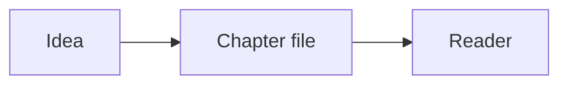

# AUTHORING — NUNDINA docs chapters

Each chapter is one markdown file in this directory, named `NN-slug.md` and listed
in `src/lib/docs.ts`. The reader (`src/components/docs/Markdown.tsx`) renders a
**controlled subset** of Markdown. Stick to it exactly so nothing is dropped.

## Hard rules (no hallucination)

1. **Cite every claim.** Repository facts as `path/to/file.rs:120`. External facts
   as `<source name>, <URL>, <access date 2026-10>`.
2. **Devnet facts only in present tense.** NUNDINA is devnet-only. 7 of 8 programs
   are deployed; `liquidity-facility` is built but not deployed; 0 of 8 are on
   mainnet. It is **not audited** and there is no APY, TVL, or LP-yield claim.
3. **Never invent** program IDs, account addresses, numbers, dates, names, or
   requirements. If a fact is not in the repo, write it under an "Open questions"
   heading as `> Open question: …`.
4. **Quote, don't embellish.** Prefer exact identifiers from source
   (`CG-P3`, `AE-P8`, `LF-P2`, `TE-P4`, `ME-P6` and other requirement IDs are
   exact and hyphenated).
5. Real market figures must be attributed and dated; do not present them as
   NUNDINA's own metrics.

## Structure

- Start with exactly one `#` H1: `# Chapter N — Title`.
- Then a one-paragraph preamble, then numbered sections:
  - `## N.1 Section`
  - `### N.1.1 Subsection` (optional)
- Use `##`–`####` only. Heading order defines the "On this page" ToC.
- A chapter should be **deep** (substance over padding) but scannable. Aim for a
  thorough reference chapter, not a summary.
- End with `## Open questions` listing anything unresolved (or omit if none).

## Supported Markdown subset

**Supported:** paragraphs; `**bold**`; `*italic*`; `` `inline code` ``;
`[text](href)` links (internal like `/docs/05-program-map-and-accounts` or external
with full URL); unordered & ordered lists; GFM tables; `>` blockquotes (use for
callouts, requirement quotes, "Open question"); `---` rules; fenced code with a
language tag; and ```` ```mermaid ```` diagrams.

**Not supported:** raw HTML, MDX components, images, footnotes, nested blockquotes.
Do not use them.

## Mermaid

Fence must open with ```` ```mermaid ```` and the first token must be one of
`flowchart`, `graph`, `stateDiagram-v2`, or `sequenceDiagram` (the repo docs linter
enforces this). Keep diagrams left-to-right and label edges. Every code fence must
be closed.



## Cross-linking

- Link sibling chapters with root-relative paths, e.g.
  `[the credit gate](/docs/07-credit-gate)`.
- Prefer the exact chapter slugs from `src/lib/docs.ts`.
