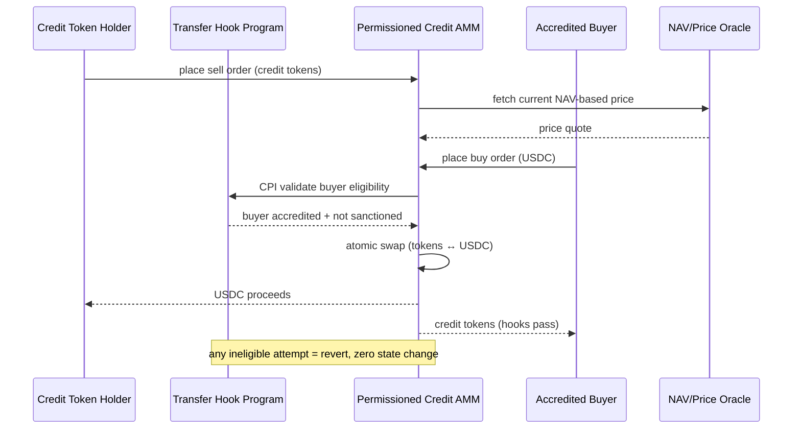
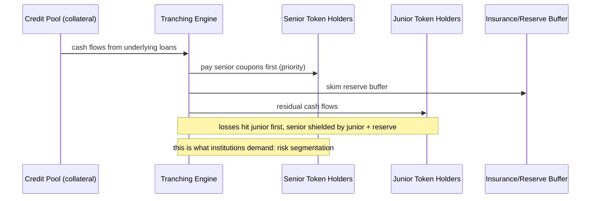
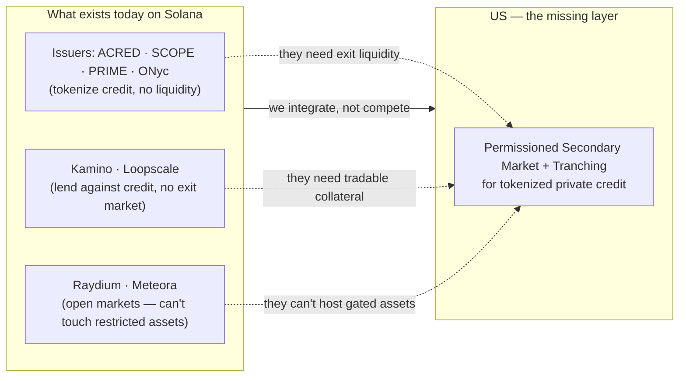

# High-Level System Architecture — Private Credit Secondary Markets on Solana

The complete picture: every layer, every actor, every mechanism in the private credit secondary market product. One view, all aspects.

---

## 1. The system at a glance (layered view)

```mermaid
flowchart TB
    subgraph L0["ASSET / ISSUER LAYER — who holds the credit"]
        A1["Apollo ACRED<br/>(Securitize, Token-2022)"]
        A2["Hamilton Lane SCOPE<br/>(Libre)"]
        A3["Figure PRIME / Hastra wYLDS"]
        A4["OnRe ONyc (reinsurance)"]
        A5["Circle USYC · BUIDL · VBILL<br/>(money-market wrappers)"]
    end

    subgraph L1["COMPLIANCE LAYER — Token-2022 native enforcement"]
        C1["Transfer Hooks<br/>KYC/AML/sanctions gate on every transfer"]
        C2["Permanent Delegate<br/>issuer freeze / seize / reverse"]
        C3["Account Freeze / Thaw<br/>restricted by default"]
        C4["Investor ID Aggregation<br/>(2,000-holder rule guard)"]
    end

    subgraph L2["CORE PROTOCOL LAYER — what WE build (six programs)"]
        P1["credit-amm<br/>Permissioned Credit AMM<br/>x·y=k, hooks-gated"]
        P2["credit-book<br/>Permissioned Orderbook<br/>(Phoenix/OpenBook-style)"]
        P3["tranch-engine<br/>Senior/Junior Tranching<br/>waterfall distribution"]
        P4["nav-oracle<br/>NAV feeds · mark-to-model"]
        P5["issuer-sdk<br/>one-click hooks + whitelist"]
        P6["credential-registry<br/>accredited/KYC credentials"]
    end

    subgraph L3["SOLANA DEFI RAILS — integration targets"]
        R1["Kamino RWA Markets<br/>(~87% of RWA DeFi TVL)"]
        R2["Loopscale Order-book Lending"]
        R3["Steakhouse Financial<br/>risk curation"]
        R4["DEXes: Raydium · Meteora"]
    end

    subgraph L4["USER / INTERFACE LAYER"]
        U1["Institutional investors<br/>accredited / qualified"]
        U2["Fund managers & treasuries"]
        U3["Keeper / liquidator bots"]
        U4["Wallets & institutional terminals"]
    end

    L0 --> L1
    L1 --> L2
    L2 --> L3
    L3 --> L4
```



**Reading it:** issuers (top) produce permissioned credit tokens on Token-2022 → our compliance layer (transfer hooks + credential-registry) gates *every* movement → our core protocol provides the two mechanisms (secondary market + tranching) → the whole thing composes with Solana's existing RWA DeFi rails → institutions access it through their tools.

> **Program inventory (consistent with `02-Protocol-Components.md`):** the six Anchor programs are `credit-amm`, `credit-book`, `tranch-engine`, `nav-oracle`, `issuer-sdk`, and `credential-registry`. Settlement/escrow is a *property of the AMM/book flows* (atomic swap), not a seventh program.

---

## 2. Every aspect mapped (the full inventory)

```mermaid
flowchart LR
    subgraph ACTORS["ACTORS"]
        INV["Accredited / Qualified Investors"]
        ISS["Credit Issuers<br/>ACRED · SCOPE · PRIME · ONyc"]
        KPR["Keepers / Liquidators"]
        CUR["Risk Curators<br/>(Steakhouse-style)"]
        TA["Transfer Agent<br/>(off-chain master file)"]
    end

    subgraph MECH["MECHANISMS"]
        M1["Secondary Exit<br/>sell credit tokens early"]
        M2["Secondary Entry<br/>buy without issuer redemption"]
        M3["Senior Tranche<br/>lower risk · lower yield"]
        M4["Junior Tranche<br/>higher risk · higher yield"]
        M5["Collateral Loops<br/>borrow against credit"]
        M6["Fee Capture<br/>taker/maker + tranche spread"]
    end

    subgraph REQ["SYSTEM REQUIREMENTS"]
        R1["Compliance-first (Reg D / 506c)"]
        R2["Atomic settlement"]
        R3["Oracle / NAV pricing"]
        R4["Bad-debt + liquidation path"]
        R5["Issuer permissioning control"]
    end

    ACTORS --> MECH
    MECH --> REQ
```



**The six mechanisms we build (each one is a feature):**
1. **Secondary Exit** — holders exit locked positions without waiting for redemption windows.
2. **Secondary Entry** — new investors enter via the market instead of mint/redeem flows.
3. **Senior Tranche** — first claim on cash flows, lower yield, safer (institutional appetite).
4. **Junior Tranche** — residual claim, higher yield, absorbs losses first (alpha appetite).
5. **Collateral Loops** — credit tokens as collateral in Kamino/Loopscale for leverage.
6. **Fee Capture** — the protocol's sustainable revenue (taker/maker fees + tranche spreads).

---

## 3. The data & trust flow (who trusts what)

```mermaid
flowchart TD
    ISS[Credit Issuer] -->|publishes NAV / price| ORACLE[Credit Pricing Module]
    ORACLE -->|price feeds| PAMM[Permissioned AMM]
    ORACLE -->|price feeds| POB[Permissioned Orderbook]
    ISS -->|mints permissioned tokens| TKN[Token-2022 Credit Token]
    TKN -->|transfer hook CPI| HOOK[Compliance Program]
    HOOK -->|checks| KYC[On-chain KYC / Accredited Registry]
    HOOK -->|checks| SAN[Sanctions List (OFAC-style)]
    HOOK -->|approve / revert| PAMM
    HOOK -->|approve / revert| POB
    TA[Transfer Agent] -->|master securityholder file| ISS
    CUR[Risk Curator] -->|tranching parameters| TR[Senior/Junior Tranching Engine]
    TR -->|waterfall cash flows| SEN[Senior Token Holders]
    TR -->|waterfall cash flows| JUN[Junior Token Holders]
```

---

## 4. The two mechanisms in detail

### Mechanism A — Permissioned Secondary Market



### Mechanism B — Senior/Junior Tranching Waterfall



---

## 5. Where we sit vs. the rest of Solana (positioning map)



**The whitespace is the point:** issuers tokenize but can't give liquidity; lenders accept collateral but can't provide an exit; open DEXes legally can't host restricted securities. The secondary market + tranching layer sits exactly in that empty middle.

---

*Next: `02-Protocol-Components.md` for the program-by-program breakdown and transaction flows.*
