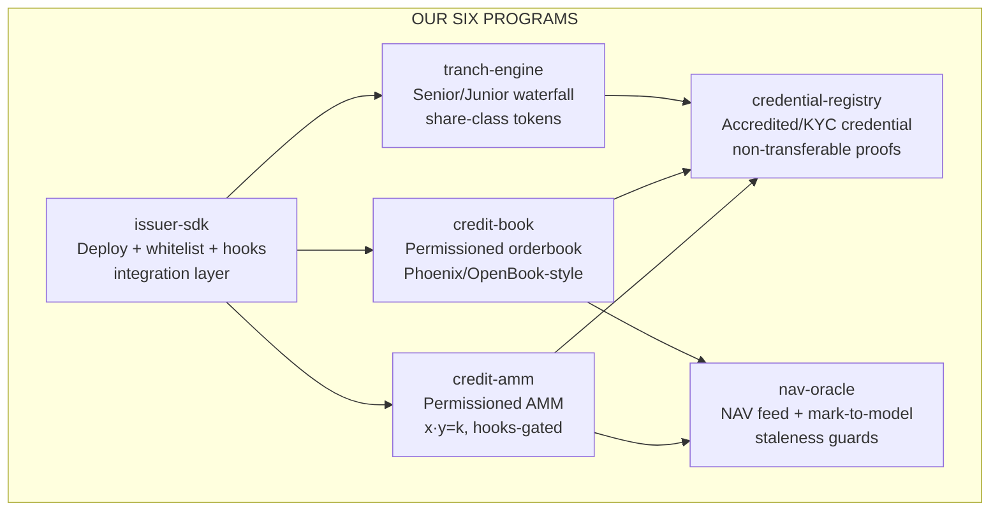
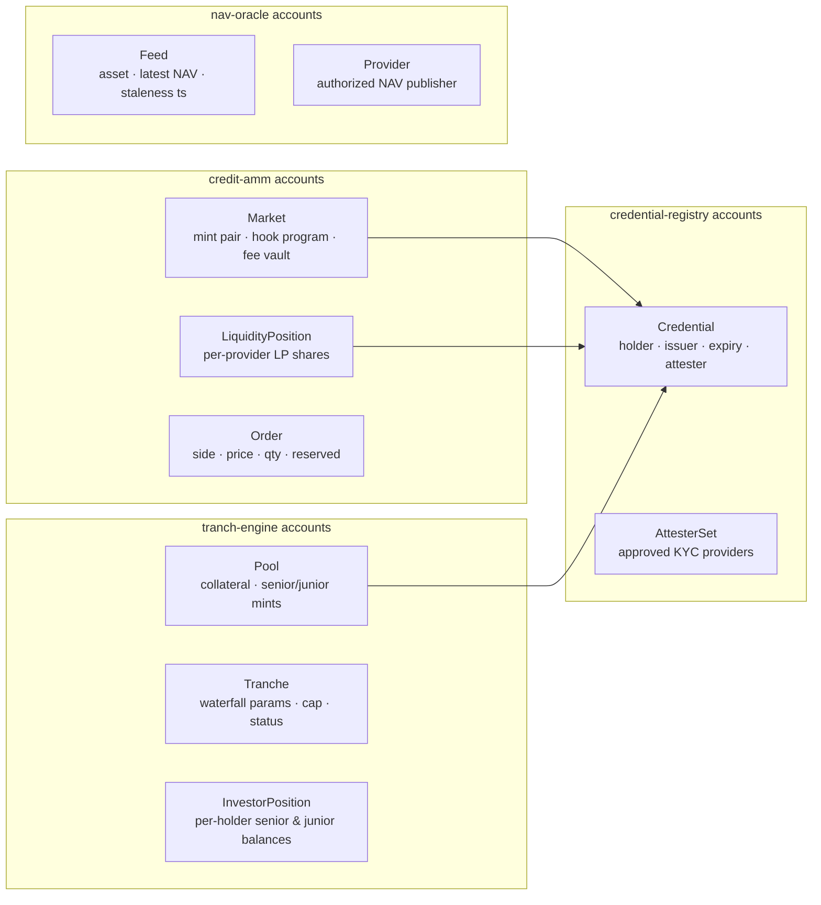
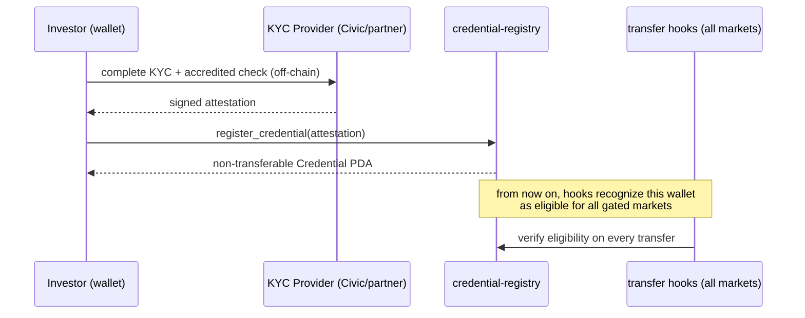
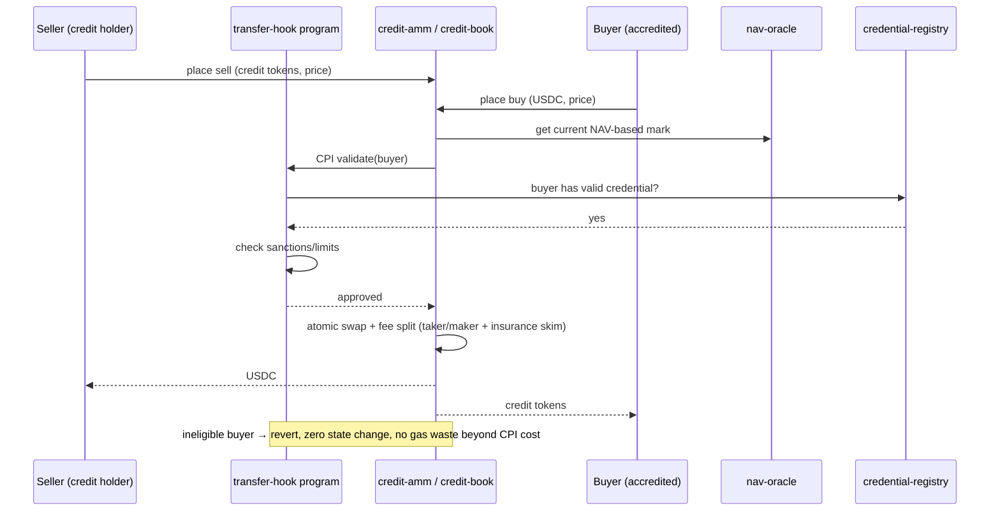
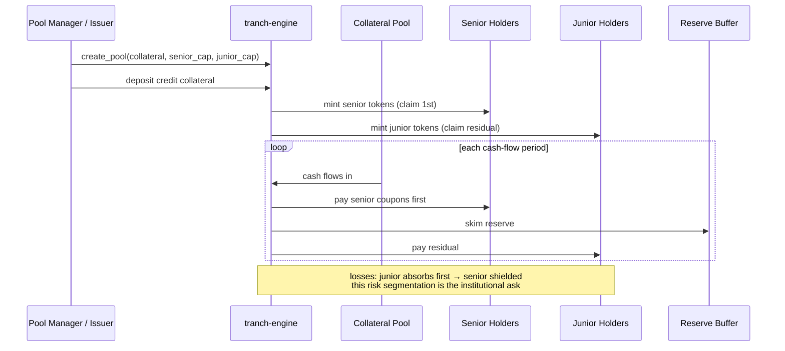
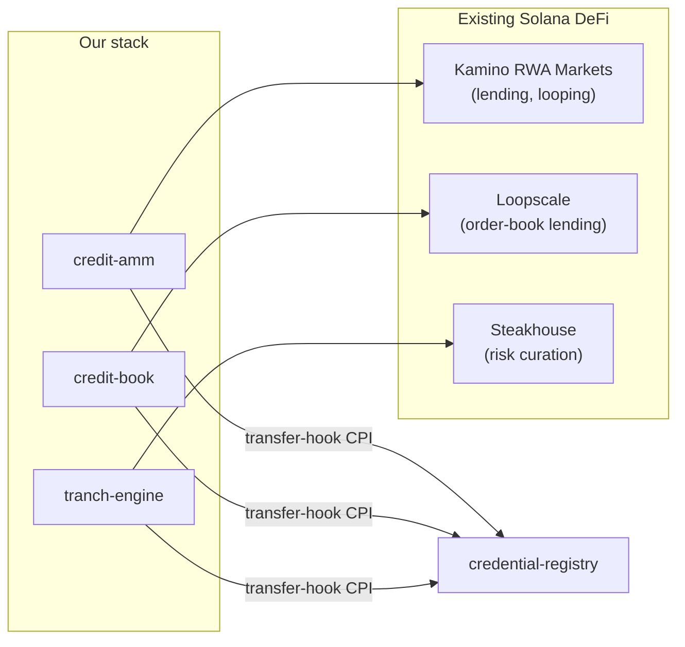

# Protocol Components & Transaction Flows

The on-chain program architecture — every program, its responsibilities, its accounts, and the critical flows as sequence diagrams. Modeled on Kimia's proven six-program composable stack.

---

## 1. Program map (six Anchor programs, one fixed-income-market stack)



**Design principles (borrowed from Kimia's playbook, adapted for credit):**
- **One program, one responsibility** — matching ≠ tranching ≠ compliance; each independently auditable.
- **Permissionless cranks, gated by hooks** — keepers can trigger rebalances/liquidations, but *every token movement* still passes the compliance hook.
- **Round-against-trader** — shared math crate (`credit-math`) always rounds against the taker.
- **Compliance by construction** — the registry is *read* by hooks; a wallet without a valid credential cannot even enter the order flow.

---

## 2. Account model per program



---

## 3. Transaction flows (the critical paths)

### Flow 1 — Investor onboarding (one-time)



### Flow 2 — Secondary trade (the core loop)



### Flow 3 — Tranching lifecycle



### Flow 4 — Liquidation / bad-debt path

```mermaid
sequenceDiagram
    participant K as Keeper (anyone)
    participant M as credit-amm
    participant TE as tranch-engine
    participant IF as Reserve Buffer
    participant ISS as Issuer (permanent delegate)

    K->>M: detect underwater position (NAV < threshold)
    M->>TE: trigger liquidation (hooks-gated)
    TE->>IF: draw reserve buffer first
    TE->>ISS: if still short → issuer freeze + recovery
    Note over TE,ISS: junior absorbs before reserve; issuer delegate is the final<br/>safety net (court orders, sanctions, lost keys)
```

---

## 4. Integration with existing Solana rails



**Composability story:** credit tokens that gain real secondary liquidity become *better collateral* — Kamino and Loopscale can lend against tranche tokens; Steakhouse curates the risk parameters. Our layer makes the whole RWA DeFi flywheel more liquid, which is exactly the Foundation's "issuance → utility" mandate.

---

*Next: `03-Feasibility-and-Compliance.md` — why this is only possible on Solana, and the compliance enforcement detail.*
