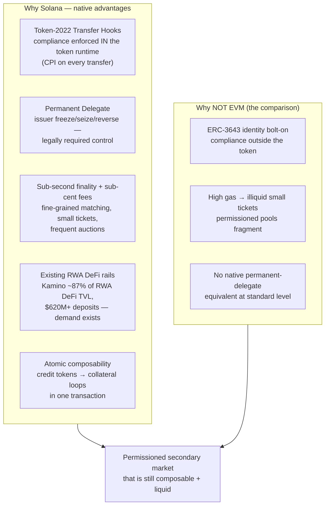
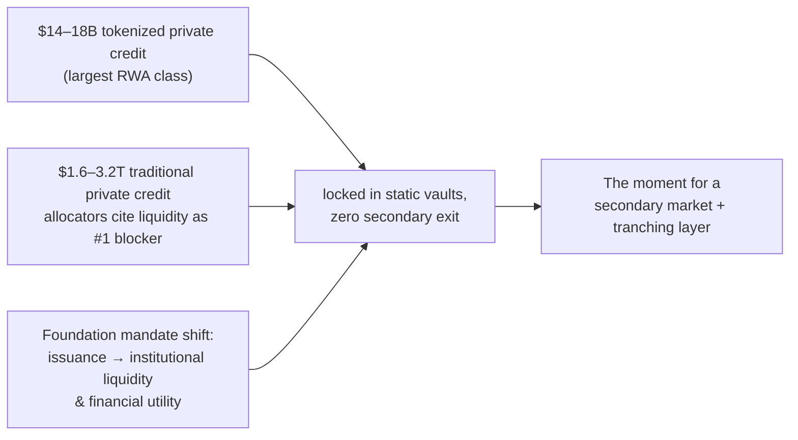
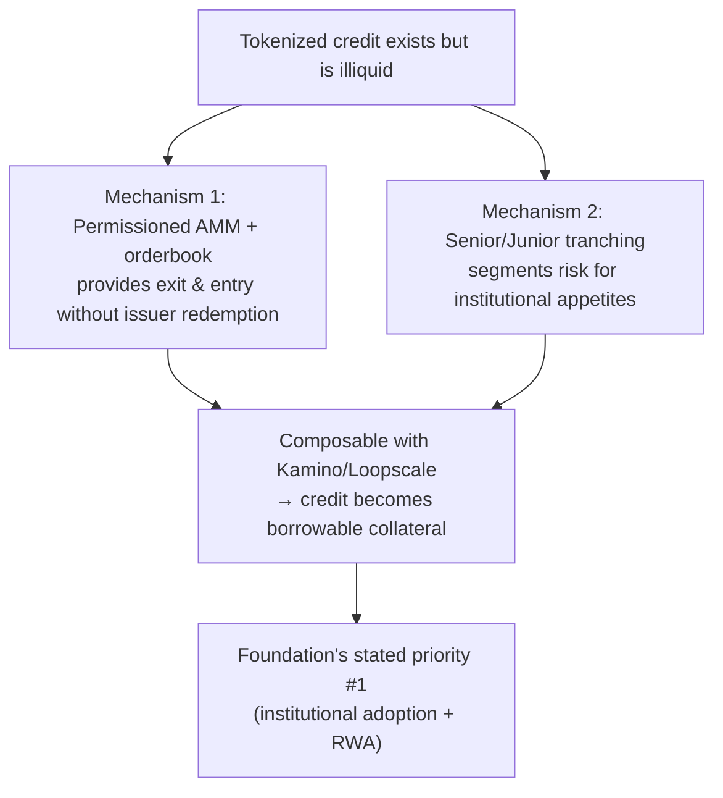
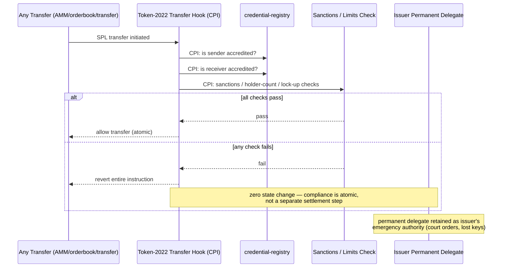
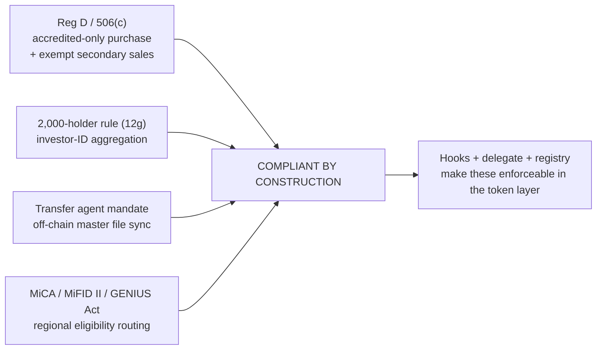

# Feasibility & Compliance — Why This Is Only Possible on Solana

> **⛔ Superseded (see `00-README.md`).** Kept as the original why-Solana case. As built, compliance is **not** a Token-2022 Transfer Hook: NPCS is default-frozen and thaws only through Token ACL (sRFC37) → `credit-gate`'s `validate`, which reads SAS attestations at account activation, and every fill is re-checked by `credit-gate` `settle_check` inside payment-rails' `settle_fill` (`06` §3, `DEPLOYMENTS.md`). The Transfer Hook diagrams below describe the design that was rejected.

The "why Solana," "why now," and "why this design" case — plus the compliance enforcement detail that makes a permissioned secondary market *natively expressible* instead of bolted-on.

---

## 1. Why this is "only possible on Solana" (the grant criterion)

**The one-sentence argument for the grant:** *"On EVM, a compliant secondary market for securities is a fragile assembly of identity contracts and transfer agents; on Solana, Token-2022 makes accredited-only transfers a property of the token itself — so we get a permissioned market that remains natively composable with lending rails. Only possible on Solana."*

---

## 2. Why now (timing evidence)

---

## 3. Why this design (the mechanisms exist to be built on)

---

## 4. Compliance enforcement detail (the load-bearing design)

### The enforcement flow on every transfer

### The four legal guardrails the design respects

---

## 5. Feasibility summary — what's proven vs. what we build

| Capability | Status on Solana | Our role |
|---|---|---|
| Token-2022 hooks + delegate | ✅ Live (used by ACRED, USYC, BUIDL) | We build on it |
| High-speed orderbooks (Phoenix/OpenBook) | ✅ Live | We wrap them with hooks |
| AMMs (Raydium/Meteora) | ✅ Live | Gated variants |
| Lending against RWA tokens | ✅ Live (Kamino, Loopscale) | We feed them liquid collateral |
| **Permissioned secondary market for credit** | ❌ **Does not exist** | **We build it** |
| **Senior/junior tranching for credit** | ❌ **Nascent (Credix, Tranched.fi — tiny)** | **We build it** |
| Credential/accredited registry | ⚠️ Fragmented (Civic, partner solutions) | We standardize it for credit |

**Verdict: 100% feasible — the hard parts (native compliance, fast settlement, lending rails) are already live; the missing pieces are exactly the two mechanisms we're building.**

---

## 6. Risk register (honest)

| Risk | Mitigation |
|---|---|
| Regulatory change (holder rules, accreditation) | Investor-ID aggregation, regional routing, issuer delegate as override |
| Cold-start liquidity | Seed with PRIME/ONyc (already secondary-friendly), incentive LPs, pair with Kamino |
| NAV/oracle manipulation | Staleness guards, multiple providers, confidence bands, mark-to-model fallback |
| Smart-contract risk | Separate auditable programs (one responsibility each), round-against-trader math |
| Helius/canonical-layer competition | We're complementary: they build privacy/compression; we build credit market infrastructure |

---

*Next: `04-Competitive-Differentiation.md` — exactly how we differ from every player in the sector.*
