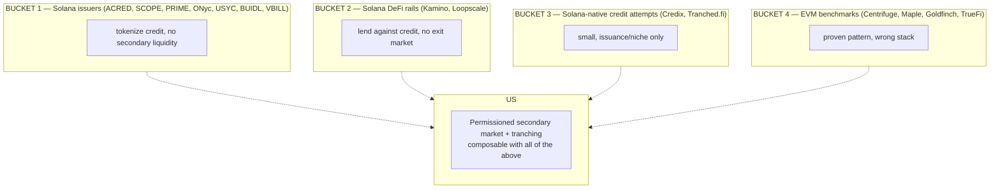
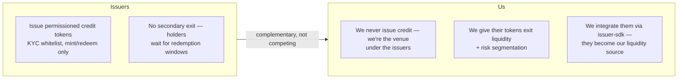
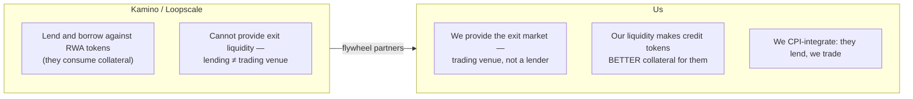
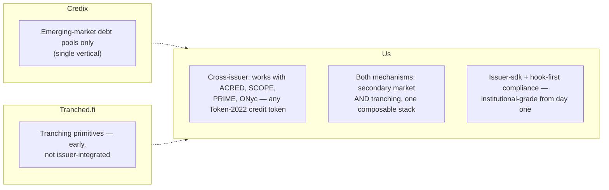
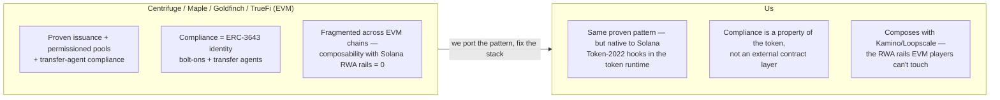
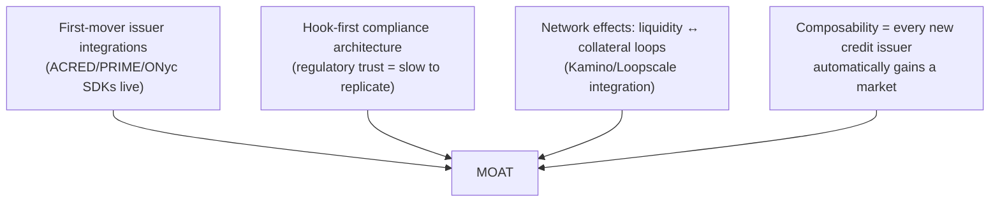

# Competitive Differentiation — How We Differ From Every Player in This Sector

> **⛔ Superseded (see `00-README.md`; current map in `../research/12`).** Integrations named below as if present — Kamino / Loopscale lending against our tokens, Orca pools for tranche tokens, an issuer SDK — are **roadmap**: no code in this repo calls those protocols. What is built is the mechanism layer (`credit-gate`, `auction-engine`, `mark-engine`, `queue-claim`, `liquidity-facility`, `tranche-engine`, `npcs-treasury`, `payment-rails`).

The sector's players grouped into four buckets — and exactly how we're different from each. No vague "we're better" claims; each difference is structural and verifiable.

---

## 1. The four buckets

---

## 2. Head-to-head differentiation

### vs. Solana issuers (ACRED, SCOPE, PRIME, ONyc, USYC, BUIDL)

**The structural difference:** issuers are *supply*; we're *distribution*. Their tokens become liquid *because of us*. This is the same relationship Kimia has with perps venues (it doesn't run the exchange AND tokenize — it tokenizes on top).

### vs. Kamino / Loopscale (Solana lending rails)

**The structural difference:** they're the *demand side* for credit collateral; we're the *liquidity side*. More secondary liquidity → better collateral → more lending. We make each other stronger; neither replaces the other.

### vs. Credix / Tranched.fi (the only Solana-native attempts)

**The structural difference:** they're early verticals; we're the horizontal infrastructure layer. Credix is debt-pools-in-emerging-markets; Tranched.fi is tranching-only. We combine both mechanisms and integrate *every* issuer, not one vertical.

### vs. EVM benchmarks (Centrifuge, Maple, Goldfinch, TrueFi)

**The structural difference:** they proved the *pattern* (permissioned pools + tranching + transfer agents work); we implement it where the *native compliance machinery and RWA liquidity* actually live. We're not reinventing Centrifuge — we're building its Solana-native successor with the token-layer compliance EVM can't offer.

---

## 3. The differentiation summary matrix

| Player | What they do | What we do instead / better | Why we win |
|---|---|---|---|
| ACRED, SCOPE, PRIME, ONyc, USYC, BUIDL, VBILL | Issue permissioned credit tokens | Give them secondary liquidity + tranching | They're supply; we're distribution. No conflict, pure synergy |
| Kamino, Loopscale | Lend against RWA tokens | Provide the exit market | They're demand; we're liquidity. Flywheel, not fight |
| Credix | EM debt pools (Solana) | Cross-issuer, both mechanisms | Horizontal vs. vertical |
| Tranched.fi | Tranching primitives (early) | Tranching + market + issuer SDK | Full stack, issuer-integrated |
| Centrifuge, Maple, Goldfinch, TrueFi | EVM permissioned credit | Same pattern, native Solana | Token-2022 compliance in the runtime; composes with Kamino/Loopscale |
| Open DEXes (Raydium/Meteora) | Open markets | Gated markets for restricted assets | They legally can't host these; we can |

---

## 4. The moat (why we can't be copied overnight)

---

## 5. What we are NOT (to keep the pitch honest)

- ❌ Not an issuer — we don't originate or tokenize credit.
- ❌ Not a lender — we don't lend capital.
- ❌ Not an open retail market — we're accredited-only by design.
- ❌ Not a fork of Centrifuge — we're a native-Solana implementation of the proven pattern.
- ❌ Not competing with Helius/Light privacy layer — orthogonal (they do confidentiality; we do credit market infrastructure).

---

*Back to `00-README.md` for the folder index, or `03-Feasibility-and-Compliance.md` for the why-Solana case.*
