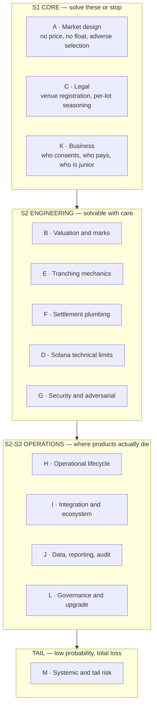

# Problem Register — Every Failure Mode in a Private Credit Secondary Market on Solana

> **Purpose:** the complete adversarial inventory. Every problem that can plausibly break this product, from market design down to compute units, with a failure mechanism, a severity, and a pointer to the architectural answer in `06-Solution-Architecture-v2.md`.
>
> **ID namespaces (#63):** the `L1`–`L6` rows here are *governance* problems; doc 07 reuses `L1`–`L27` for its *legal* register. `I1`–`I8` here are *integration* problems; doc 09 reuses `I1`–`I3` for the NPCS asset invariants. Cite with the doc number (`05 L5`, `07 L5`) when ambiguous. Code comments that say "L5 snapshot discipline" mean `05 L5`.
>
> **Severity:** **S1** = kills the product · **S2** = kills a feature or causes principal loss · **S3** = degrades materially · **S4** = friction.
> **Likelihood:** H / M / L, assuming no mitigation.
>
> **How to use this:** the S1×H rows are the only things that matter in month 1. Everything else is a roadmap. If you cannot answer A1, B1, C1, C2 and K1 to a sceptical allocator in two sentences each, do not write code yet.

---

## Domain map

---

## A · Market design & economics — *the domain that has actually blocked this product for two years*

| # | Problem | Failure mechanism | Sev | Lik | Answer |
|---|---|---|---|---|---|
| **A1** | **Passive-LP adverse selection** | An AMM quotes off a stale monthly/quarterly NAV. Holders with information about a coming markdown — the manager's own LPs, anyone watching the underlying borrowers — sell into the pool at the old mark. LPs are structurally the exit liquidity for informed sellers and bleed to zero | **S1** | **H** | §2 — no passive LP on the raw fund share. Sealed-bid periodic auction; every participant is an active bidder |
| **A2** | **There is no price** | The asset's "price" is an appraisal produced quarterly by the party whose fee depends on it. Continuous venues need a continuous reference and there isn't one | **S1** | **H** | §2, §4 — auction *manufactures* the price; `mark-engine` publishes discount curve |
| **A3** | **Thin float / no continuous two-sided depth** | Private-credit float on Solana is ~$10M today (ACRED on Loopscale ≈ $6.9M). A continuous book quotes air; spreads are 10%+ and nobody trades | **S1** | **H** | §2 — batch auction aggregates a whole period of intent into one cross. Depth is *time-aggregated*, not instantaneous |
| **A4** | **Cold start / two-sided chicken-egg** | Sellers won't submit without buyers; buyers won't onboard (KYC + accreditation + custody) without inventory | **S1** | **H** | §12 — anchor-buyer commitment before launch, issuer-sponsored first auction, `queue-claim` as the demand magnet |
| **A5** | **The issuer's own redemption window is the competing venue** | If the fund repurchases at NAV quarterly, why sell at a discount to us? | **S1** | **H** | §5 — we serve the *gated residual*: the pro-rated, denied portion. Our customer is created by the gate, not by the lockup |
| **A6** | **Winner's curse suppresses bids** | Buyers know sellers are informed, so they bid a wide discount to protect themselves; sellers reject; volume = 0 | **S2** | **H** | §2 — mandatory pre-auction disclosure pack, uniform-price clearing (not pay-as-bid), issuer participation as reference bidder |
| **A7** | **Discount signalling harms the issuer** | A public 12%-discount print marks the manager's book and invites redemption. Issuers will refuse consent | **S1** | **H** | §5, §11 — issuer-configurable print policy: delayed/banded publication, aggregate-only prints, issuer right-of-first-refusal at the clearing price |
| **A8** | **Fee model can't cover the cost of compliance** | 10–25bps on $10M of annual volume is $10–25K. The compliance and legal cost of a securities venue is 100× that | **S2** | **H** | §13 — revenue from `liquidity-facility` spread + tranche management fee + the **data product**, not from trading fees |
| **A9** | **Minimum viable ticket vs. accreditation cost** | Onboarding an accredited investor costs more than the profit on a $25K trade | **S3** | **H** | §12 — institutional-first (min ticket $250K+), reuse SAS attestations so onboarding amortises across issuers |
| **A10** | **Fragmentation across issuers** | Ten small isolated auctions, each too thin to clear | **S2** | **M** | §2 — synchronised auction calendar; cross-asset auction sessions; basket bidding |
| **A11** | **Wrong-way liquidity** | Everyone wants to sell at the same time (post-markdown) and buy at the same time (post-rally). One-sided auctions never cross | **S2** | **H** | §2 — reserve-price + minimum-fill logic, `liquidity-facility` as the alternative when the auction is one-sided, standing anchor bids |
| **A12** | **Buyers can just buy primary** | Most of these funds are open for subscription at NAV. Why buy secondary at all? | **S2** | **M** | §5 — secondary is attractive only at a *discount* or for *seasoned/short-duration* exposure; price the vintage advantage explicitly. Also why `queue-claim` (unavailable primary) matters more than spot |

---

## B · Valuation & marks

| # | Problem | Failure mechanism | Sev | Lik | Answer |
|---|---|---|---|---|---|
| **B1** | **Stale NAV** | Quarterly NAV, published weeks in arrears. Every risk decision made against it is wrong by construction | **S1** | **H** | §4 — staleness-decayed haircut; `NAV_effective = f(age, vol, sector)` |
| **B2** | **NAV suspension** | Manager suspends or delays the mark. Every downstream system loses its input | **S2** | **H** | §4, §11 — explicit `Suspended` state propagating to auction pause / waterfall standstill |
| **B3** | **Manager-marked NAV is not arms-length** | Appraised marks are smoothed and lag reality; senior tranche protection computed off them overstates safety | **S2** | **H** | §4 — dual price: use `min(NAV_official, NAV_implied_auction)` for all protective logic |
| **B4** | **No NAV feed at all** | Most issuers don't publish NAV on-chain. Only a handful (WisdomTree CRDT via Chainlink, Galaxy/State Street via NAVLink) do | **S1** | **H** | §4, §12 — attested-publisher path as fallback: issuer signs a NAV attestation via SAS; feed adapter normalises NAVLink / RedStone / attested |
| **B5** | **Oracle staleness → liquidation cascade** | A missed publication triggers spurious liquidations in `liquidity-facility` | **S2** | **M** | §4, §8 — staleness bands: warn / freeze-new / freeze-all. Never liquidate on stale data |
| **B6** | **Auction-implied price is manipulable at low volume** | A $50K wash cross sets the mark used to value $20M of tranches | **S2** | **H** | §4, §8 — minimum-volume and minimum-participant thresholds before a print is mark-eligible; volume-weighted, outlier-trimmed, time-decayed curve |
| **B7** | **Interest accrual between marks** | Credit accrues daily; NAV updates quarterly. Sawtooth pricing creates free arbitrage at each print | **S3** | **H** | §4 — accrual model between marks (coupon accrual curve), reset to official NAV on publication with a documented jump policy |
| **B8** | **PIK and non-accrual distortion** | Underlying loans paying in kind inflate NAV without cash. Waterfall pays coupons from cash that doesn't exist | **S2** | **M** | §6 — separate `cash_yield` from `accrued_yield` in the waterfall; cash-only senior coupons |
| **B9** | **Currency and duration mismatch** | Underlying in EUR/GBP or floating-rate; token priced in USDC | **S3** | **M** | §4 — per-asset FX and rate-duration metadata in the mark; disclose, don't hedge, in v1 |
| **B10** | **Model risk in the discount curve** | A wrong discount model quietly misprices every tranche and every advance | **S2** | **M** | §4 — publish the model, version it on-chain, and make every mark reproducible from raw inputs (§10) |

---

## C · Legal & regulatory — *where "compliant by construction" is a dangerous phrase*

| # | Problem | Failure mechanism | Sev | Lik | Answer |
|---|---|---|---|---|---|
| **C1** | **Operating an unregistered exchange** | An AMM/order book/auction that brings together multiple buyers' and sellers' orders in securities using established non-discretionary methods **is an exchange** under Exchange Act Rule 3b-16 → must register or run as an **ATS operated by a registered broker-dealer**. Reg D exempts the *transfer*, not the *venue*. This is the single most likely way the project dies | **S1** | **H** | §9 — venue-operator as a **pluggable licensed role**; partner ATS/BD, or non-US/Reg S v1. Protocol is non-custodial infrastructure |
| **C2** | **Rule 144 seasoning is per-lot, not per-holder** | Non-reporting issuer ⇒ 12-month holding period, running **per acquisition lot**. A fungible SPL balance cannot express "300 free-trading, 700 seasoned 4 more months, 200 affiliate-tainted." Every permissioned-token system gates *who* may hold, almost none gates *which units* may move *when* | **S1** | **H** | §7 — **lot ledger**: per-holder, per-lot PDA with acquisition timestamp, source, affiliate flag; FIFO/specified-lot selection at auction submission |
| **C3** | **Broker-dealer / transaction-based compensation** | Taking a fee on securities trades can itself make you an unregistered broker | **S1** | **H** | §9, §13 — revenue from software licensing, facility spread, and data; trading fees only via the licensed operator |
| **C4** | **12(g) holder-of-record threshold** | >2,000 holders of record (or 500 non-accredited) with >$10M assets forces Exchange Act registration on the *issuer*. Fractionalising a fund share across wallets is the fastest way to blow this up and lose every issuer relationship | **S1** | **M** | §7 — **holder-count governor**: wallets aggregate to investor IDs, hard cap enforced pre-allocation, auction rejects breaching fills |
| **C5** | **Transfer agent is the ledger of record** | The on-chain balance is not legally authoritative. If the master securityholder file and the chain diverge, the chain loses | **S2** | **H** | §10 — two-way reconciliation loop, on-chain state as *instruction* + evidence, TA file as record, break-detection alarms |
| **C6** | **Reg S / non-US flow contamination** | A Reg S offshore flow touching a US person voids the exemption | **S2** | **M** | §7 — jurisdiction attestations, per-market eligibility policy, distribution-compliance period clocks, geo-fenced front-end |
| **C7** | **MiCA does not apply; MiFID II does** | Tokenized credit = financial instrument. An EU secondary venue must be an authorised MTF/OTF run by an investment firm | **S2** | **M** | §9 — regional routing; EU flow only via an authorised partner venue |
| **C8** | **Section 4(a)(7) / 4(a)(1½) conditions** | Resales must satisfy an exemption per trade — information delivery, accredited purchaser, no general solicitation, no issuer shell | **S2** | **H** | §7, §9 — per-trade exemption checklist encoded in the gate; disclosure-pack hash bound to each auction |
| **C9** | **General solicitation** | A public order book, a public discount print, or a public leaderboard can constitute general solicitation for a 506(b) issue | **S2** | **M** | §7, §11 — 506(c)-only assets for public prints; gated data room for 506(b); issuer-configurable print policy |
| **C10** | **Custody rule / possession-or-control** | Escrowing client securities may constitute custody, triggering broker-dealer custody rules or investment-adviser Rule 206(4)-2 | **S2** | **M** | §9 — non-custodial escrow PDAs with holder-revocable authority; qualified-custodian integration (Anchorage/Fireblocks) for institutional flow |
| **C11** | **Sanctions / OFAC delta** | A wallet is sanctioned *after* onboarding; attestations are stale; a blocked person trades | **S2** | **H** | §7 — block-list precedence over allow-list (Token ACL semantics), attestation TTL + revocation feed, pre-settlement re-check |
| **C12** | **AML/BSA on the fiat and stablecoin loop** | Off-ramp obligations, travel rule, source-of-funds on large tickets | **S3** | **M** | §9 — obligations sit with the licensed operator and the stablecoin issuer; protocol emits the audit trail |
| **C13** | **Tranching creates a *new* security** | A senior/junior share class you create is itself a security you have issued — with its own registration, disclosure and possibly Investment Company Act / ABS Reg AB implications. This is a much bigger legal step than running a venue | **S1** | **H** | §6, §9 — tranche issuance sits in an **issuer-side or sponsor-side SPV**, not in the protocol. We provide the accounting engine; the SPV provides the paper |
| **C14** | **Investment Company Act / Volcker-style traps** | A protocol-controlled vehicle holding pools of securities can be an unregistered investment company | **S2** | **M** | §6, §9 — no protocol-owned pooled vehicle; per-deal SPV or issuer-side structure |
| **C15** | **ERISA / UBTI / withholding for the buyer base** | Pension and offshore buyers can't take certain structures; withholding on interest-like distributions | **S3** | **M** | §10 — investor-type attestations; per-tranche eligibility flags; distribution reporting |
| **C16** | **State-level BD registration and blue sky** | US state licensing on top of federal | **S3** | **M** | §9 — operator's problem by design |
| **C17** | **Innovation Exemption landed — but does not cover private funds** | SEC order 2026-90 (17 Sep 2026) grants 5-year relief to Tokenized Securities Venues for tokenized **NMS stock** via permissioned AMMs. Reg D fund shares are **not** in scope yet. Template exists; scope does not. Never load-bearing for v1 | **S1** | **M** | §9 + `../research/12` §6 — issuer-sponsored window unaffected; TSV relief is upside for the direct-venue path |
| **C18** | **Legal enforceability of the on-chain waterfall** | A smart-contract waterfall that contradicts the fund's LPA or the SPV's indenture is unenforceable; the paper wins | **S1** | **M** | §6 — waterfall parameters derived from, and hash-bound to, the executed legal document; a documented human override |

---

## D · Solana / on-chain technical

| # | Problem | Failure mechanism | Sev | Lik | Answer |
|---|---|---|---|---|---|
| **D1** | **Transfer hooks break composability** | Hook fires on every transfer; caller must resolve `ExtraAccountMetaList` and pass extra accounts in exact order. **Routers drop hooked tokens from routes**; many protocols blacklist them. The current architecture docs make hooks the load-bearing primitive — that is backwards | **S1** | **H** | §3 — **Token ACL (sRFC37)** as the compliance core: default-frozen accounts, permissionless thaw, pluggable Gate Program, zero CU on the transfer path |
| **D2** | **Hooks ⊕ Confidential Transfers are mutually exclusive** | A hook can't read an encrypted amount. Still unresolved in 2026. So no confidential order sizes at the token layer | **S2** | **H** | §2 — confidentiality achieved at the *auction* layer via commit–reveal hashes, not the token layer |
| **D3** | **Compute-unit ceiling on the auction clear** | Clearing N sealed bids, resolving lots, checking eligibility and settling in one transaction will exceed 1.4M CU well before N is interesting | **S1** | **H** | §2 — **chunked clearing**: price discovery in one instruction, allocation in paginated instructions, settlement per-fill; deterministic and resumable |
| **D4** | **Account size / zero-copy limits** | Order books and lot ledgers grow unbounded; 10MB account cap; realloc costs | **S2** | **H** | §2, §7 — fixed-capacity ring buffers per session, per-lot PDAs instead of one giant vector, session archival |
| **D5** | **Transaction size and address-lookup-table limits** | A settlement with many accounts (mint, ACL config, gate, extra metas, lot PDAs, escrow, fee vaults) blows the 1232-byte packet even with ALTs | **S2** | **H** | §2 — per-fill settlement instruction, pre-created ALTs per market, account-count budget as a design constraint |
| **D6** | **Crank liveness** | Auctions need a clearing crank. If no keeper runs it, funds sit escrowed indefinitely | **S2** | **M** | §8 — permissionless crank + bonded operators + **timeout refund path** callable by any participant |
| **D7** | **Clock manipulation / slot-time drift** | Auction windows keyed to slots drift against wall-clock NAV publication schedules | **S3** | **M** | §2 — `Clock.unix_timestamp` for windows, slot only for tie-breaks, grace periods |
| **D8** | **Rounding and precision** | Pro-rata allocation across sealed bids, tranche waterfalls, and per-lot splits create dust and off-by-one exploits | **S2** | **H** | §2, §6 — shared `credit-math` crate, u128 intermediates, always round against the initiator, dust sweep to reserve |
| **D9** | **Reentrancy and CPI depth** | 4-level CPI limit; gate → ACL → token → escrow chains hit it. A malicious gate program can grief | **S2** | **M** | §3 — flat CPI topology, gate programs allow-listed by mint config, depth budget documented per flow |
| **D10** | **Program upgrade authority = trust hole** | Institutions will ask who can change the code and how fast. An upgradeable program with a single key is a disqualifier | **S1** | **H** | §11 — Squads multisig with timelock, staged immutability, published upgrade policy, verifiable builds |
| **D11** | **Network congestion / priority fees** | Auction close and settlement land in the same slots as congestion events; fills fail | **S3** | **M** | §8 — retry-with-escalating-priority, jittered submission, settlement idempotency |
| **D12** | **Chain halt or degraded liveness during a settlement window** | Partial settlement leaves escrow inconsistent | **S2** | **L** | §8 — every multi-step flow is a resumable state machine, never a partially-applied mutation |
| **D13** | **`DefaultAccountState` + ATA UX** | Frozen-by-default token accounts break naive wallets and any integrator that doesn't append the thaw instruction | **S3** | **H** | §3 — SDK auto-inserts thaw; rely on the `token_acl` metadata pointer for wallet auto-detection; document for every integrator |
| **D14** | **Permanent delegate / freeze authority is a centralisation vector** | Legally necessary (court orders, lost keys, sanctions) but it means the issuer can seize. DeFi integrators price this as risk | **S3** | **H** | §3, §11 — disclose explicitly, publish the authority set, emit every delegate action as an indexed event |
| **D15** | **Rent, dust and account cleanup** | Thousands of lot PDAs and session accounts accumulate rent-bearing state | **S3** | **M** | §7 — closable session accounts, rent refunded to the payer, per-holder lot compaction |
| **D16** | **Anchor / dependency supply chain** | Token-2022, Anchor, ACL and gate crates all move; an upgrade breaks a live market | **S3** | **M** | §11 — pinned versions, verifiable builds, staging cluster mirroring mainnet extension set |
| **D17** | **Simulation vs execution divergence for gated transfers** | Front-ends simulate successfully, then the gate rejects at execution (revoked attestation, list update mid-flight) | **S3** | **H** | §3 — pre-flight eligibility endpoint + on-chain re-check + human-readable rejection reasons |

---

## E · Tranching mechanics

| # | Problem | Failure mechanism | Sev | Lik | Answer |
|---|---|---|---|---|---|
| **E1** | **Junior demand is the binding constraint** | Institutional appetite is overwhelmingly senior. Without first-loss capital the stack cannot be struck. Exponent's alpha is capped at $2.5M for exactly this reason | **S1** | **H** | §6 — sponsor/issuer-retained first loss as the default (also what makes senior credible), plus capped incentivised junior |
| **E2** | **Loss attribution ambiguity** | *When* is a loss realised — on NAV markdown, on default, on final recovery? Junior holders will litigate whichever definition costs them | **S1** | **H** | §6 — three-book accounting: `unrealised_mark`, `realised_loss`, `recovery_receivable`; junior absorbs realised, senior protected against unrealised via `min()` marks |
| **E3** | **Timing mismatch** | Senior coupons are due monthly; underlying cash arrives lumpy and quarterly | **S2** | **H** | §6 — reserve buffer sized to n coupon periods; deferral (non-cumulative vs cumulative) explicitly modelled |
| **E4** | **Tranche imbalance drift** | Redemptions from one tranche change the subordination ratio and silently re-rate the other | **S2** | **H** | §6 — attachment/detachment points enforced as invariants; redemptions blocked when they would breach subordination |
| **E5** | **Tranche tokens are illiquid too** | You've turned one illiquid token into two more illiquid tokens | **S2** | **H** | §6, §2 — tranche tokens *do* have a model price, so they are the correct assets to list in an Orca permissioned pool and to lend against on Kamino/Loopscale |
| **E6** | **Maturity mismatch** | Tranche maturity vs. underlying fund's open-ended, no-maturity structure | **S2** | **H** | §6 — fixed-term tranches with an extension option + a wind-down auction at maturity; never promise redemption the underlying can't fund |
| **E7** | **Correlated pool = no diversification** | Tranching a single fund's shares just re-slices one credit exposure; senior "safety" is illusory if the fund itself blows up | **S2** | **M** | §6 — minimum-diversification and concentration limits; disclose that senior is protected against *severity*, not against total loss |
| **E8** | **Waterfall vs. legal document divergence** | See C18. Also: fee ordering, expenses, and the manager's carry sit *above* junior in the real LPA | **S1** | **M** | §6 — full expense/fee waterfall modelled, parameters hash-bound to the executed document |
| **E9** | **Redemption run on junior** | Junior holders exit at the first sign of stress, stranding senior with no cushion | **S2** | **H** | §6 — junior lockup + gate; subordination invariant blocks the exit |
| **E10** | **Distributions in kind / corporate actions** | Fund distributes securities, does a split, or restructures. The waterfall has no representation for it | **S2** | **M** | §10 — corporate-action module with a pause + manual-adjustment path, all adjustments evented |
| **E11** | **Tax character pass-through** | Senior/junior holders need K-1-equivalent character (interest vs return of capital vs capital gain). On-chain waterfall doesn't produce it | **S3** | **H** | §10 — distribution-classification metadata per payment, exported to the reporting layer |
| **E12** | **Negative NAV / total loss handling** | Waterfall arithmetic with a wiped-out junior and impaired senior | **S2** | **M** | §6 — explicit `Impaired` and `WoundDown` states, no underflow paths, terminal accounting |

---

## F · Settlement & liquidity plumbing

| # | Problem | Failure mechanism | Sev | Lik | Answer |
|---|---|---|---|---|---|
| **F1** | **DvP atomicity across a gated asset** | Buyer's cash moves, seller's token fails the gate → one-sided settlement | **S2** | **H** | §2 — single-transaction atomic escrow release; eligibility re-checked inside the settlement instruction |
| **F2** | **Failed-fill handling** | Bidder wins an allocation then lacks funds or eligibility at settlement | **S2** | **H** | §2 — pre-funded escrow at bid submission (cash locked at commit), not at settlement |
| **F3** | **Partial fills of an indivisible legal lot** | Pro-rata allocation splits an acquisition lot, forking its seasoning clock | **S2** | **H** | §7 — lot-splitting rules that preserve acquisition metadata on both halves |
| **F4** | **Stablecoin choice and depeg** | USDC vs USDG vs PYUSD; Loopscale's ACRED product settles in USDG. A depeg during settlement mis-prices every fill | **S3** | **M** | §2 — per-market settlement asset, price-checked at clear, depeg circuit breaker |
| **F5** | **GENIUS Act: stablecoins can't pay yield** | Cash legs sit idle; buyers won't pre-fund for a week for free | **S2** | **H** | §2 — short commit windows (hours, not weeks); optional yield-bearing settlement asset accepted as the cash leg |
| **F6** | **Fiat on/off-ramp latency vs T+0 settlement** | Institutions fund from bank rails; the auction settles instantly. Mismatch | **S3** | **H** | §12 — pre-funding requirement, custodian integration, committed-capital model for anchor buyers |
| **F7** | **Custodian can't hold the asset** | Anchorage/Fireblocks must support the specific mint, its extensions, and the thaw flow | **S2** | **H** | §12 — custodian compatibility as a launch gate, not an afterthought |
| **F8** | **Liquidation of a permissioned collateral** | `liquidity-facility` default: you cannot dump gated collateral on an open DEX. Kamino/Loopscale have the same unsolved problem | **S1** | **H** | §5 — liquidation *is* an auction (forced-sale session) with a standing backstop bidder and issuer right of first refusal |
| **F9** | **Cross-chain fragmentation** | ACRED and STAC exist on 5–6 chains; the float is split, and so is price discovery | **S3** | **M** | §12 — Solana-first, publish the print as a cross-chain reference; bridge later, never in v1 |
| **F10** | **Settlement finality vs legal transfer** | Chain finality is instant; legal transfer completes when the transfer agent books it | **S2** | **H** | §10 — two-phase legal settlement: on-chain provisional + TA confirmation, with a documented break process |

---

## G · Security & adversarial

| # | Problem | Failure mechanism | Sev | Lik | Answer |
|---|---|---|---|---|---|
| **G1** | **Front-running the NAV print** | Whoever sees the NAV first trades against the auction. Classic mutual-fund late-trading, reproduced on-chain | **S1** | **H** | §2 — commit–reveal sealed bids; auction window closes *before* the print; no order modification after commit |
| **G2** | **Wash trading to set the mark** | Two colluding wallets cross a small size to move `NAV_implied`, then borrow against the inflated mark | **S1** | **H** | §4, §8 — min-volume/min-participant thresholds, distinct-investor-ID requirement, outlier trimming, mark eligibility flags |
| **G3** | **Sybil wallets for a single investor** | Breaks the holder-count governor and the anti-collusion checks | **S2** | **H** | §7 — investor-ID aggregation at the attestation layer, not wallet-level counting |
| **G4** | **Bid-shading / collusion in a thin auction** | Three known buyers coordinate a low clearing price | **S2** | **H** | §2 — reserve price from the mark, uniform-price clearing, issuer right of first refusal, sealed bids |
| **G5** | **Oracle manipulation of the underlying feed** | Compromise or spoof the NAV publisher | **S1** | **L** | §4 — multi-publisher quorum, deviation bounds vs prior mark, manual attestation fallback, publisher key rotation |
| **G6** | **Gate-program griefing** | A malicious or buggy Gate Program blocks thaws or consumes CU, freezing a market | **S2** | **M** | §3 — allow-listed gate programs, CU budget caps, fallback gate |
| **G7** | **Admin key compromise** | Freeze authority, upgrade authority, or mark-publisher key stolen | **S1** | **L** | §11 — Squads multisig + timelock + role separation + hardware/HSM + published authority map |
| **G8** | **Escrow drain via account-substitution** | Attacker passes a look-alike escrow/vault/mint account | **S2** | **M** | §11 — strict PDA derivation and `has_one` constraints everywhere; no unchecked `AccountInfo` |
| **G9** | **Economic exploit of tranche rounding** | Repeated micro-mints/redeems extract dust from the waterfall | **S2** | **M** | §6 — round against the user, minimum ticket, per-epoch action limits |
| **G10** | **Flash-loan-style same-slot manipulation** | Borrow, move the mark, exploit, repay | **S2** | **M** | §4 — marks are period-averaged and never same-slot spot; time-weighted inputs only |
| **G11** | **MEV on the settlement transaction** | Reordering or sandwiching around the clear | **S3** | **M** | §2 — uniform clearing price removes the incentive structurally (the SUPA insight); Jito bundles for settlement atomicity |
| **G12** | **Denial-of-service via bid spam** | Thousands of tiny sealed bids exhaust session capacity and CU | **S3** | **H** | §2 — bid bond, minimum size, per-investor bid caps, fixed session capacity |
| **G13** | **Griefing the timeout refund** | Attacker forces auction failure repeatedly to prevent any price forming | **S2** | **M** | §2, §8 — forfeitable bid bonds, reputation on investor IDs, operator-triggered manual clear |
| **G14** | **Unaudited fork / imitation with the same name** | Users lose funds on a clone; reputational kill | **S3** | **M** | §11 — verifiable builds, published program IDs, on-chain registry of official markets |

---

## H · Operational & lifecycle

| # | Problem | Failure mechanism | Sev | Lik | Answer |
|---|---|---|---|---|---|
| **H1** | **Issuer consent is a hard veto** | Transfer restrictions mean the issuer/manager must approve every secondary transfer. No consent, no product. **This is the true gating item for the whole business** | **S1** | **H** | §12 — issuer consent workflow as a first-class on-chain object; win one issuer before building |
| **H2** | **Issuer has negative incentive** | Secondary transfers cost the manager fee revenue (redemption fees), create discount signalling (A7), and add admin burden | **S1** | **H** | §13 — pay the issuer: fee share, right of first refusal, controlled print policy, and reduced redemption-queue pressure as the pitch |
| **H3** | **KYC / attestation provider dependency** | Provider outage or de-listing freezes onboarding | **S3** | **M** | §3 — multiple SAS credential issuers, attestation portability, cached validity with TTL |
| **H4** | **Attestation expiry mid-flight** | Accreditation lapses between bid and settlement | **S3** | **H** | §7 — validity must cover the whole settlement window; re-check at settlement; grace policy |
| **H5** | **Revocation propagation lag** | Revoked credential still passes for hours | **S2** | **M** | §7 — block-list precedence, short TTLs, revocation feed as a settlement pre-check |
| **H6** | **Reconciliation breaks** | On-chain vs transfer-agent divergence discovered weeks later | **S2** | **H** | §10 — daily automated reconciliation with break alarms and a documented resolution SLA |
| **H7** | **Dispute resolution has no on-chain answer** | Two parties disagree about a fill, a mark, or a waterfall payment | **S2** | **M** | §10 — arbitration clause in the venue terms, immutable evidence export, operator adjustment path with full audit trail |
| **H8** | **Court order / legal seizure** | A judgment requires clawback of tokens already traded | **S2** | **M** | §3, §11 — permanent delegate retained by the issuer (never by us), documented and evented |
| **H9** | **Key loss by an institutional holder** | Locked-out holder with a real legal claim | **S3** | **M** | §12 — custodian-first onboarding; issuer-delegate recovery procedure |
| **H10** | **Wind-down of a market** | A market must close with positions outstanding | **S2** | **M** | §11 — terminal state machine: final auction → final waterfall → escrow return → account closure |
| **H11** | **Team key-person and knowledge risk** | A 2–4 person team operating securities infrastructure | **S3** | **H** | §11 — runbooks, no manual-only paths, everything scriptable and reproducible |
| **H12** | **Insurance / E&O** | An operational error causes a client loss with no cover | **S3** | **M** | §13 — operator carries E&O; protocol reserve fund |

---

## I · Integration & ecosystem

| # | Problem | Failure mechanism | Sev | Lik | Answer |
|---|---|---|---|---|---|
| **I1** | **Kamino / Loopscale must accept the tranche token** | Without lending integration, tranche tokens are dead-end assets (E5) | **S2** | **H** | §5, §12 — design tranche tokens to be Token-ACL-compatible and mark-priced from day one; partner integration before launch |
| **I2** | **Orca permissioned pool interoperability** | Our gate must be compatible with Orca's access-control expectations or we can't list | **S2** | **M** | §3 — conform to sRFC37/ABL semantics exactly; treat Orca as the continuous venue for tranche tokens |
| **I3** | **Jupiter routing excludes gated assets** | Distribution loss; also D1 | **S3** | **H** | §3 — Token ACL keeps transfers route-clean; publish the resolver metadata |
| **I4** | **Wallet support for frozen-by-default and thaw** | Users see zero balance or failed sends | **S3** | **H** | §3 — `token_acl` metadata pointer + SDK helpers; test matrix across Phantom/Backpack/Squads |
| **I5** | **Institutional access path** | Allocators use OMS/EMS and custodians, not browser wallets | **S3** | **H** | §12 — API-first, FIX-ish adapter, custodian-signed flows, Squads-native |
| **I6** | **Competing with a partner** | Securitize could ship the same auction on its ATS; Orca could add batch auctions | **S2** | **H** | §12 — position as the pricing/queue/tranching engine *they license*, and own the data asset |
| **I7** | **Standards drift** | sRFC 00020 finalises differently from our assumptions | **S3** | **M** | §11 — participate in the sRFC thread; adapter-pattern the token interface |
| **I8** | **Indexer / RPC support for extension state** | Lot ledgers, ACL configs, gate state need reliable indexing | **S3** | **M** | §10 — own indexer, Geyser plugin, deterministic event schema |

---

## J · Data, reporting & audit

| # | Problem | Failure mechanism | Sev | Lik | Answer |
|---|---|---|---|---|---|
| **J1** | **Marks not reproducible** | An auditor cannot re-derive the mark that valued a position | **S2** | **H** | §10 — versioned model + raw inputs + output hash, all on-chain |
| **J2** | **No investor statements** | Institutions need periodic position/valuation/income statements | **S3** | **H** | §10 — statement generator off the event stream |
| **J3** | **Tax reporting** | Interest vs capital vs return-of-capital character; withholding (E11, C15) | **S3** | **H** | §10 — classification metadata on every distribution |
| **J4** | **Audit trail completeness** | Missing events make an event unprovable after the fact | **S2** | **H** | §10 — event-per-state-transition discipline; no silent mutations |
| **J5** | **Privacy vs transparency** | Institutions won't broadcast position sizes and exit prices; but hooks+confidential transfers are incompatible (D2) | **S2** | **H** | §2, §10 — commit–reveal hides bids pre-clear; aggregate-only public prints; permissioned data room for detail |
| **J6** | **SOC 2 / operational assurance** | Institutional diligence asks for it | **S3** | **M** | §13 — operator-side control framework, phase 3 |

---

## K · Business & go-to-market

| # | Problem | Failure mechanism | Sev | Lik | Answer |
|---|---|---|---|---|---|
| **K1** | **Nobody has to say yes but the issuer, and the issuer's incentive is negative** | See H1/H2. This is the real product risk, larger than every technical item combined | **S1** | **H** | §12, §13 |
| **K2** | **Addressable float today is ~$10M** | Fee-bearing volume in year 1 could be single-digit millions | **S1** | **H** | §12 — target the STAC/Ethena $250M cohort and OnRe/Exponent flow; sell the facility and the data, not the trading fee |
| **K3** | **Enterprise sales cycle vs. runway** | 9–18 month issuer cycles against a grant-funded runway | **S2** | **H** | §12 — sequence: permissionless-adjacent asset (ONyc) → semi-permissioned (YLDS/PRIME) → fully gated (ACRED/STAC) |
| **K4** | **The "just use the ATS" objection** | Securitize can do all of this behind its own licence | **S2** | **H** | §12 — be the engine they don't have; the auction, the queue claim, and the mark are the differentiators, not the venue |
| **K5** | **Token launch temptation** | A protocol token on a securities venue invites a second securities problem | **S2** | **M** | §13 — no token in v1; equity/convertible-grant path |
| **K6** | **Grant framing mismatch** | Building a rival registry/AMM reads as duplication; the Foundation funds public goods and standards | **S3** | **H** | §13 — Gate Program + auction engine + public discount dataset as the open core |
| **K7** | **Regulatory-change risk to the whole thesis** | Holder rules, accreditation definition, or Innovation Exemption shifts | **S2** | **M** | §9 — parameterised policy engine; jurisdiction routing |
| **K8** | **Team credibility with allocators** | Private credit allocators buy from people with credit track records | **S3** | **H** | §12 — recruit or advisory-board a credit/secondaries person before the first issuer meeting |

---

## L · Governance & upgrade

| # | Problem | Failure mechanism | Sev | Lik | Answer |
|---|---|---|---|---|---|
| **L1** | **Who sets parameters?** | Haircuts, reserve prices, subordination levels are all economically decisive | **S2** | **H** | §11 — curator model (Steakhouse-style) with published mandates and on-chain parameter bounds |
| **L2** | **Curator insolvency or misconduct** | Bad parameters cause real loss | **S2** | **M** | §11 — hard on-chain bounds that no curator can exceed; curator skin-in-the-game |
| **L3** | **Upgrade vs immutability tension** | Institutions want immutability; a young protocol needs to iterate | **S2** | **H** | §11 — timelocked upgrades → per-market immutability freeze after maturity |
| **L4** | **Emergency powers abuse** | A pause key used to advantage an insider | **S2** | **L** | §11 — pause is *pause only*, never a state-mutating power; multi-party, evented |
| **L5** | **Parameter change mid-auction** | Changes the economics of live bids | **S2** | **M** | §2 — parameters snapshotted at session open, immutable for the session |
| **L6** | **Fork/governance capture** | Later token governance overrides prudential limits | **S3** | **L** | §11 — prudential limits outside governance reach |

---

## M · Systemic & tail

| # | Problem | Failure mechanism | Sev | Lik | Answer |
|---|---|---|---|---|---|
| **M1** | **Credit cycle turns** | 2026 is the private credit market's "first big test." Defaults rise, NAVs fall, junior wipes out, senior impairs, and the first on-chain private-credit product to exist prints the loss publicly | **S1** | **M** | §6, §11 — design for the down case first; conservative attachment points; public, honest loss accounting is a feature, not a bug |
| **M2** | **Correlated redemption run** | Gate slam across the industry (already happening since Q1 2026) → every holder tries to exit at once → auctions clear at brutal discounts → death spiral in the mark | **S1** | **M** | §4, §11 — mark circuit breakers, forced-sale session flagging (excluded from the mark), facility-first routing |
| **M3** | **Issuer / manager insolvency** | The underlying asset's sponsor fails mid-market | **S2** | **L** | §11 — terminal wind-down state machine; no protocol-held claims |
| **M4** | **NAV suspension across the board** | All feeds go dark simultaneously | **S2** | **L** | §4 — suspension state, standstill, no liquidations |
| **M5** | **Stablecoin depeg during settlement** | Cash leg is worth 0.9 | **S2** | **L** | §2 — settlement-asset price check + breaker |
| **M6** | **Chain-level outage** | Solana degraded during a redemption window | **S2** | **L** | §8 — resumable state machines; off-chain evidence of intent |
| **M7** | **Custodian or oracle provider failure** | Single point of failure in the institutional path | **S2** | **L** | §12 — dual custodian, dual oracle |
| **M8** | **Legal challenge as precedent** | First enforcement action against on-chain private-credit secondary trading names us | **S1** | **L** | §9 — licensed-operator slot, conservative jurisdiction sequencing, real securities counsel from month 1 |

---

## Ranked kill-list — the ten that decide the outcome

```mermaid
flowchart LR
    subgraph MUST["Must be answered before writing production code"]
        K1["K1/H1/H2 · Issuer consent<br/>and negative issuer incentive"]
        C1["C1 · Venue registration<br/>Rule 3b-16 / Reg ATS"]
        A1["A1/A2/A3 · No price, thin float,<br/>LP adverse selection"]
        C2["C2 · Per-lot Rule 144 seasoning"]
        E1["E1 · Junior capital<br/>is the binding constraint"]
    end
    subgraph NEXT["Must be answered before mainnet"]
        C13["C13 · Tranching issues<br/>a new security"]
        D1["D1 · Hooks break composability<br/>use Token ACL"]
        B4["B4 · Most issuers publish no NAV"]
        F8["F8 · Liquidating permissioned collateral"]
        C4["C4 · 12(g) holder-count"]
    end
    MUST --> NEXT
    NEXT --> OUT["Everything else is engineering"]
```

| Rank | ID | The question it forces |
|---|---|---|
| 1 | K1 / H1 / H2 | Which issuer will sign a secondary-transfer consent, and what do we pay them for it? |
| 2 | C1 | Who is the licensed venue operator on day one? |
| 3 | A1 / A2 / A3 | What mechanism produces a price without a passive LP and without continuous depth? |
| 4 | C2 | How do we track per-lot seasoning so a transfer is actually lawful? |
| 5 | E1 | Who takes first loss? |
| 6 | C13 | Whose SPV issues the tranche paper? |
| 7 | D1 | Token ACL, not transfer hooks — is every integrator aligned on that? |
| 8 | B4 | Where does the NAV come from for our pilot asset? |
| 9 | F8 | How is a defaulted permissioned collateral actually liquidated? |
| 10 | C4 | What is the holder-count budget per asset, and who enforces it? |

---

*Next: `06-Solution-Architecture-v2.md` — the architecture that answers every row above, with diagrams per problem cluster.*
