# Solution Architecture v2 — The Pricing, Queue & Risk-Transfer Engine for Gated Credit

> **Supersedes** `01-High-Level-Architecture.md`, `02-Protocol-Components.md`, `03-Feasibility-and-Compliance.md` and the differentiation claims in `04-Competitive-Differentiation.md`. Those documents assume a world that ended in May–June 2026 (see `../research/12-Validation-2026-Reality-Check.md`).
>
> **This document answers every row in `05-Problem-Register.md`.** Section numbers here are the `§` targets referenced there. A full traceability matrix is at the end (§14).
>
> **Product name:** `NUNDINA`

---

## The three reframes that make this buildable

1. **Stop trying to be a venue. Be the mechanism.** Orca and Securitize built venues in May 2026. Nobody built the thing that tells you what a gated, quarterly-marked credit position is worth, or that turns a denied redemption request into a financeable asset.
2. **v1 is an issuer-sponsored liquidity window, not a third-party exchange.** An issuer running a periodic repurchase/liquidity auction in its own securities is a fundamentally different regulatory object from a third party matching investor orders (§9). It also flips the issuer's incentive from hostile to positive — they get a NAV-accretive buyback tool, control of the print, and relief on their gated redemption queue. **This single decision resolves the five worst problems in the register at once: K1, H1, H2, C1, A7.**
3. **Never put a passive LP in front of a stale NAV.** Price discovery is a **sealed-bid periodic uniform-price auction**. There is no pool to pick off, so the adverse-selection problem that has blocked this entire category simply does not arise (§2).

---

## §1 · System overview — what we build vs. what we integrate

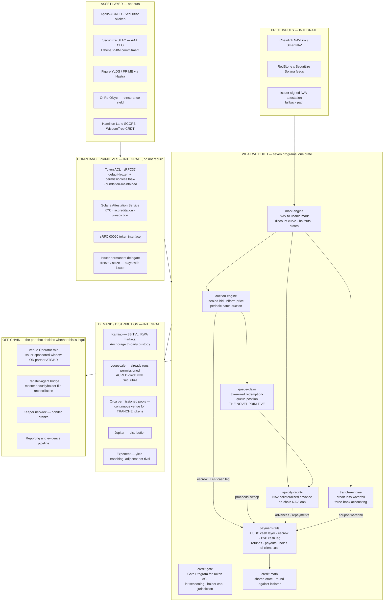

### Program inventory and dependency graph

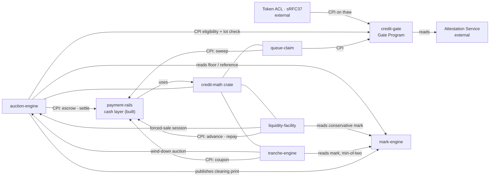

**Deliberate omissions.** No AMM (Orca has it, and it's the wrong primitive for the raw asset — A1). No credential registry (SAS + Token ACL — D1, K6). No NAV oracle (NAVLink / RedStone — B4). No issuance platform (Securitize). No protocol token (K5). No custody (C10).

**Audit boundary:** each program is independently auditable, one responsibility each, and `credit-gate` is the only program that must be audited to securities-infrastructure standard because it is the one enforcing law.

*Amendment (2026-09, #47):* the build added **`payment-rails`**, a shared cash layer below the engines that holds every escrowed client dollar (SRS 08 §4.7). It is audited to the same standard as `credit-gate`: the gate enforces law, and the rails hold the money. Its "one responsibility" is exact cash movement, shared by the engines instead of duplicated in each.

---

## §2 · `auction-engine` — sealed-bid periodic uniform-price auction
*Answers: A1, A2, A3, A6, A10, A11, D3, D4, D5, D7, D8, F1, F2, F4, F5, G1, G4, G11, G12, G13, J5, L5, M5*

### Why an auction and not a pool

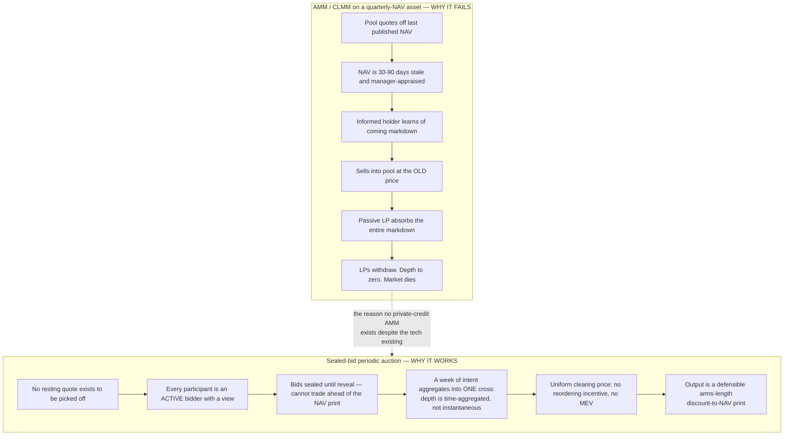

### Session state machine

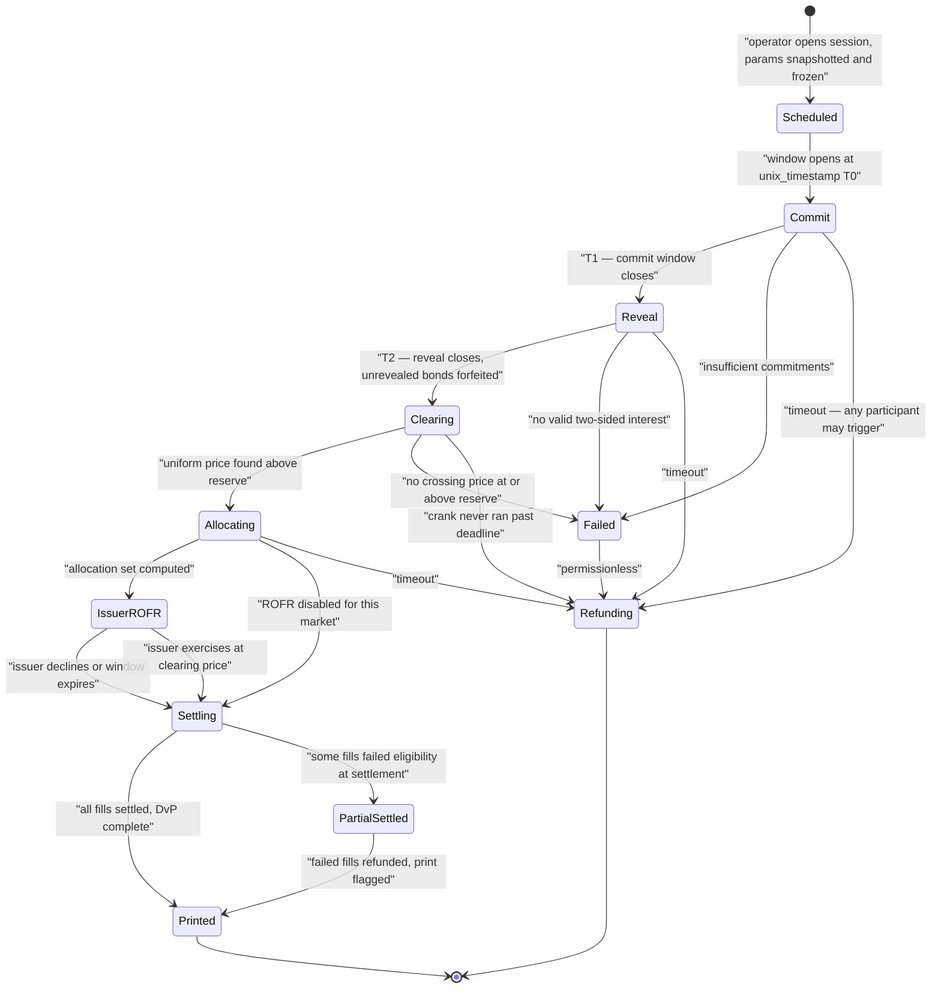

**Every terminal path returns escrow.** No state where funds are stuck pending a keeper that never runs (D6, G13).

### The full flow

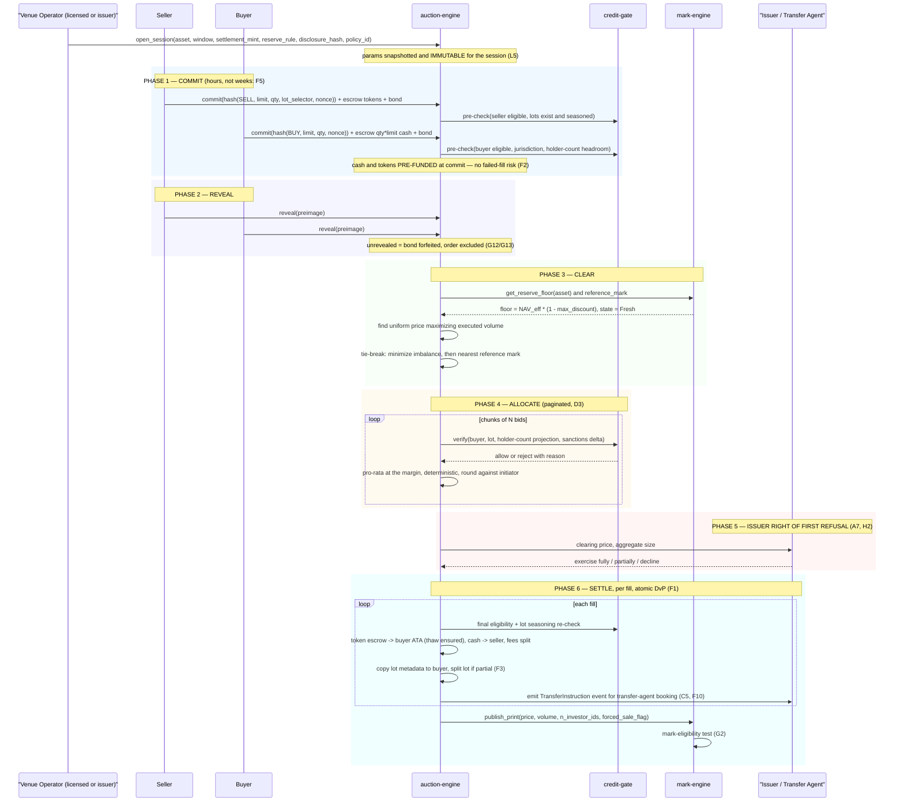

### Design decisions and the problems they close

| Decision | Closes |
|---|---|
| **Uniform price, not pay-as-bid** | Reduces winner's curse (A6); removes reordering incentive so MEV is structurally absent (G11) — the SUPA insight applied to a slow auction |
| **Commit–reveal sealed bids** | Cannot trade ahead of the NAV print (G1); bid sizes private until clear (J5) without needing Confidential Transfers, which are incompatible with hooks anyway (D2) |
| **Pre-funded escrow at commit** | No failed fills (F2); bond makes spam expensive (G12) and refusal-to-reveal costly (G13) |
| **Reserve price from `mark-engine`, plus issuer hard floor** | Prevents a distressed one-sided session printing an absurd mark (A11, M2) |
| **Issuer right of first refusal at the clearing price** | Turns the issuer from veto into sponsor (H2); gives them a NAV-accretive buyback; lets them control the print (A7) |
| **Chunked clear/allocate/settle, one fill per instruction** | Stays under 1.4M CU and 1232-byte packet limits at any N (D3, D5); fixed-capacity session ring buffers keep accounts bounded (D4) |
| **`unix_timestamp` windows with grace periods** | No slot-drift against NAV publication calendars (D7) |
| **Synchronised cross-asset auction calendar** | Concentrates thin liquidity into fewer, deeper crosses (A3, A10) |
| **Settlement-asset price check + breaker** | Depeg protection (F4, M5) |
| **`forced_sale_flag`** on liquidation sessions | Those prints are excluded from the mark, so a liquidation cascade cannot feed itself (M2) |

**Cadence:** align to the issuer's NAV cycle — commit window opens after the prior print, closes *before* the next NAV publication. Weekly for liquid-ish assets (ONyc), monthly/quarterly for fund shares, ad-hoc for forced-sale and wind-down sessions.

---

## §3 · `credit-gate` — compliance at account activation, not at transfer
*Answers: D1, D2, D9, D13, D14, D17, G6, H3, H8, I2, I3, I4*

**The correction:** the previous architecture made **transfer hooks** load-bearing. Hooks fire on every transfer, force every caller to resolve `ExtraAccountMetaList` in exact order, and make routers drop the token from routes — many protocols blacklist hooked tokens outright. **Token ACL (sRFC37)** exists precisely to fix this: freeze authority is delegated to a `MintConfig` PDA, accounts are default-frozen, and a **permissionless thaw** is validated by a pluggable **Gate Program**. Compliance runs once, at account activation. Zero CU on the transfer path. This is what Orca's permissioned pools use.

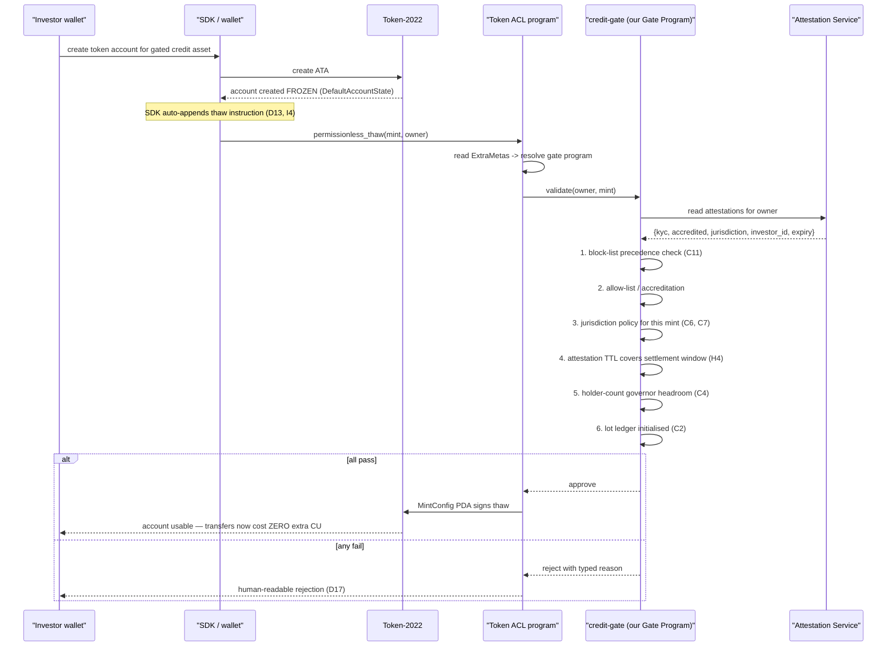

### Composability comparison

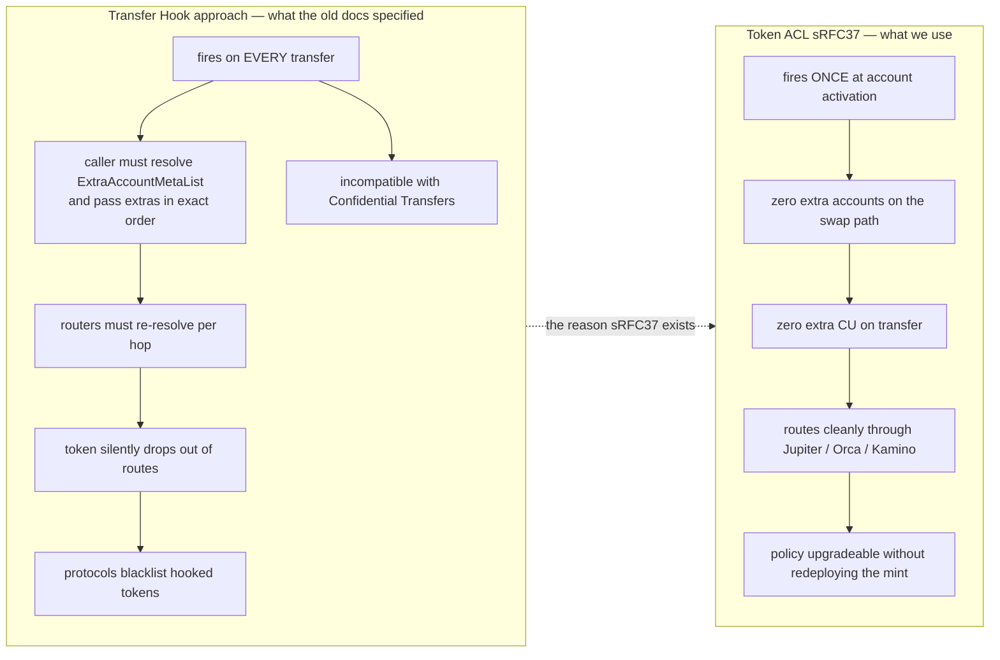

**Gate composition.** `credit-gate` is a *policy engine*, and every policy is a parameter, not code — so a regulatory change is a config change (K7):

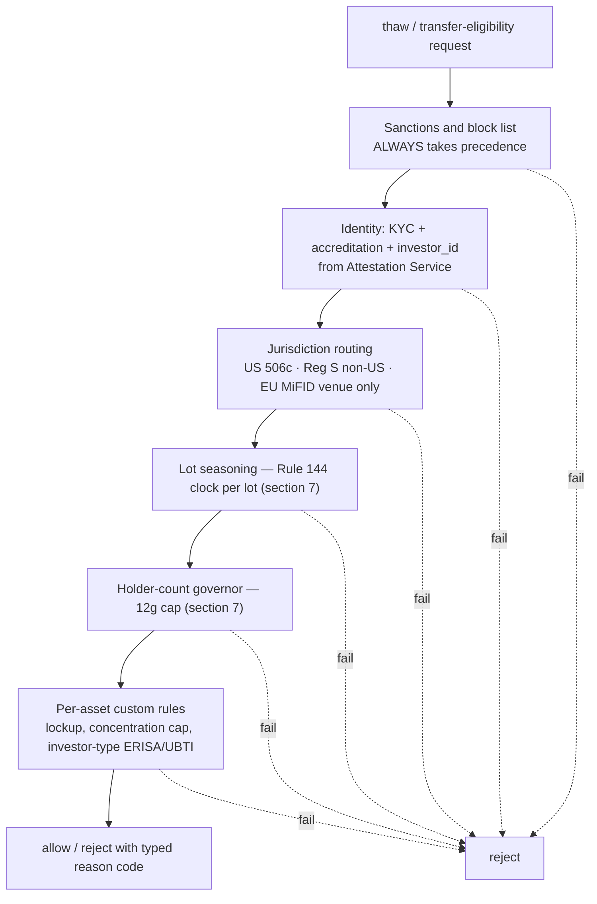

**Hardening:** gate programs are allow-listed in the mint config with a CU budget cap and a fallback gate, so a buggy or hostile gate cannot freeze a market (G6). Multiple SAS credential issuers are accepted so one provider's outage doesn't halt onboarding (H3). Flat CPI topology keeps depth within the 4-level limit (D9). The **issuer keeps the permanent delegate / freeze authority — we never hold it** — and every delegate action is emitted as an indexed event (D14, H8).

---

## §4 · `mark-engine` — turning a stale appraisal into a usable price
*Answers: B1–B10, G2, G5, G10, J1, M2, M4*

Oracles publish a *number*. Nobody publishes a *mark*. This is the layer that does.

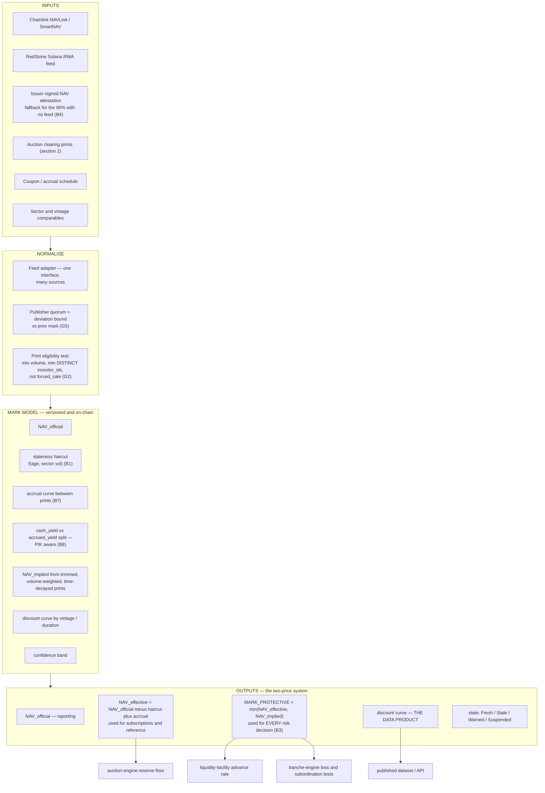

### Mark state machine — nothing liquidates on stale data

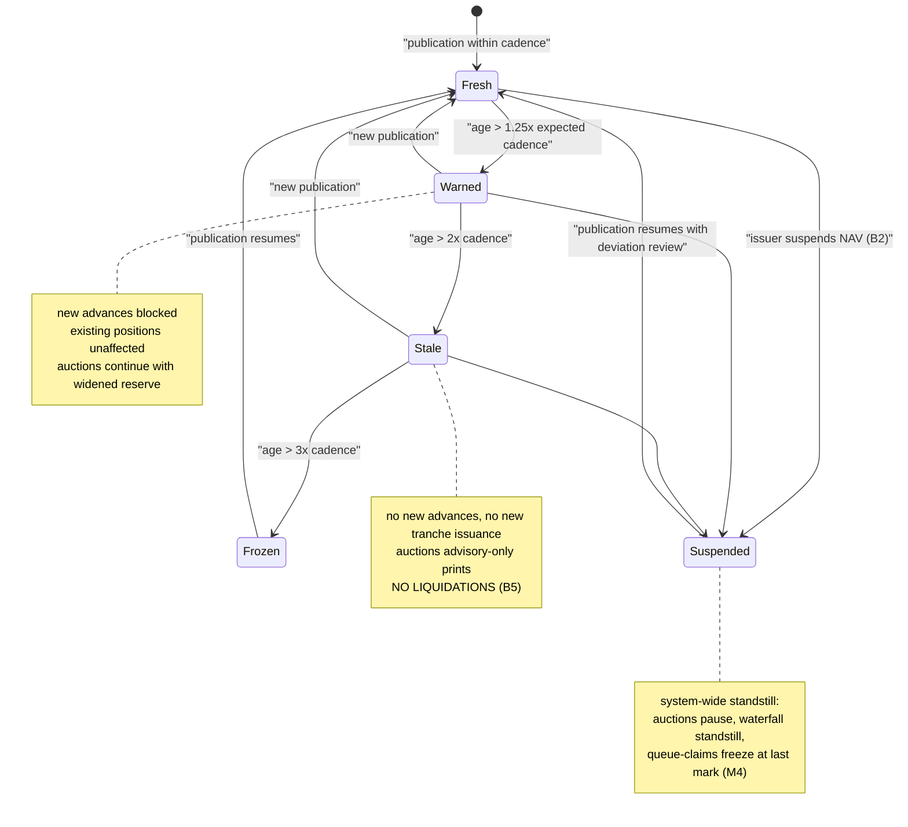

**Anti-manipulation:** a print is mark-eligible only if it clears minimum volume, minimum *distinct investor IDs* (not wallets — G3), and is not flagged `forced_sale`. Inputs are time-weighted and never same-slot, so a flash-loan-style manipulation has nothing to grab (G10). Outlier trimming plus deviation bounds versus the prior mark contain a compromised publisher (G5). Every mark is reproducible from raw inputs plus a version-pinned model, with the output hash on-chain (J1, B10).

---

## §5 · `queue-claim` + `liquidity-facility` — the primitives nobody has
*Answers: A5, A12, F8, I1, and the economics of M2*

### The insight

The binding constraint on private credit liquidity in 2026 is **not the lock-up, it is the gate**. Semi-liquid credit vehicles cap repurchases at roughly 5% of NAV per quarter, redemption requests have exceeded that cap repeatedly since late Q1 2026, and managers are now enforcing it. **Every pro-rated investor is a forced seller holding a dated, uncertain, perfectly priceable claim that currently cannot be sold, financed, or hedged.**

And note what a claim on *proceeds* does that a transfer of the *share* does not: it can be structured without changing the holder of record — which sidesteps the 12(g) holder-count pressure entirely (C4) and is often a lower consent bar in the fund documents than an outright transfer. *This needs counsel per fund, but it is structurally the easier door.*

### Queue-claim lifecycle

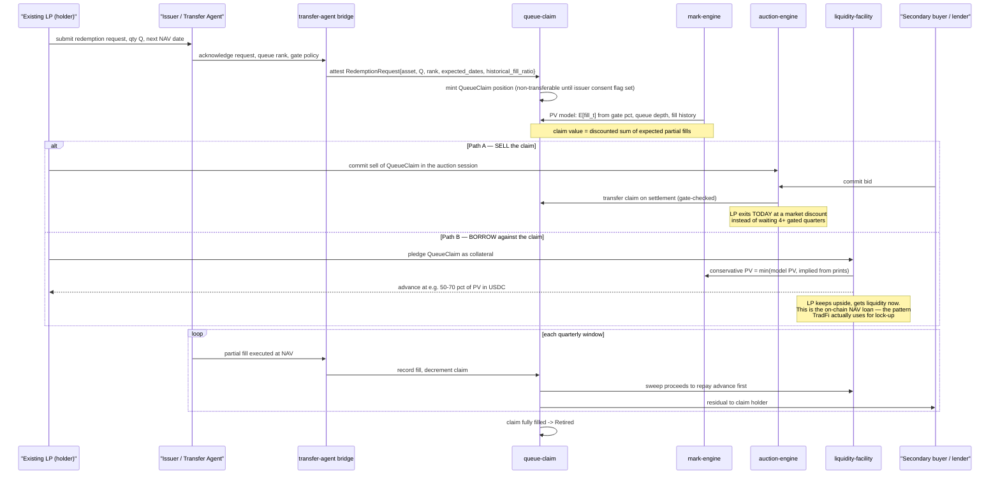

### Queue-claim state machine

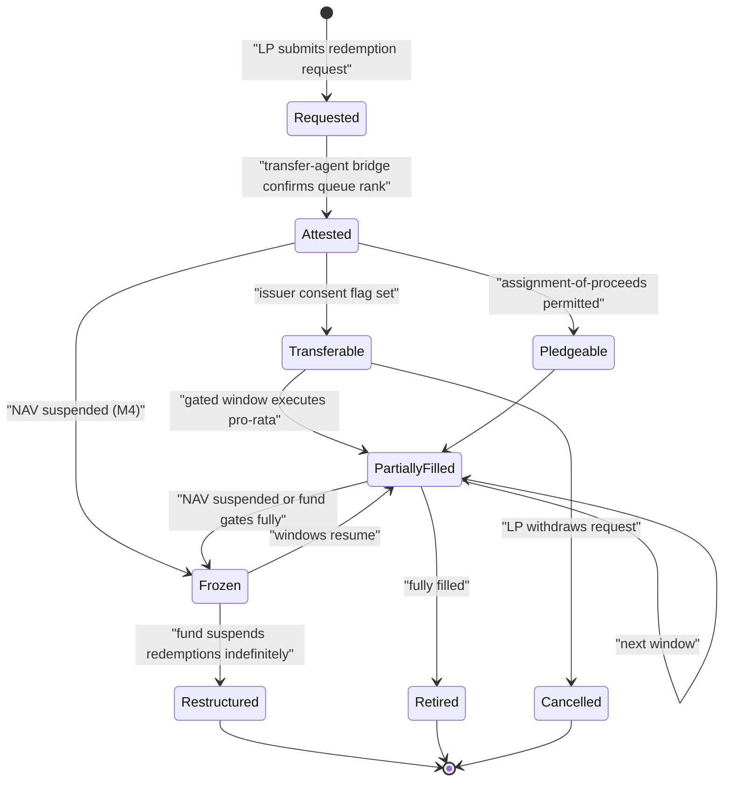

### `liquidity-facility` and the liquidation problem

Selling is the *worse* answer for most holders; borrowing against the position is the right one, and it's what Loopscale already proved works on Solana with ACRED at small scale. The unsolved part is **liquidation of permissioned collateral** — you cannot dump a gated security on an open DEX (F8). Kamino and Loopscale have exactly this problem.

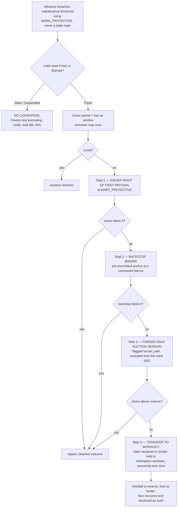

**Routing:** where Kamino or Loopscale can host the collateral, route there and take an origination/curation fee instead of holding balance-sheet risk (I1). Where they can't — queue-claims, tranche tokens, exotic marks — the internal facility is the venue of last resort, funded by the anchor institution, never by retail.

---

## §6 · `tranche-engine` — credit-loss waterfall, not yield-variance tranching
*Answers: E1–E12, B8, C13, C18, G9, M1*

Exponent (June 2026) tranches *yield variance* on a permissionless yield token. That's a rate product. An allocator asking for "senior" means **protection against principal loss from underlying defaults** — with realized-versus-expected loss accounting, recovery timing, PIK handling, and a standstill when the manager stops marking. Nobody has that on Solana.

### Three-book accounting — the answer to "when is a loss real?"

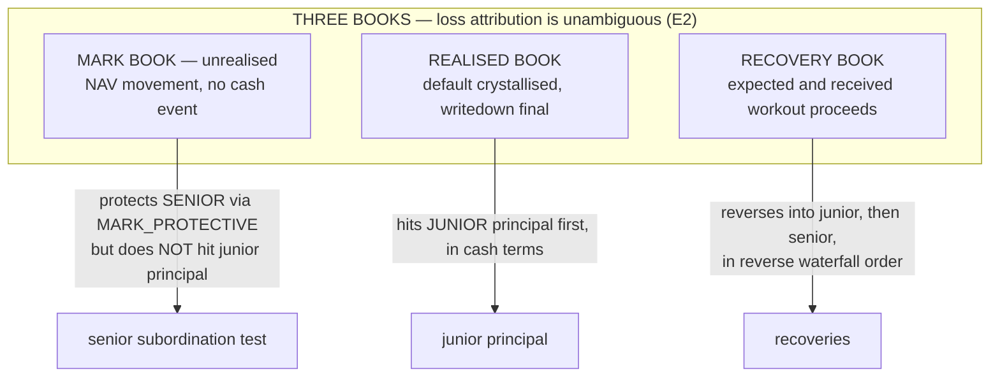

### Cash waterfall and loss waterfall

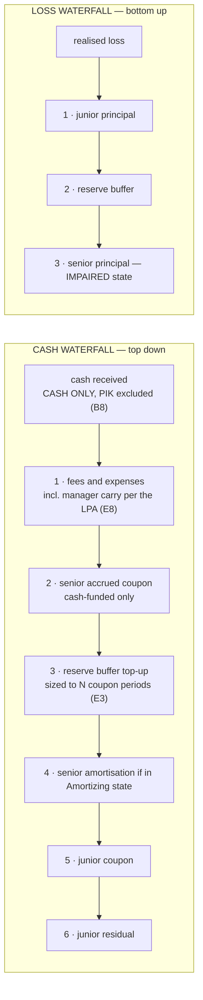

### Tranche state machine

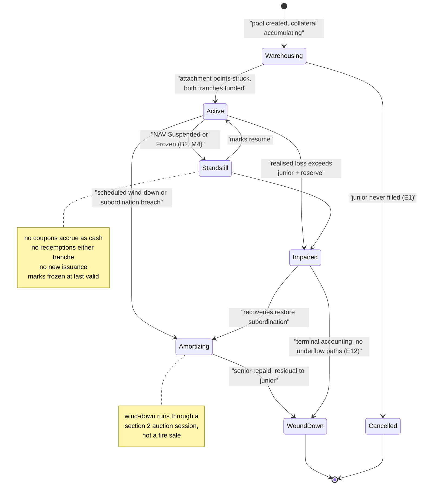

### Structural answers to the two things that actually kill tranching

**E1 — junior is the binding constraint.** Institutional appetite is overwhelmingly senior; Exponent capped its alpha at $2.5M for this reason. The design assumption must be **sponsor-retained first loss**: the issuer or sponsor holds a minimum junior strip. That is not a workaround — retained risk is precisely what makes senior credible to an allocator, and it is standard in every real securitisation. Incentivised third-party junior sits *on top* of that minimum, capped.

**C13 — a tranche is a new security you issued.** So don't issue it. `tranche-engine` is an **accounting and distribution engine**; the paper is issued by an **issuer-side or sponsor-side SPV**, with `legal_doc_hash` and `waterfall_version` bound on-chain and a documented human override authority for when the contract and the indenture disagree (C18). We never operate a protocol-owned pooled vehicle (C14).

**Subordination invariant**, enforced on every state-changing instruction:

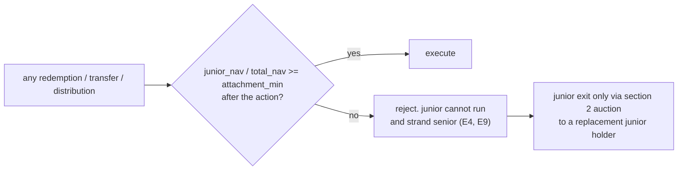

Junior tranche tokens carry a lockup plus a gate; their exit is *sale to a replacement*, never redemption out of the structure. Tranche tokens themselves — unlike the raw fund share — have a model price, which makes them the correct assets to list in an **Orca permissioned pool** and to pledge on **Kamino/Loopscale** (E5, I1). That's the composability payoff: tranching converts an unpriceable asset into two priceable ones.

---

## §7 · Lot ledger, holder governor, jurisdiction — the legal state machine nobody implements
*Answers: C2, C4, C6, C8, C9, C11, D4, D15, F3, G3, H4, H5*

**C2 is a latent defect across the entire permissioned-token category.** Rule 144's holding period runs **per acquisition lot, per holder**. A fungible SPL balance cannot express "300 free-trading, 700 seasoned for four more months, 200 affiliate-tainted." Every system today gates *who* may hold. Almost none gates *which units* may move *when*. Own this.

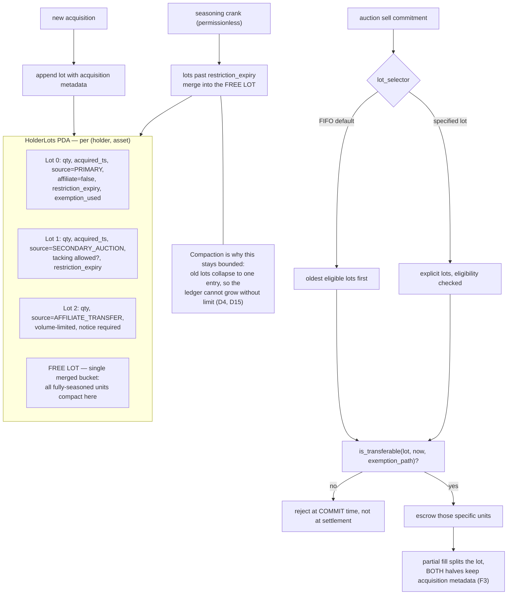

### Holder-count governor — the 12(g) tripwire

Exceeding 2,000 holders of record (or 500 non-accredited) with >$10M assets forces Exchange Act registration on **the issuer**. Breaching it is how you lose every issuer relationship permanently.

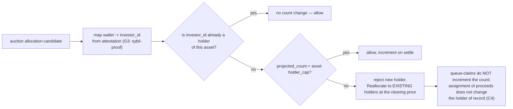

Counting decrements on exit-to-zero, and the cap is set per asset by the issuer with headroom, not at the statutory number.

**Timing discipline (H4, H5, C11):** attestation validity must span the **entire** commit→settle window, checked at commit *and* re-checked inside the settlement instruction; block-list always takes precedence over allow-list, matching Token ACL semantics; revocation feeds are a settlement pre-check with short TTLs.

**Jurisdiction routing (C6, C7, C9):** each market carries an eligibility policy — `US_506c`, `RegS_NonUS` with distribution-compliance-period clocks, `EU_MTF_only`. Public prints are permitted only for 506(c) assets; 506(b) assets print into a gated data room to avoid a general-solicitation problem. Reg S and US flows are separate markets with separate sessions — never one book with a filter.

---

## §8 · Liveness, cranks and failure handling
*Answers: B5, D6, D11, D12, G13, M6*

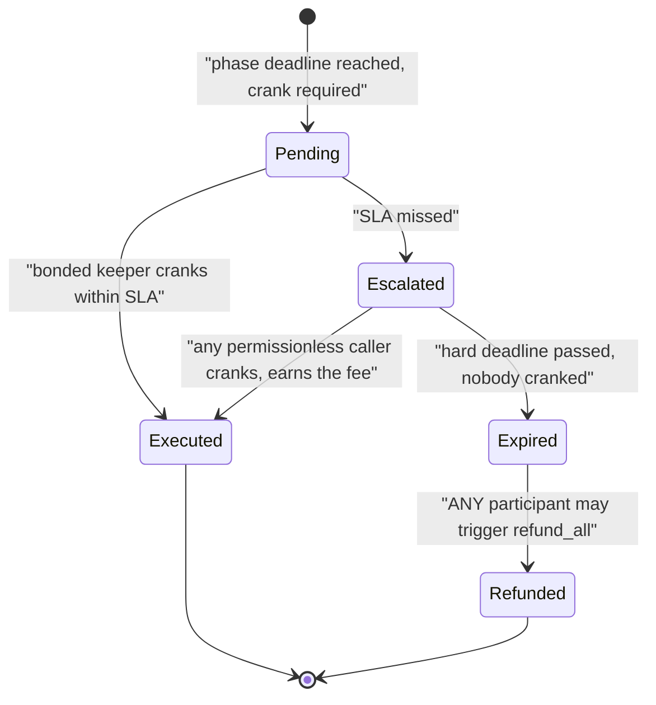

Rules that make this safe:

- **Every multi-step flow is a resumable state machine with idempotent steps.** No flow can be left partially applied by a halt, a congestion event, or a keeper dying mid-loop (D12, M6).
- **Bonded keepers with a permissionless fallback.** Bonds are forfeitable for missed SLAs; anyone can crank after the SLA and collect the fee (D6).
- **Timeout refund is callable by any participant, always.** There is no configuration in which escrow is unreachable (D6, G13). *Build note (#62):* this holds when an asset's permanent delegate drains an escrow vault. The refund returns what is held and records the shortfall (`payment-rails` tests `delegate_seizure_cannot_strand_the_ask_bond`, `short_cash_vault_still_refunds_and_closes`). It does not hold while the asset's freeze authority has frozen the vault. A frozen *destination* (the seller's NPCS account re-frozen on attestation lapse) blocks only that account: the refund fails typed and lands on any other thawed account of the owner (#90). Both freeze authorities are the issuer's (§11 THEIRS). Shortfalls are booked on the session and fail reconciliation (#89).
- **Retry with escalating priority fees, jittered submission, idempotent settlement** — auction closes land in congested slots by definition (D11).
- **Never liquidate on stale marks** (B5) — enforced in `mark-engine` state, not in facility logic, so no code path can bypass it.

---

## §9 · Legal topology — filling the venue-operator slot
*Answers: C1, C3, C7, C10, C12, C14, C16, C17, K7, M8*

**The hard fact:** a system that brings together orders of multiple buyers and sellers of securities using established, non-discretionary methods **is an exchange** under Exchange Act Rule 3b-16, and must register as a national exchange or operate as an **ATS run by a registered broker-dealer** under Reg ATS. "Permissioned = compliant by construction," as written in the old `03-Feasibility-and-Compliance.md`, conflates two different things: Reg D governs whether the *transfer* is exempt; it says nothing about whether *you* may run the *venue*. The SEC's Innovation Exemption was announced 21 Apr 2026 and **delayed 26 May 2026** after exchange-lobby pushback, so it cannot be load-bearing.

**The architectural answer: make the venue operator a role, not an assumption.**

```mermaid
flowchart TB
    subgraph PROTO["THE PROTOCOL — us. Non-custodial software."]
        PR1["programs deployed, open source"]
        PR2["no discretion over matching:<br/>clearing rule is deterministic and public"]
        PR3["no custody: escrow PDAs,<br/>participant-revocable (C10)"]
        PR4["revenue from licence, facility spread<br/>and data — NOT per-trade (C3)"]
    end

    subgraph ROLE["VENUE OPERATOR — a permissioned on-chain role.<br/>Only this role may open a session."]
        direction LR
        V1["OPTION A — v1 DEFAULT<br/>ISSUER-SPONSORED WINDOW<br/>issuer runs a periodic repurchase /<br/>liquidity auction in its OWN securities.<br/>Not a third-party exchange.<br/>Tender-offer rules apply, standard practice"]
        V2["OPTION B<br/>PARTNER ATS / BROKER-DEALER<br/>Securitize, Figure, Texton-type venues.<br/>We are the matching engine vendor"]
        V3["OPTION C<br/>NON-US VENUE<br/>Reg S flow via a licensed offshore<br/>operator. Separate market, separate book"]
        V4["OPTION D — upside only<br/>INNOVATION EXEMPTION<br/>direct operation IF it lands.<br/>Never assumed (C17)"]
    end

    PROTO -->|"programs enforce: only an authorised<br/>venue_operator may open_session"| ROLE
    ROLE --> ASSETS["per-asset, per-jurisdiction<br/>eligibility policy"]
```

### Why Option A is the whole strategy

An issuer conducting a repurchase or liquidity window in its own securities is a categorically different regulatory object from a third party matching investor-to-investor orders. And look at what it does to the register:

| Problem | Why the issuer-sponsored window solves it |
|---|---|
| **C1** unregistered exchange | Issuer transacting in its own securities, not a third-party matching venue |
| **K1 / H1** issuer consent | The issuer *is* the sponsor. Consent is the product |
| **H2** issuer's negative incentive | They gain a NAV-accretive buyback tool, relief on the gated queue, and price control |
| **A7** discount signalling | Issuer controls print policy: banded, delayed, or aggregate-only |
| **A5** issuer redemption competes with us | It *is* the issuer's redemption — we make it price-discovered and capital-efficient instead of a flat-NAV pro-rata lottery |
| **A11** one-sided flow | Issuer is the natural standing bid |

**Then earn the way up:** issuer-sponsored windows (v1) → partner ATS for true investor-to-investor US flow (v2) → offshore Reg S market in parallel → direct operation only if the Innovation Exemption lands.

### Routing decision tree

```mermaid
flowchart TB
    T["incoming trade intent"] --> J{"participant jurisdiction?"}
    J -->|"US person"| U{"asset offered under 506c?"}
    U -->|no| BLOCK1["reject — 506b assets: gated data room,<br/>no public print (C9)"]
    U -->|yes| A{"accredited attestation valid<br/>through settlement?"}
    A -->|no| BLOCK2["reject"]
    A -->|yes| S{"counterparty structure?"}
    S -->|"issuer is counterparty"| PATH_A["ISSUER WINDOW<br/>Option A"]
    S -->|"investor to investor"| PATH_B{"partner ATS live?"}
    PATH_B -->|yes| PATH_B2["route via partner ATS<br/>Option B"]
    PATH_B -->|no| BLOCK3["not available in this market yet"]
    J -->|"non-US"| RS{"Reg S compliance period elapsed<br/>and no US nexus?"}
    RS -->|yes| PATH_C["OFFSHORE MARKET<br/>Option C"]
    RS -->|no| BLOCK4["reject"]
    J -->|"EU"| EU["MiFID II instrument:<br/>authorised MTF/OTF only (C7)"]
```

Everything in this section is a **parameter of the policy engine**, so a regulatory change is a config change and not a rewrite (K7). And the reason to sequence conservatively is M8: you do not want to be the enforcement precedent that defines this category.

---

## §10 · Data, reporting, reconciliation and evidence
*Answers: C5, E10, E11, F10, H6, H7, I8, J1–J6, C15*

**The chain is not the ledger of record.** The transfer agent's master securityholder file is. If they diverge, the file wins. Architect for that.

```mermaid
sequenceDiagram
    participant AE as auction-engine
    participant EV as "event stream (Geyser indexer)"
    participant TAB as transfer-agent bridge
    participant TA as "Transfer Agent (record)"
    participant REC as reconciliation service
    participant OUT as "reports / statements / API"

    AE->>EV: TransferInstruction{from, to, qty, lot_ids, price, session, exemption_path, disclosure_hash}
    EV->>TAB: normalised instruction
    TAB->>TA: book the transfer on the master file
    TA-->>TAB: confirmation or REJECTION with reason
    alt confirmed
        TAB->>AE: mark fill LEGALLY_SETTLED (two-phase, F10)
    else rejected
        TAB->>AE: raise BREAK, freeze affected lots, alert operator
        Note over TAB,AE: documented resolution SLA and<br/>arbitration path (H7)
    end

    loop daily
        REC->>EV: on-chain balances and lots by investor_id
        REC->>TA: master file positions
        REC->>REC: diff. any delta = BREAK ALARM (H6)
    end

    EV->>OUT: investor statements (J2)
    EV->>OUT: distribution character: interest / ROC / gain (E11, J3, C15)
    EV->>OUT: mark reproduction: inputs + model version + output hash (J1)
    EV->>OUT: discount-curve dataset — the commercial product
```

**Rules:** one event per state transition, no silent mutations — an unemitted event is an unprovable event (J4). Corporate actions (splits, in-kind distributions, restructurings) go through an explicit module that **pauses**, applies an evented adjustment, and resumes (E10). Privacy is handled by design: commit–reveal hides bids pre-clear, public prints are aggregate-only, and detail lives in a permissioned data room — which is necessary anyway because Confidential Transfers cannot coexist with hooks (J5, D2).

---

## §11 · Authority, governance, circuit breakers and wind-down
*Answers: D10, D14, D16, G7, G8, G14, H8, H10, H11, L1–L6, M1–M3*

### Authority map — publish this; institutions will ask

```mermaid
flowchart TB
    subgraph OURS["OUR AUTHORITIES — minimal by design"]
        U1["program upgrade authority<br/>Squads multisig + TIMELOCK<br/>staged to immutable (D10, L3)"]
        U2["PAUSE authority<br/>pause ONLY, never state-mutating (L4)"]
        U3["parameter authority<br/>bounded by hard on-chain limits (L1, L2)"]
        U4["gate allow-list authority"]
    end
    subgraph THEIRS["AUTHORITIES WE NEVER HOLD"]
        T1["permanent delegate / freeze — ISSUER<br/>court orders, sanctions, lost keys (H8, D14)"]
        T2["NAV publication — ORACLE / ISSUER"]
        T3["master securityholder file — TRANSFER AGENT"]
        T4["session opening — VENUE OPERATOR (section 9)"]
        T5["custody of client assets — QUALIFIED CUSTODIAN"]
    end
    subgraph HARD["OUTSIDE ANY GOVERNANCE REACH — prudential floor (L6)"]
        H1["max advance rate ceiling"]
        H2["min subordination floor"]
        H3["max discount / reserve-price bound"]
        H4["no-liquidation-on-stale-mark rule"]
        H5["timeout refund path"]
    end
    OURS -.->|"cannot override"| HARD
```

**Enforcement status of the HARD items (build, 2026-09):** H1 is enforced (#94): `payment-rails` `advance_funds` rejects an advance rate above `credit_math::MAX_ADVANCE_RATE_BPS` = 5 000 (50%, SRS 08 LF-P1) and an amount above the curator-stated collateral mark × rate, and records both on the `Advance`. The mark itself is unverified until a mark engine exists. H2 and H3 have **no value in the plan of record** and are enforced nowhere. `haircut_bps` takes its ceiling from the caller and only rejects one above 100%, so a caller passing `ceiling_bps = 0` gets a bound that binds nothing. H4 is enforced vacuously, because there is no mark engine and no liquidation instruction. H5 is enforced by the `payment-rails` refunds, with the ask-vault caveat in `payment-rails/PHASES.md`. The live table is in `programs/credit-math/src/prudential.rs`. The rails' own caps (`MAX_FEE_BPS`, `MAX_RESERVE_BPS`, `MAX_RATE_BPS`) bound different quantities and are not these items.

**Curators (L1, L2):** haircuts, reserve prices and attachment points are economically decisive, so they belong to a named curator with a published mandate and skin in the game — the Steakhouse-style pattern — operating strictly inside the hard bounds above. Parameters are snapshotted at session open and immutable for the session (L5).

**Key hygiene:** hardware/HSM, role separation, no single key with two capabilities (G7). Strict PDA derivation and `has_one` constraints everywhere; no unchecked `AccountInfo` (G8). Verifiable builds, published program IDs and an on-chain registry of official markets so clones are detectable (G14, D16). Pinned dependency versions with a staging cluster mirroring mainnet's extension set (D16). Runbooks for everything and no manual-only path, because this will be a small team operating securities infrastructure (H11).

### System-wide circuit-breaker hierarchy

```mermaid
stateDiagram-v2
    [*] --> Normal
    Normal --> Cautious: "mark Warned OR volatility breach"
    Cautious --> Restricted: "mark Stale OR print outside deviation band"
    Restricted --> Standstill: "NAV Suspended OR issuer gate slam OR<br/>settlement-asset depeg"
    Standstill --> Restricted: "conditions clear + curator review"
    Restricted --> Cautious: "fresh mark"
    Cautious --> Normal: "fresh mark, normal vol"
    Normal --> Emergency: "exploit suspected OR authority compromise"
    Cautious --> Emergency
    Restricted --> Emergency
    Standstill --> Emergency
    Emergency --> Standstill: "multi-party review, post-mortem published"
    Standstill --> WindDown: "market terminated (H10, M3)"
    WindDown --> [*]

    note right of Cautious
      no new advances
      auction reserve widened
    end note
    note right of Restricted
      no new tranche issuance
      prints advisory only
      NO liquidations
    end note
    note right of Standstill
      auctions paused
      waterfall standstill
      queue-claims frozen at last mark
      refund paths remain OPEN
    end note
    note right of WindDown
      final auction, final waterfall,
      escrow return, account closure
    end note
```

**The down case is the design case (M1).** 2026 is private credit's first real test. The first on-chain private-credit product to exist will print a loss publicly at some point — so build the loss accounting to be honest and legible, because that is what converts allocators after the fact. `WindDown` is a first-class state with a complete terminal path, not an afterthought (H10, M3).

---

## §12 · Cold start and go-to-market sequencing
*Answers: A4, A9, B4, F6, F7, F9, H9, I1, I5, I6, K2, K3, K4, K8, M7*

The addressable float is the harshest number in this whole analysis: **ACRED on Loopscale is roughly $6.9M**. The "$620M+ RWA deposits" figure in the old docs is mostly treasury and basis wrappers, not gated private-credit fund shares. So sequence by *how easy it is to get a yes*, not by prestige.

```mermaid
flowchart TB
    subgraph P1["PHASE 1 — months 0-4 · PROVE THE MECHANISM"]
        A1["Asset: OnRe ONyc<br/>on-chain native, secondary-friendly,<br/>already tranching with Exponent"]
        A2["Build: auction-engine + mark-engine<br/>+ credit-gate on devnet then mainnet"]
        A3["Deliverable: first sealed-bid uniform-price<br/>auction on a Solana yield/credit asset,<br/>with a published discount print"]
        A4["Funding: Superteam micro-grant,<br/>then Colosseum"]
    end
    subgraph P2["PHASE 2 — months 4-9 · PROVE THE LEGAL SHAPE"]
        B1["Asset: Figure YLDS / PRIME via Hastra<br/>most secondary-friendly issuer, ATS-adjacent"]
        B2["Build: credit-gate lot ledger + holder governor<br/>+ queue-claim v1"]
        B3["Ship the ISSUER-SPONSORED WINDOW (section 9 Option A)"]
        B4["Foundation grant: standard for the Gate Program<br/>as an sRFC37 reference implementation"]
    end
    subgraph P3["PHASE 3 — months 9-18 · PROVE INSTITUTIONAL SCALE"]
        C1["Asset: Securitize ACRED and STAC<br/>Ethena's 250M is the step change"]
        C2["Partner: Securitize ATS as venue operator,<br/>Loopscale/Kamino for the facility"]
        C3["Build: tranche-engine + liquidity-facility<br/>+ transfer-agent bridge"]
        C4["Convertible grant / seed"]
    end
    P1 --> P2 --> P3
```

### The cold-start flywheel — and where to inject

```mermaid
flowchart LR
    SUP["gated sellers<br/>pro-rated at the 5pct window"] --> AUC["auction session"]
    AUC --> PRINT["discount print"]
    PRINT --> MARK["credible mark"]
    MARK --> LEND["Kamino / Loopscale can<br/>lend against it"]
    LEND --> DEMAND["more buyers: the asset<br/>is now financeable"]
    DEMAND --> AUC
    MARK --> TRANCHE["tranching becomes possible:<br/>you cannot tranche what you cannot price"]
    TRANCHE --> DEMAND

    INJ1["INJECTION 1 — anchor buyer<br/>committed capital signed BEFORE launch (A4)"] --> DEMAND
    INJ2["INJECTION 2 — issuer as standing bid<br/>via right of first refusal (A11)"] --> AUC
    INJ3["INJECTION 3 — queue-claim<br/>the only place to buy exposure<br/>that primary cannot offer (A12)"] --> DEMAND
```

**Non-negotiable launch gates** — treat each as a blocker, not a nice-to-have:

| Gate | Why | Problem |
|---|---|---|
| One issuer has signed a secondary-transfer / window consent | Nothing works without it | K1, H1 |
| One anchor buyer with committed capital | Otherwise the first auction fails and the print is worthless | A4, A11 |
| NAV feed or signed attestation for the pilot asset | No mark, no product | B4 |
| Custodian confirms it can hold the specific mint and extension set | Institutions cannot self-custody | F7, H9 |
| Institutional access path: API + Squads + custodian-signed flows | Allocators do not use browser wallets | I5 |
| Securities counsel opinion on the venue structure | See §9 | C1 |
| A credit/secondaries person on the team or advisory board | Allocators buy from people with credit track records | K8 |
| Minimum ticket set institution-scale, ≥$250K | Onboarding cost exceeds trade profit below that | A9 |

**Positioning discipline (I6, K4):** Securitize could ship an auction behind its own licence, and Orca could add batch auctions. The defence is not speed — it's being the layer they license: the auction mechanism, the queue claim, the mark, and the dataset. **Any pitch positioned against Securitize loses.** Solana-first, single-chain, until the print is a reference other chains cite (F9). Dual oracle and dual custodian before institutional scale (M7).

---

## §13 · Business model
*Answers: A8, H2, H12, J6, K5, K6*

Trading fees cannot fund a securities venue: 10–25bps on $10M of annual volume is $10–25K, against compliance costs two orders of magnitude higher (A8). And taking transaction-based compensation on securities trades is itself a broker-registration risk (C3). So the revenue does not come from trading.

```mermaid
flowchart TB
    subgraph OPEN["OPEN CORE — Standard grant (K6)"]
        O1["credit-gate: Gate Program for Token ACL /<br/>sRFC 00020 — lot seasoning, holder governor,<br/>jurisdiction routing. A public good the<br/>Foundation's own standards work lacks"]
        O2["auction-engine: open sealed-bid<br/>uniform-price auction primitive"]
        O3["the published discount-to-NAV dataset"]
    end
    subgraph COMM["COMMERCIAL — Convertible grant / equity"]
        C1["liquidity-facility spread<br/>the main line: lend, don't match"]
        C2["tranche-engine management and<br/>structuring fee, paid by the SPV sponsor"]
        C3["mark-engine as a licensed data feed:<br/>discount curves for allocators, auditors,<br/>lenders and fund admins"]
        C4["software licence to venue operators<br/>and issuers — NOT per-trade (C3)"]
        C5["queue-claim origination fee"]
    end
    OPEN -->|"credibility, standards position,<br/>grant alignment"| COMM
    COMM --> ISS["issuer economics: fee share +<br/>right of first refusal + queue relief.<br/>PAY the issuer — this is what flips H2"]
```

**No protocol token in v1** — a token on a securities venue creates a second securities problem you do not need (K5). Operator carries E&O; the protocol maintains a reserve fund (H12). SOC 2 and formal control framework in Phase 3 when institutional diligence starts asking (J6).

---

## §14 · Traceability — every problem to its answer

| Domain | Problems | Where answered |
|---|---|---|
| **A · Market design** | A1 A2 A3 A6 A10 A11 | §2 sealed-bid uniform-price periodic auction |
| | A4 A9 A12 | §12 cold-start injections, launch gates |
| | A5 A7 | §5 queue-claim; §9 issuer-sponsored window; §2 issuer ROFR |
| | A8 | §13 revenue not from trading fees |
| **B · Valuation** | B1 B2 B3 B4 B5 B6 B7 B9 B10 | §4 mark-engine, two-price system, state machine |
| | B8 | §4 cash/accrued split; §6 cash-only senior coupons |
| **C · Legal** | C1 C3 C7 C10 C12 C14 C16 C17 | §9 venue-operator role, routing tree |
| | C2 | §7 lot ledger with per-lot seasoning |
| | C4 | §7 holder-count governor; §5 claims don't add record holders |
| | C5 | §10 transfer-agent bridge, two-phase settlement |
| | C6 C8 C9 C11 | §7 jurisdiction policy, exemption path per trade, block-list precedence |
| | C13 C18 | §6 SPV issues the paper, doc-hash binding, human override |
| | C15 | §10 investor-type attestations, distribution character |
| **D · Solana technical** | D1 D2 D9 D13 D14 D17 | §3 Token ACL instead of transfer hooks |
| | D3 D4 D5 D7 D8 | §2 chunked clearing, bounded sessions, ALTs, shared math |
| | D6 D11 D12 | §8 bonded cranks, permissionless fallback, timeout refunds |
| | D10 D16 | §11 timelocked multisig, verifiable builds, pinned deps |
| | D15 | §7 lot compaction, closable accounts |
| **E · Tranching** | E1 | §6 sponsor-retained first loss |
| | E2 | §6 three-book accounting |
| | E3 E4 E6 E9 E12 | §6 reserve sizing, subordination invariant, state machine |
| | E5 | §6 tranche tokens are priceable → Orca / Kamino listable |
| | E7 E8 | §6 concentration limits, full expense waterfall, doc binding |
| | E10 E11 | §10 corporate-action module, distribution character |
| **F · Settlement** | F1 F2 F4 F5 | §2 atomic DvP, pre-funded escrow, short windows, depeg breaker |
| | F3 | §7 lot splitting preserving metadata |
| | F6 F7 F9 | §12 pre-funding, custodian gate, single-chain v1 |
| | F8 | §5 four-step liquidation ladder ending in workout |
| | F10 | §10 two-phase legal settlement |
| **G · Security** | G1 G4 G11 G12 G13 | §2 commit–reveal, uniform price, bonds |
| | G2 G5 G10 | §4 print eligibility, publisher quorum, time-weighting |
| | G3 | §7 investor-ID aggregation |
| | G6 | §3 gate allow-list, CU caps, fallback gate |
| | G7 G8 G14 | §11 key hygiene, PDA constraints, verifiable builds |
| | G9 | §6 round against user, minimum tickets, epoch limits |
| **H · Operational** | H1 H2 | §9 issuer-sponsored window; §13 issuer economics |
| | H3 H4 H5 | §3 multiple credential issuers; §7 TTL and revocation discipline |
| | H6 H7 | §10 daily reconciliation, break alarms, arbitration |
| | H8 | §11 issuer keeps permanent delegate |
| | H9 | §12 custodian-first onboarding |
| | H10 H11 H12 | §11 wind-down state, runbooks; §13 E&O and reserve |
| **I · Integration** | I1 I2 I3 I4 | §3 Token ACL keeps routes clean; §6 tranche tokens as the listable asset |
| | I5 I6 | §12 institutional access path, positioning discipline |
| | I7 I8 | §11 sRFC participation, adapter pattern; §10 own indexer |
| **J · Data** | J1 J2 J3 J4 J5 J6 | §10 evidence pipeline, reproducible marks, gated data room |
| **K · Business** | K1 K2 K3 K4 K8 | §12 sequencing and launch gates |
| | K5 K6 | §13 no token, open-core split |
| | K7 | §9 policy engine parameterisation |
| **L · Governance** | L1 L2 L3 L4 L5 L6 | §11 curator model, hard prudential bounds, session snapshots |
| **M · Tail** | M1 M2 M3 M4 M5 M6 M7 M8 | §11 circuit-breaker hierarchy, wind-down; §4 suspension; §5 forced-sale exclusion; §9 conservative jurisdiction sequencing |

---

## §15 · What to do next week

1. **Get the one signature.** Approach OnRe first — on-chain native, already tranching with Exponent, most likely to say yes to a liquidity window. Do not build until someone has agreed in principle to sponsor a window or consent to secondary transfer. Every other task is downstream of this.
2. **Get a securities opinion on §9 Option A.** One memo, one question: does an issuer-sponsored periodic repurchase auction operated on our software make *us* an exchange or a broker? The answer determines the entire company.
3. **Build the smallest honest demo:** `auction-engine` + `mark-engine` on devnet, one asset, one sealed-bid uniform-price session, ending in a published discount print. That demo — an arms-length price for an asset that has never had one — is the whole pitch, and it is a two-to-three week build.
4. **Write the Gate Program spec and post it in the sRFC 00020 thread.** Per-lot seasoning and holder-count governance are missing from the standard, they are unambiguously public goods, and being in that conversation is worth more than any deck.
5. **Recruit the credit person.** Not a Solana dev — someone who has traded a private credit secondary and can tell you within thirty seconds why a manager would refuse the window.

---

*Reality check and evidence: `../research/12-Validation-2026-Reality-Check.md` · Full failure inventory: `05-Problem-Register.md`*
