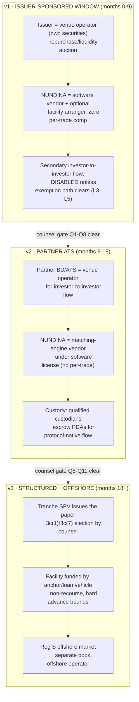

# 07 · Legal Topology & Compliance Register — NUNDINA

> **Status:** The linked legal + engineering compliance layer. Derives from `05-Problem-Register.md` (C-domain), `06-Solution-Architecture-v2.md` (§7, §9, §10, §11, §13) and `../research/12-Validation-2026-Reality-Check.md` §6.
>
> **ID namespace (#63):** `L1`–`L27` here are the *legal* register. Doc 05 uses `L1`–`L6` for *governance* problems, so a bare `L5` in code or another doc means `05 L5` unless it says `07`.
>
> **Scope decisions locked by the founder (24 Sep 2026):**
> 1. **US operating posture with partner broker-dealer topology** (§9 Option A for v1, Option B for v2 US investor-to-investor flow)
> 2. **Full v1→v3 coverage** (windows → ATS flow → tranching SPV + facility + offshore parallel)
> 3. **Every unconfirmed item is a counsel gate** — marked `⛔ COUNSEL GATE`, numbered, and collected in §6. Nothing here is a legal conclusion.
> 4. **No counsel engaged yet** — this doc is formatted to hand directly to a securities firm as the intake memo.

**Confidence key (used throughout):**
- `[PRIMARY]` — read the primary source text (e.g., SEC press release 2026-90)
- `[SECONDARY]` — reputable secondary source seen (headline/snippet level); verify before relying
- `[UNVERIFIED]` — industry reporting only; treat as hypothesis, never as fact
- **No marker** — an engineering requirement this repo already committed to (traceable to `05`/`06`), or standard design discipline. Not a legal assertion.

---

## 0. The one-paragraph frame

NUNDINA's programs are non-custodial software with deterministic, published rules. Every legally sensitive *activity* — operating a venue, effecting trades, holding custody, booking the ledger of record — is assigned to a **named licensed role**, and the protocol enforces that only an authorized role can trigger the corresponding action. The doc below does three things: (I) registers every legal risk with its mechanism and mitigation; (II) states the legal topology per phase with explicit gates; (III) converts the legal answers into requirements the six programs must encode.

---

## PART I · LEGAL RISK REGISTER

> Format: **ID · Rule · What it says [confidence] · How it bites us · Mitigation · Where encoded · Status.**
> Severities reuse the register convention: **S1** kills the company · **S2** kills a feature · **S3** degrades · **S4** friction.
> Items marked ✅ are design commitments already made in `05`/`06`; this doc adds the engineering detail. Items marked ⛔ are open and require counsel before the dependent build phase.

### I.A — The venue & broker questions (the ones that kill companies)

| ID | Rule / doctrine | What it says | How it bites NUNDINA | Mitigation | Encoded in |
|---|---|---|---|---|---|
| **L1** (C1) | **Exchange Act Rule 3b-16 / Reg ATS** `[SECONDARY — see Q1]` | A system bringing together orders of multiple buyers and sellers of securities via established non-discretionary methods is an "exchange": register as a national exchange or operate as an ATS run by a registered BD | If the protocol itself (or NUNDINA the company) matches investor-to-investor orders outside a licensed shell, that is the unregistered-exchange fact pattern | Venue operator is a **role, not an assumption** (`06` §9): v1 = issuer-sponsored window (issuer transacting in its own securities); v2 = partner ATS; v3 = offshore Reg S venue. Protocol never holds the matching discretion | `auction-engine`: only an authorized `venue_operator` may `open_session`; operator identity is an on-chain account with a published authority map |
| **L2** (C3) | **Exchange Act §15(a) — broker registration / transaction-based compensation** `[SECONDARY — see Q2]` | Effecting securities transactions for others (or being compensated transactionally for inducing them) requires BD registration; "finders" and referral arrangements are an enforcement staple | A per-trade fee to NUNDINA, or marketing that looks like soliciting orders, is broker-indicia risk on top of L1 | **No per-trade revenue to NUNDINA, ever** (`06` §13): software license, facility spread, data product. Front-end never routes orders to a counterparty outside the licensed operator | Revenue model is a *company* commitment, but the protocol supports it: fee accounts payable only to operator/licensee identities, never to a protocol-owned vault |
| **L3** | **Section 5 / per-trade resale exemption** | Every secondary resale needs an exemption: 4(a)(7), 4(a)(1½), or the transfer being inside an exemption the issue was sold under | An auction is many resales at once; each fill must independently satisfy an exemption path | Per-market eligibility policy with an `exemption_path` per fill; disclosure-pack hash bound to the session (`06` §7) | `credit-gate` + `auction-engine`: `is_transferable(lot, now, exemption_path)` checked at commit **and** inside settlement |
| **L4** (C8) | **§4(a)(7) conditions** `[SECONDARY — see Q3]` | Resale safe harbor for accredited buyers: minimum $2,500 investment per buyer, holding-period seasoning, issuer reporting current, no shell issuer, no general solicitation | A fill routed through a wallet whose attestation says "accredited" still fails 4(a)(7) if issuer reporting or the $2,500 floor is not checked | Encode the checklist; reject at commit with typed reasons | `credit-gate`: per-fill checklist flags (accredited, min-ticket, seasoning via lot ledger, issuer-reporting currency flag supplied by issuer attestations) |
| **L5** | **§4(a)(1½) — the residual safe harbor** `[SECONDARY — see Q3]` | Resale by a holder not underwriting/distributing: buyers sophisticated, no public offering, no transaction-based compensation to intermediaries, issuer not engaged in distribution | The 4(a)(1½) path is the one a periodic auction most plausibly fits for seasoned lots — but it has never been blessed for an on-chain batch mechanism | Counsel memo is the gate (Q3); structurally we support it: no public solicitation for 506(b) assets, sealed bids, no NUNDINA transaction compensation | Print policy (`06` §11): 506(b) assets print aggregate-only into the gated data room; 506(c) only may have public prints |
| **L6** (C2) | **Rule 144 — seasoning is per-lot** `[SECONDARY — see Q4]` | For non-reporting issuers, a 12-month holding period runs **per acquisition lot**; tacking from a non-affiliate is allowed in defined cases; affiliate resales are additionally volume-limited and notice-filed (exact formula and current text: counsel to confirm) | A fungible SPL balance cannot express "300 free / 700 seasoning 4 months / 200 affiliate-tainted." A lawful transfer requires moving *specific lawful units* | **Lot ledger** (`06` §7): per-holder, per-lot PDA — `acquired_ts`, `source`, `affiliate_flag`, `restriction_expiry`, `exemption_used`; FIFO or specified-lot selection; partial fills split lots preserving metadata; seasoning crank merges expired lots into a FREE bucket | `credit-gate` `HolderLots` PDA; `auction-engine` lot selector at commit |
| **L7** (C4) | **Exchange Act §12(g)** `[SECONDARY — see Q5]` | ≥2,000 holders of record (or 500 non-accredited) with >$10M assets forces issuer registration | Every fractionalized wallet increments the issuer's count. Breach = permanent loss of issuer trust (and an S1 issuer problem) | **Holder-count governor** (`06` §7): wallet→`investor_id` aggregation from SAS attestations (sybil-resistant), hard per-asset cap set below statutory numbers, breaching allocations rejected and reallocated to existing holders; queue-claims don't increment (assignment of proceeds ≠ holder of record — counsel to confirm per fund, Q6) | `credit-gate` governor; `queue-claim` accounting |
| **L8** | **Tender-offer / issuer repurchase mechanics** `[UNVERIFIED — see Q7]` | An issuer buying back its own securities runs under offer-document discipline (who, size, price, proration, duration); the equity self-tender rulebook (13e-4) applies to registered classes — applicability to unregistered fund interests must be confirmed | The v1 issuer-sponsored window *is* an issuer repurchase program. Sloppy mechanics = fiduciary and disclosure complaints by LPs | Window parameters are published on-chain and immutable per session; pro-rata and proration rules deterministic; issuer ROFR exercises are evented; the offer document is off-chain and its hash is bound to the session | `auction-engine` session snapshot; ROFR step is a discrete, evented state |

### I.B — The product-structure questions (tranching, claims, facility)

| ID | Rule / doctrine | What it says | How it bites NUNDINA | Mitigation | Encoded in |
|---|---|---|---|---|---|
| **L9** (C13) | **A tranche is a new security** | Whoever issues senior/junior paper makes an offering — with its own Securities Act exposure, disclosure duties, and possibly Investment Company Act status | If the *protocol* or NUNDINA issues tranche tokens, NUNDINA becomes an issuer of securities | **Never the issuer** (`06` §6): paper is issued by an issuer-side or sponsor-side **SPV**; `tranche-engine` is an accounting/distribution engine only; `legal_doc_hash` + `waterfall_version` bound on-chain; human override authority documented and evented (C18) | `tranche-engine`: no mint path exists outside SPV-authorized config; doc-hash required at pool creation |
| **L10** (C14) | **Investment Company Act §3(a)(1)** `[SECONDARY — see Q8]` | A pooled vehicle holding securities is an investment company unless excepted (3(c)(1): ≤100 holders; 3(c)(7): qualified purchasers only) | The SPV issuing tranches is exactly such a vehicle; getting the exception wrong impairs the securities themselves | SPV elects its exclusion with counsel; tranche eligibility flags encode the holder-quality requirement (3(c)(7) ⇒ qualified-purchaser attestation class) | `credit-gate` eligibility policy class per SPV market; Q8 output configures it |
| **L11** (C15) | **ERISA plan-asset rules** `[SECONDARY — see Q9]` | A vehicle with >25% benefit-plan investors can itself become subject to ERISA (prohibited-transaction rules); alternatives (VCOC/REOC) are technical | Pension money buying tranches can re-shape the SPV's obligations | Investor-type attestations at onboarding; per-tranche ERISA eligibility flag; benefit-investor counting in the governor | `credit-gate` investor-type attestations; SPV level per Q9 |
| **L12** (C10) | **Custody triggers** `[SECONDARY — see Q10]` | Adviser custody rule 206(4)-2 (assets held with qualified custodians, audit surprises); BD customer-protection regime; possession-or-control concepts | Escrowing client securities "for" participants can be characterized as custody *of the operator*, which is what we are structuring to avoid | Escrow lives in **program-derived PDAs controlled by program logic**, revocable by the holder, never by NUNDINA signature (`06` §9); qualified custodians (Anchorage/Fireblocks) hold institutional positions; confirm the PDA pattern with counsel (Q10) | All escrow accounts are PDAs with `has_one` constraints; no NUNDINA-owned asset accounts anywhere |
| **L13** (F8-adjacent) | **Facility = lending, not dealing in securities (to be confirmed)** `[UNVERIFIED — see Q11]` | A loan collateralized by securities can, at the margin, look like a repo/dealing activity or trigger recharacterization on default remedies | The `liquidity-facility` advances cash against gated collateral; its forced-sale ladder exercises remedies over securities | Non-recourse documentation; lender-of-record structure (fund/anchor, not NUNDINA as principal at scale — `06` §5 routing); advance-rate hard bounds; counsel confirms characterization and remedy package (Q11) | `liquidity-facility`: hard on-chain advance-rate ceiling; forced-sale sessions flagged and excluded from marks |

### I.C — The distribution & information questions

| ID | Rule / doctrine | What it says | How it bites NUNDINA | Mitigation | Encoded in |
|---|---|---|---|---|---|
| **L14** (C9) | **General solicitation — 506(b) vs 506(c)** `[SECONDARY]` | 506(b) prohibits general solicitation; 506(c) permits it with verified accreditation | A public discount print or public order book on a 506(b) asset is solicitation evidence | Per-market policy: public prints only for 506(c); 506(b) prints into the gated data room; front-end geo/permission fences (`06` §7) | `mark-engine` print policy flags; front-end enforcement + on-chain print visibility classes |
| **L15** | **Form D & blue-sky notices** `[SECONDARY — see Q12]` | Rule 503 requires Form D filing within 15 days of first sale in a 506 offering; most states require matching notice filings for enforcement-preemption benefits *(verify current form/deadline with counsel)* | Primary offerings happen at the issuer level, so this is mostly the issuer's duty — but NUNDINA must know which assets are current, because 4(a)(7) reporting-currency depends on it (L4) | Issuer-compliance flag is a **market-level configuration input**, attested by the issuer at onboarding; stale flag ⇒ market disabled | `credit-gate` market config: `issuer_reporting_current` flag, refreshed by issuer attestation |
| **L16** | **506(d) bad-actor disqualification** `[SECONDARY]` | Disqualified persons (convictions, orders, associations) taint the exemption | Our covered persons (issuer, operator, BD partner, us) must be screened at onboarding and re-screened periodically | Onboarding checklist + periodic re-attestation; block-list precedence semantics reused | Company-level process; `credit-gate` block-list precedence is the on-chain analog |
| **L17** (C11) | **OFAC sanctions** `[PRIMARY/SECONDARY — see Q13]` | US persons may not deal with blocked parties; wallet-level blocking lists lag | An attested-but-later-sanctioned wallet passing checks at settlement | Block-list precedence over allow-list (Token ACL semantics), attestation TTL spanning commit→settle, revocation feed as settlement pre-check, pre-settlement re-check (`06` §7) | `credit-gate` block-list module; `auction-engine` settlement re-check |
| **L18** (C12) | **BSA / money transmission** `[SECONDARY — see Q13]` | Money-transmitting requires registration; the exemptions turn on custody and control of value — the exact line for non-custodial escrow software is a judgment call that must be confirmed with counsel *(also: the 2025–26 rulemaking cycle on "convertible virtual money" is in flux — do not assume yesterday's definition)* | If escrow PDAs + our operational control = "accepting and transmitting value," NUNDINA could be an unregistered MSB | Design position: program-controlled escrow, no NUNDINA custody or unilateral control; obligations sit with the licensed operator and stablecoin issuers; confirm with counsel (Q13) and monitor rulemaking | Escrow PDA design (L12); operator agreements in v2+ |
| **L19** (F5-adjacent) | **Stablecoin settlement asset** `[SECONDARY — see Q14]` | The GENIUS Act bars yield-bearing payment stablecoins; per `05` F5, cash legs that sit idle compress participation. *Status of implementing rules and which assets qualify: verify with counsel before choosing the v1 settlement mint* | Choosing a settlement asset that is later deemed a prohibited yield product strands markets | Settlement asset is **per-market configuration** with a price-check and depeg breaker already designed; policy engine makes a swap a config change (K7) | `auction-engine` settlement-mint config; breaker |
| **L20** (A7-adjacent) | **Information & MNPI hygiene at the issuer** | Issuers and managers hold inside information about borrowers and about their own NAV decisions; a controlled print policy is also an information-policy | The issuer sees clearing prices pre-market (ROFR) and their prints move marks — governance must prevent selective disclosure by accident | Issuer-configurable print policy (delayed/banded/aggregate-only) agreed **in writing at onboarding**; ROFR exercises evented with timestamps; data-room access logs retained | `mark-engine` print classes; operator process |

### I.D — Record-keeping, disputes, and operating

| ID | Rule / doctrine | What it says | How it bites NUNDINA | Mitigation | Encoded in |
|---|---|---|---|---|---|
| **L21** (C5) | **Transfer agent is the ledger of record** | On-chain balances are evidence, not the legal register; the TA's master securityholder file wins on divergence | Every fill is provisional until the TA books it | **Two-phase legal settlement** + daily reconciliation + break alarms (`06` §10) | `auction-engine` TransferInstruction events; TA bridge service |
| **L22** | **BD books-and-records (17a-4 regime)** `[SECONDARY — see Q15]` | Registered intermediaries must retain records (WORM-style) — our v2 partner BD inherits obligations for activity on our stack | Our event stream must export what the BD's compliance system needs, or the partnership stalls | Event schema designed with the BD partner: per-fill records with price, size, parties, timestamps, exemption path — exportable, complete (J4 discipline) | Indexer event schema; export API (phase-2 gate) |
| **L23** (H7) | **Disputes & arbitration** | On-chain state cannot resolve a disagreement about a fill, a mark, or a waterfall payment | One dispute without a path = institutional trust gone | Venue terms with arbitration clause; immutable evidence export (events + marks + model versions); operator adjustment path with full audit trail (`06` §10) | Evidence pipeline; adjustment instruction class |
| **L24** (K5) | **No protocol token** | A token distributed to participants of a securities venue invites its own securities analysis | — | Committed: no token in v1 (`06` §13) | Company commitment |
| **L25** (C16) | **State blue sky for the *operator*** | State-level BD/IA registration can apply on top of federal status | Depends on where NUNDINA's people sit and what role they touch (L2) | Resolved inside the L2/L1 structure: roles that trigger state licensing sit with the licensed operator | Company structure |
| **L26** | **Non-US expansion (EU/UK)** `[SECONDARY — see Q16]` | EU: tokenized credit = financial instrument ⇒ authorized MTF/OTF territory (MiFID II). UK/other: parallel analysis per jurisdiction | A EU user reaching a US-run auction is a routing problem today, a licensing problem later | v1–v2: EU flow geo-fenced out; v3: partner-venue routing only (`06` §9 routing tree) | Front-end geo-fence; per-market jurisdiction policy |
| **L27** (C7-adjacent) | **Reg S offshore book** `[SECONDARY — see Q17]` | Reg S requires offshore transactions, no directed selling efforts to US persons, and distribution-compliance periods | One mixed book contaminates the exemption for everyone | Separate markets, separate sessions, separate books; distribution-compliance clocks per lot (`06` §7) | `credit-gate` Reg S market class + clocks |

---

## PART II · LEGAL TOPOLOGY BY PHASE

### v1 — Issuer-sponsored window (the default legal posture)

**Structure.** The issuer opens each session as `venue_operator` on its own asset. All orders are escrowed pre-funded; the issuer holds the right of first refusal at the clearing price; prints follow the issuer's agreed print policy. NUNDINA's company is a software vendor (license fee) and, separately, arranger of a lending facility funded by others.

**What must be true before the first session (in order):**

1. ⛔ **Q1 memo** (exchange/broker analysis of the software-operator role) — *the* gate; nothing precedes it.
2. ⛔ **Q7 memo** (issuer repurchase mechanics for unregistered fund interests; LPA constraints on buybacks, price/proration discretion).
3. Issuer signs: window consent, print policy, ROFR mechanics, LPA compatibility confirmation.
4. ⛔ **Q6 memo** per fund (assignment-of-proceeds vs transfer; whether queue-claims change holder of record; consent bar in the fund documents).
5. Custodian compatibility confirmed for the mint + extension set (F7 — operational, but it fails institutionally without it).
6. Front-end: eligibility, geo and disclosure gates live; 506(b) assets print only into the data room.

### v2 — Partner ATS for US investor-to-investor flow

**Structure.** A registered BD/ATS (Securitize-type or regional BD) becomes the `venue_operator` for third-party matching. NUNDINA licenses the engine. The BD's regulatory perimeter covers matching, execution and custody-adjacent duties.

**Gates before enabling:** ⛔ Q1/Q2 outputs re-cut for the ATS topology · ⛔ Q15 (records export schema agreed) · ⛔ Q10 (who is custodian of protocol-native escrow in an ATS context) · Form ATS materiality/new-functionality analysis sits with the partner (their counsel) but our roadmap must not surprise them.

### v3 — Tranching SPV, facility at scale, offshore

**Gates before enabling:** ⛔ Q8 (SPV election), Q9 (ERISA), Q11 (facility characterization + remedies), Q17 (Reg S clocks and offshore operator licensing) · SPV offering docs (PPM) hash-bound into `tranche-engine` pool config · human-override authority for waterfall-vs-indenture conflicts named in the SPV docs and evented on-chain (C18).

---

## PART III · ENGINEERING COMPLIANCE REQUIREMENTS (per program)

> These are **requirements**, derived from Part I. Each is testable; each traces to an L-item. Programs must fail closed with typed, human-readable reasons (D17 discipline from `06` §3).

### `credit-gate` (the compliance core — audit to securities-infrastructure standard)

| # | Requirement | Implements |
|---|---|---|
| CG-1 | `HolderLots` PDA per (holder, asset): lots carry `acquired_ts, source, affiliate_flag, restriction_expiry, exemption_used`; FIFO default + specified-lot selection; partial-fill split preserves metadata; permissionless seasoning crank merges expired lots into a compacted FREE bucket | L6 |
| CG-2 | Holder-count governor: wallet→`investor_id` via SAS attestation; per-asset cap (issuer-set, below statutory); breaching allocations rejected pre-allocation; count decrements on exit-to-zero; queue-claims never increment | L7 |
| CG-3 | Jurisdiction/exemption policy per market: `US_506c`, `US_506b_data_room`, `RegS_NonUS` (with per-lot distribution-compliance clock), `EU_MTF_only` (routed out in v1–v2) | L3, L14, L26, L27 |
| CG-4 | Per-fill exemption checklist evaluated at commit **and** re-checked inside settlement: accredited attestation valid through settle, min-ticket (4(a)(7) floor when that path is used), lot seasoning OK, issuer-reporting flag current, block-list clear | L3, L4, L17 |
| CG-5 | Block-list precedence over allow-list on every check; attestation TTL ≥ full commit→settle window; revocation feed consumed pre-settlement | L17, H4/H5 |
| CG-6 | Issuer-compliance market flags attested at onboarding and refreshable: `issuer_reporting_current`, `bad_actor_screened`, `print_policy_class` | L15, L16, L20 |
| CG-7 | Typed rejection reasons, human-readable, emitted as events (never silent) | D17, L23 |

### `auction-engine`

| # | Requirement | Implements |
|---|---|---|
| AE-1 | `open_session` authorized **only** for a registered `venue_operator` account; operator identity + legal wrapper recorded in market config | L1 |
| AE-2 | Session parameters snapshotted and immutable for the session; offer-document/disclosure-pack hash bound at open | L8, C8 |
| AE-3 | No protocol-collected per-trade fee; fee splits payable only to configured operator/licensee identities | L2 |
| AE-4 | Issuer ROFR is a discrete evented state (exercise fully/partially/decline, timestamped) | L8, L20 |
| AE-5 | Print publication honors market print policy: public / banded / aggregate-only / data-room | L14 |
| AE-6 | Per-fill atomic DvP with eligibility re-check inside settlement; `forced_sale_flag` on liquidation sessions; depeg breaker on settlement asset | L3, L17, L19 |
| AE-7 | Every terminal path refunds escrow; timeout refund callable by any participant | L12 (non-custody argument depends on holder-controlled recovery paths) |

### `queue-claim`

| # | Requirement | Implements |
|---|---|---|
| QC-1 | Mint only against a transfer-agent-attested `RedemptionRequest` (asset, qty, rank, dates, fill history) | L21 |
| QC-2 | Non-transferable until issuer consent flag set; separately pledgeable if assignment-of-proceeds permitted (two independent flags, both issuer-controlled) | Q6, L7 |
| QC-3 | Claims never increment holder-of-record counts; proceeds flow per claim state machine, swept to facility first | L7 |
| QC-4 | Every state transition evented (Requested→Attested→Transferable/Pledgeable→…→Retired/Frozen/Restructured) | L23, J4 |

### `liquidity-facility`

| # | Requirement | Implements |
|---|---|---|
| LF-1 | Advances priced off `min(NAV_official, NAV_implied_auction)`; **no liquidation on any stale/suspended mark** (enforced in mark state, not facility logic) | B1–B5 |
| LF-2 | Liquidation ladder: issuer ROFR → backstop bidder → forced-sale auction (flagged, mark-excluded) → workout; non-recourse shortfall to reserve then lender | L13 |
| LF-3 | Hard on-chain advance-rate ceiling and maintenance thresholds outside curator discretion | L13, L1/L2 boundaries |
| LF-4 | Lender-of-record is an external fund/anchor structure, not NUNDINA principal at scale; NUNDINA earns arrangement/origination economics | L2, L13 |

### `tranche-engine`

| # | Requirement | Implements |
|---|---|---|
| TE-1 | No issuance path: pool creation requires SPV-authorized config with `legal_doc_hash` + `waterfall_version` | L9, C18 |
| TE-2 | Three-book accounting (mark / realised / recovery); cash-only senior coupons; subordination invariant blocks exits that breach attachment points | E2–E4, E9 |
| TE-3 | Tranche holder-quality flags (e.g., qualified-purchaser class when the SPV elects 3(c)(7); ERISA class flag) enforced via gate policy | L10, L11 |
| TE-4 | Human override instruction class: multi-party, evented, documented authority — used only when contract and indenture conflict | C18 |

### `mark-engine` + off-chain layer

| # | Requirement | Implements |
|---|---|---|
| ME-1 | Print eligibility thresholds (min volume, min distinct investor IDs, outlier trim); marks reproducible: raw inputs + model version + output hash on-chain | L23, J1, G2 |
| ME-2 | Print visibility classes per market policy (public / banded / data-room) | L14, L20 |
| ME-3 | Two-phase legal settlement vs TA booking; daily reconciliation with break alarms; frozen affected lots on break | L21 |
| ME-4 | Complete event-per-state-transition discipline; evidence export bundle (events + marks + model versions) for arbitration and BD records | L22, L23, J4 |
| ME-5 | Data room access logs retained; 506(b) detail never public | L14 |

---

## PART IV · COUNSEL GATES — the memo to hand a securities firm

> **Status: no counsel engaged (as of 24 Sep 2026).** Sequence matters: Q1 and Q3 precede any production code; the rest precede their phase. Answers become config (K7), not rewrites.

| # | Question (one line each) | Blocks | Register refs |
|---|---|---|---|
| **Q1** | Does an issuer running a periodic repurchase/liquidity auction on our non-custodial software (issuer = sole counterparty, deterministic rules) make **NUNDINA** an exchange (3b-16) or broker (15(a))? Does the answer change when third parties also submit orders in the same session? | ALL of v1 | L1, L2, C1 |
| **Q2** | Which NUNDINA revenue lines (license, facility spread, data subscription, origination fee) create transaction-based-compensation or finder risk, and what structuring removes it? | v1 build | L2, C3 |
| **Q3** | Do auction fills on seasoned, non-affiliate lots satisfy **§4(a)(1½)** / **§4(a)(7)** given: sealed bids, accredited-only attestation, per-lot seasoning ledger, no general solicitation (506(b) variant) — and what disclosure must accompany each fill? | v1 secondary flow | L3, L4, L5, C8 |
| **Q4** | Confirm current **Rule 144** mechanics for non-reporting issuers: holding period, tacking on secondary acquisitions through the auction, affiliate volume/notice limits, and the exact formula to encode in the lot ledger | v1 build | L6, C2 |
| **Q5** | Confirm the **§12(g)** counting analysis for: (a) on-chain holders of the fund token, (b) holders via nominee/custodian, (c) queue-claim holders | v1 build | L7, C4 |
| **Q6** | Per target fund: does **assignment of redemption-queue proceeds** (a) require issuer/manager consent, (b) change the holder of record for 12(g), (c) survive fund gating and suspension events, (d) create any deemed-redemption or fee event under the LPA? | v1 queue-claim | L7, C4, A5 |
| **Q7** | What offer-document and process discipline does an issuer repurchase window in unregistered fund interests require (timing, pricing basis, pro-rata classes, disclosure to LPs), and does any of it implicate the LPA's redemption provisions? | v1 launch | L8, H1/H2 |
| **Q8** | For the v3 tranche SPV: **3(c)(1) vs 3(c)(7)** election, manager/adviser status for the sponsor, and disclosure requirements for the senior/junior paper | v3 | L9, L10, C13 |
| **Q9** | ERISA: 25% benefit-plan-investor management (or VCOC/REOC) for the SPV and for facility participation by pension money | v3 | L11, C15 |
| **Q10** | Custody: does program-controlled escrow (PDA, holder-revocable, no operator signature) constitute custody/possession-or-control for us or for the partner BD? Where must qualified custodians sit? | v1 escrow design, v2 | L12, C10 |
| **Q11** | Facility characterization: is a non-recourse advance against gated fund units a loan, a repo, or a securities dealing activity — and is the proposed remedy package (ROFR → backstop → flagged forced-sale auction → assignment) enforceable and clean? | v3 | L13, F8 |
| **Q12** | Form D and state notice obligations: confirm current deadlines and who files (issuer vs sponsor) for our pilot assets, and what NUNDINA must verify to rely on `issuer_reporting_current` | v1 build | L15 |
| **Q13** | BSA/MSB and OFAC: given non-custodial escrow PDAs and program-controlled settlement, is NUNDINA a money transmitter under current FinCEN interpretation (including any 2025–26 rulemaking)? What sanctions-screening cadence and records satisfy examiners? | v1 build | L17, L18, C11, C12 |
| **Q14** | Settlement asset: which stablecoins are clean cash legs post-GENIUS (no yield features, issuer registration status), and what diligence do we document per asset? | v1 build | L19, F4, F5 |
| **Q15** | Records: what export schema, retention, and WORM characteristics does the partner BD need from our event stream (17a-4 and ATS books-and-records analogs)? | v2 | L22 |
| **Q16** | EU/UK: confirm v1–v2 geo-fencing posture is sufficient and define the minimal partner-venue structure for EU flow (MTF/OTF) when scale demands it | v2+ | L26, C7 |
| **Q17** | Reg S: define the offshore operator structure, distribution-compliance clock mechanics per lot, and directed-selling-effort firewall for a separate offshore book | v3 | L27, C6 |
| **Q18** | Data product: can the discount-print dataset be sold (a) publicly for 506(c) assets, (b) at all for 506(b) assets, and what aggregation thresholds keep it outside solicitation/MNPI territory? | v1 data | L14, L20, A7 |
| **Q19** | Entity & team: given founders/operators' locations, who may touch US-flow decisions, and what entity structure (opco vs regco) keeps licensing boundaries clean? | company setup | L25, K3 |
| **Q20** | Standing question: monitor SEC **TSV order 2026-90** scope — does its conditions set (auditable public contracts, permissioned access, issuer notice) foreshadow extension to private-fund venues, and should NUNDINA comment? | strategy | C17, research/12 §6 |

---

## PART V · ONGOING COMPLIANCE CALENDAR (once live)

| Cadence | Item | Owner |
|---|---|---|
| Per fill | Exemption checklist + block-list re-check at settlement (CG-4/CG-5) | `credit-gate` / settlement path |
| Per session | Print policy honored; ROFR exercises evented; offer-doc hash binding | `auction-engine` |
| Daily | TA reconciliation + break alarms; frozen-lot handling (ME-3) | TA bridge service |
| Weekly | Sanctions/block-list feed refresh; attestation TTL audit | Ops |
| Monthly | `issuer_reporting_current` and bad-actor re-attestation review (CG-6) | Ops |
| Quarterly | Evidence-bundle export + retention check; mark reproducibility spot audit (ME-1) | Ops / auditor |
| Per phase gate | Re-run counsel gates Q1–Q20 that apply to the next phase; record answers as config changes | Founder + counsel |
| Continuous | Regulatory watch: TSV order comment cycle, GENIUS implementation, FinCEN rulemaking, Rule 144 text (Q14/Q20/Q12) | Founder |

---

## Appendix — Source confidence notes

- **[PRIMARY]** SEC Press Release 2026-90 (read in full): TSV relief, five-year term, conditions — tokenized **NMS stock** only; used in Q20/C17 framing only, never as a v1 dependency.
- **[SECONDARY]** Everything else legal: read at headline/memo-summary level only (Sullivan & Cromwell and Dechert memos on 2026-90; Reg ATS/3b-16, 4(a)(7), Rule 144, 12(g), 3(c)(1)/3(c)(7), custody and BSA framings carried from `05`/`06` plus standard doctrine). **No statute text or rule release was read directly in preparing this doc** — that is precisely why every doctrinal statement is paired with a numbered counsel question instead of a conclusion.
- **[UNVERIFIED]** Tender-offer rulebook applicability to unregistered fund interests (L8), facility recharacterization risk (L13), FinCEN rulemaking flux (L18): flagged in-line; treat as open.
- Where `05`/`06` assert a statutory constant (2,000/500 holders, $10M, 5% gates), those constants are re-verified inside Q5/Q12/Q7 rather than re-asserted here.
- Market facts cited from `../research/12-Validation-2026-Reality-Check.md` (Apollo 17% gate, $5B trapped, TSV order) are labeled there by confidence; this doc inherits those labels.

*Related: `05-Problem-Register.md` (C-domain severity) · `06-Solution-Architecture-v2.md` §7/§9/§10/§11/§13 (architecture answers) · `../research/12` §6 (TSV order evidence)*
