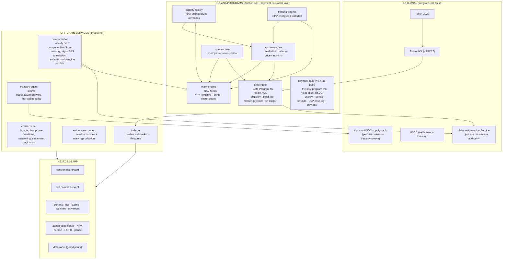

# 08 · SRS — NUNDINA Pilot: Proving the Rails on a Real, Self-Issued Asset

> **Purpose:** build-level Software Requirements Specification for the pilot that proves all six programs end-to-end **with zero third-party permissions**, then supports the issuer conversations (OnRe, Figure/Hastra, Securitize; Kamino as venue integration, phase 3).
>
> **Related:** `05-Problem-Register.md` (problem IDs) · `06-Solution-Architecture-v2.md` (§ refs) · `07-Legal-Topology-and-Compliance.md` (CG-*/AE-*/QC-*/LF-*/TE-*/ME-* requirements) · `../research/12` (evidence).
>
> **Decisions locked by the founder (24 Sep 2026):** devnet → mainnet-beta · **real SAS attestations from day 1** (we operate our own attester authority) · **no mocks — the pilot asset is a real, USDC-backed fund with a really-computed NAV** · full stack including queue-claim, facility, tranching · **polished Next.js 16 UI** · **all real wallets** (Squads for authorities, Phantom/Backpack for participants) · USDC settlement · **$1–5K USDC real-money mainnet budget** · **full external audit before mainnet** · private allowlist UI · **1–2 person team**.
>
> **Two founder choices interpreted explicitly (not silently):**
> 1. *"No simulation, all real"* → the pilot token is minted 1:1 against a real USDC treasury sleeve placed in a real permissionless yield venue; NAV is genuinely computed from treasury holdings at each weekly mark and published by our real SAS attester. There is no scripted price path. Consequences: NAV movement is small and slow (yield-scale, not credit-loss-scale), and the "markdown event" in demos is whatever the market actually does. Accepted.
> 2. *"Full audit now"* × 1–2 people × full stack → the honest timeline to the recorded issuer demo is **~4–5 months**, dominated by a 6–10 week audit window (P7) that runs after programs freeze. Accepted; the phase plan in §12 sequences around it and the UI build runs parallel to the audit.

---

## 1 · What the pilot must prove (success criteria)

The pilot succeeds when all twelve scenarios below have been executed **on mainnet-beta with real USDC** (P1–P5 proven on devnet first), recorded, and reproducible:

| # | Scenario | Proves |
|---|---|---|
| **AC-1** | Team wallet completes SAS attestation flow with our attester; gated NPCS token account thaws via Token ACL → `credit-gate`; ineligible wallet is rejected with a typed reason | Compliance-at-activation core (06 §3; CG-4/5/7) |
| **AC-2** | Weekly NAV marks publish for 4+ consecutive weeks from real treasury data, with staleness states transitioning Fresh→Warned→Stale→Fresh as publication timing varies | `mark-engine` state machine on real data (B1, B5) |
| **AC-3** | A full sealed-bid uniform-price session: 3+ bidders commit (tokens + cash escrowed), reveal, clear at a uniform price, allocate pro-rata, settle per-fill DvP, emit print | `auction-engine` complete lifecycle (06 §2) |
| **AC-4** | A session where the clearing price implies a discount to the current NAV; print published under the market's print policy; discount curve updates | Price discovery for a NAV-priced asset (A2, B6) |
| **AC-5** | Issuer ROFR exercised partially in one session (multisig approves at clearing price) and declined in another | Issuer-as-sponsor mechanics (H2, A7) |
| **AC-6** | Per-lot seasoning: a lot acquired in AC-3 cannot be sold in the next session until `restriction_expiry`; seasoning crank merges it into the FREE bucket after expiry; partial fill splits preserve metadata | Rule 144 lot ledger (C2; CG-1) |
| **AC-7** | Holder governor: a bid that would add a new investor_id beyond the cap is rejected and reallocated to existing holders | 12(g) governor (C4; CG-2) |
| **AC-8** | A team wallet submits a real redemption request; a queue-claim mints against the TA-attested request; the claim **sells in a session**; later the claim **pledges into the facility** for a USDC advance | The novel primitive, both paths (06 §5) |
| **AC-9** | Facility advance breaches maintenance (via a real NAV move or a manual threshold drill on devnet): no-liquidation-on-stale-mark verified, then the ladder runs: ROFR → backstop → forced-sale auction (flagged, mark-excluded) → workout | Liquidation for permissioned collateral (F8; LF-1/2) |
| **AC-10** | Tranche pool: SPV-configured pool hashes a real "indenture" doc; senior/junior minted; one real coupon period distributes cash-only senior coupon then junior residual from actual treasury yield; subordination invariant blocks a junior exit that would breach attachment | Credit-loss waterfall (06 §6; TE-1/2) |
| **AC-11** | Timeout/refund: kill a crank mid-session; verify any-participant refund path returns all escrow | Liveness guarantees (D6, G13) |
| **AC-12** | Evidence export: one session's complete event bundle exports and every mark is reproducible from raw inputs + model version | Audit trail (J1, J4; ME-1) |

**Non-goals (explicit):** no protocol token · no public solicitation or public participation (allowlist only, and **no NPCS tokens leave team-controlled wallets before counsel confirms the offering question — Q3/506(c) gate**, see §10.3) · no cross-chain · no mobile · no real third-party issuer asset · no public data-room content beyond synthetic-labeled prints.

---

## 2 · System architecture

**Shared crate `credit-math`:** u128 intermediates, uniform-price clearing, pro-rata allocation, waterfall arithmetic, haircut curves. Every function rounds **against the initiator**. *Planned* consumers: auction-engine, tranche-engine, liquidity-facility, queue-claim. **As built (2026-09), the only consumer is `payment-rails`**, which calls `ceil_div`, `mul_div`, `accrue_interest` and `distribute_cash`. Clearing, pro-rata, NAV, haircut, PV and the loss waterfall are pure, tested functions with **no program consumer yet** (#48). Unit-test target: 100% branch coverage on this crate (D8); CI job `credit-math — coverage` publishes the measured figure.

---

## 3 · The pilot fund — "NUNDINA Pilot Credit Sleeve" (NPCS)

This is the asset the rails run on. It is **real**: real USDC backs it, real yield accrues, NAV is really computed. It is also **clearly labeled** a pilot/demo asset in metadata and prints.

### 3.1 Structure

| Parameter | Value | Notes |
|---|---|---|
| Token standard | Token-2022 SPL | Extensions: `DefaultAccountState=frozen`, `MetadataPointer` + Token Metadata, `PermanentDelegate` |
| Mint authority | Squads multisig (2-of-2: founder + ops key) | Minting only via "deposit confirmed" treasury instruction |
| Permanent delegate | **Squads multisig (we are the issuer)** | Deliberate: AC-9 depends on it; disclosed in every demo ("in production this stays with the fund issuer" — D14 discipline) |
| Transfer authority model | Token ACL (sRFC37): MintConfig PDA delegates thaw decisions to **`credit-gate`** | Zero-CU transfer path once thawed (D1) |
| Backing | $2–5K USDC (mainnet budget tranche) deposited in a **Kamino USDC supply vault** (permissionless market — no token-access approval needed) | Backup if Kamino integration is troublesome: hold USDC in a program-controlled treasury PDA, NAV accrues flat. Real, just boring. Decide at P2, note in demo script |
| Supply cap | = treasury USDC at deposit, 1:1 | Additional mint only on new deposit event |
| Metadata | name `NUNDINA Pilot Credit Sleeve`, symbol `NPCS`, `PILOT-DEMO-ASSET — NOT AN OFFER — SYNTHETIC LABEL` in metadata + on every print | Dataset pollution guard (research/12 §8.7) |
| Holder cap (governor) | 8 investor_ids (far below the real-world governor's purpose, but exercises the code path) | CG-2 |
| Eligibility policy | `PILOT_506C_TEST`: accredited-flag SAS attestation (ours), jurisdiction US or non-US test flag, block-list empty but enforced | CG-3 config class |
| Seasoning (lot ledger) | Pilot uses a **compressed Rule-144 analog**: `restriction_expiry = acquired_ts + 7 days` | Exercises identical code paths with pilot-friendly timing; real constants are config, switched per-market (CG-1) |

### 3.2 NAV computation (the "no simulation" core)

`nav-publisher` (weekly cron, configurable):

1. Read treasury: vault shares via Kamino vault account + rate data (or USDC balance if backup mode).
2. Compute `NAV_gross = treasury_value / supply`.
3. Deduct accrued protocol fees (pilot: 10bps/yr equivalent, booked to the fee account — exercises the fee waterfall line).
4. Attach `model_version`, `raw_inputs_hash`, `computed_ts`.
5. Sign a **real SAS attestation** (our attester authority) containing `{asset, nav, computed_ts, model_version, inputs_hash, expiry}`.
6. Submit `mark-engine::publish_nav` with the attestation verified on-chain.

Mark states arise **naturally**: publishing weekly keeps Fresh; skipping a week forces Warned→Stale; an admin `suspend` (and only real events) sets Suspended. The demo shows real staleness behavior by *actually not publishing* during a recorded week — real mechanism, honest demo.

**Yield reality check (documented expectation, not simulation):** $3K at ~5–8% APY ≈ **$3–5/month** of NAV drift. Marks will move in the 4th–6th decimal. That is sufficient to exercise every code path (states, haircuts, protective marks, waterfall math) but it means *no dramatic markdown will occur naturally*. If a demo needs a loss event: run AC-9's ladder drill on devnet with an admin-set mark move (labeled `ADMIN_DRILL` in events), and keep mainnet prints honest. **Do not fake a mainnet markdown.**

---

## 4 · Program requirements

### 4.1 `credit-gate` (Anchor; audit-scope-critical)

| ID | Requirement | Ref |
|---|---|---|
| CG-P1 | `validate(owner, mint)` instruction implementing the Token ACL Gate Program interface (sRFC37): on thaw, verify (1) block-list miss, (2) valid SAS attestation set {accredited, jurisdiction, investor_id, expiry} for owner per market policy, (3) attestation expiry ≥ configured settlement horizon, (4) holder-governor headroom, (5) lot-ledger init. Approve/reject with typed reason codes; every decision evented | CG-1..7; L17 |
| CG-P2 | Market config PDA per mint: policy class, attestation schema IDs, block-list source, holder cap, seasoning seconds, settlement horizon — updatable only by gate-config authority (multisig), changes evented, never mid-session (snapshot discipline lives in auction-engine) | CG-3 |
| CG-P3 | `HolderLots` PDA per (holder, mint): fixed-capacity ring of lot records `{qty, acquired_ts, source, affiliate_flag, restriction_expiry, exemption_path}`; `append_lot` called by auction-engine settle + primary mint; `split_lot` preserves metadata on both halves; `merge_expired` (permissionless, pays crank fee) compacts expired lots into a FREE bucket | CG-1; C2; D4/D15 |
| CG-P4 | Holder governor: map wallet→investor_id from attestation; `project_and_check(new_id?)` callable by auction-engine at allocation; enforce cap; decrement on exit-to-zero; queue-claim holdings never increment | CG-2; C4; G3 |
| CG-P5 | Block-list precedence over allow-list on every check path; block-list PDA updatable by multisig with ≤1 session latency; revocation = attestation expiry check + list check at every validate | CG-5; C11; H5 |
| CG-P6 | SAS attestation read: verify SAS program account ownership, attester authority ∈ market config's attester set, schema ID match, expiry window, investor_id extraction | CG-4 |
| CG-P7 | All rejections emit `{reason_code, detail_hash}` events; human-readable mapping lives off-chain (ME-5/UI) | CG-7; D17 |

**Acceptance:** AC-1, AC-6, AC-7.

### 4.2 `auction-engine` (Anchor; audit-scope-critical for escrow paths)

| ID | Requirement | Ref |
|---|---|---|
| AE-P1 | `open_session(mint, params)`: only `venue_operator` authority (multisig role); snapshot ALL session params (window timestamps, reserve rule, settlement mint=USDC, print policy, min bid, bond, chunk size, ROFR flag, forced_sale flag) into a Session PDA at open; immutable for the session | AE-1/2; L5 |
| AE-P2 | State machine exactly per 06 §2: Scheduled→Commit→Reveal→Clearing→Allocating→IssuerROFR→Settling→Printed; Failed/Refunding terminal paths from every phase per the diagram; every transition evented; `unix_timestamp` windows + grace periods | 06 §2; D7 |
| AE-P3 | Commit: sealed `hash(side, limit, qty, lot_selector, nonce)` + **pre-funded escrow** (tokens from seller incl. lot escrow via gate check; USDC from buyer = qty×limit) + forfeitable bond. Bid caps per investor; fixed session capacity ring buffer | AE-6; F2; G12 |
| AE-P4 | Reveal: preimage check; unrevealed ⇒ bond forfeited to protocol reserve, order excluded. Commit window may auto-fail (insufficient commitments) → refund | G13 |
| AE-P5 | Clearing: single instruction computes uniform price maximizing executed volume; tie-break: minimize imbalance → nearest reference mark (from mark-engine). Reserve floor = `NAV_effective × (1 − max_discount_param)`; no cross ≥ floor ⇒ Failed | A11; 06 §2 |
| AE-P6 | Allocation: **chunked** — deterministic ordering, pro-rata at the margin via `credit-math`, gate re-check per chunk (`project_and_check`), round against initiator; state resumable per chunk (idempotent, cursor in Session PDA) | D3; D8 |
| AE-P7 | IssuerROFR: discrete state; ROFR authority (multisig) exercises fully/partially/declines within window; exercise = cash-for-tokens at clearing price; evented with timestamps | AE-4; L8 |
| AE-P8 | Settlement: **one fill per instruction**, loopable by crank: gate final re-check (attestation still valid, lot seasoning still OK, block-list re-check), atomic DvP (thaw-ensured token transfer, USDC release), lot append/split on buyer, `TransferInstruction` event {from,to,qty,lot_ids,price,session,exemption_path,disclosure_hash}, decrement/hold holder counts | AE-6; CG-4; L21 |
| AE-P9 | Print: on Printed, emit `ClearingPrint{price, volume, n_investor_ids, forced_sale_flag, print_policy_class}` consumed by mark-engine | AE-5; ME-2 |
| AE-P10 | Timeout refunds: every phase has a hard deadline; `refund_all` permissionless and callable by any participant; escrow only in PDAs with `has_one` constraints; no engine-owned balances | AE-7; D6 |
| AE-P11 | Forced-sale sessions: `forced_sale=true` set at open by facility; prints flagged (mark-engine excludes); reserve rules relaxed per config | LF-2; M2 |

**Acceptance:** AC-3, AC-4, AC-5, AC-11.

### 4.3 `mark-engine`

| ID | Requirement | Ref |
|---|---|---|
| ME-P1 | Feed PDA per asset: `{nav_latest, effective_ts, state, model_version, inputs_hash, publisher_set}`; `publish_nav(attestation)` verifies SAS attestation ∈ publisher set before writing | B4; ME-1 |
| ME-P2 | State machine: Fresh (age < warn_h) → Warned → Stale (≥ stale_h) → Suspended (explicit only); transitions evented; state readable by all programs | B1/B2/B5 |
| ME-P3 | `NAV_effective = NAV_latest × haircut(state, age, asset_vol_params)`; haircut params per-market, bounded by hard on-chain ceilings (governance can't exceed) | B1; L1/L2 bounds |
| ME-P4 | Print ingestion from auction-engine: eligibility test (min volume, min distinct investor_ids, outlier band vs prior mark) before a print enters `NAV_implied` curve; rejected prints stored but flagged | G2; B6 |
| ME-P5 | `MARK_PROTECTIVE = min(NAV_official_effective, NAV_implied_curve)`; every consumer (facility, tranching) reads this, never raw NAV | B3 |
| ME-P6 | Print policy classes: `PUBLIC / BANDED / AGGREGATE_ONLY / DATA_ROOM` per market; publishes conform (banded: round + delay; aggregate-only: no price, volume+count only) | AE-5; L14 |
| ME-P7 | Circuit-breaker integration: feed state participates in the system-wide hierarchy (Normal/Cautious/Restricted/Standstill) per 06 §11; suspended mark ⇒ global no-liquidation (enforced here, so no consumer can bypass) | 06 §11; LF-1 |

**Acceptance:** AC-2, AC-4, AC-12.

### 4.4 `queue-claim`

| ID | Requirement | Ref |
|---|---|---|
| QC-P1 | `RedemptionRequest` PDA created only from an attested request: in pilot, our issuer side (multisig) attests via SAS: `{holder, asset, qty, request_ts, window_date, rank, fill_history}` — a *real* request by a team wallet against real NPCS | QC-1; L21 |
| QC-P2 | Claim position PDA + non-transferable position token; `Transferable` flag and `Pledgeable` flag set independently by issuer consent (multisig); state machine per 06 §5 (Requested→Attested→Transferable/Pledgeable→PartiallyFilled→Retired/Frozen/Restructured/Cancelled) | QC-2; Q6 |
| QC-P3 | Sell path: claim is a session participant asset — auction-engine treats a transferable claim as the traded asset (its own market class with its own mark = discounted PV model from mark-engine: `E[fill_t] × discount curve`) | AC-8; A12 |
| QC-P4 | Pledge path: `pledge(claim, facility)`; `record_fill(qty)` per real window execution; proceeds sweep order: facility repayment → claim holder | QC-3 |
| QC-P5 | Claims never touch holder-governor counts (CG-P4 consumes this invariant) | C4 |

**Acceptance:** AC-8 (both paths).

### 4.5 `liquidity-facility`

| ID | Requirement | Ref |
|---|---|---|
| LF-P1 | Advance PDA: `{collateral (NPCS lot or claim), principal USDC, advance_rate, maintenance_ratio, state}`; underwriting uses `MARK_PROTECTIVE`; **advance_rate ≤ hard on-chain ceiling (50%)**, curator params below it | LF-3; L13 |
| LF-P2 | Funding: facility USDC comes from a dedicated facility fund PDA seeded from the mainnet budget (anchor = team treasury in pilot); routing note (to Kamino/Loopscale in production) documented, not built | LF-4 |
| LF-P3 | Health check: `MARK_PROTECTIVE`-based maintenance; breach → grace window (top-up allowed) → ladder | LF-1/2 |
| LF-P4 | **No liquidation when mark state ∈ {Warned?, Stale, Suspended}** — enforced by reading mark-engine state inside the liquidate instruction (Warned blocks new advances only) | LF-1; B5 |
| LF-P5 | Ladder exactly per 06 §5: (1) issuer ROFR at MARK_PROTECTIVE (multisig), (2) backstop bidder (pre-registered team wallet, contracted haircut), (3) forced-sale auction session via auction-engine with `forced_sale=true`, (4) workout assignment to lender PDA; shortfall → reserve → lender, non-recourse, evented | F8; M2 |
| LF-P6 | Repayment/sweep hooks from queue-claim fills; interest accrues per second over `Δt_seconds`, computed at each touch by `credit_math::accrue_interest` (pilot rate: fixed 12% APR, config) | QC-P4 |

**Acceptance:** AC-9.

### 4.6 `tranche-engine`

| ID | Requirement | Ref |
|---|---|---|
| TE-P1 | Pool creation requires SPV config: `legal_doc_hash` (pilot indenture doc: written by us, versioned in repo, hash on-chain) + `waterfall_version`; **no mint path without it** | TE-1; L9 |
| TE-P2 | Senior/junior Token-2022 mints; junior carries lockup + transfer restriction via gate class; deposit of NPCS collateral creates tranches at configured attachment points | 06 §6 |
| TE-P3 | Three-book accounting: `unrealised_mark / realised_loss / recovery_receivable` ledgers; mark moves hit MARK book (senior protected via MARK_PROTECTIVE, junior principal untouched); realised losses hit junior principal; recoveries reverse in reverse-waterfall order | E2 |
| TE-P4 | Distribution instruction (per period, crank-triggered): cash waterfall top-down from actual received yield — fees → senior coupon (cash-only) → reserve top-up → senior amortization → junior coupon → junior residual; every line evented with distribution character metadata | E8/E11; AC-10 |
| TE-P5 | Subordination invariant enforced pre-state-change: `junior_nav/total ≥ attachment_min` after action else reject; junior exit only via auction session to replacement holder | E4/E9 |
| TE-P6 | States: Warehousing→Active→Standstill→Amortizing→Impaired→WoundDown per 06 §6 state machine; wind-down runs through auction-engine; no underflow paths (u128 checked arithmetic, exhaustive tests) | E12 |
| TE-P7 | Human override instruction: multisig-only, evented, references off-chain authority doc — used only on contract/indenture conflict | C18 |

**Acceptance:** AC-10.

### 4.7 `payment-rails` (Anchor; audit-scope-critical: holds client cash) — plan amendment, 2026-09 (#47)

**Why this section exists.** The build added a seventh program that this SRS did not plan. `payment-rails` (`GdWmRivxe1k76apQB7EgJ4yBq8Fi3Lw25E8V3XosPocn`, live on devnet) is a **single audited cash layer**. Every micro-USDC that moves in the protocol moves through it; the security never does. It replaces four separate money-moving code paths inside auction-engine, liquidity-facility, queue-claim and tranche-engine. This amendment adopts it (option A of #47) instead of leaving code and plan to disagree.

**Position in the dependency graph.** It sits *below* the four engines: they own the semantics (commit/reveal/clear, marks, ladders, attachment points) and call into the rails for every cash movement. It depends only on `credit-math` and Token-2022/SPL Token, and holds no state that the engines can't reconstruct from its events.

| Engine requirement | What `payment-rails` implements for it | Status |
|---|---|---|
| AE-P3 / AE-P4 | pre-funded bid escrow + forfeitable bond; ask escrow (asset + bond) | ✅ R1/R2 |
| AE-P7 | issuer ROFR cash-for-asset fill | ✅ R2 |
| AE-P8 | one-fill-per-instruction atomic DvP; `TransferInstruction` record. **Gate re-check not yet performed** (`gate_check = NotPerformed`) | ⚠️ R2, pending gate P1 |
| AE-P10 | permissionless, never-pausable refunds; PDA-only escrow; completes even on a delegate-drained vault | ✅ R1 (+#62) |
| LF-P2 / LF-P6 | facility fund, advances to registered destinations, simple-interest accrual, repayment | ✅ R3 |
| QC-P4 | proceeds sweep: facility repayment first, then holder | ✅ R3 |
| TE-P4 | cash waterfall with exact conservation | ✅ R3 |

Interface: `payment-rails/INTERFACE.md`. Phases: `payment-rails/PHASES.md`. Registry: `payment-rails/DEPLOYMENTS.md`.

**Consequence for doc 06 §1 ("one responsibility each").** The rails are one responsibility (*move cash exactly*), cut horizontally across the engines rather than vertically. Each engine stays independently auditable for its semantics; the rails are audited once for all cash paths (§11).

**Acceptance:** AC-11 (refunds), the cash legs of AC-3/5/8/9/10, and the kill-the-crank drill in CI.

---

## 5 · SAS attestation design (real from day 1)

| Item | Decision |
|---|---|
| Attester authority | One dedicated keypair, **we are the attester** (SAS is permissionless for attesters). Key stored encrypted (age/KMS-style), never on a dev machine; ops runbook in repo |
| Schemas (3) | `nundina.identity.v1` {investor_id (UUIDv7), jurisdiction, kyc_level} · `nundina.accreditation.v1` {accredited: bool, method, expiry ≤ 90d} · `nundina.redemption_request.v1` {asset, qty, window_date, rank} |
| Issuance flow | Internal "registrar" step in the admin UI: verify the person (team-only in pilot: video call + entity check), then issue attestation on-chain. The *interface* is production-shaped; the *policy* is team-only until Q3 clears |
| Rotation/revocation | Attester rotation: add-new → re-attest → remove-old, both in market config attester sets (multisig). Revocation = expiry + block-list, per CG-P5 |
| Mainnet note | Real SAS program on mainnet-beta; attestations cost real fees — negligible at pilot scale |

---

## 6 · Off-chain services

| Service | Stack | Responsibilities | Notes |
|---|---|---|---|
| **indexer** | Node/TS + Helius webhooks → Postgres (Supabase) | Decode every program event → normalized tables (sessions, bids, fills, lots, marks, claims, advances, waterfall lines); idempotent upserts; gap-fill via RPC backfill | Single source for UI + evidence |
| **api** | Next.js route handlers (same repo as UI) | Read APIs over Postgres; write paths *always* build real transactions client-side (wallet-signed) — the server never custodies or signs user actions | ME-4 discipline |
| **nav-publisher** | Node cron (GitHub Actions or small VPS) | Weekly NAV computation per §3.2 → SAS attestation → mark-engine publish. Multisig not required per-publish (publisher key ∈ publisher set); publisher set changes are multisig | The one autonomous signer besides crank |
| **treasury-agent** | Ops-runbook-driven (not autonomous) | Deposit/withdraw sleeve USDC; reconciles vault shares vs NAV inputs weekly | Manual with checklist; no key automation |
| **crank-runner** | Node bot, bonded wallet | Phase-deadline cranks, seasoning merges, settlement pagination, distribution cranks; escalating priority fees + jitter (D11); **kill-switch drill is part of AC-11** | Bonded per 06 §8 |
| **evidence-exporter** | Node CLI | Session evidence bundles (all events + marks + model versions + inputs) → signed JSON files in repo/storage | AC-12; L23 |

---

## 7 · Frontend — Next.js 16

| Area | Requirement |
|---|---|
| Framework | Next.js 16 (App Router, RSC-first, server components for read views; client components for wallet interactions). TypeScript strict. Tailwind + shadcn/ui + Tremor (or Recharts) for marks/charts |
| Wallet | Wallet Standard via `@solana/wallet-adapter-react` (or Kit-native adapter): **Phantom + Backpack + Squads** connect. All real wallets per decision — no embedded/keypairless modes |
| Pages | `/dashboard` (live sessions, mark states, system breaker state) · `/sessions/[id]` (commit/reveal UI, live clearing result, fills, print) · `/portfolio` (my lots + seasoning countdown, claims, advances, tranche positions) · `/admin` (gate config, attestation issuance, NAV publish, ROFR actions, pause, reserve) — admin pages require multisig-proposed transactions (Squads UI flow) · `/data-room` (prints per policy class; gated) |
| Access | **Private allowlist**: connect + CG check against market policy before any page data; read access only for allowlisted wallets (founder decision). All NPCS-related views carry the `PILOT-DEMO-ASSET` label prominently |
| UX bar | The 6-minute recorded demo runs entirely through this UI — bid commit → reveal → clearing animation → ROFR decision → settlement → print. It must look institutional: dark theme, numeric precision, no crypto-degen aesthetics |
| i18n/perf | Out of scope. Responsive desktop-first |

---

## 8 · Wallets & authorities map

| Wallet | Type | Holds | Can do | Cannot do |
|---|---|---|---|---|
| **Protocol authority** | Squads 2-of-2 (founder + ops) | upgrade authority (all programs), pause authority, parameter authority (within hard bounds), gate config authority, ROFR/issuer role, permanent delegate, fee/reserve receiver | Everything administrative, always timelocked for upgrades (48h) | Nothing outside hard prudential bounds (06 §11 HARD set) |
| **SAS attester** | Standalone encrypted keypair | — | Issue/revoke attestations | Any token or program authority |
| **nav-publisher** | Standalone keypair | — | mark-engine publish (member of publisher set) | Config or governance |
| **Crank (bonded)** | Hot keypair, small SOL | bond | Permissionless cranks only | Anything with discretion |
| **Treasury hot** | Keypair + ledger co-sign | USDC sleeve | Deposits/withdrawals per runbook | Program authorities |
| **Participants** | Phantom/Backpack (3–4 real wallets: seller, buyerA, buyerB, claim-holder) | NPCS lots, USDC, claims | Bid, pledge, redeem — everything user-side | Any admin function |

Every authority above appears in the demo's authority-map slide (11 §publish discipline: "here is every key and what it can and cannot do").

---

## 9 · Environments & data

| Env | Cluster | Purpose | Money |
|---|---|---|---|
| local | LiteSVM / solana-test-validator | Unit + integration tests, CI | none |
| dev | devnet | Full-stack dev; devnet SAS + devnet USDC | faucet |
| staging | devnet (frozen builds, mainnet config parity) | Pre-audit freeze verification, demo dry-runs | none |
| **mainnet-beta** | real | P8 pilot sessions, recorded demo | **$1–5K USDC real** |

Postgres: Supabase (dev/prod projects). RPC: Helius (free dev tier → paid at P8). Program IDs, verifiable builds, and an on-chain registry of official deployments published from day one (G14).

---

## 10 · Compliance integration (from doc 07 — the pilot obeys its own rules)

1. **Encode the register:** CG-P1..7, AE-P1..11 etc. implement the 07 Part-III requirements literally — the pilot is the reference implementation of our own compliance claims (and the Foundation-grant artifact).
2. **Print hygiene:** every NPCS print is `PUBLIC` but metadata-labeled synthetic; the discount curve the pilot builds is demo data and is excluded from any commercial dataset claim.
3. **⛔ OFFERING GATE (blocking, counsel):** NPCS transfers are restricted to **team-controlled, attested wallets only** until Q3 (and the 506(c)/private-offering analysis for even a self-issued pilot asset with any outside holder) clears. If a demo requires an "outside" viewer: they get **read-only UI access**, never tokens. This gate is a hard P8 precondition, same rank as the audit.
4. **Q14 settlement check:** USDC-as-settlement GENIUS-cleanliness memo confirmed before P8 mainnet USDC movement (expected trivial; still verify — L19).
5. **E&O-lite posture:** no outside user funds at risk in pilot (team money only) — this is what makes a full-audit-then-tiny-mainnet plan defensible.

---

## 11 · Audit plan (P7 — the long pole)

| Item | Plan |
|---|---|
| Scope (fixed) | **`payment-rails`** (added 2026-09, #47: it holds all client cash, so it is not optional at any pricing), `credit-gate`, `auction-engine` (escrow/clearing/settlement), `liquidity-facility`, `credit-math`. `mark-engine`, `queue-claim`, `tranche-engine` included at best-effort pricing — scope growth is the #1 timeline risk; **freeze scope at contract** |
| Firms | 2–3 boutique Solana shops (OtterSec/Neodyme/Zellic-tier or independent auditors) — request quotes at P3 so the slot is booked before P5, not after |
| Prep | Internal review checklist per program (invariants, PDA derivation table, has_one audit, overflow proofs), fuzz targets for credit-math + clearing, LiteSVM adversarial suite (bid spam, refund griefing, gate griefing) — **delivered with the codebase** to cut audit days |
| Findings | All criticals/highs fixed + re-reviewed before mainnet; mediums triaged with written rationale; report published (marketing asset for issuers/grants) |
| Duration | 6–10 weeks elapsed typical; assume 10 in the plan |

---

## 12 · Phase plan (1–2 people; UI work parallel from P2 if 2 people)

| Phase | Weeks (cum) | Deliverable (exit criteria) |
|---|---|---|
| **P0 Scaffold** | 1 (1) | Monorepo (Anchor workspace + Next.js + services), Squads created, CI + verifiable builds, `credit-math` skeleton + property tests running |
| **P1 Gate + Asset** | 2–4 (4) | NPCS mint + Token ACL + `credit-gate` full CG-P1..7 on devnet; SAS attester live; AC-1 passes E2E through the UI's admin pages |
| **P2 Marks + Treasury** | 3–5 (5) ∥ | `mark-engine` + nav-publisher + treasury sleeve deposited; AC-2 running weekly; UI dashboard live |
| **P3 Auction** | 5–8 (8) | `auction-engine` complete incl. chunked settlement + refunds + cranks; AC-3, AC-4, AC-5, AC-11 pass; **audit quotes requested** |
| **P4 Claims + Facility** | 8–10 (10) | `queue-claim` + `liquidity-facility`; AC-8, AC-9 pass |
| **P5 Tranching** | 10–12 (12) | `tranche-engine`; AC-10 passes; **programs frozen for audit** |
| **P6 UI completion** | 8–14 (14) ∥ | Full Next.js app per §7; demo dry-run on staging |
| **P7 Audit** | 12–22 (22) | External audit + fixes; evidence-exporter + AC-12; staging parity freeze |
| **P8 Mainnet pilot** | 22–24 (24) | Mainnet deploy, allowlist onboarding, **all 12 ACs re-run on mainnet with real USDC ($1–5K)**, recorded 6-minute demo + authority-map slide |
| **→ Then** | 24+ | Issuer outreach with demo (OnRe DM package already drafted) · Figure/Hastra · Securitize; Kamino integration talks (phase-3 asset, not pilot) |

**Cut list if solo or slipping (in order):** UI polish → shadcn defaults · tranche-engine slides-only in demo (defer AC-10 to post-audit) · facility ladder drill on devnet only (AC-9 mainnet partial) · evidence-exporter CLI before UI. **Never cut:** credit-gate, auction-engine escrow paths, audit, mainnet AC-1/AC-3.

---

## 13 · Testing & acceptance

- **credit-math:** property-based tests (proptest) on clearing, pro-rata, waterfall invariants; 100% branch coverage; known-answer tests against hand-computed vectors.
- **Programs:** Anchor lang tests on LiteSVM; adversarial suite: bid spam (G12), reveal-griefing (G13), refund griefing, gate rejection fuzzing, account-substitution attempts (G8), timestamp edge windows (D7), chunk interruption/resume (D3/D12).
- **E2E:** the 12 ACs scripted (TypeScript harness driving real wallets where human action is simulated; real Phantom/Squads clicks for the recorded runs).
- **Circuit-breaker drills:** suspension → standstill → recovery walkthrough recorded for the demo appendix.
- **Definition of done per AC:** passes on devnet staging AND (P8) on mainnet, with evidence bundle archived.

---

## 14 · Risks & open items

| Risk | Mitigation |
|---|---|
| Audit timeline blowout | Book slot at P3; fixed scope; ship prep artifacts; parallelize UI during audit |
| Solo-founder bus factor | Everything in repo, runbooks for all keys/services; Squads co-signer is the recovery path |
| Kamino sleeve friction (integration hiccups) | Backup: plain USDC treasury PDA, flat-NAV mode — noted honestly in demo script |
| NPCS offering question (even internal) | Hard gate §10.3: team wallets only pre-counsel; read-only outside access |
| Small NAV movement makes demos look static | Demo script leans on mechanism states + AC-9 devnet drill labeled `ADMIN_DRILL`; never fake mainnet marks |
| Helius/vendor dependency | RPC is swappable (QuickNode fallback env); no vendor lock in program design |
| Scope creep toward "product" | This SRS is the pilot boundary; issuer-specific features wait for the first signed window |

**Open items carried (not blocking pilot):** Q1/Q3/Q7 counsel engagement (starts in parallel at P3 — memos needed before issuer signatures, not before pilot build) · real TA bridge (pilot: we are issuer+TA in one, documented as such) · print-dataset commercialization (post-pilot).

---

## 15 · Traceability

| SRS area | 06 ref | 07 reqs | ACs |
|---|---|---|---|
| credit-gate | §3, §7 | CG-1..7 | 1, 6, 7 |
| auction-engine | §2 | AE-1..7 | 3, 4, 5, 11 |
| mark-engine | §4 | ME-1..5 | 2, 4, 12 |
| queue-claim | §5 | QC-1..4 | 8 |
| liquidity-facility | §5 | LF-1..4 | 9 |
| tranche-engine | §6 | TE-1..4 | 10 |
| payment-rails (§4.7, as built) | §2, §5, §6 cash legs | AE-4, AE-6 (DvP; eligibility re-check pending), AE-7, QC-3, TE-2 (cash-only coupons). **AE-3 is contradicted by the per-trade fee (#59)** | 3, 5, 8, 9, 10, 11 |
| services/UI/governance | §8, §10, §11 | L-items via Part III | 12 |

*Next docs: demo script (6-minute session) · issuer one-pager · Foundation grant application (credit-gate as sRFC37 reference implementation).*
