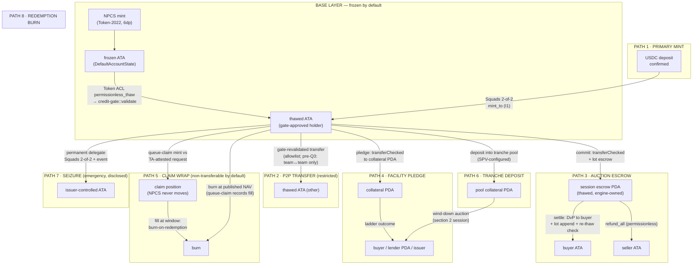
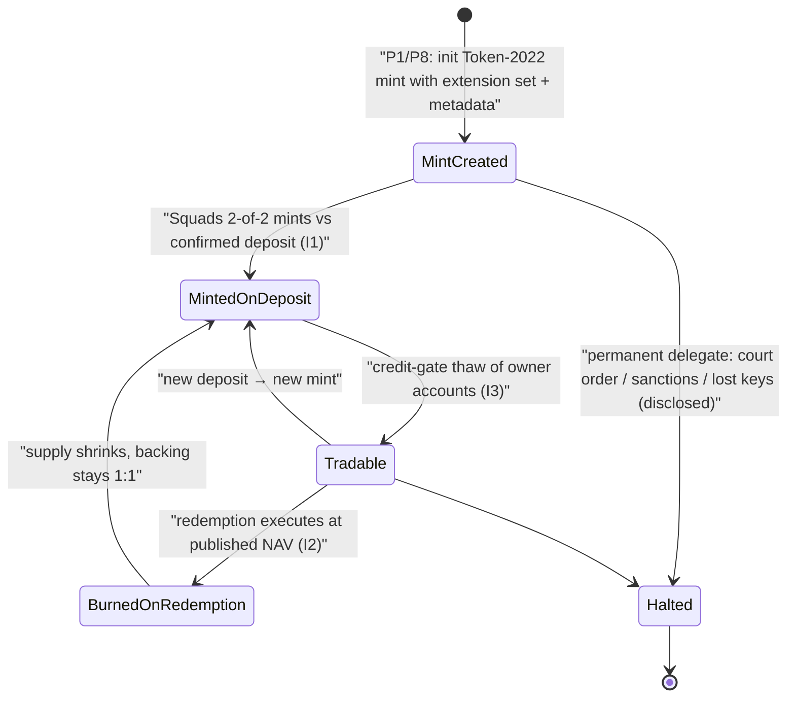

# 09 · NPCS — Pilot Asset Specification

> **Purpose:** the complete, build-ready specification of **NPCS** (`NUNDINA Pilot Credit Sleeve`) — the real, USDC-backed pilot asset that every program in `08-SRS-Pilot-Rails.md` runs on. This doc implements `08` §3 at decision level: token structure, the three invariants and their integer math, **the full movement topology (every path a unit can take on Solana)**, account/rent/CU budgets, adversarial containment, and deployment.
>
> **Supersedes nothing.** Implements `08` §3. Depends on `06` §3 (Token ACL / sRFC37) and `07` Part III (CG-*).
>
> **Decision record — locked by the founder, 25 Sep 2026:**

| # | Decision | Value | Rules out |
|---|---|---|---|
| **D-A** | Scope | **NPCS only.** No protocol token. `06` §13 / `07` L24 (K5) stand as written | Token-launch design work in v1 |
| **D-B** | Mint facts | **6 decimals · symbol `NPCS` · name `NUNDINA Pilot Credit Sleeve`** · fresh mainnet mint created at P8 (the devnet mint is throwaway) | 9dp convention; carrying a devnet mint to mainnet |
| **D-C** | Build order | **Token and `credit-gate` in P1 together.** No ungated NPCS mint ever exists — the asset is born frozen and only thaws through the gate | A throwaway ungated mint, interface rework |
| **D-D** | Pilot parameters | SRS §3.1 defaults confirmed: **8 investor_id cap · 7-day seasoning analog · 10bps/yr fee · weekly NAV · Kamino USDC sleeve** (backup: program-owned USDC PDA, flat NAV — decided at P2) | — |
| **E** | Toolchain | **Anchor 1.1.2 via avm** · Solana CLI 2.3.0 · Node ≥ 20 · Kit-first TypeScript (`@solana/kit`) | Anchor 0.32.x; web3.js v1 patterns |

---

## 1 · What NPCS is

A **Token-2022 SPL asset** representing a claim on a real USDC treasury sleeve. It is the *underlying* the six programs price, trade, queue, finance, and tranche. It is **not** a protocol token, has no distribution, no vesting, no emissions, and no governance. Its entire economics is the three invariants in §3.

It is real (`08` decision: "no simulation"): real USDC backs it in a real permissionless yield venue, NAV is genuinely computed weekly, and its metadata and every print carry `PILOT-DEMO-ASSET — NOT AN OFFER`.

### 1.1 Structural replication map — ONyc-class vs. NPCS

The pilot replicates the *shape* of real permissioned credit tokens (OnRe ONyc, Securitize sTokens, Kamino-gated assets) and deliberately exceeds the softest of them on permissioning:

| Structural property | ONyc (docs, Sep 2026) | NPCS (this spec) |
|---|---|---|
| Claim on real sleeve | ✅ Bermuda segregated account | ✅ Kamino USDC sleeve (real, permissionless market) |
| NAV updated on-chain | ✅ pool NAV appreciates | ✅ weekly SAS-attested publish (I2) |
| Yield form | appreciation, no emissions | appreciation, no emissions (fee line only) |
| Eligibility gate | at issuance/redeem only | at account activation (thaw) + lots + governor |
| Post-mint transferability | **fully transferable** | **frozen-by-default; gate-thawed; seasoned lots** |
| Transfer path cost | standard | zero extra CU post-thaw (sRFC37) |
| Issuer final control | platform off-chain rails | permanent delegate (disclosed) + freeze via ACL |

**Why NPCS runs the harder class:** AC-1/6/7 (thaw, seasoning, governor) are the novel mechanisms under proof. The ONyc-class soft posture (no seasoning, no cap, transferable post-mint) is expressible later as a *policy class* on the same gate — a parameter, not a rewrite. Pilot proves the strictest path; softer classes are strictly easier.

## 2 · Token structure — extension manifest

| Token-2022 extension | On NPCS? | Why |
|---|---|---|
| `DefaultAccountState = frozen` | **YES** | Zero-trust by default. No token account is usable until `credit-gate` validates the owner (AC-1). Compliance at account activation (`06` §3). |
| `MetadataPointer` + Token Metadata | **YES** | Name/symbol/URI minted on-chain, including the `PILOT-DEMO-ASSET — NOT AN OFFER` label (dataset-pollution guard, `research/12` §8.7). |
| `PermanentDelegate` | **YES** | AC-9 depends on issuer-side final control; delegate = Squads 2-of-2; disclosed in every demo and the authority-map slide ("in production this stays with the fund issuer" — D14 discipline). |
| `TransferHook` | **no** | Superseded by Token ACL / sRFC37 — hooks break composability (`06` §3, D1). |
| `TransferFee` | **no** | The pilot fee (10bps/yr) is a **NAV-side accrual line**, not a transfer tax. Keeps the transfer path clean. |
| `InterestBearingMint` | **no** | NAV comes from real treasury value, not an on-mint rate index. The yield is *outside* the token, in the sleeve. |
| `ConfidentialTransfer` | **no** | Incompatible with the permissioned book (`06` D2). Sealed-bid commit/reveal is the privacy mechanism, at the auction layer. |
| `NonTransferable` | **no** | Trading the asset *is the product* (auctions, claims, facility collateral). |

**Authority model** (matches `08` §8): mint authority, permanent delegate, and freeze-all = **Squads 2-of-2 (founder + ops)**. Minting only against a confirmed treasury deposit. Token ACL `MintConfig` PDA delegates thaw decisions to **`credit-gate`**.

### 2.1 Provenance & the honeypot collision (OAK 2026-03 finding)

Since Token ACL's first mainnet transaction (2026-03-06), **a regulated fund and a honeypot have the same on-chain shape**: default-frozen accounts + live freeze authority. Metadata claiming sRFC37 conformance is free text and forgeable. The *only* structural discriminator is: **the freeze authority account is owned by the Token ACL program itself** (its `MintConfig` PDA), not by any wallet.

NPCS adopts the consequences explicitly:

1. **Structure over claims.** NPCS's freeze authority *is* the Token ACL `MintConfig` PDA — verifiable by one account read (owner of the freeze authority == Token ACL program `TACLkU6…`). The demo authority-map slide includes this live check.
2. **Metadata is labeled, never load-bearing.** The `PILOT-DEMO-ASSET — NOT AN OFFER` string is hygiene, not proof. No eligibility claim rests on metadata.
3. **Permanent delegate is the residual risk surface and we say so.** OAK's 2026-Q1 continuation entry documents operators revoking checkable authorities while keeping the delegate. NPCS *keeps* the delegate by design (AC-9) — the honest position is full disclosure of what the delegate can do, not pretense that conformance makes it safe.
4. **Gate provenance published.** The `MintConfig` names `credit-gate`; its program ID and verifiable build are published from day one (G14). A reader can enumerate: who thaws (gate rules), who freezes (ACL PDA), who seizes (delegate, multisig).

## 3 · The three invariants (the "tokenomics", precisely)

All arithmetic in **u128 intermediates**, integer-only, rounding **against the initiator** (`credit-math` rule, D8). Amounts in base units: 1 NPCS = 10⁶, 1 USDC = 10⁶.

### I1 — Backing invariant (supply governance)

```
supply_base_units  ==  total_confirmed_deposits_usdc × 10⁶        (at all times)
```

- **Mint** occurs only on a deposit-confirmed event: treasury-agent verifies the sleeve balance, ops proposes the mint in Squads, 2-of-2 approves, mint executes. The (deposit → mint) event pair is indexed so the invariant is auditable from the event stream alone (AC-12 evidence).
- **Burn** occurs only on a confirmed redemption execution (pilot: team wallets, issuer = us, redemption at published NAV; `queue-claim` records the fill). Burn amount × published NAV is paid out of the sleeve.
- Net effect: NPCS is never a promise — every base unit maps 1:1 to a USDC that entered the sleeve, and redemptions exit at the published mark.

### I2 — NAV invariant (the weekly mark)

```
nav_gross_pico     = floor( treasury_value_micros × 10¹² / supply_base_units )
fee_pico           = floor( nav_gross_pico × fee_bps × Δt_seconds / (10⁴ × 31_536_000) )
nav_published_pico = nav_gross_pico − fee_pico
```

- **NAV precision (D-B correction):** NAV is carried at **pico precision — 10¹² sub-units per whole NPCS**, not 6dp. At pilot scale the 10bps/yr fee is ≈ 19 micro-NPCS/unit/week, which a 6dp mark floors to zero; pico represents it exactly. Implemented and tested in `credit-math`.
- `treasury_value_micros` = USDC value of sleeve holdings read from the Kamino vault account + rate data (backup mode: plain USDC balance, NAV accrues flat).
- Publish sequence per `08` §3.2: compute → attach `model_version`, `raw_inputs_hash`, `computed_ts` → sign a **real SAS attestation** → `mark-engine::publish_nav` (attestation verified on-chain).
- Rounding: **floor on both lines** — the publisher (us) is the initiator, so rounding goes against us. Documented, deterministic, reproducible from raw inputs + model version (J1, ME-1).
- Yield reality (accepted, not simulated): $3K at 5–8% APY ≈ **$3–5/month**; marks move in the 4th–6th decimal. This exercises every code path and produces no dramatic markdown naturally. Demo loss events are devnet `ADMIN_DRILL`s. **Mainnet marks are never faked.**

### I3 — Eligibility invariant (what holding NPCS means)

No NPCS base unit can sit in a token account whose owner has not passed `credit-gate`:

1. thaw requires a valid SAS attestation set {accredited, jurisdiction, investor_id, expiry} per the `PILOT_506C_TEST` policy class;
2. every acquisition appends a **lot** with `restriction_expiry = acquired_ts + 7 days` (compressed Rule-144 analog; real constants are per-market config, CG-1);
3. holdings never push distinct investor_ids past the **8-id governor cap**;
4. until the Q3/506(c) counsel gate clears, eligibility is *de facto* restricted to team-controlled, attested wallets (`08` §10.3 — hard P8 precondition).

## 4 · Movement topology — every path a NPCS unit can take on Solana

All movement is **mediated**: the frozen-by-default base layer means no wallet can initiate custody movement except through an ACL-thawed account, and thaw is gate-gated. Eight paths exist; anything else is impossible at the base layer.



### Path-by-path mechanics

| # | Path | Solana mechanics | Gate involvement | Stuck-state risk |
|---|---|---|---|---|
| **1** | Primary mint | `mint_to` to a *thawed* ATA; mint authority = Squads vault transaction; event `{deposit_ref, qty, sleeve_balance_before/after}` | Holder must already be gate-thawed | None (mint is unconditional once proposed) |
| **2** | P2P transfer | Plain `transfer_checked` between thawed ATAs; **zero extra CU** (the sRFC37 payoff) | Indirect: seller lots must be seasoned (lot ledger checked at acquisition, not at transfer — pilot policy records the check at thaw + acquisition) | None |
| **3** | Auction escrow | Seller `transfer_checked` → session escrow PDA at commit (pre-funded, F2); settle does per-fill DvP: escrow → buyer ATA, cash → seller; buyer's thaw re-validated at settle (CG-P8) | Commit pre-check + per-fill re-check | None — every terminal path refunds (AC-11) |
| **4** | Facility pledge | `transfer_checked` → collateral PDA; maintenance via `MARK_PROTECTIVE`; ladder per `06` §5 | Pledge = acquisition for facility PDA (lot append, affiliate=false) | None — workout assignment is a state, not a stuck transfer |
| **5** | Claim wrap | **NPCS does not move.** The claim is a separate non-transferable position minted against a TA-attested redemption request; the NPCS leaves at the actual gated window | Claim transferability is a flag set by issuer consent (QC-P2) | None — claim is a state machine, not custody |
| **6** | Tranche deposit | `transfer_checked` → pool collateral PDA; tranche mints are separate Token-2022 assets with their own gate class | Subordination invariant pre-check (TE-P5) | None — wind-down via auction session |
| **7** | Seizure | `permanent_delegate` transfer by Squads 2-of-2; **every use evented with reason hash**; break-glass only (sanctions/court/lost keys) | N/A (this is the power the gate exists to make rare) | Disclosure burden, not custody risk |
| **8** | Redemption burn | `burn` from holder ATA at published NAV; sleeve pays out `qty × nav_published`; queue-claim records the fill | Burned units exit the governor count | None |

**The negative space is deliberate:** a NPCS unit cannot move to a frozen account (base layer refuses), cannot be bought at an AMM (no AMM for the raw asset), cannot leave the allowlisted universe (thaw is gate-bounded), and cannot enter any external DeFi route unless that route's owner passes the gate (their tokens arrive frozen).

## 5 · Account topology — every PDA, rent, and CU budget

| Account | Seeds / owner | Size & rent | Written by | Budget note |
|---|---|---|---|---|
| Mint | keypair; extensions per §2 | ~350B + metadata ≈ **~1.3KB** | init once | One-time init tx |
| User ATA (frozen) | ATA program | ~160B | user (or payer) | ~0.0021 SOL rent, paid by onboarding tx |
| `MintConfig` PDA | Token ACL program | ACL-managed | ACL init | One-time wiring tx |
| `MarketConfig` PDA | `credit-gate` — seeds `[b"config", mint]` | ~200B fixed | gate-config authority | CG-P2; snapshot-read by sessions |
| `HolderLots` PDA | `credit-gate` — seeds `[b"lots", mint, owner]` | **1,088B ≈ 0.0086 SOL** — 128 lots × 8B qty/ts fields + header (D4 cap) | gate (append/split/merge) | Compaction keeps ≤ 128; ring-buffer overwrite if full (D15) |
| Governor ledger PDA | `credit-gate` — seeds `[b"gov", mint]` | ~96B — 8 investor_id slots × 12B | gate (project_and_check) | Cap 8 ⇒ bounded forever |
| Session escrow PDA | `auction-engine` — seeds `[b"escrow", session, bidder]` | ~120B, **rent-exempt, closed at settle/refund** | engine | Closed ⇒ rent returned; no dust |
| Collateral PDA | `liquidity-facility` — seeds `[b"collat", advance_id]` | ~140B | facility | Closed at ladder completion |
| Pool collateral PDA | `tranche-engine` — seeds `[b"pool", pool_id]` | ~160B | tranche-engine | Lives for pool lifetime |
| Claim position PDA | `queue-claim` — seeds `[b"claim", asset, holder, request_ts]` | ~130B | queue-claim | Retired ⇒ closed |

**Compute-unit envelope (CG-P1 validate, the worst path):** SAS attestation parse (~30k CU) + policy checks (~5k) + governor projection (~3k) + lot init (~5k) + CPI accounting (~10k) ≈ **≤ 60k CU** against the default 200k instruction limit — comfortable. The zero-CU transfer path after thaw is the entire reason sRFC37 was chosen (D1): routes, wallets, and future Kamino/Orca integrations pay nothing per hop.

## 6 · `credit-math` inventory — every function NPCS economics touches

Pilot scale: **$3,000 USDC sleeve**. All functions integer, u128 intermediates, property-tested (proptest) from P0.

| Function | Formula | Worked example (pilot scale) |
|---|---|---|
| `supply_from_deposit` | `deposit_usdc_micros × 10⁶ ÷ 10⁶ = supply_base` | 3,000.00 USDC → **3_000_000_000 base** (3.000B = 3,000 × 10⁶) |
| `nav_gross_pico` | `floor(treasury_micros × 10¹² ÷ supply_base)` | treasury 3,001.234567 → **1_000_411_522_333 pico** (1.000411522333 NPCS) — hand-verified test vector |
| `fee_accrual` | `floor(nav_pico × fee_bps × Δt ÷ (10⁴ × 31_536_000))` | 10bps over 7 days on 1.000411… → **≈ 19.19 micro-NPCS per unit** (~1.9e7 pico) — exact at pico precision, invisible at 6dp. *This is why NAV is pico (D-B correction)* |
| `nav_published` | `nav_gross − fee` | see above; drift ≈ 4th–6th decimal (accepted) |
| `pro_rata_at_margin` | uniform-price allocation: fill marginal bidders proportionally, `round_against_initiator` | 2,000 bid @ clearing vs 1,500 offered → each marginal bidder gets floor-adjusted share; remainder dust to *next-best* rules, never to filler |
| `uniform_clear_price` | price maximizing executed volume; tie-break: min imbalance → nearest reference mark | 3 bidders (AC-3): deterministic single price |
| `haircut` | `nav_effective = nav × (1 − haircut_bps ÷ 10⁴)`, bounded by hard on-chain ceiling | Fresh state = 0bps; Stale = param (e.g. 200bps) ⇒ $3,000 sleeve marks to $2,940 *reference*, never published as NAV |
| `pv_of_claim` | `Σ E[fill_t] × (1 − discount_bps·t)⁻¹` over quarterly windows | claim on 1,000 NPCS behind a gate filling ~5%/qtr → PV ≈ 850–950bps discount band — the *real* pricing math of the pilot |
| `waterfall_line` | top-down cash, bottom-up loss, u128, no underflow | AC-10 distribution: fees → senior coupon → reserve → junior |
| `accrue_interest` | facility: `floor(principal × rate_bps × Δt ÷ (10⁴ × 31_536_000))` | 12% APR on 1,000 USDC = **328_767 micros/day ≈ $0.33** ($120/yr) — hand-verified test vector |

**Property-test invariants (P0 skeleton, 100% branch target):** `nav_published ≤ nav_gross ≤ treasury × 10⁶` · `supply == deposits` at every step · `Σ pro_rata allocations == min(supply_offered, bid_depth)` exactly · `waterfall lines sum == cash received, exactly, no residue` · `round_against_initiator` holds on every rounding site (fuzzed).

## 7 · Adversarial movement cases & containment

| Case | Attack | Containment (already in design) |
|---|---|---|
| **Double-pledge** | Holder pledges same lot to facility AND commits it to an auction | Lot ledger is the single source of truth: `append_lot`/escrow marks the lot `encumbered`; both paths CPI-check lot state at commit (CG-P3 + LF/P4 + AE-P3). Second mover reverts. |
| **Free-transfer gap** | Two thawed wallets move tokens *outside* the lot ledger via plain `transfer_checked`, defeating seasoning | Accepted pilot residue, by design: sRFC37 has no transfer-time hook (that's its point, D1). Seasoning is enforced **where units are acquired in the protocol** (mint, auction settle, pledge) and re-checked at every protocol exit (auction commit, pledge, burn). Raw P2P between thawed team wallets can bypass — contained pre-Q3 because all thawed wallets are team wallets, and disclosed as the known v1 boundary (production issuers add transfer-class config or keep books via TA). |
| **Thaw-expiry race** | Attestation expires between commit and settlement; settlement would complete to an ineligible holder | AE-P8 re-runs the full gate check per fill; fail ⇒ fill skipped, escrow refunded to the failed side (state `PartialSettled`), print flagged (AC-3/AC-5 paths). |
| **Governor run-around** | Use many wallets (same investor_id) to fake holder-count headroom | Governor maps **wallet → investor_id from attestation** (CG-P4), not wallet count; one id = one slot regardless of wallets. |
| **Lot-ring exhaustion** | Spam tiny acquisitions to overflow the 128-lot ring | Ring compaction merges seasoned lots into FREE bucket (permissionless crank, fee-paid); worst case ring-overwrite refuses *newest* unmerged lots rather than corrupting old ones (D15). |
| **Delegate abuse** | Permanent delegate used outside break-glass | Multisig-only + reason-hash event mandatory + authority-map disclosure; pilot holders are team wallets; production posture documented for issuers (§2.1 point 3). |
| **Escrow griefing** | Commit spam / refusal to reveal | Forfeitable bond (G12/G13); fixed session capacity; bond funds protocol reserve. |
| **NAV publisher compromise** | Fake mark | Attestation must be in publisher set, deviation bounds vs prior mark (G5), model version + inputs hash reproducible (J1), hard haircut ceilings (ME-P3). |

## 8 · Lifecycle



## 9 · Repo layout ("the token has its own folder")

```
token/                    ← the asset, everything about it, nothing else
├── params.toml                # decimals=6, cap=8 investor_ids, seasoning=7d, fee_bps=10,
│                              #   nav_cadence=weekly, policy=PILOT_506C_TEST, cluster overrides
├── metadata.json              # name, symbol, URI content; PILOT-DEMO-ASSET — NOT AN OFFER
├── scripts/
│   ├── init-mint.ts           # kit: create Token-2022 mint w/ extension set, metadata, ACL MintConfig wiring
│   ├── mint-on-deposit.ts     # deposit-confirmed mint flow (Squads-proposed)
│   ├── burn-on-redemption.ts  # redemption burn flow
│   └── verify.ts              # extension audit: reads mint account, asserts the §2 manifest
│                              #   + provenance check: freeze-authority owner == Token ACL program (§2.1)
├── runbook.md                 # key ceremony, deposit/mint ops, redemption ops, break-glass
└── tests/
    └── mint.spec.ts           # LiteSVM: born-frozen, metadata label, delegate identity, ACL wiring

programs/credit-gate/          ← P1, same phase (D-C): CG-P1..7 per 08 §4.1
programs/…                     ← P2+: mark-engine, auction-engine, queue-claim, liquidity-facility, tranche-engine
programs/credit-math/          ← shared crate: §6 functions live here as tested, property-fuzzed code
```

NPCS is **not a program** — it is a mint plus scripts plus config. All *behavior* around it (thaw, lot ledger, governor) lives in `credit-gate`; all *math* lives in `credit-math`. That separation is what makes the asset independently auditable.

## 10 · Deployment plan

| Env | Mint | When | Notes |
|---|---|---|---|
| devnet | throwaway mint | P1 | Real SAS (devnet), real Token ACL wiring, real USDC (faucet). Discarded after staging. |
| staging (devnet, frozen builds) | same devnet mint | P6–P7 | Demo dry-runs; no fresh money |
| **mainnet-beta** | **fresh mint, created at P8 in the key ceremony** | P8 | $2–5K real USDC sleeve; never reuse the devnet mint or its keys; metadata label mandatory |

**Key ceremony (mainnet, P8):** generate mint/delegate/freeze authorities as Squads 2-of-2 members (no standalone admin key); attester + nav-publisher remain standalone encrypted keys per `08` §8. The mint keypair itself is discarded after init — authority is what matters. Every authority and its limits appear in the demo authority-map slide, alongside the live §2.1 provenance check.

## 11 · Risk notes (signing / fees / delegate)

- **Permanent delegate risk is structural:** we hold seizure power over pilot wallets. Disclosed in every demo; acceptable in pilot because every holder is a team wallet; non-negotiable disclosure for any future issuer asset. It is also the residual surface OAK documents — conformance proves nothing about the delegate (§2.1).
- **Mint authority = Squads 2-of-2** — no single key can inflate supply; I1 is enforced by process + event evidence, not by a program, in the pilot. Production issuers replace this with their own treasury program.
- **NAV publisher key** is the one autonomous signer besides the crank; it can only publish into the publisher-set-verified feed, bounded by `mark-engine`'s on-chain ceilings (ME-P3).
- **Seasoning bypass via raw P2P** is a known, disclosed v1 boundary (§7); it is acceptable only while the thawed universe is team wallets — the Q3 counsel gate and the allowlist are what make it acceptable.
- **Offering gate:** NPCS never reaches a non-team wallet before counsel clears Q3/506(c) — enforced by policy config, not goodwill (`08` §10.3).

## 12 · Acceptance hooks

This doc is satisfied when: **AC-1** passes E2E on devnet (attestation → thaw through gate; ineligible wallet rejected with typed reason), **AC-6/AC-7** pass (lot seasoning + governor on NPCS), `token/scripts/verify.ts` asserts the §2 extension manifest **and** the §2.1 provenance check on a live mint, and every §6 function is property-tested. NAV math (I2) is covered by `credit-math` from P0.

---

**Sources for §2.1:** Solana Foundation, sRFC-37 / token-acl (github.com/solana-foundation/token-acl; SRFCs discussion #2) · OAK, "Solana permissioned tokens — a regulated fund and a honeypot have the same on-chain shape" (onchainattack.org, 2026-03-06) `[PRIMARY]/[SECONDARY]` tagged in repo CI where applicable.
