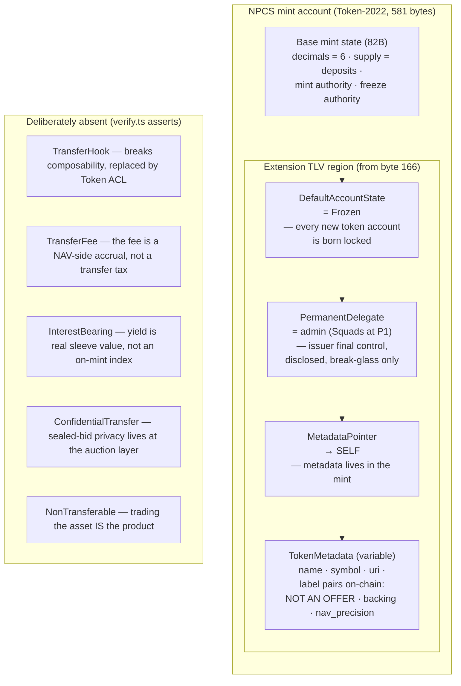
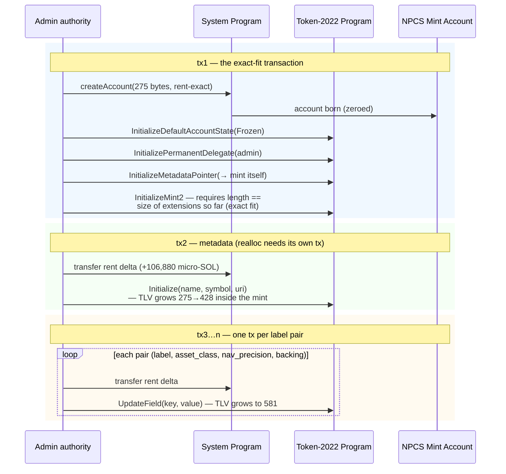
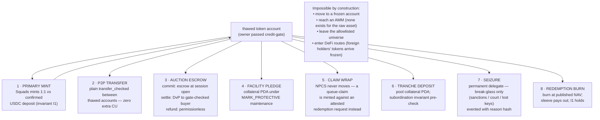
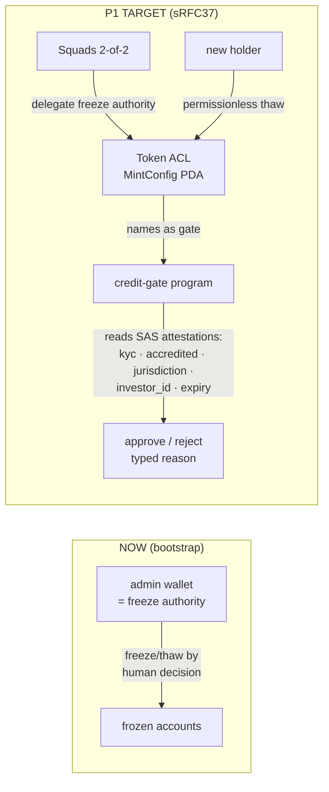

# NPCS — Token Architecture

How the pilot token is built on Solana, what every byte of it does, and where
it is going. Companion to `TOKENOMICS.md` (the money rules) and `runbook.md`
(the ops). Spec authority: `../preresearch/architecture/09`.

---

## 1 · Mint anatomy — the extension manifest

NPCS is a Token-2022 mint with an exact set of extensions. Everything the
token is, permission-wise, is decided by this manifest — asserted on-chain by
`scripts/verify.ts` on every run:

Why frozen-by-default: compliance runs **once at account activation**, not on
every transfer. After thaw, transfers cost **zero extra compute** — routes,
wallets, and future DeFi integrations pay nothing per hop. That is the entire
reason sRFC37 (Token ACL) was chosen over transfer hooks.

## 2 · How the mint is created (`scripts/init-mint.ts`)

The creation sequence is forced by Token-2022's TLV mechanics (each rule
below was proven empirically — see `runbook.md` §mechanics):

**The three mechanics that shaped this sequence** (all verified against the
spl-token-2022 source and on-chain):

1. `InitializeMint2` rejects any account with trailing space — the account
   must be *exactly* as large as the extensions initialized so far.
2. Metadata ops grow the account internally but never fund it — a rent
   `SystemProgram.transfer` must precede each growth.
3. An account cannot be realloc'd in the transaction that created it
   ("memory allocation failed, out of memory") — metadata lives in later txs.

## 3 · Movement topology — every path a NPCS unit can take

The frozen base layer means all movement is mediated. Eight paths exist;
anything else is impossible at the base layer:

## 4 · Where it goes — the ACL target state

Today the freeze authority is the bootstrap admin wallet. P1 moves it into
*code*:

**What exists today (code, #122/#131/#133):** the right-hand box is built.
`credit-gate` reads real SAS attestations (`eligibility::evaluate`): SAS
program owner, canonical attestation PDA, the market's credential and
schemas, an attester from `MarketConfig::attesters`, and expiry against the
settlement horizon. `validate` adds the CG-P4 holder governor, and
`can_thaw_permissionless` / `can_freeze_permissionless` are the Token ACL
gate hooks. `settle_check` re-runs the same decision inside every
payment-rails fill. `ops/gate/wire.ts` creates the Token ACL MintConfig and
delegates the freeze authority to it. The schemas, credential and attester
are live on devnet (`ops/gate/deployment-devnet.json`).

**What is not done yet:** wiring the devnet NPCS mint to the deployed gate
(#170/#171, see DEPLOYMENTS.md). Until that is recorded, the left-hand box
is still what runs on devnet.

After wiring, the §2.1 provenance check becomes REQUIRED: the freeze-authority
account's owner must be the Token ACL program — the only structural
discriminator between a regulated permissioned fund and a honeypot (since
March 2026 they share the same on-chain shape; see doc 09 §2.1).
