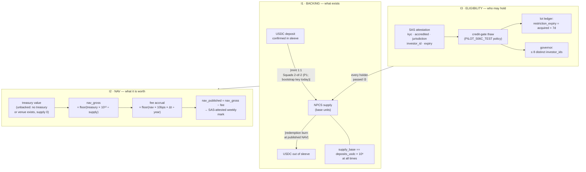
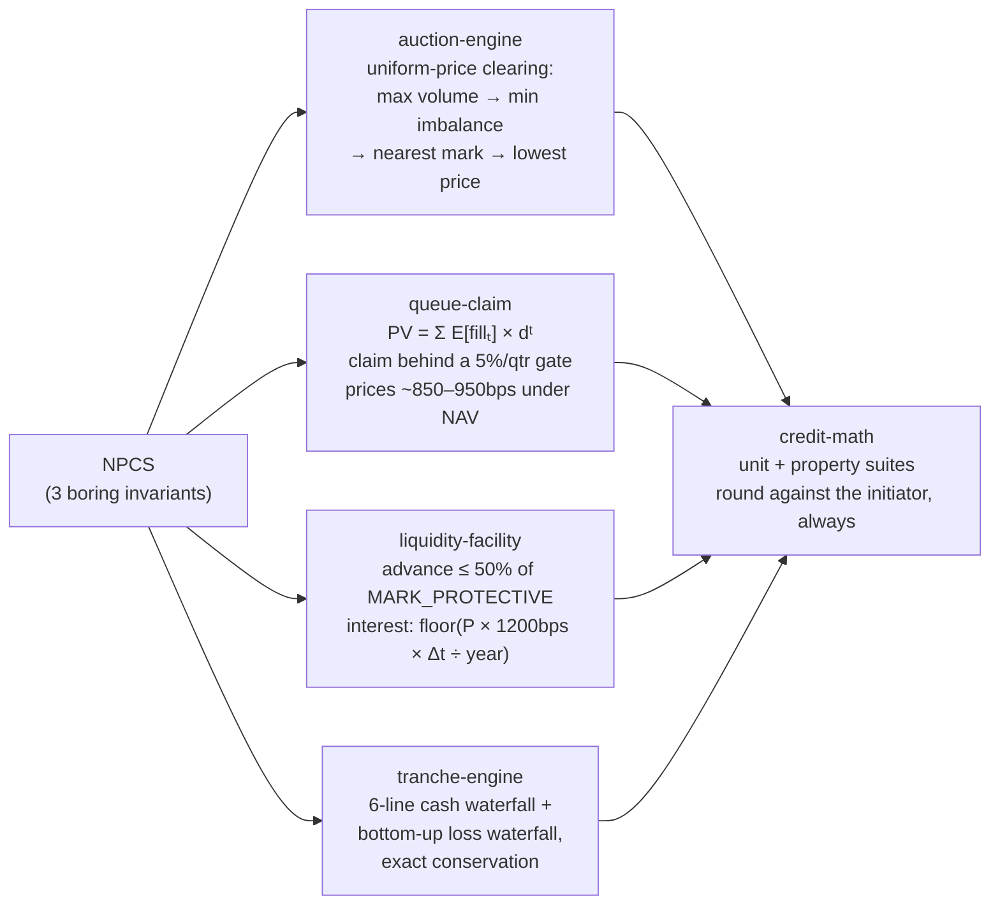

# NPCS — Tokenomics

NPCS has **no tokenomics in the crypto sense** — by design. No distribution,
no vesting, no emissions, no staking, no governance. What it has instead is
**three invariants**: the complete, testable description of what the token is
worth and who may hold it. They are the **design**. Below is what enforces
each one today.

## 0 · What is enforced today (#43)

| Invariant | Arithmetic | Enforced on-chain? |
|---|---|---|
| **I1** backing (`supply == deposits × 10⁶`) | nothing to compute | ❌ **No.** No deposit instruction, no mint-on-deposit or burn-on-redemption script, no recorded supply check. It is enforced by process and event evidence, not by a program (doc 09 §12). The mint authority is a single bootstrap key, not Squads |
| **I2** NAV | ✅ implemented and tested in `credit-math` (`nav.rs`) | ❌ **No program calls it yet** (no mark engine) |
| **I3** eligibility | ✅ on `main` (#122): SAS read, governor, lot ledger, block-list, Token ACL hooks; not deployed | ❌ **No, not yet on the live mint.** The gate is built and tested against the real SAS and Token ACL programs, but devnet runs the pre-#26 gate and NPCS is not handed to Token ACL (`ops/gate/`). Every account is born frozen, and today the freeze authority, the bootstrap wallet `2xhjfAdr…6sRXMh`, thaws by hand. `seasoning_seconds` and `holder_cap` are stored config that nothing reads |

Until P1 wires the gate, the eligibility of every holder rests on the
operator of one wallet. That is the shape doc 09 §2.1 warns is
indistinguishable from a honeypot, so the diagram below is the target, not
the current state.

---

## 1 · The three invariants (target design)



## 2 · The exact math (integer, u128, floor-against-initiator)

The I2 formulas below are implemented in `../programs/credit-math` (unit tests
plus property suites × 512 fuzz cases; run `cargo test -p credit-math`). I1 and
I3 are specifications with no implementation yet (§0). NAV is carried at **pico precision (10¹² per whole
NPCS)** — a decision the test suite forced: the weekly fee is ≈ 19.18 µUSDC per
NPCS, and a 6dp NAV truncates up to 1 µUSDC of it (~5%) at every publish.

| # | Formula | Note |
|---|---|---|
| I1 | `supply_base == deposits_usdc_micros` | 6dp both sides; mint only on confirmed deposit, burn only on redemption execution |
| I2a | `nav_gross_pico = floor(treasury_micros × 10¹² ÷ supply_base)` | the weekly mark from real money |
| I2b | `fee_pico = floor(nav_gross × fee_bps × Δt ÷ (10⁴ × 31,536,000))` | 10bps/yr, Julian year clock |
| I2c | `nav_published = nav_gross − fee` | never inflating; publisher floors against itself |
| I3 | `restriction_expiry = acquired_ts + 604_800` | compressed Rule-144 analog; real constants are per-market config. **Specified, not implemented**: no lot ledger exists yet |

**Worked example at pilot scale** ($3,000.00 sleeve → 3,000 NPCS, weekly Δt):

```
nav_gross   = floor(3_001_234_567 × 10¹² ÷ 3_000_000_000) = 1_000_411_522_333 pico   (1.000411522333 NPCS)
fee(7d)     = floor(1_000_411_522_333 × 10 × 604_800 ÷ 315_360_000_000) =     19_178_082 pico   (0.000019178082)
nav_pub     = 1_000_411_522_333 − 19_178_082              = 1_000_392_344_251 pico   (1.000392344251)
```

**Honesty note (do not fake this in demos):** $3K at 5–8% APY ≈ **$3–5/month**
of NAV drift. Marks move in the 4th–6th decimal — that exercises every code
path (states, haircuts, protective marks, waterfall math) but no dramatic
markdown occurs naturally. Loss-event demos are devnet drills labeled
`ADMIN_DRILL`; mainnet marks are never faked (SRS decision, 24 Sep 2026).

## 3 · Where the *interesting* money math lives

The token's economics are intentionally boring (1:1, floor, gate). The
mechanism's economics — the part being proven — is downstream:



## 4 · What NPCS deliberately has none of

| Mechanism | Why absent |
|---|---|
| Protocol token distribution | A token on a securities venue creates a second securities problem (K5/L24). Committed: none in v1. Future path = equity/convertible grants |
| Fee capture / buybacks | v1 revenue is issuer economics + data product; trading fees can't fund a securities venue (06 §13) |
| Governance | Governance of a 2-person pilot is theater; hard prudential bounds are on-chain ceilings instead |
| Emissions / staking / rewards | NPCS is a fund share, not an incentive asset; yield is real sleeve appreciation |

If a NUNDINA protocol token ever ships (v2/v3), it needs counsel clearance, a
real job (governance over bounds, keeper bonds, data access rights), and
decentralized participants to govern. The schema hygiene being kept now
(versioned events, model-versioned marks) is what would let it layer on
without re-architecture.
